# clara-mcp 模块学习指南

> 这份文档面向「要读懂并改造 clara-mcp」的开发者，只讲**设计思想、类架构、关键步骤的思路**，不逐方法展开。
> 方法级契约以源码 Javadoc 为准，需求与落地清单见 `docs/business-design/clara-mcp-service-business-design.md`
> 与 `docs/technical-design/clara-mcp-service-technical-design.md`。

## 0. 先给结论

clara-mcp 做的事情可以压成一句话：**把外部 MCP 服务端变成「模型看得见、叫得动、校验得住」的工具**。

为此它做了三个分离：

1. **发现与调用分离**：启动时连一次服务端，把「你会什么」固化成快照；对话中只拿快照办事，不重新问。
2. **能力与路由分离**：能力快照是契约（带 Schema 哈希、协议版本、服务端身份）；扁平的工具名路由表只负责快速分派。
3. **传输 / 协议 / 业务三层分离**：`IMcpTransport` 只管收发字节，`IMcpClient` 只管 MCP 方法语义，
   `Registry/Catalog/Gateway` 才管「能不能调、调的是谁」。

读代码时带着这三个分离去看，类之间的关系会非常清楚。

## 1. 模块定位与边界

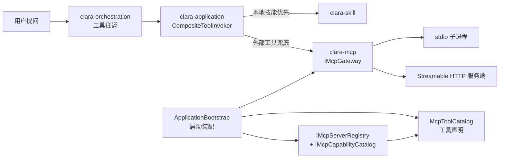

职责边界：

| 是 | 不是 |
| --- | --- |
| 描述怎么连（配置 → 注册项） | 决定什么时候调工具（编排层） |
| 连上后问清能力并固化快照 | 决定给模型看哪些提示词（skill / 编排层） |
| 把快照翻译成工具声明、按名分派 | 处理对话上下文与历史 |
| 在调用前做契约校验（状态 / 能力 / 哈希 / 身份） | 实现具体业务工具（服务端自己实现） |

一个容易看漏的边界：**工具声明在 clara-application（`McpToolCatalog`），不在 clara-mcp**。
因为「工具声明长什么样」由模型协议决定（`ToolSpecification`），属于宿主适配；clara-mcp 只提供能力快照。

## 2. 三条设计主线

### 2.1 发现与调用分离

发现是「慢、会失败、要连服务端」的动作；调用是「对话里高频发生」的动作。把两者拆开带来三个直接结果：

- 调用期不出现 `tools/list` 之类的发现请求，轮次延迟稳定；
- 发现失败只影响「这次接入」，不会让每轮对话都超时；
- 快照可以按需刷新（`/refresh` 语义），也可以只用于探测（`discover` 不发布）。

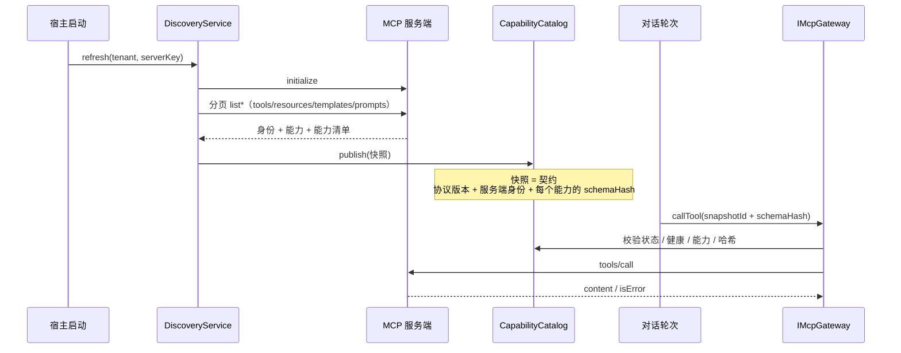

代价也很明确：**快照会过期**。所以必须有 2.2 的契约校验兜底。

### 2.2 把「能力」当成契约

快照里固化了三类「契约锚点」：

| 锚点 | 作用 | 不一致时的后果 |
| --- | --- | --- |
| `protocolVersion` | 客户端与服务端说同一种协议 | `MCP_PROTOCOL_INCOMPATIBLE`，注册项标记 `INCOMPATIBLE` |
| 服务端身份（name + version） | 防止「同名换了实现」 | `MCP_SERVER_IDENTITY_CHANGED`，标记 `REVIEW_REQUIRED` |
| 每个能力的 `schemaHash` | 防止模型拿着旧入参契约调用 | `MCP_SCHEMA_MISMATCH`，直接拒绝执行 |

调用前的校验是一条**漏斗**：前一层不过就直接失败，不会把请求发给服务端。

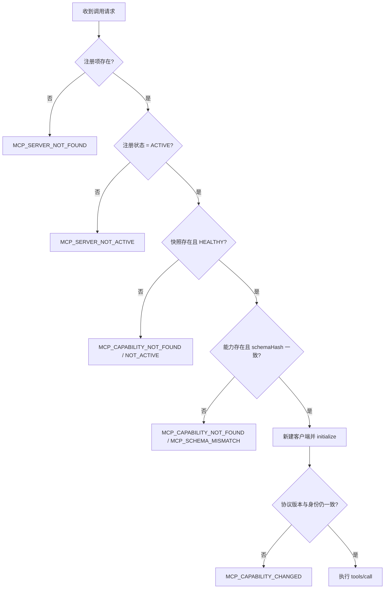

设计取舍：**宁可拒绝，也不带旧契约调用**。工具入参 Schema 一旦变化，模型手上的声明与真实服务端就不一致，
继续调用只会得到难以定位的参数错误；显式失败并提示刷新，比「看起来能跑但偶尔错」更可控。

### 2.3 三层解耦：传输 / 协议 / 业务

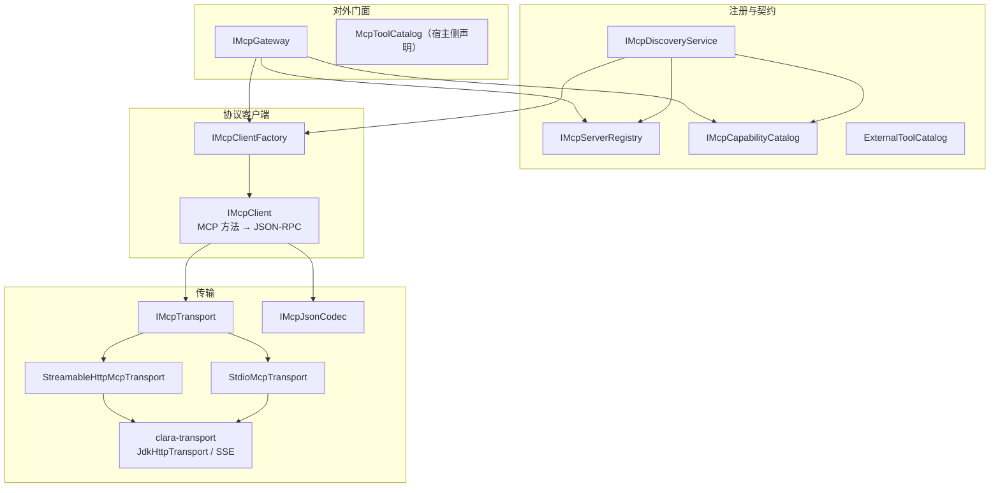

为什么这样切：

- **新增一种传输**（例如 WebSocket）只实现 `IMcpTransport`，客户端与业务层零改动；
- **新增一个 MCP 方法**只改 `IMcpClient` 与其实现，传输层零改动；
- **换注册表存储**（内存 → 数据库）只实现 `IMcpServerRegistry` / `IMcpCapabilityCatalog` 两个接口，
  发现与网关的流程不变。

接口后面目前都只有「一个默认实现」。这里接口的价值不是多实现，而是**给两个使用方（发现 / 调用）留出替换点**，
以及把「谁依赖谁」钉死。

## 3. 类架构

### 3.1 包职责

| 包 | 职责 | 关键类型 |
| --- | --- | --- |
| `com.clara.mcp` | 模块级共享设施 | `McpErrors` |
| `com.clara.mcp.api` | 模块对外契约：所有接口集中于此，统一 `I` 前缀 | `IMcpClient`、`IMcpClientFactory`、`IMcpGateway`、`IMcpServerRegistry`、`IMcpCapabilityCatalog`、`IMcpDiscoveryService`、`IMcpTransport`、`IMcpTransportListener`、`IMcpJsonCodec`、`IProcessFactory`、`IMcpHeadersProvider` |
| `com.clara.mcp.transport` | JSON-RPC 消息的编解码与解码结果 | `McpDecodedMessage`、`JacksonMcpJsonCodec` |
| `com.clara.mcp.transport.stdio` | 本地子进程传输 | `StdioMcpTransport` |
| `com.clara.mcp.transport.http` | Streamable HTTP 的 MCP 协议适配（JSON-RPC / 会话 / 重连） | `StreamableHttpMcpTransport` |
| `com.clara.core.transport` | 跨模块通用传输契约（core） | `IHttpTransport`、`IHttpCall`、`RawHttpRequest`、`RawHttpResponse`、`HttpTransportPolicy`、`ISseEventParser` |
| `com.clara.transport` | 跨模块通用传输实现 | `JdkHttpTransport`、`DefaultSseEventParser`、`BoundedStreams`、`DaemonThreads`、`HostEndpointPolicy` |
| `com.clara.mcp.transport.jsonrpc` | JSON-RPC 2.0 消息值对象 | `JsonRpcRequest`、`JsonRpcResponse`、`JsonRpcNotification` |
| `com.clara.mcp.client` | MCP 方法语义、初始化与分页 | `DefaultMcpClient`、`McpInitialization`、`McpPage` |
| `com.clara.mcp.client.gateway` | 面向宿主的统一调用门面 + 校验 | `DefaultMcpGateway` |
| `com.clara.mcp.client.call` | 调用入参 / 出参值对象 | `McpToolCall`、`McpToolResult` 等 |
| `com.clara.mcp.registry` | 服务端注册表、能力目录、快照、发现的实现 | `InMemoryMcpServerRegistry`、`InMemoryMcpCapabilityCatalog`、`DefaultMcpDiscoveryService`、`McpServerSnapshot` |
| `com.clara.mcp.registry.capability` | 能力描述与 Schema 哈希 | `McpToolDescriptor`、`SchemaHasher` |
| `com.clara.mcp.registry.config` | 外部配置加载与注册 | `McpServerConfigLoader`、`McpServerRegistrar` |
| `com.clara.mcp.tool` | 工具名 → 服务端快照的路由绑定 | `ExternalToolCatalog`、`ExternalToolBinding` |

为什么把接口单独放进 `api` 包：接口是模块对宿主与跨层调用方的契约，实现包可以继续演进（换存储、换传输、换校验策略），
契约包保持稳定；统一 `I` 前缀让「接口 / 实现」一眼可分，避免接口与默认实现同名家族看混。
`api` 包只放接口与契约说明，不放实现和可变状态；类内部的私有函数式接口也已改为 JDK 的
`Function` / `BiFunction` / `Predicate`，模块内不再有嵌套接口。

### 3.2 接口与默认实现

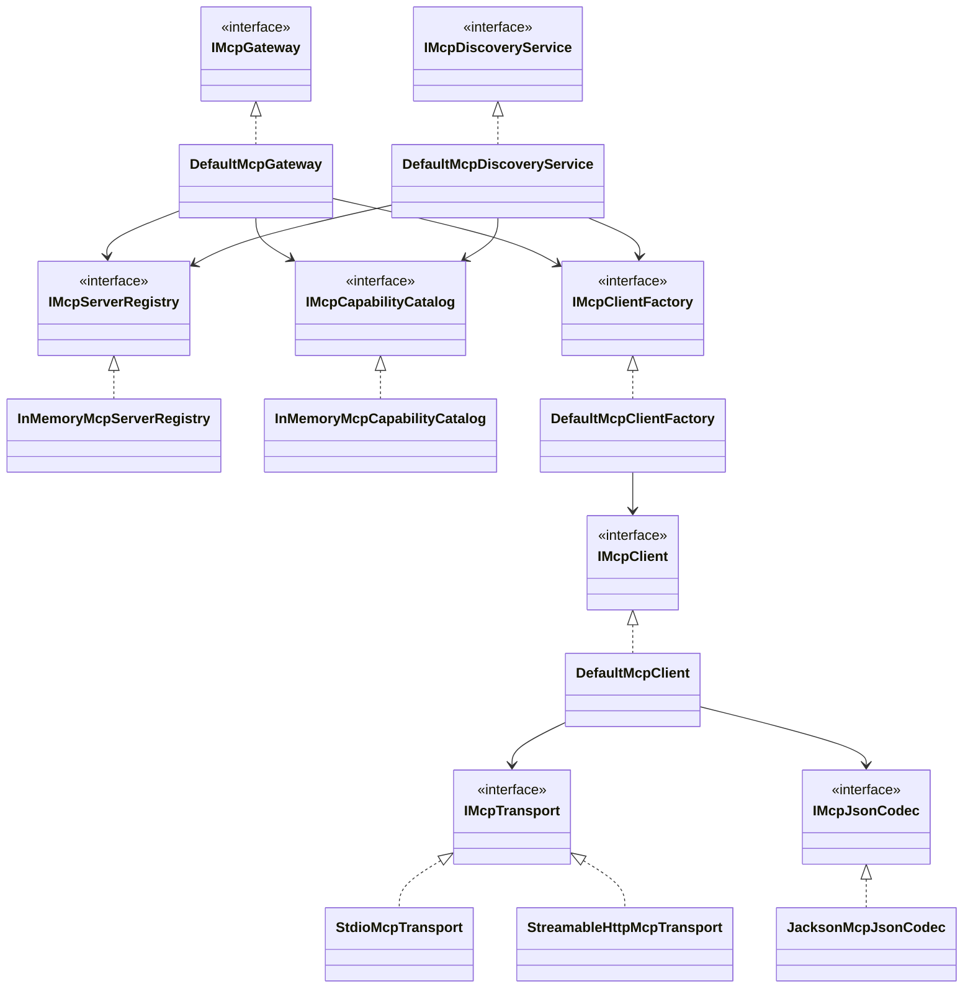

一个关键的生命周期约定：**`IMcpClient` 是「一次性」的**——一个实例绑一条连接，不跨线程复用，用完必须关闭。
发现服务和网关都遵守这个约定（各自 `finally` 里关闭）。所以模块里没有连接池，也不存在「共享客户端并发调用」的问题。

### 3.3 两份目录：能力目录 vs 外部工具路由目录

这是本模块最容易看糊的地方。它们都叫「目录」，但职责完全不同。

| 维度 | `IMcpCapabilityCatalog` | `ExternalToolCatalog` |
| --- | --- | --- |
| 存什么 | 完整快照：身份、协议版本、工具 / 资源 / 模板 / 提示词、健康状态 | 只有「工具名 → 四元组」 |
| 键 | 租户 + 服务端 + 快照 ID（另有「最新快照」索引） | 工具名 |
| 谁写 | 发现服务 `publish` | `ExternalToolCatalog.registerSnapshot`（发现成功后） |
| 谁读 | 网关（校验）、`McpToolCatalog`（声明） | `CompositeToolInvoker`（分派） |
| 地位 | 契约与真相 | 快速路由表 |

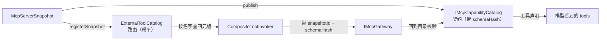

为什么要两份：

- 模型只认「工具名」，需要一张扁平表 O(1) 回答「这名字是不是外部工具、去哪个服务端」；
- 但扁平表**不能作为真相**：它没有 Schema、没有健康状态、没有身份信息，被篡改或过期都无法发现；
- 所以网关执行前必须回到能力目录做一次校验——路由表负责「找得到」，能力目录负责「敢不敢调」。

### 3.4 值对象家族

三条统一原则：**不可变、构造期校验、集合只读拷贝**（`ImmutableValues` 递归拷贝并拒绝非字符串键）。

调用入参是「同构」的，记住这一组四元组就能看懂三个请求类：

```text
tenantId + serverKey + snapshotId + 目标名 + schemaHash + ConvContext + CallContext
                     │              │
                     │              └─ toolName / uri / promptName
                     └─ 发现时固化的快照（决定用哪一版契约）
```

两个「为什么」：

- **为什么显式带 `tenantId`**：注册表与能力目录都按租户分区，同一 `serverKey` 在不同租户下是不同的服务端；
  而 `ConvContext` 已不携带租户标识，所以由调用入参显式携带。
- **为什么带 `CallContext`**：网关入口先检查一次取消令牌，长调用可以被宿主打断。

## 4. 关键步骤 A：启动接入链

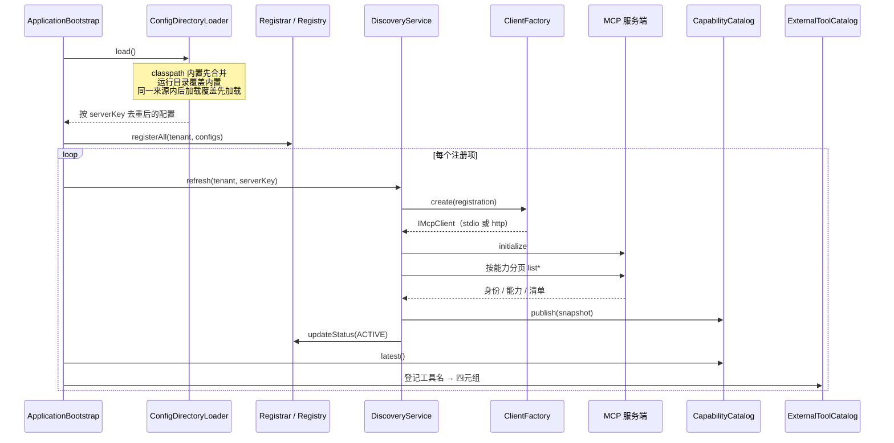

六个关键决策：

1. **配置格式对齐生态**：沿用 Claude Desktop / VS Code 的 `mcpServers` 结构，接入成本最低。
2. **变量未定义直接失败**：`${VAR}` 解析不到就报错，绝不把未解析的占位符当成密钥发出去。
3. **传输方式由字段推断**：有 `command` → stdio，有 `url` → http，两者互斥；不需要额外的 `type` 字段。
4. **单点失败隔离**：一个服务端发现失败不影响其它服务端，启动不会因为一个坏配置整体失败。
5. **失败要落状态，不只写日志**：协议不兼容 → `INCOMPATIBLE`；身份变化 → `REVIEW_REQUIRED`。
6. **先有快照才登记工具**：`latest()` 为空就不登记，避免「声明了但调不了」。

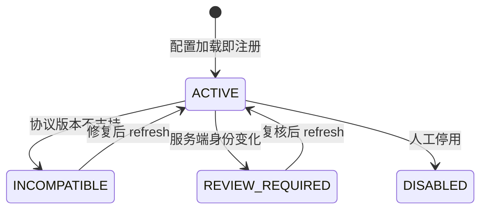

### 4.1 启动链里的安全边界

| 风险 | 设计 | 位置 |
| --- | --- | --- |
| 配置里写任意命令 → 任意代码执行 | 可执行文件必须命中允许清单，且按 `toRealPath` 比较 | `StdioMcpTransport` 构造期 |
| 配置写裸命令名（`npx` / `node`）无法校验 | 工厂在允许清单里按文件名解析成绝对路径 | `DefaultMcpClientFactory` |
| 子进程缺环境变量起不来 | 继承父进程环境后再叠加配置 `env` | `IProcessFactory` 默认实现 |
| 明文 / 任意主机端点 | 默认只允许 HTTPS；host 必须在白名单 | `HostEndpointPolicy` + `StreamableHttpMcpTransport` 构造期 |
| 请求头注入（CRLF、覆盖 Host） | 校验头名/头值并拒绝 `Host` / `Content-Length` / `Connection` 等传输层头 | `RawHttpRequest` / `HttpHeaders` 构造期 |
| 超大响应撑爆内存 | 单行 / 整包都有字节上限 | `BoundedStreams` / `JdkHttpTransport` |

## 5. 关键步骤 B：一次工具调用

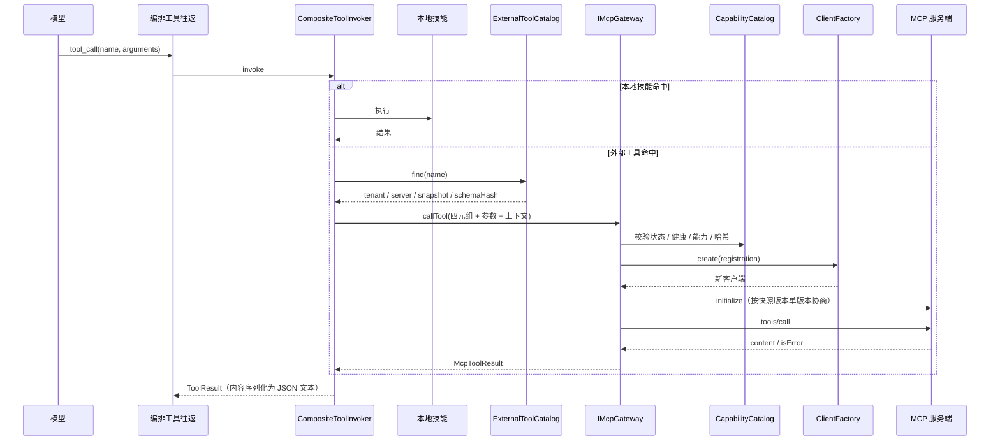

三个要点：

1. **本地优先、外部兜底，且「声明」与「路由」同优先级**。
   `CompositeToolCatalog` 先收本地、同名不覆盖；`CompositeToolInvoker` 也先查本地。
   两处必须保持一致：否则会出现「声明是 MCP 工具、执行却走本地技能」，Schema 不同就会变成难查的参数错误。
2. **每次调用新建客户端、用完即关**。MCP 会话有状态，缓存连接就要处理会话失效、并发复用、进程回收；
   当前选择「简单 + 隔离」，代价是每次多一次握手。
3. **外部结果统一转成 JSON 文本**回填给模型。模型协议只需要文本，不需要理解 MCP 的内容块结构。

## 6. 传输层：同一个抽象，两种「性格」

`IMcpTransport` 只定义五件事：启动并注册监听、异步发请求、单向发通知、按 ID 取消、健康检查。
两种实现解决的是完全不同的问题；其中 HTTP 的字节收发与 SSE 解析已下沉到 `clara-transport`，
本节只讨论 MCP 协议语义。

### 6.1 stdio：把子进程当成一条有状态的管道

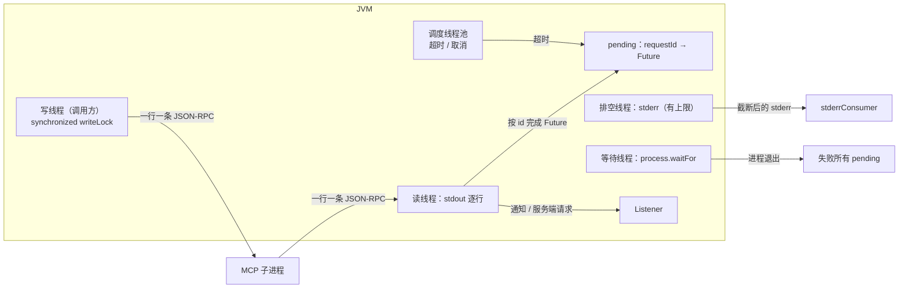

关键思路（不是细节）：

- **请求-响应靠 ID 配对**，不是「下一个响应就是我的」——并发调用时后者必然错乱；
- **读线程绝不能阻塞**：stderr 必须单独排空，否则管道写满会让服务端卡死，表现为「连接还在但永远没响应」；
- **超时与取消是两件事**：本地让 Future 失败 + 尽力发一条 `notifications/cancelled` 告知服务端；
- **关闭要幂等且彻底**：先让所有 pending 失败，再关流、`destroy`，2 秒不退则 `destroyForcibly`。

### 6.2 Streamable HTTP：一个 POST，可能是 JSON 也可能是 SSE

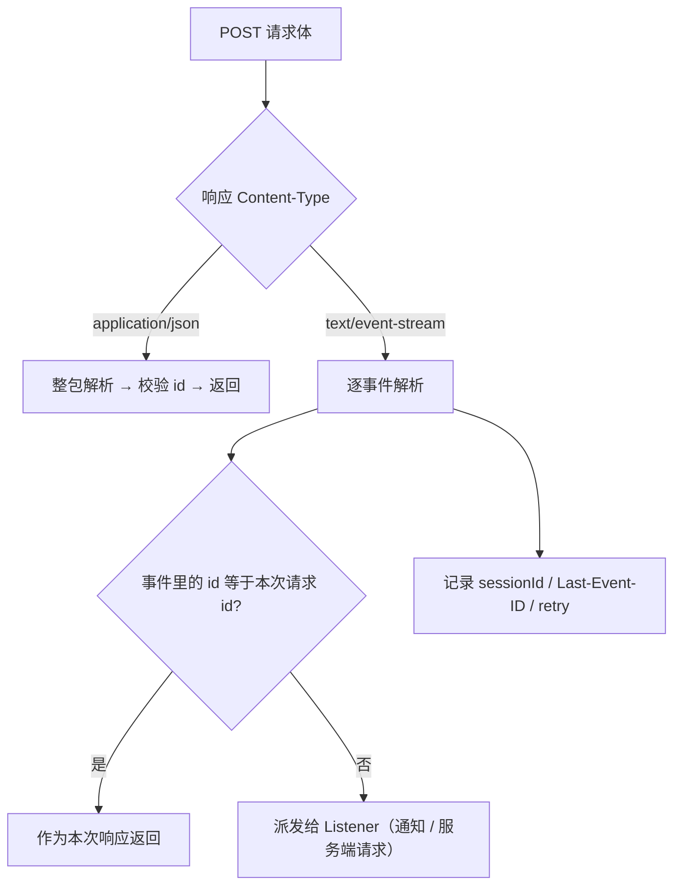

关键思路：

- **SSE 响应里可能混着别的消息**：只有 id 匹配当前请求的那条才是响应，其余必须派发，不能丢；
- **会话是服务端给的**：`Mcp-Session-Id` 从响应头捕获，后续请求自动带上；`Last-Event-ID` 用于断线续传；
- **独立的 GET 事件流是预留能力**：代码里已有 `startEventStream()`（含 retry 退避循环），
  但当前宿主装配没有调用它，实际只走 POST 请求-响应；
- 同理，`setProtocolVersion(...)` 也没有被装配链路调用，因此当前不会发送 `MCP-Protocol-Version` 请求头。
  读到这两个方法时不必找调用方——它们是给「需要服务端主动通知 / 严格版本头」的场景留的。
- **公共传输已下沉**：`StreamableHttpMcpTransport` 不再直接使用 `HttpURLConnection`，也不在本模块内维护
  SSE 解析器；连接、超时、体积上限与 SSE 解析统一由 `clara-transport` 的 `JdkHttpTransport` 提供。
  协议侧只保留 JSON-RPC、会话 ID、`Last-Event-ID` 与重连，模型调用和 MCP 调用因此共享同一套
  超时、上限与取消语义。

### 6.3 客户端层只做一件事：方法名 → JSON-RPC

`DefaultMcpClient` 把每个 MCP 方法映射成固定的 `method` 字符串，并在初始化后补发 `notifications/initialized`。
它刻意不解析成强类型 DTO，而是把 `result` 当 `Map` 用 Jackson 逐字段读取——因为 MCP 各实现会在结果里带
额外字段，强类型反序列化会被版本差异打断。

## 7. 设计取舍一览

| 取舍点 | 当前选择 | 代价 | 什么时候该改 |
| --- | --- | --- | --- |
| 连接 / 子进程复用 | 每次发现、每次调用都新建并关闭 | 多一次握手或进程启动 | 调用量大且服务端支持多路复用时引入会话池 |
| 快照存储 | 内存 + 「发现时间更新者胜出」 | 重启丢失，需重新发现 | 多实例部署时换持久化实现 |
| 能力变更检测 | 哈希 + 身份 + 协议版本，每次调用都 `initialize` | 每次多一次往返 | 服务端稳定且延迟敏感时可放宽到定期校验 |
| 分页保护 | 最大页数 + 游标去重 | 能力极多时可能触顶失败 | 遇到超大能力集时调大上限 |
| 服务端主动通知 | 已实现监听与 SSE 派发，未启用独立事件流 | 拿不到 `listChanged` 之类的事件 | 需要实时刷新能力时启用 |
| 同名工具优先级 | 本地优先 | MCP 工具会被本地遮蔽 | 需要 MCP 覆盖本地时，两处一起改 |

## 8. 扩展点

| 想做的事 | 改哪里 | 不用改哪里 |
| --- | --- | --- |
| 新增传输（如 WebSocket） | 实现 `IMcpTransport` + 在 `DefaultMcpClientFactory` 分派 | 客户端、发现、网关 |
| 注册 `LEGACY_SSE` | 目前工厂会抛 `CAPABILITY_NOT_SUPPORTED`，需补实现 | 同上 |
| 新增一个 MCP 方法 | `IMcpClient` 加方法 + `DefaultMcpClient` 拼 JSON-RPC + 能力描述值对象 | 传输层 |
| 换注册表 / 目录存储 | 实现 `IMcpServerRegistry` / `IMcpCapabilityCatalog` | 发现与网关流程 |
| 多租户 | 已按租户分区，宿主传不同 `tenantId` 即可 | 模块代码 |
| 让 MCP 工具参与工具声明 | 已在 `McpToolCatalog` 完成，新增来源时实现 `IToolCatalog` | clara-mcp |

## 9. 学习路线与自测

### 9.1 建议阅读顺序（先骨架后血肉）

1. `IMcpGateway` → `DefaultMcpGateway`：先看「一次调用要过哪些关」；
2. `IMcpServerRegistry` / `IMcpCapabilityCatalog` / `McpServerSnapshot`：搞清「两份目录 + 契约」；
3. `DefaultMcpDiscoveryService`：把上面三者串成闭环；
4. `IMcpClient` → `DefaultMcpClient`：看 MCP 方法怎么变成 JSON-RPC；
5. `IMcpTransport` → 两个传输实现：最后看 IO 与并发细节；
6. 回到宿主：`ApplicationBootstrap.loadMcpServers`、`McpToolCatalog`、`CompositeToolInvoker`。

### 9.2 五个自测题

1. 为什么调用阶段不重新 `tools/list`？如果快照过期了靠什么发现？
2. `ExternalToolCatalog` 已经能按名字找到工具，为什么网关还要查 `IMcpCapabilityCatalog`？
3. 一个 stdio 服务端启动后立刻退出，Clara 会看到什么现象？为什么 stderr 必须单独排空？
4. 服务端升级后某个工具的入参 Schema 变了，Clara 会怎么表现？错误码是什么？
5. 为什么调整「同名工具优先级」必须同时改 `CompositeToolCatalog` 和 `CompositeToolInvoker`？

### 9.3 跑测试

```bash
mvn -o -Dmaven.repo.local=.m2/repository -pl clara-mcp -am test
```

clara-mcp 目前有 19 个测试类、共 132 个单测，重点覆盖：请求-响应配对与超时、SSE 解析与截断、发现的分页保护、
Schema 哈希的稳定性、网关校验链与「失败也关客户端」、配置覆盖规则、注册表并发安全。
读代码卡住时，直接去对应测试里找「预期行为」，通常比读实现更快。

## 10. 一页速查

```text
配置 config/mcp/*.json
  → McpServerConfigDirectoryLoader  合并去重
  → McpServerRegistrar              → IMcpServerRegistry（ACTIVE）
  → IMcpDiscoveryService.refresh     → IMcpClient.initialize + list*
                                    → McpServerSnapshot
                                    → IMcpCapabilityCatalog.publish（契约）
                                    → 注册状态 ACTIVE / INCOMPATIBLE / REVIEW_REQUIRED
  → ExternalToolCatalog.registerSnapshot → ExternalToolCatalog（工具名 → 四元组）
  → McpToolCatalog                  → 模型看到的 tools
  → CompositeToolInvoker            → IMcpGateway.callTool
                                    → 校验状态 / 健康 / 能力 / 哈希 / 身份
                                    → IMcpClientFactory.create → IMcpTransport
                                    → tools/call
```
