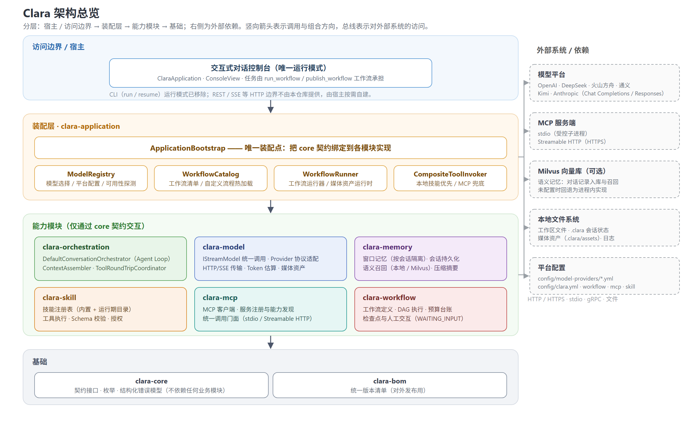
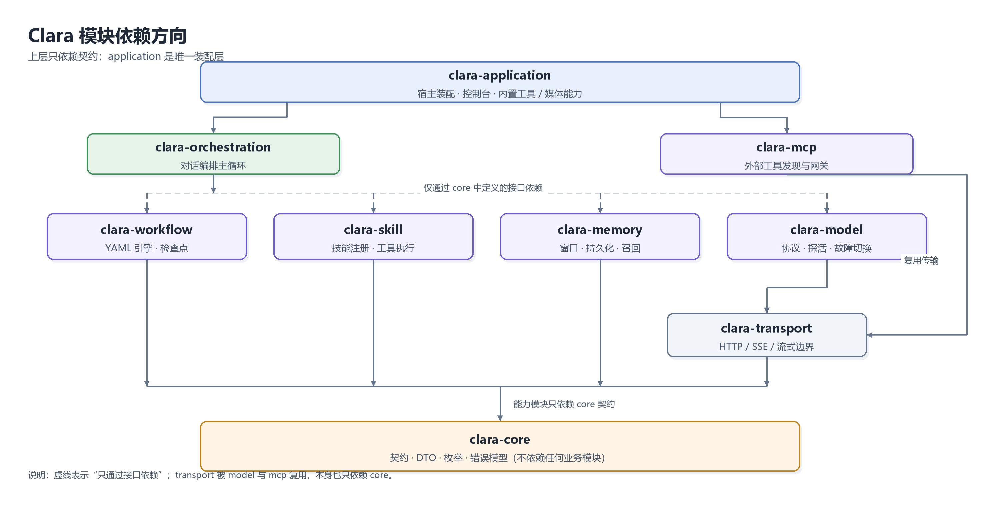
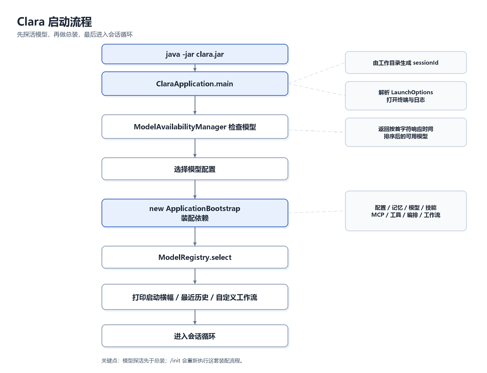
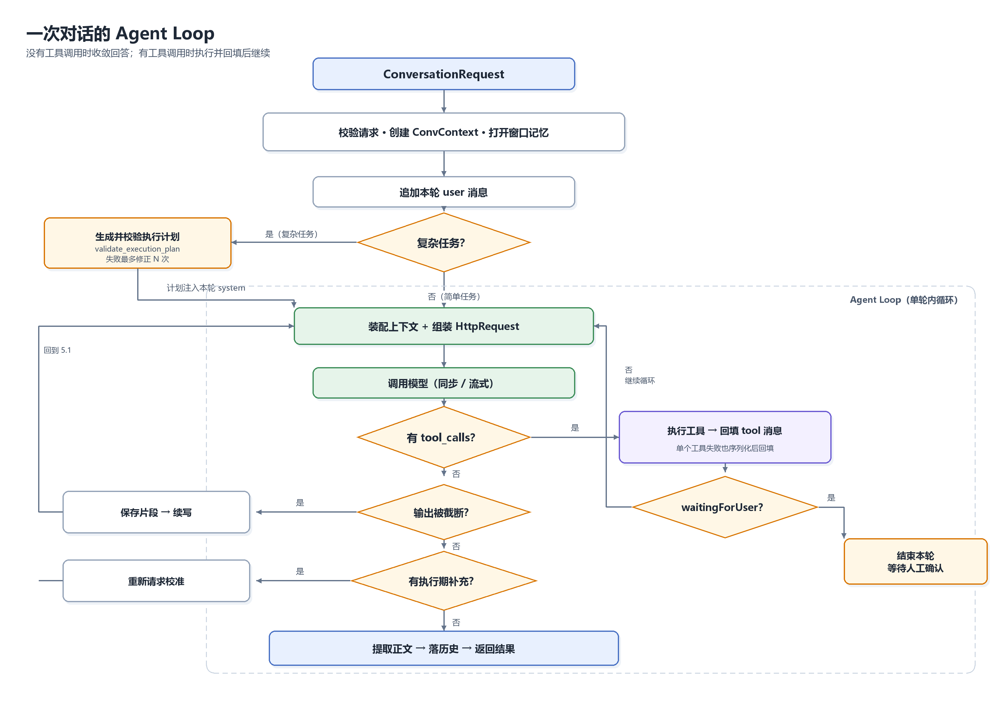
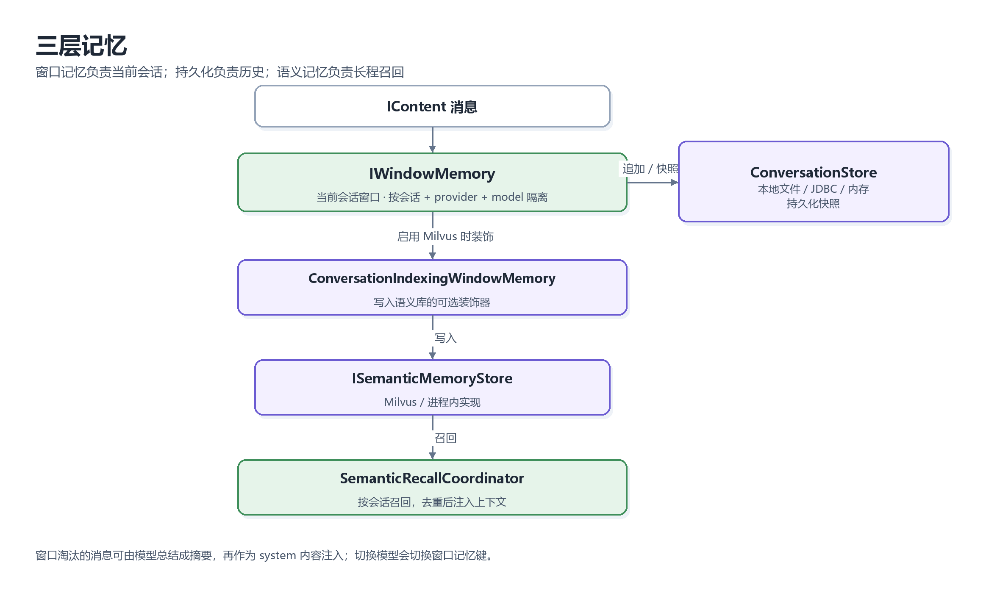
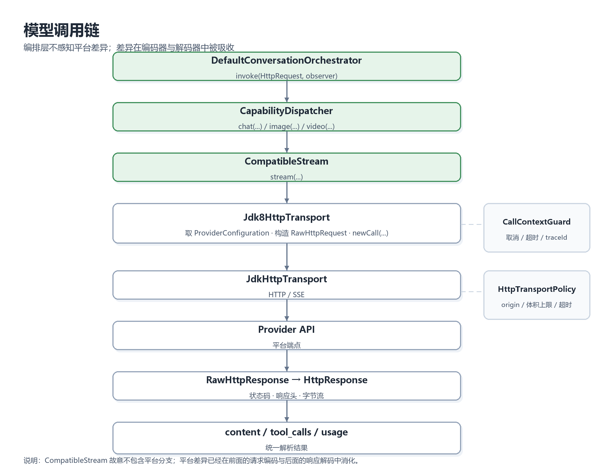
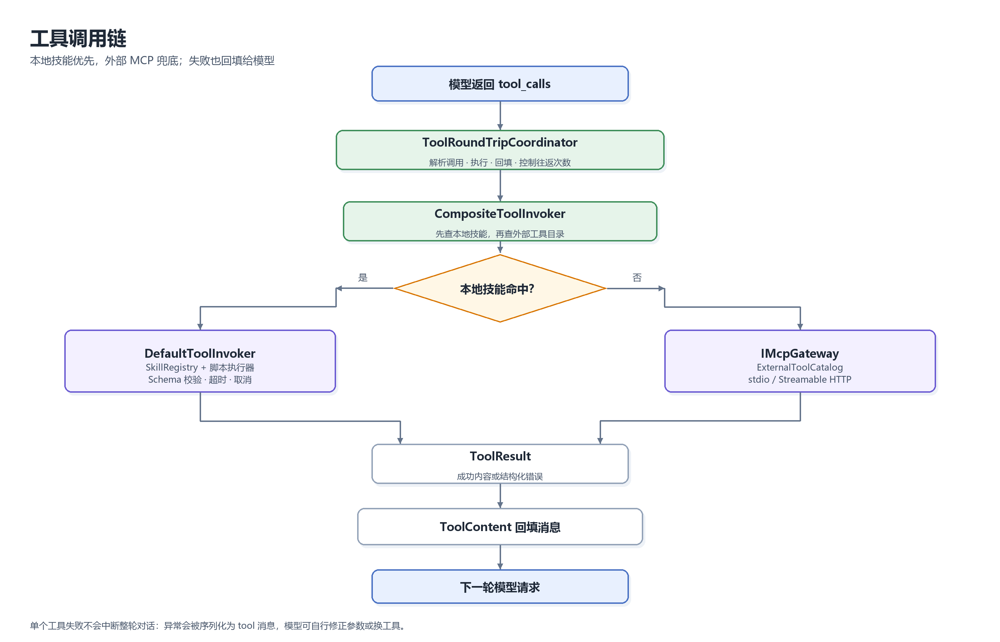
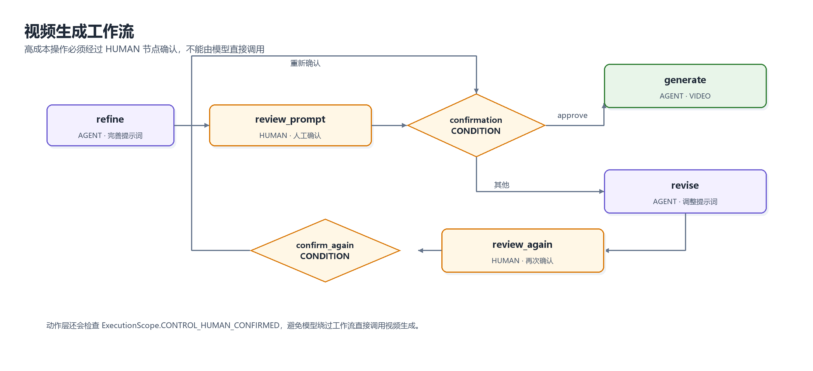

# Clara 项目学习指南

> 面向准备读懂、维护或扩展 Clara 的开发者。本文只抓“设计思想、关键调用链、类职责与配置入口”，
> 不逐行解释方法；细节契约以源码 Javadoc 和 `docs/technical-design/` 下的模块设计为准。
> 文档中的架构图已拆分为独立 PNG 图片，存放在 `docs/architecture-design/diagrams/`，正文按相对路径引用，不依赖 Mermaid 插件。

## 0. 先给结论

可以把 Clara 理解成四层：

1. **`clara-core` 定义契约**：接口、跨模块 DTO、枚举、错误模型。业务模块都围绕它编程。
2. **能力模块各做一件事**：`model` 负责模型协议，`memory` 负责历史与召回，`skill` / `mcp` 负责工具，
   `workflow` 负责确定性流程，`transport` 负责 HTTP / SSE。
3. **`clara-orchestration` 只做组合**：它把“上下文 → 模型 → 工具 → 再模型”的 Agent Loop 串起来。
4. **`clara-application` 负责装配与控制台**：它知道所有实现类，业务模块反过来不知道 application。

因此读代码时不要从所有模块平铺开始，先抓三条线：

- **启动线**：`ClaraApplication` → `ApplicationBootstrap` → 各模块实例。
- **对话线**：`DefaultConversationOrchestrator.converse` → `ContextAssembler` → `CapabilityDispatcher`
  → `ToolRoundTripCoordinator` → 历史落盘。
- **配置线**：`config/clara.yml`、`config/model-providers/*.yml`、`config/skill/**`、
  `config/workflow/**`、`config/mcp/**`。



---

## 1. 项目定位与模块边界

### 1.1 它是什么，不是什么

Clara 当前是 **Java 8 的“运行时库 + 交互式控制台”**，不是开箱即用的 Web 服务：

- 仓库里没有 Spring Boot、Servlet 容器或内置 REST 服务；
- `clara.jar` 的主类是 `com.clara.ClaraApplication`，提供终端对话；
- 宿主如果要做 REST / SSE，需要自己接 `ApplicationBootstrap` 与编排接口；
- 各模块可以单独作为 Maven 依赖使用，`clara-bom` 只负责版本清单。

### 1.2 模块职责

| 模块 | 核心职责 | 先看哪里 |
| --- | --- | --- |
| `clara-bom` | 对外发布的依赖版本清单 | `clara-bom/pom.xml` |
| `clara-core` | 契约、DTO、枚举、错误模型、字段协议注解 | `clara-core/src/main/java/com/clara/{core,dto,enums,exception}` |
| `clara-transport` | 通用 HTTP、SSE、流式读取、体积上限、取消守卫 | `JdkHttpTransport`、`HttpCall`、`BoundedStreams` |
| `clara-model` | Provider 配置、请求编码、响应解码、模型探活、媒体能力 | `ProviderRequestEncoder`、`CompatibleStream` |
| `clara-memory` | 窗口记忆、会话持久化、摘要压缩、语义记忆 | `DefaultWindowMemory`、`ConversationStore` |
| `clara-mcp` | MCP 注册、发现、能力快照、网关、stdio / HTTP 传输 | `DefaultMcpDiscoveryService`、`DefaultMcpGateway` |
| `clara-workflow` | YAML 定义、节点引擎、检查点、人工交互、动态计划 | `WorkflowDefinitionLoader`、`DefaultWorkflowEngine` |
| `clara-skill` | 技能与提示词注册、脚本发现、Schema 校验、工具执行 | `SkillRegistry`、`DefaultToolInvoker` |
| `clara-orchestration` | 对话编排、上下文装配、工具往返、意图计划 | `DefaultConversationOrchestrator` |
| `clara-application` | 总装配、控制台、MCP / 图谱接入、媒体与内置工具 | `ApplicationBootstrap`、`ClaraApplication` |

### 1.3 依赖方向



*图 1-1：Clara 模块依赖方向*

这里最重要的约束是：

- **core 不依赖任何业务模块**；
- **orchestration 不 new Provider、Store、Transport 实现**，只依赖 core 接口；
- **application 是唯一知道“用哪个实现”的地方**；
- 任何能力模块都不能反向依赖 application。

这套结构带来的直接好处是：替换模型协议、向量库、工具执行器时，通常只改装配点和对应模块，
不需要动编排主循环。

### 1.4 包名的阅读提示

- `com.clara.core.*`：跨模块契约，先看接口签名就能知道能力边界；
- `com.clara.kernel.*`：模型内核与底层协议实现，不是“业务内核”；
- `com.clara.orchestration.*`：编排协作者，按 `context / tool / capability / intent / record` 分包；
- `com.clara.mcp.api.*`：MCP 对外接口都在 `api` 包，符合项目“接口以 I 开头”的约定；
- `com.clara.adapter.console.*`：终端适配层，负责输入、颜色、日志与命令分发，不承载业务能力。

---

## 2. 启动过程：谁把系统装起来

### 2.1 入口做了什么

`ClaraApplication.main` 的顺序可以概括为：



*图 2-1：Clara 启动流程*

几个容易忽略的点：

- **`sessionId` 由工作目录推导**：同一目录再次启动会续接同一份历史；换目录就是换上下文。
- **`/init` 不是简单重启**：它会重新创建 `ApplicationBootstrap`，重新检测模型、技能、MCP 与图谱连接，
  但当前会话标识保留。
- **模型探活先于总装**：先确认“哪些模型能用、谁最快”，再选择默认模型，避免启动后第一轮才发现凭据或网络不可用。
- **控制台视图先于装配**：`ConsoleView` 接管标准输出、打开本轮日志文件，后续各模块的过程输出才能统一着色与落盘。

### 2.2 `ApplicationBootstrap` 的装配顺序

`ApplicationBootstrap` 是 Clara 的“手工 Spring 容器”。它大致按下面的依赖顺序装配：

1. **配置与语义记忆**：读取 `config/clara.yml`，判断 Milvus 是否启用；不可用时回退到进程内实现。
2. **模型调用入口**：`CompatibleStream(new Jdk8HttpTransport())`，作为统一 `IStreamModel`。
3. **技能注册表**：扫描内置与运行期 `config/skill`，加载工具、提示词与脚本。
4. **MCP 基础设施**：注册表、能力目录、客户端工厂、网关、发现服务、外部工具路由表。
5. **工具调用器**：本地技能优先，外部 MCP 兜底，组合成 `CompositeToolInvoker`。
6. **意图计划**：按 `intentPlanning` 开关创建 `IntentPlanCoordinator` 与计划校验器。
7. **记忆与压缩**：窗口压缩、语义召回、窗口记忆工厂。
8. **上下文装配器**：把压缩、召回、图谱补充、技能匹配、常驻提示词组合起来。
9. **编排器**：`CapabilityDispatcher` + `ToolRoundTripCoordinator` + `DefaultConversationOrchestrator`。
10. **工作流**：引擎、定义加载器、注册表、运行器、动作工厂、内置工具。
11. **内置工具收尾**：把 `run_workflow`、`publish_workflow`、`validate_execution_plan` 注册到脚本执行器。

这样安排的原因很实际：后面的对象需要前面的能力，但又不希望全部在构造函数里硬编码。
例如工作流 `AGENT` 节点需要编排器，编排器又需要工具调用器；因此先装配工具与编排，再把动作工厂注入工作流加载器。

### 2.3 为什么不用 Spring

不是“为了造轮子”，而是 Clara 的定位是**可嵌入库**：

- 宿主可能已经有自己的容器、配置中心与生命周期管理；
- 显式装配让依赖关系一眼可见，也便于单元测试替换；
- 模块可以单独引入，不会被一整套框架约定绑住；
- Java 8 与离线依赖约束下，手工装配比引入完整框架更轻。

代价是装配代码较长、对象创建顺序需要人工维护；所以 `ApplicationBootstrap` 必须保持“只装配、不写业务”。

---

## 3. 一次对话的完整生命周期

### 3.1 入参与出参

一次对话由 `ConversationRequest` 描述，关键字段包括：

| 字段 | 作用 |
| --- | --- |
| `conversationId` | 会话标识，与记忆模块同源同值 |
| `provider` / `model` | 决定窗口记忆隔离键与调用目标 |
| `capabilityKind` | `CHAT` / `IMAGE` / `VIDEO` 等能力种类 |
| `userInput` | 本轮用户输入 |
| `attachments` | 多模态附件或参考图 |
| `providerConfiguration` | 本轮绑定到 `ConvContext` 的平台配置 |
| `control` | 窗口、压缩、检索参数 |
| `observer` | 流式事件接收方 |
| `planningEnabled` | 是否启用意图识别与动态计划 |
| `runtimeHint` | 只作用于本轮的临时系统提示 |
| `cancellationToken` | 取消信号 |
| `userIntervention` | 执行期用户补充输入通道 |

返回值 `ConversationResult` 主要包含：正文、思维链、状态、工具往返次数、token 用量、结构化错误，
以及“是否因等待人工确认而暂停”。

### 3.2 主流程

`DefaultConversationOrchestrator.converse` 是核心入口，简化后是：



*图 3-1：一次对话的 Agent Loop*

### 3.3 循环中的六个关键判断

1. **请求是否被取消**：每轮开始、工具执行前后都检查 `ConvContext` 的取消令牌。
2. **上下文或响应是否超限**：超限不直接失败，按失败类型压缩输入或收紧输出上限后重试。
3. **输出是否被长度截断**：若带工具调用，禁止执行不完整参数；若只是正文，则保存已生成部分并续写。
4. **是否有工具调用**：有则执行并回填，直到模型不再调用工具。
5. **是否触发人工确认**：工具结果里 `waitingForUser=true` 时，本轮提前结束，交给用户决定。
6. **是否有执行期补充**：用户可在模型思考或工具执行期间追加要求，下一轮请求前注入历史。

### 3.4 为什么“工具失败”不直接中断

`ToolRoundTripCoordinator` 会把单个工具调用的异常序列化为：

```json
{"error":"[错误码/分类] 可读原因"}
```

然后作为 `tool` 消息回填给模型。这样模型可以自行修正参数、换工具或向用户解释，
而不是让整轮对话因为一次参数校验失败而崩掉。

### 3.5 状态与错误

- `COMPLETED`：模型给出最终答复，或工作流暂停等待用户输入；
- `FAILED`：编排或模型调用失败，`ConversationResult.error` 带结构化错误；
- `CANCELLED`：用户取消；
- 模型“不可用”的判定集中在 `ModelFailover.isUnavailable`，只有鉴权、限流、超时、外部服务失败、
  凭据不可用等才值得切换模型；入参非法、内容安全、用户取消不切换。

---

## 4. 上下文、历史与记忆

### 4.1 上下文装配顺序

`ContextAssembler.assemble` 负责把“历史、窗口、摘要、技能、图谱、语义召回”拼成本轮消息。顺序是：

1. 读取完整历史，过滤掉非法的空 assistant 消息；
2. 按 `WindowPolicy` 裁剪出本轮窗口；
3. 压缩历史工具结果，避免超长工具输出占满 token；
4. 对被窗口淘汰的消息生成摘要；
5. 按用户输入匹配技能，得到提示词与工具声明；
6. 查询外部知识补充（如代码图谱）；
7. 从语义记忆召回被淘汰的历史知识；
8. 按固定顺序拼接 system 指令，并把 system 放到消息首位。

### 4.2 六类 system 内容

`systemText` 的拼接顺序是有意设计的：

| 顺序 | 内容 | 是否每轮固定 |
| --- | --- | --- |
| 1 | `extraPrompts`：本轮计划、工作流续接提示、续写指令 | 否，仅本轮 |
| 2 | `basePrompts`：常驻约定，如“读代码先查图谱” | 是 |
| 3 | 技能提示词：按输入相似度匹配 | 否 |
| 4 | 图谱补充信息：从代码知识图谱查到的事实 | 否 |
| 5 | 窗口淘汰消息的摘要 | 否 |
| 6 | 语义记忆召回内容 | 否 |

为什么把常驻提示词单独一条通道：技能提示词靠向量检索，受阈值和条数上限影响，
同一句“先查图谱”可能有时注入、有时不注入；固定约定必须每轮稳定出现。

### 4.3 三层记忆



*图 4-1：三层记忆*

- **窗口记忆**：以“会话 + 供应商 + 模型”为键，负责历史恢复、裁剪与追加；
- **持久化存储**：`ConversationStore` 有本地文件、JDBC、内存三种实现；
- **语义记忆**：启用 Milvus 时，每条对话消息写入语义库，供长程召回；
- **压缩**：窗口淘汰的消息可由模型总结成摘要，再作为 system 内容注入。

重要细节：切换模型会切换窗口记忆键，因此历史按模型隔离；切回原模型时恢复原上下文。
这是排查“换模型后历史不见了”的第一解释。

### 4.4 本地历史落盘

`LocalConversationStore` 把历史写到：

```text
<工作目录>/.clara/state/conversations/
```

实现要点：

- 文件名是 `sha256(conversationId + provider + model).bin`；
- 使用目录级排他锁，避免同一目录多个 Clara 实例同时写；
- 写入走临时文件 + `force` + 原子替换，避免半个 JSON；
- 快照包含版本号，追加时做乐观并发校验；
- `ConversationCodec` 在每条消息上附加 `clara_usage` 字段保存 token 用量。

### 4.5 语义记忆

`MilvusSettings` 从 `config/clara.yml` 的 `milvus` 节点读取配置。两种模式：

- `vector`：嵌入向量相似度检索；
- `bm25`：Milvus 内置全文检索，中文走 `chinese` 分词，不依赖嵌入服务。

启用后：

- `ConversationIndexingWindowMemory` 在追加消息时写入语义库；
- `SemanticRecallCoordinator` 每轮按输入召回；
- 召回结果若本轮上下文已经包含，会被判重丢弃，避免重复占 token；
- 召回、图谱、计划过程都通过 `IContextTraceSink` 输出到控制台与日志。

注意：不同模式集合结构不同，切换时可能需要重建集合；`recreateOnSchemaMismatch` 控制是否自动重建。

---

## 5. 模型层：协议、传输与故障切换

### 5.1 配置模型

每个 `config/model-providers/*.yml` 描述“平台 + 能力”：

```yaml
provider: DEEPSEEK
credential:
  secretRef: deepseek
  environmentVariable: CLARA_DEEPSEEK_API_KEY
transport:
  allowedOrigins: [https://api.deepseek.com]
  readTimeoutMillis: 600000
  maxRequestBytes: 8388608
  maxResponseBytes: 33554432
capabilities:
  CHAT:
    endpoint: https://api.deepseek.com/chat/completions
    modelId: deepseek-v4-pro
    apiProfile: Completion
    parameters:
      maxTokens: 393216
```

关键对象：

- `ProviderConfiguration`：平台级配置，持有凭据、传输、能力映射；
- `ModelConfig`：单个能力的端点、模型 ID、协议档位、`secretRef`；
- `ModelRegistry`：按别名加载与缓存配置，维护当前会话模型；
- `ModelAvailabilityManager`：启动探活，按首字符响应时间排序并写回默认模型。

### 5.2 `@ProviderAdapter`：把平台差异放到字段上

Clara 没有在编码器里写 `if (provider == OPENAI) ...`，而是用字段注解声明：

```java
@ProviderAdapter(
    type = ModelProviderEnum.DEEPSEEK,
    capability = CapabilityKindEnum.CHAT,
    defaultValue = "enabled",
    allowed = {"enabled", "disabled"}
)
private String someParameter;
```

`AbstractRequestEncoder` 会按当前 `ModelProviderEnum + CapabilityKindEnum` 匹配注解，
完成三件事：

1. 决定字段是否下发；
2. 应用默认值；
3. 做 `allowed / min / max` 校验。

`ProviderRequestEncoder` 再按 `ProtocolEnum` 选择：

- `CompletionRequestEncoder`：Chat Completions 风格；
- `ResponseRequestEncoder`：Responses 风格。

这么设计的好处是：新增平台通常只加配置与少量字段规则，不需要复制整套请求编码逻辑。

### 5.3 调用链



*图 5-1：模型调用链*

`CompatibleStream` 故意不包含平台分支；平台差异已经在请求编码与响应解码中消化。
`ConvContext` 通过线程上下文传递当前会话、平台配置、能力种类、取消令牌与 traceId，
避免每层都显式传一长串参数。

### 5.4 流式、取消与边界

- 流式响应用 SSE 解析，首个正文字符或思维链字符就驱动控制台输出；
- `CallContextGuard` 把取消令牌、超时和 trace 信息接到真实 HTTP 调用；
- 传输策略限制允许的 origin、请求体上限、响应体上限、连接与读取超时；
- 超时、协议错误、响应体过大、取消等会被映射成结构化 `ClaraError`；
- 流式事件异常不会悄悄吞掉，而会以错误事件或领域异常上抛。

### 5.5 可用性检查与故障切换

启动时 `StreamingModelProbe` 会发一个最小流式请求：

- 收到首个非空正文增量 → 可用，记录首字符响应时间；
- 只收到思维链 → 也视为可用，因为平台、凭据、模型已确认可用；
- 错误、超时、正常结束但无输出 → 不可用；
- 跳过项通常是凭据环境变量缺失，不会发起请求。

`ModelFailover` 不重新探活，而是沿用启动期的响应时间排序：

1. 当前模型优先；
2. 失败属于“模型不可用”时，切换到下一个可用模型；
3. 如果本轮已经执行过工具调用，不再切换，避免重复副作用；
4. 用户按 ESC 取消时，整轮共享同一个取消令牌，不因切换模型而丢失。

### 5.6 图片与视频

- 图片生成 / 编辑：`ImageParameters` 声明各平台支持的尺寸、质量、格式等字段；
- 图生图：有参考图时 OpenAI 编码器改走 multipart 图片编辑接口；
- 视频：不是同步聊天协议，而是“提交任务 + 轮询任务”，由 `AgentWorkflowAction` 的视频分支处理；
- 视频产物由 `VideoDownloader` 下载到工作区 `.clara/media/videos`；
- 视频成本高，工作流必须先经过 `HUMAN` 节点确认，动作层会检查人工确认标记。

---

## 6. 工具、技能与 MCP

### 6.1 工具调用链



*图 6-1：工具调用链*

关键语义：

- 工具名先在技能注册表里查，命中就走本地；
- 否则查 `ExternalToolCatalog`，命中就走 MCP；
- 两边都没有则返回结构化“工具未找到”；
- 工具执行失败会包装成 `{"error": ...}` 回填，不抛出到编排外层。

### 6.2 技能注册表

`SkillRegistry` 同时扫描内置目录与运行期目录：

- `config/skill/tools/`：JSON 工具声明；
- `config/skill/prompt/`：提示词；
- `config/skill/scripts/`：自描述 Python 脚本，通过 `--describe` 输出元数据；
- 运行期目录覆盖内置目录的同名项；
- 读取时会比对文件签名，发现新增 / 修改 / 删除就自动重扫。

技能描述可被写入语义记忆，供 `SkillMatchCoordinator` 按用户输入检索。
`DefaultToolExecutor` 负责 Schema 校验、权限检查和脚本执行预算。

### 6.3 MCP 的三层解耦

`clara-mcp` 的设计可以压成一句话：**把外部 MCP 服务端变成“模型看得见、叫得动、校验得住”的工具**。

- **发现与调用分离**：启动时连一次服务端，把能力固化成快照；对话中只拿快照办事。
- **能力与路由分离**：快照保存协议版本、服务端身份、每个工具的 Schema 哈希；外部工具目录只做快速分派。
- **传输 / 协议 / 业务分离**：
  - `IMcpTransport` 只管字节收发；
  - `IMcpClient` 只管 MCP 方法语义；
  - `Registry / Catalog / Gateway` 才负责“能不能调、调的是谁”。

### 6.4 调用前的契约校验

`DefaultMcpGateway` 在真正发出 `tools/call` 前会逐层检查：

1. 注册项存在；
2. 注册状态为 `ACTIVE`；
3. 快照存在且健康；
4. 工具存在且 `schemaHash` 一致；
5. 重新初始化后协议版本与服务端身份仍然一致。

任何一层不通过都直接拒绝，不把旧契约请求发给服务端。
这看起来严格，但能避免“模型按旧 Schema 传参、服务端按新 Schema 解析”的难查问题。

### 6.5 stdio 与 Streamable HTTP

- **stdio**：启动本地子进程，通过逐行 JSON-RPC 通信；可执行文件必须在允许清单内；
- **Streamable HTTP**：通过 HTTP 端点发 JSON-RPC，支持流式响应；
- 两者都受消息体积上限、超时、取消与关闭语义约束；
- `config/mcp/mcp.json` 描述服务端：`command` 或 `url` 二选一。

代码知识图谱当前通过 stdio 调用 Docker 容器内的 `codebase-memory-mcp`，配置形如：

```json
{
  "command": ["docker", "exec", "-i", "clara-codebase-memory-mcp", "codebase-memory-mcp"]
}
```

### 6.6 代码知识图谱的接入位置

代码图谱有两个使用点：

1. **提示词前补充**：`CodeGraphSupplement` 实现 `IContextSupplementProvider`，
   每轮先按输入查一次图谱，命中就把结构化事实注入 system；
2. **模型按需调用**：常驻提示词 `code_graph_guide` 告诉模型“先查图谱，图谱没有再查本地文件”，
   模型在工具往返中调用 `code_graph`。

相关开关在 `config/clara.yml` 的 `codeGraph`：

- `enabled`：总开关；
- `supplement`：是否每轮自动查询并注入（默认关闭，避免拖慢首字响应）；
- `autoMount`：启动时是否确保容器能看到当前工作目录；
- `autoImport`：启动时是否后台导入当前目录；
- `mcpServer`：MCP 注册键；
- `supplementMaxChars`：单轮补充内容上限。

手动操作：

- `/graph`：查看当前工作目录的图谱状态；
- `/graph import`：同步导入当前目录，大仓库可能耗时数分钟。

---

## 7. 工作流引擎

### 7.1 为什么需要工作流

模型擅长“根据上下文决定下一步”，但不擅长保证：

- 步骤顺序固定；
- 某一步必须人工确认；
- 长流程可暂停、恢复；
- 失败后可定位到具体节点；
- 中间产物不全部回灌给模型。

工作流把这些问题变成配置与引擎语义。

### 7.2 定义加载

`WorkflowDefinitionLoader` 用 Jackson YAML 读取：

- `workflowId`：必填；
- `version`：默认 `1.0.0`；
- `inputSchema` / `outputSchema`：可选；
- `outputs`：对外输出变量键；
- `root`：节点树。

节点类型包括：

| 类型 | 作用 |
| --- | --- |
| `SEQUENCE` | 顺序执行子节点 |
| `PARALLEL` | 并行执行子节点并合并作用域 |
| `CONDITION` | 按条件选择分支 |
| `LOOP` | 有最大迭代次数与退出条件 |
| `AGENT` | 调用模型，支持 `prompt` / `promptText` / 角色 / 模型 / 能力 |
| `TOOL` | 调用工具 |
| `REVIEW` | 多角色讨论并汇总 |
| `HUMAN` | 等待人工输入 |

`WorkflowDefinitionRegistry` 递归扫描 `config/workflow`，按 `workflowId` 建索引；
文件签名变化时自动刷新，因此运行期新增的自定义工作流无需重启。

### 7.3 执行与检查点

`DefaultWorkflowEngine` 用节点路径作为执行键，例如 `root/step1/0/child`。
已完成节点会记录在 `ExecutionScope` 中，恢复时跳过已完成的节点，避免重复副作用。

每次状态变化都写检查点：

- `WorkflowRun.checkpoint` 用期望版本做乐观并发写入；
- `InMemoryCheckpointStore` 保存当前版本与历史版本；
- 版本不一致抛冲突错误。

注意：默认检查点是**进程内实现**。进程重启后实例状态不会自动恢复；
如需跨进程恢复，应替换 `ICheckpointStore`。

### 7.4 HUMAN 节点与人工确认

工作流执行到 `HUMAN` 节点时：

1. 如果作用域里没有对应输入键，抛出 `WaitingInputSignal`；
2. 引擎把实例状态写为 `WAITING_INPUT`，返回等待节点与输入键；
3. `WorkflowRunner` 把结果整理成 JSON，包含 `waitingForUser=true`、`display` 和 `nextAction`；
4. `ToolRoundTripCoordinator` 检测到 `waitingForUser`，结束本轮并返回 `pausedForUserInput=true`；
5. 下一轮用户确认后，模型按 `nextAction` 用同一 `instanceId` 调用 `run_workflow` 恢复。

`PendingWorkflowRegistry` 会按会话保存待确认实例 30 分钟，并把它注入下一轮的临时系统提示，
防止模型在故障转移或上下文压缩后忘记续接。

### 7.5 视频工作流的保护

`config/workflow/video_generation.yml` 是一个典型例子：



*图 7-1：视频生成工作流*

视频生成属于高成本操作，所以必须经过人工确认；动作层还会检查
`ExecutionScope.CONTROL_HUMAN_CONFIRMED`，避免模型绕过工作流直接调用。

### 7.6 自定义工作流

`PublishWorkflowTool` 支持模型生成并发布自定义工作流：

1. 把 YAML 写到系统临时文件；
2. 用加载器解析校验；
3. 通过后原子移动到 `config/workflow/custom/<workflowId>.yml`；
4. 注册表签名变化，下一次 `run_workflow` 自动看到新流程。

`WorkflowRunner` 只回传 `outputs` 声明的变量，并对超过 20000 字符的字符串截断，
避免把批量读取的源码等中间产物整体回灌给模型。

---

## 8. 编排层的高级机制

### 8.1 意图识别与动态计划

`IntentPlanCoordinator` 在进入 Agent Loop 前判断任务复杂度：

- 问候、单点问答、单条命令 → 简单任务，直接回答；
- 多步骤、跨文件 / 工具、先分析再修改再验证 → 复杂任务，生成计划；
- 计划必须通过 `validate_execution_plan` 工具或本地 `ExecutionPlanValidator` 校验；
- 校验失败最多修正 `maxRepairAttempts` 次；
- 计划只注入本轮 system，不写入历史。

失败语义是“降级不阻断”：模型没返回、JSON 非法、校验失败或工具不可用时，退回简单任务。

### 8.2 输出截断与上下文超限

- **输出截断**：`finish_reason=LENGTH` 时保存已生成部分，最多续写两次；
- **带工具调用的截断**：直接失败，因为参数可能不完整，不能执行写文件 / 改代码等有副作用的操作；
- **上下文超限**：压缩窗口、收紧工具结果预算后重试；
- **响应体超限**：只收紧单次输出上限，不压缩输入，避免丢掉刚收集到的工具结果。

这些恢复策略都复用同一个请求循环，不重新执行工具，避免重复副作用。

### 8.3 执行期用户干预

`UserInterventionBuffer` 允许用户在模型思考或工具执行期间追加说明：

- 编排在每次模型请求前 drain 补充；
- 每条补充作为独立 user 消息写入历史；
- 若最终答复生成期间收到补充，最多再请求模型两次，让模型做增量修正；
- 补充不会中断当前模型调用，只在下一个检查点生效。

### 8.4 调用记录与用量

- `CallRecordPublisher` 在每次模型响应后生成调用记录；
- `InMemoryCallRecordSink` 保留最近若干条，供上层读取；
- `TokenUsage` 随 assistant 消息持久化；
- `/usage` 展示历史估算与本次进程累计；
- 图谱查询、视频生成等能力有独立用量台账，不与文本 token 混在一起。

---

## 9. 控制台入口与交互

### 9.1 主循环

`ClaraApplication` 负责：

- 初始化终端、颜色、日志文件与输入读取器；
- 每次输入先交给 `SessionCommandHandler`；
- 非命令输入进入 `converse`，按可用模型顺序尝试；
- 打印流式思考、正文、工具调用、状态行与错误；
- 在退出或 `/init` 时关闭 `ApplicationBootstrap`。

### 9.2 内置命令

| 命令 | 作用 |
| --- | --- |
| `/?` / `/help` | 显示命令帮助 |
| `/model` | 重新选择模型 |
| `/init` | 重新初始化模型、技能、MCP、图谱连接 |
| `/compress` / `/compact` | 压缩当前上下文 |
| `/new` | 开始新对话，旧历史保留 |
| `/usage` / `/tokens` | 统计 token 用量 |
| `/history` | 查看用户与助手消息及逐条用量 |
| `/graph` | 查看代码知识图谱状态 |
| `/graph import` | 导入当前工作目录 |
| `/log` / `/verbose` | 切换精简 / 全量日志 |
| `/color` | 开关颜色 |
| `exit` / `quit` / `/exit` | 结束会话 |

输入体验由 JLine 适配层负责：方向键召回历史、`Shift+Enter` 换行、`Enter` 发送、
执行中按两次 ESC 取消。详细日志始终完整落盘，控制台显示受 `/log` 与 `/color` 影响。

### 9.3 启动横幅与观测

启动时会展示：

- Python 运行时、凭据环境变量检查结果；
- 模型可用性检查（可用 / 跳过 / 不可用，带颜色与原因）；
- 当前默认模型与首字符响应时间；
- MCP 服务端与外部工具数量；
- 代码图谱状态；
- 当前会话 ID、最近几条历史、自定义工作流清单。

这些信息不是装饰：排查“为什么模型没被调用”“为什么工具不可见”“为什么历史没续接”时，
先看启动横幅通常比翻代码更快。

---

## 10. 配置与扩展点

### 10.1 配置目录

```text
config/
├── clara.yml                    # 总开关、默认模型、Milvus、意图计划、图谱
├── model-roles.yml              # 角色 → 模型别名
├── model-providers/*.yml        # 平台与能力配置
├── skill/
│   ├── prompt/                  # 提示词
│   ├── tools/                   # JSON 工具声明
│   └── scripts/                 # 自描述脚本工具
├── workflow/
│   ├── *.yml                    # 内置工作流
│   └── custom/                  # 模型生成 / 用户自定义工作流
└── mcp/
    └── mcp.json                 # MCP 服务端注册
```

### 10.2 新增一个模型平台

1. 在 `config/model-providers/` 新增 YAML，填 `provider`、凭据环境变量、端点与能力；
2. 若平台字段与现有协议不同，在参数对象的字段上补 `@ProviderAdapter`；
3. 必要时新增 `ProtocolEnum` 分支与请求 / 响应编码器；
4. 在 `config/clara.yml` 的 `enabledProviders` 中加入别名；
5. 启动验证：可用性检查、单轮对话、工具调用、流式取消。

### 10.3 新增一个技能工具

1. 在 `config/skill/scripts/<分类>/` 放脚本，实现 `--describe` 元数据；
2. 或直接在 `config/skill/tools/` 放 JSON 工具声明；
3. 在 `config/skill/prompt/` 放使用说明，便于技能匹配；
4. 重启或等待注册表签名刷新；
5. 用对话或工具调用验证 Schema、权限和失败回填。

### 10.4 新增一个 MCP 服务端

1. 在 `config/mcp/mcp.json` 增加 `command`（stdio）或 `url`（Streamable HTTP）；
2. 启动时 `loadMcpServers` 会完成注册、发现、能力快照发布与外部工具登记；
3. 若为 stdio，确保可执行文件在允许清单内；
4. 在控制台确认外部工具数量与工具声明；
5. 在 `run_workflow` 或普通工具往返中验证调用。

### 10.5 新增一个工作流

1. 在 `config/workflow/` 或 `custom/` 新增 YAML；
2. 声明 `workflowId`、`root`、节点 `type` 与 `outputKeys`；
3. `AGENT` 节点用 `prompt` 或 `promptText`，必要时指定 `role` / `model` / `capability`；
4. 高风险步骤前加 `HUMAN`；
5. 通过 `publish_workflow` 的校验，或直接启动验证；
6. 用 `run_workflow` 调用，检查 `outputs` 是否只包含需要回传的变量。

### 10.6 替换存储或向量库

- 会话存储：实现 `ConversationStore`，在 `ApplicationBootstrap.createConversationStore` 替换；
- 语义记忆：实现 `ISemanticMemoryStore`，在装配层替换；
- 工作流检查点：实现 `ICheckpointStore`，替换 `InMemoryCheckpointStore`；
- 工具路由：实现 `IToolInvoker` / `IToolCatalog`，或扩展 `CompositeToolInvoker` 的分派规则。

### 10.7 安全与边界清单

- 凭据只通过 `secretRef` 与环境变量解析，不写进日志；
- HTTP 端点走 origin 白名单，默认只允许 HTTPS；
- 文件工具拒绝 `..` 越界与忽略目录；
- MCP stdio 可执行文件必须命中允许清单；
- 请求、响应、MCP 消息、文档解析、媒体资产都设置体积上限；
- 取消信号要传到每个外部调用与长耗时任务；
- 生产环境应替换内存注册表 / 检查点，并补齐审计与权限。

---

## 11. 推荐阅读路径与源码索引

### 11.1 第一遍：跑通主链路（半天）

1. `clara-application/src/main/java/com/clara/ClaraApplication.java`
2. `clara-application/src/main/java/com/clara/ApplicationBootstrap.java`
3. `clara-orchestration/src/main/java/com/clara/orchestration/DefaultConversationOrchestrator.java`
4. `clara-orchestration/src/main/java/com/clara/orchestration/context/ContextAssembler.java`
5. `clara-orchestration/src/main/java/com/clara/orchestration/tool/ToolRoundTripCoordinator.java`

目标：能画出“输入 → 装配 → 模型 → 工具 → 返回”的完整路径。

### 11.2 第二遍：模型与传输（一天）

1. `ProviderConfiguration` / `ModelConfig`
2. `ProviderRequestEncoder` / `AbstractRequestEncoder`
3. `CompletionRequestEncoder` / `ResponseRequestEncoder`
4. `CompatibleStream` / `Jdk8HttpTransport` / `JdkHttpTransport`
5. `StreamingModelProbe` / `ModelAvailabilityManager` / `ModelFailover`

目标：能解释“一个字段为什么只对某个平台下发”“首字符响应时间怎么测”“取消怎么传到 socket”。

### 11.3 第三遍：记忆与工具（一天）

1. `DefaultWindowMemory` / `ConversationStore` / `LocalConversationStore`
2. `ConversationCodec` / `ConversationSnapshot`
3. `ConversationIndexingWindowMemory` / `SemanticRecallCoordinator`
4. `SkillRegistry` / `DefaultToolInvoker`
5. `DefaultMcpDiscoveryService` / `DefaultMcpGateway`

目标：能定位“历史为什么没续接”“语义召回为什么为空”“工具为什么不可见”。

### 11.4 第四遍：工作流与扩展（一天）

1. `WorkflowDefinitionLoader` / `WorkflowDefinitionRegistry`
2. `DefaultWorkflowEngine` / `WorkflowRun` / `ExecutionScope`
3. `WorkflowRunner` / `WorkflowRunTool` / `PublishWorkflowTool`
4. `AgentActionFactory` / `AgentWorkflowAction`
5. `config/workflow/video_generation.yml` 与 `review_panel.yml`

目标：能独立新增一个带人工确认、可恢复的工作流。

### 11.5 速查表

| 想改什么 | 先看 |
| --- | --- |
| 模型请求字段 / 平台差异 | `clara-model/.../message/**`、`@ProviderAdapter` |
| HTTP / SSE / 超时 / 取消 | `clara-transport/.../http/**`、`Jdk8HttpTransport` |
| 对话主循环 | `DefaultConversationOrchestrator` |
| 上下文顺序 | `ContextAssembler` |
| 历史持久化 | `LocalConversationStore`、`ConversationCodec` |
| 语义召回 | `MilvusSettings`、`SemanticRecallCoordinator` |
| 工具分派 | `CompositeToolInvoker`、`ToolRoundTripCoordinator` |
| MCP 发现 / 调用 | `DefaultMcpDiscoveryService`、`DefaultMcpGateway` |
| 工作流节点 | `WorkflowDefinitionLoader`、`DefaultWorkflowEngine` |
| 控制台命令 | `SessionCommandHandler` |
| 启动装配 | `ApplicationBootstrap` |

---

## 12. 设计取舍与常见问题

### 12.1 为什么 `clara-core` 这么大

因为 core 承载的是“跨模块语言”，不是“最小工具类库”。接口、DTO、枚举、错误模型放在 core，
才能让 orchestration 只依赖契约，不依赖具体实现。代价是 core 需要保持稳定，新增字段要谨慎。

### 12.2 为什么工作流要单独一层

只靠模型自由调用工具，无法保证高风险操作的顺序与确认点。工作流提供：

- 固定顺序与分支；
- 人工暂停 / 恢复；
- 节点级模型 / 角色选择；
- 输出裁剪；
- 可检查的执行状态。

它不是替代模型，而是把“必须确定的流程”从提示词里拿出来。

### 12.3 为什么默认不每轮查代码图谱

`CodeGraphSupplement` 每轮查询会压在首字响应之前，大仓库可能耗时数秒到数十秒。
因此默认让模型按需调用 `code_graph`，只有明确需要“图谱优先”的场景才打开 `supplement`。

### 12.4 为什么历史按模型隔离

不同模型的上下文窗口、工具协议、推理特性不同；按“会话 + 供应商 + 模型”隔离，
可以避免切换模型后把不兼容的历史直接塞给新模型。切换模型时看起来“历史消失”，
其实是切到了另一份历史；切回原模型即可恢复。

### 12.5 为什么工具失败要回填而不是抛出

模型具备根据错误信息自我修正的能力。把参数错误、脚本失败、MCP 拒绝变成可读的 `tool` 消息，
比直接终止整轮更符合 Agent Loop 的工作方式；只有“输出截断且带工具调用”这类可能产生不完整副作用的情况
才强制失败。

### 12.6 为什么默认检查点是内存的

`InMemoryCheckpointStore` 适合单机、单进程和演示，成本低、实现简单。
它不支持跨进程恢复；生产环境如果需要重启后继续等待人工确认，应实现持久化 `ICheckpointStore`。

### 12.7 常见排查顺序

**模型没有返回**

1. 看启动可用性检查：凭据、HTTP 状态、错误信息；
2. 看 `/log` 全量日志中的请求端点与响应状态；
3. 看是否触发上下文 / 响应体超限；
4. 看 `ModelFailover` 是否已经切换过模型。

**工具没有执行**

1. 模型是否真的返回了 `tool_calls`；
2. 工具是否出现在本轮工具声明里（技能匹配 / MCP 发现）；
3. `ToolRoundTripCoordinator` 是否把错误回填成了 `{"error": ...}`；
4. 工作流是否停在 `HUMAN` 节点。

**历史没有续接**

1. 当前工作目录是否与上次一致；
2. 当前模型是否与上次一致（历史键包含 provider + model）；
3. `.clara/state/conversations` 是否有写权限、是否被其他实例加锁；
4. `/history` 是否能看到旧消息。

**图谱没有命中**

1. `/graph` 是否显示已导入；
2. 容器是否挂载了当前工作目录；
3. `codeGraph.enabled` 与 `supplement` 是否符合预期；
4. 查询词是否是图谱里的符号名 / 文件名；
5. 必要时执行 `/graph import`。

---

## 附录：术语表

| 术语 | 含义 |
| --- | --- |
| Provider | 模型平台，如 DEEPSEEK、OPENAI、VOLCENGINE |
| Capability | 能力种类，如 CHAT、IMAGE、VIDEO |
| Protocol | 协议档位，如 Completion、Response |
| Window Memory | 当前会话的短时历史与裁剪视图 |
| Semantic Memory | 跨窗口的语义检索存储 |
| Skill | 本地提示词 / 工具 / 脚本的集合 |
| MCP | Model Context Protocol，外部工具与资源协议 |
| Workflow | YAML 定义的确定性执行流程 |
| Checkpoint | 工作流实例的状态快照与版本 |
| Context Supplement | 在提示词前注入的外部知识，如代码图谱 |
| Failover | 当前模型不可用时按响应时间顺序切换 |

---

## 相关文档

- 架构图与时序图：`docs/diagrams/architecture.svg`、`conversation-flow.svg`、`conversation-sequence.svg`
- 模块技术设计：`docs/technical-design/`
- 模块业务设计：`docs/business-design/`
- MCP 模块学习指南：`docs/architecture-design/clara-mcp-module-learning-guide.md`
- 模型请求 / 响应设计：`docs/architecture-design/model-request-response-design.md`
- Java 8 迁移说明：`docs/migration-design/java8-ai-capability-migration.md`