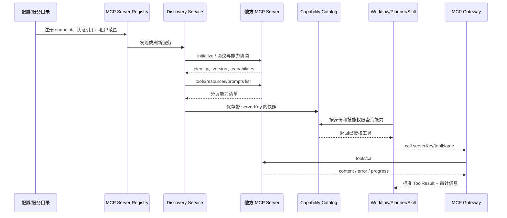
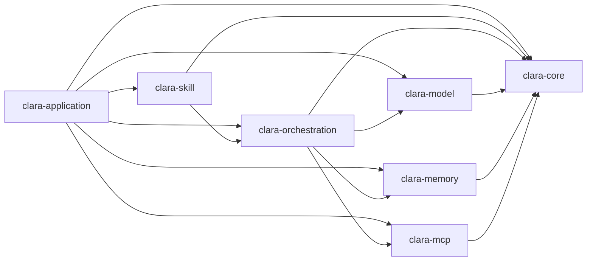

# Clara AI 能力迁移架构设计（基于 LangChain4j，Java 8）

> 状态：编码迁移完成；线上 Provider/Milvus 验证延期
>
> 日期：2026-09-07
> 目标：从当前 LangChain4j 仓库中提炼多模型、多模态生成与理解、上下文记忆、MCP Client、流程编排、任务规划和通用技能服务能力，并迁移到 Clara 的 Java 8 技术栈。

当前迭代以 Java 8 编译、离线单元/契约/安全测试和完整 Maven Reactor
通过作为编码验收条件。按当前决定不再执行线上 Provider 请求；Anthropic、
Milvus 服务端和火山图生视频同样暂不验证。线上结果只决定具体 descriptor
能否在部署环境标记为 `ACTIVE`，不阻塞本文范围内的编码迁移完成。

## 1. 结论摘要

当前仓库是 Maven 多模块工程，主干版本为 `1.20.0-beta30-SNAPSHOT`，父工程明确设置 `java.version=17`。目标工程不能在 Java 8 中直接依赖或原样复制当前模块，建议采用以下策略：

1. 保留 LangChain4j 的核心抽象思想，例如统一消息、同步/流式模型接口、窗口记忆、EmbeddingStore、MCP ToolProvider、Planner/Action/Scope 和 Skill。
2. 重新定义一组精简、稳定、Java 8 原生的领域接口，避免把供应商 SDK、HTTP 实现和 Milvus SDK 类型泄漏到公共领域。
3. 能力按业务领域合并为 8 个 Maven 模块，模块内部使用命名空间隔离 API、运行时和适配器；通用任务不依赖预定义特殊业务模块。
4. 首期迁移文本/图片/音频/视频多模态输入、文生图、图生图、语音转写、语音合成、文生视频、图生视频、工具调用、Embedding、短期记忆、可切换的本地/Milvus 长期语义记忆、stdio/远程 HTTP MCP Client、确定性工作流和可恢复任务规划。
5. “流程会话”和“任务规划”最终通过统一的技能目录与技能执行服务对外提供，但二者保留不同执行语义：流程是预定义图，任务规划是运行时生成和修订计划。

## 2. 仓库简要扫描与迁移来源

本次仅扫描与目标直接相关的模块，没有逐文件审阅整个仓库。

| 能力 | 当前模块/关键对象 | 可提炼内容 | Java 8 处理 |
| --- | --- | --- | --- |
| 公共消息与模型 | `langchain4j-core`: `ChatMessage`、`ChatRequest`、`ChatResponse`、`ChatModel`、`StreamingChatModel` | 统一消息、请求参数覆盖、同步/流式分离、监听器 | 精简重写 |
| 模型平台适配 | `langchain4j-open-ai`、`langchain4j-anthropic`、`langchain4j-ollama`、`langchain4j-azure-open-ai` | Builder 配置、请求/响应映射、SSE 聚合、供应商参数 | 按 Provider 独立重写 |
| 多模态内容 | `langchain4j-core`: `Image`、`Audio`、`Video`、`ImageContent`、`AudioContent`、`VideoContent` | URL/Base64/二进制媒体及对话多模态输入 | 统一为媒体引用，二进制外置 |
| 图片生成 | `langchain4j-core`: `ImageModel`; OpenAI、Google GenAI、Workers AI、Ollama 等实现 | 文生图、多图生成、图生图、蒙版编辑 | 扩展为类型化请求与能力矩阵 |
| 音频处理 | `langchain4j-core`: `AudioTranscriptionModel`、`TextToSpeechModel`; OpenAI/Azure 实现 | 语音转文字、文字转语音 | 独立音频端口重写 |
| 视频生成 | 当前仓库仅有 `Video`/`VideoContent` 输入对象，没有独立 `VideoGenerationModel` | 视频理解输入可提炼；文生视频无现成抽象 | 新建设计，采用异步任务接口 |
| 文件与文档解析 | `document-parsers`: Apache POI、PDFBox、Tika 实现 | Word、Excel、PDF 文本和结构提取 | 定义 Clara Parser/Writer 端口，选择 Java 8 兼容依赖重写 |
| 短期记忆 | `langchain4j`: `MessageWindowChatMemory`、`TokenWindowChatMemory` | 消息数/Token 滑动窗口、System 消息保留、工具调用消息成组淘汰 | 算法迁移并补并发控制 |
| 存储端口 | `langchain4j-core`: `ChatMemoryStore`、`EmbeddingStore` | 存储与策略分离、向量检索请求/结果 | 重定义为领域端口 |
| 语义记忆存储 | `langchain4j-milvus`: `MilvusEmbeddingStore` | Collection、向量写入、相似度检索、元数据过滤 | Clara 定义统一端口，提供 JVM 内存和 Milvus 两种实现 |
| MCP Client | `langchain4j-mcp`: `McpClient`、`DefaultMcpClient`、`StdioMcpTransport`、`StreamableHttpMcpTransport`、`McpToolProvider` | JSON-RPC、初始化与能力协商、工具/资源/Prompt 发现调用、传输生命周期 | 支持本地 stdio 和外部 Streamable HTTP |
| 流程编排 | `langchain4j-agentic`: sequence/parallel/conditional/loop planners | 顺序、并行、条件、循环、共享 Scope | 以显式定义对象重写，首期不依赖动态代理注解体系 |
| 任务规划 | `langchain4j-agentic`: `Planner`、`Action`、`AgenticScope`、`AgenticScopeStore` | `call/done/suspend` 动作、状态快照、恢复执行 | 扩展为显式任务 DAG 和检查点 |
| 技能 | `langchain4j-skills`: `Skill`、`Skills`、文件/类路径加载器 | 技能元数据、按需激活、资源读取、工具绑定 | 定义可版本化、可发布的技能服务 |

### 2.1 不能直接依赖当前代码的原因

当前代码使用了 Java 8 不具备的语言或 JDK 能力，包括：

- Java 16/17：`record`、模式匹配 `instanceof`、sealed interface。
- Java 9+：`List.of`、`Map.of`、`Set.of`、`Process.pid()`、`Process.onExit()`、`CompletableFuture.failedFuture()`。
- Java 11+：`java.net.http.HttpClient`、`Path.of`、`Files.readString`。
- Java 16+：`Stream.toList()`。
- 当前父 POM 和部分第三方依赖版本也以 Java 17 为基线。

因此，“迁移”应理解为受现有设计启发的选择性重写，而不是把当前 `dev.langchain4j` 包整体复制到 Java 8 工程。复制具体源码时还必须保留 Apache License 2.0 的版权、许可证和 NOTICE 要求。

## 3. 范围与边界

### 3.1 首期范围

- 多平台文本聊天模型，支持同步和流式请求。
- 图片、音频、视频作为 ChatModel 的多模态输入，按模型能力校验。
- 文生图、图生图、蒙版编辑和批量生图。
- 语音转写和文字转语音；接口允许后续增加音频翻译或音频生成能力。
- 文生视频和图生视频，支持按模型传入参考图/首帧/尾帧；采用提交、查询、取消的异步任务语义。
- 公共参数与供应商扩展参数，支持全局、平台、模型、单次调用四级覆盖。
- 文本 Embedding 模型。
- 内存消息窗口、Token 窗口、持久化会话存储。
- 基于 JVM 内存或 Milvus 的相关历史消息召回，并与短期窗口组合。
- MCP Client 支持本地 stdio 以及他方提供的 Streamable HTTP 服务，具备注册、能力发现、工具/资源/Prompt 调用、健康检查和动态刷新能力。
- 顺序、并行、条件、循环工作流。
- 基于 LLM 或规则的任务分解、DAG 调度、重试、暂停、恢复和人工介入。
- 将工作流与任务规划发布为统一技能服务。
- 提供 Clara 控制台应用：在受控工作目录中读取文件，识别业务意图，匹配技能并执行工作流或任务规划。
- 工作目录支持代码、Word、Excel、PDF 的读取、字面量/安全正则搜索，以及经授权的文件新增、文本替换和匹配文本/范围删除。

### 3.2 暂不迁移

- Moderation、Rerank 和通用模型批处理；图片批量生成仍在范围内。
- MCP Server、WebSocket 非标准传输、MCP Sampling；旧 SSE 传输只作为明确配置的兼容适配器。
- A2A、多进程分布式 Agent 调度。
- 任意脚本执行型 Skill。
- 当前 Agentic 模块完整的注解、动态代理和声明式兼容层。

## 4. 总体架构

Clara 采用六边形架构。领域模块定义稳定模型和端口，应用模块编排用例，Provider/Store/Transport 连接外部系统。下图表达运行时调用关系，不表示所有节点之间都有直接 Maven 依赖。

```mermaid
flowchart TB
    subgraph ACCESS[接入层 - clara-application]
        REST[REST API]
        SSE[SSE 流式 API]
        JAVA[Java Facade]
        CLI[Clara Console / CLI]
        ADMIN[配置与管理 API]
    end

    subgraph APP[应用用例层 - clara-application]
        CONV[Conversation Service]
        MEDIA[Media Generation Service]
        SKILL_APP[Skill Application Service]
        WORKSPACE_RUN[Workspace Business Runner<br/>意图识别 / 技能匹配 / 执行]
        FEEDBACK[Feedback Controller / Interaction Service<br/>问题输出 / 反馈接收 / 恢复]
        INSTANCE[实例查询 / 暂停 / 恢复 / 取消]
    end

    subgraph SKILLS[技能领域 - clara-skill]
        SKILL_REG[Skill Registry<br/>版本 / Schema / 权限 / 资源]
        SKILL_EXEC[Skill Executor]
        COMMON[通用技能<br/>对话 / 生图 / 视频 / 总结]
        DOMAIN[特殊业务技能<br/>skill.domain.*]
    end

    subgraph ORCH[编排领域 - clara-orchestration]
        WORKFLOW[Workflow Engine<br/>顺序 / 并行 / 条件 / 循环]
        PLANNER[Task Planner Engine<br/>计划 / DAG / 重规划]
        INTENT[Intent Recognizer<br/>意图候选 / 置信度 / 证据]
        SCOPE[Execution Scope]
        HUMAN[User Interaction Gateway<br/>输入 / 选择 / 确认 / 审批]
        CHECKPOINT[Checkpoint / 幂等账本]
    end

    subgraph CAPABILITY[基础能力层]
        MODEL_ROUTER[Model Router<br/>模型能力校验与路由]
        CONTEXT[Context Assembler<br/>短期 + 语义记忆]
        TOOL_ROUTER[Tool Router<br/>鉴权 / 限流 / 审计]
        FILE_TOOLS[Workspace File Tools<br/>scan / find / read / match<br/>create / replace / delete-text]
        DOC_IO[Document Adapters<br/>代码 / POI / PDFBox / OCR]
        MEDIA_STORE[Media Store<br/>本地文件 / 对象存储]
    end

    subgraph MODEL[模型领域 - clara-model]
        PROVIDERS[Provider Adapters<br/>OpenAI / 字节 / DeepSeek / 阿里 / Anthropic]
        CHAT[Chat / Streaming / Embedding]
        GEN[图片 / 音频 / 视频生成任务]
    end

    subgraph MEMORY[记忆领域 - clara-memory]
        WINDOW[消息窗口 / Token 窗口]
        SEMANTIC[语义记忆检索]
        INMEMORY[(Local Vector Store<br/>JVM 内存索引 + 工作目录持久化)]
        STATE[(Conversation / Run State<br/>Local / JDBC)]
        MILVUS[(Milvus)]
    end

    subgraph MCP[MCP Client 领域 - clara-mcp]
        MCP_REG[MCP Server Registry]
        DISCOVERY[初始化 / 能力发现<br/>Tools / Resources / Prompts]
        CATALOG[MCP Capability Catalog]
        GATEWAY[MCP Gateway]
        STDIO[stdio Transport]
        HTTP[Streamable HTTP<br/>旧 SSE 兼容]
    end

    subgraph EXTERNAL[外部系统]
        LLM[五家模型平台]
        LOCAL_MCP[本地 MCP Server]
        REMOTE_MCP[他方 MCP Server]
        WORKSPACE[(指定工作目录)]
        OBJECT[(对象存储)]
    end

    REST --> CONV
    SSE --> CONV
    REST --> MEDIA
    SSE --> MEDIA
    JAVA --> SKILL_APP
    CLI --> WORKSPACE_RUN
    REST --> SKILL_APP
    ADMIN --> SKILL_REG
    ADMIN --> MCP_REG
    REST --> FEEDBACK
    CLI --> FEEDBACK
    JAVA --> FEEDBACK
    INSTANCE --> WORKFLOW
    INSTANCE --> PLANNER

    SKILL_APP --> SKILL_REG
    SKILL_REG --> COMMON
    SKILL_REG --> DOMAIN
    SKILL_APP --> SKILL_EXEC
    WORKSPACE_RUN --> INTENT
    WORKSPACE_RUN --> SKILL_REG
    WORKSPACE_RUN --> SKILL_EXEC
    SKILL_EXEC --> WORKFLOW
    SKILL_EXEC --> PLANNER
    SKILL_EXEC --> MODEL_ROUTER
    WORKFLOW --> SCOPE
    PLANNER --> SCOPE
    WORKFLOW --> HUMAN
    PLANNER --> HUMAN
    HUMAN --> FEEDBACK
    FEEDBACK --> SCOPE
    FEEDBACK --> INSTANCE
    SCOPE --> CHECKPOINT
    WORKFLOW --> MODEL_ROUTER
    PLANNER --> MODEL_ROUTER
    WORKFLOW --> TOOL_ROUTER
    PLANNER --> TOOL_ROUTER
    INTENT --> MODEL_ROUTER

    CONV --> CONTEXT
    CONV --> MODEL_ROUTER
    MEDIA --> MODEL_ROUTER
    MEDIA --> MEDIA_STORE
    CONTEXT --> WINDOW
    CONTEXT --> SEMANTIC
    WINDOW --> STATE
    SEMANTIC --> INMEMORY
    SEMANTIC --> MILVUS
    CHECKPOINT --> STATE

    MODEL_ROUTER --> CHAT
    MODEL_ROUTER --> GEN
    CHAT --> PROVIDERS
    GEN --> PROVIDERS
    PROVIDERS --> LLM
    MEDIA_STORE --> OBJECT
    MEDIA_STORE -->|local assets| WORKSPACE

    TOOL_ROUTER --> GATEWAY
    TOOL_ROUTER --> FILE_TOOLS
    WORKSPACE_RUN --> FILE_TOOLS
    FILE_TOOLS --> DOC_IO
    DOC_IO --> WORKSPACE
    MCP_REG --> DISCOVERY
    DISCOVERY --> CATALOG
    CATALOG --> GATEWAY
    GATEWAY --> STDIO
    GATEWAY --> HTTP
    STDIO --> LOCAL_MCP
    HTTP --> REMOTE_MCP
```



关键调用关系：

1. 普通会话由 `Conversation Service` 组装上下文后调用模型；模型要求执行工具时统一经过 `Tool Router`，不能绕过授权直接访问 MCP。
2. 技能由 `Skill Registry` 提供版本化定义，`Skill Executor` 按类型路由到模型、固定工作流或动态任务规划。
3. 工作流和任务规划共享 Scope、检查点和幂等账本，也可同时调用模型能力与 MCP 工具。
4. MCP Registry 管理本地和他方服务，Discovery 识别服务能力并写入 Catalog，Gateway 只调用目录中已授权的能力。
5. 图片、音频、视频以 MediaAsset 在各领域间传递，二进制进入当前 MediaStore，不穿透到流程快照或会话状态库。
6. 控制台通过 Workspace Business Runner 识别任务意图和所需能力，再执行通用任务规划或明确指定的技能；所有文件读写都经过 Workspace File Tools 的路径、权限和变更集校验。
7. 流程或计划缺少信息时，通过 User Interaction Gateway 生成结构化问题并保存检查点；Feedback Controller 接收用户反馈后恢复同一个实例。

### 4.1 MCP 发现与调用链



发现不等于信任。未经配置或审批的 endpoint 不进入 Registry；发现结果还要经过租户、技能、用户和工具四级权限过滤，才可暴露给模型。

核心依赖规则。下图统一采用通常语义：`A --> B` 表示 Maven 模块 A 编译期依赖 B：



`clara-core` 不依赖任何业务模块；`clara-model`、`clara-memory`、`clara-mcp` 不相互依赖。`clara-orchestration` 只通过端口使用模型、记忆和 MCP，不依赖具体 Provider/Store/Transport 类型。`clara-skill` 不直接依赖 Provider、Milvus SDK 或 MCP Transport。`clara-application` 是最终装配模块，其他模块不得反向依赖它。构建阶段使用 Maven Enforcer/ArchUnit 类规则阻止未声明依赖和循环依赖。

## 5. Maven 模块与 Java 包规划

按业务领域合并模块，内部使用 Java 命名空间隔离 API、运行时和适配器，避免为每个技术实现发布一个 jar。Clara 的 Maven `groupId` 和 Java 根包固定为 `com.clara`，artifact 使用 `clara-*` 前缀，包路径不包含 `ai` 层级。

| Maven 模块 | 主要命名空间 | 领域职责 |
| --- | --- | --- |
| `clara-bom` | 无 | Java 8 兼容依赖和插件版本 |
| `clara-core` | `.kernel`、`.media`、`.model.api`、`.tool` | 公共值对象、媒体资产、模型端口和通用工具契约；不含外部 SDK |
| `clara-model` | `.model.runtime`、`.model.provider.*` | 模型注册/路由以及五个厂商的 Chat、Embedding、图片、音频、视频实现 |
| `clara-memory` | `.memory.api`、`.memory.shortterm`、`.memory.semantic.*`、`.memory.persistence.*` | 短期窗口、会话存储、本地/Milvus 语义记忆和上下文装配 |
| `clara-mcp` | `.mcp.client`、`.mcp.registry`、`.mcp.transport.*` | MCP 协议、服务发现、stdio/HTTP 传输和能力聚合 |
| `clara-orchestration` | `.orchestration.api`、`.orchestration.intent`、`.orchestration.interaction`、`.workflow`、`.planner`、`.orchestration.persistence` | 意图识别、工作流、任务规划、人机交互、检查点和恢复 |
| `clara-skill` | `.skill.api`、`.skill.runtime`、`.skill.common`、`.skill.domain.*` | 技能契约、通用任务执行和可选领域技能 |
| `clara-application` | `.application.*`、`.workspace.*`、`.adapter.rest`、`.adapter.cli`、`.adapter.document.*`、`.bootstrap` | 用例装配、独立工作目录领域、反馈控制器、文档读写、REST/SSE、控制台和启动 |

### 5.1 模块内部命名空间

```text
clara-core
  com.clara.kernel
  com.clara.media
  com.clara.model.api
  com.clara.tool

clara-model
  com.clara.model.runtime
  com.clara.model.provider.openai
  com.clara.model.provider.volcengine
  com.clara.model.provider.deepseek
  com.clara.model.provider.alibaba
  com.clara.model.provider.anthropic

clara-memory
  com.clara.memory.api
  com.clara.memory.shortterm
  com.clara.memory.semantic
  com.clara.memory.semantic.local
  com.clara.memory.semantic.milvus
  com.clara.memory.persistence.jdbc

clara-mcp
  com.clara.mcp.client
  com.clara.mcp.registry
  com.clara.mcp.transport.stdio
  com.clara.mcp.transport.http

clara-orchestration
  com.clara.orchestration.api
  com.clara.orchestration.intent
  com.clara.orchestration.interaction
  com.clara.orchestration.workflow
  com.clara.orchestration.planner
  com.clara.orchestration.persistence.jdbc

clara-skill
  com.clara.skill.api
  com.clara.skill.runtime
  com.clara.skill.common
  com.clara.skill.domain.<domain>

clara-application
  com.clara.application.conversation
  com.clara.application.media
  com.clara.application.skill
  com.clara.application.interaction
  com.clara.workspace.api
  com.clara.workspace.domain
  com.clara.workspace.application
  com.clara.workspace.runtime
  com.clara.workspace.persistence.local
  com.clara.adapter.rest
  com.clara.adapter.cli.command
  com.clara.adapter.cli.tui
  com.clara.adapter.cli.plain
  com.clara.adapter.cli.json
  com.clara.adapter.document.code
  com.clara.adapter.document.office
  com.clara.adapter.document.pdf
  com.clara.bootstrap
```

模块内部同样采用 `runtime/core --> api`、`provider/adapter --> runtime/core` 的依赖方向，API 不反向依赖实现。五个 Provider 共享 Clara HTTP/SSE 基础组件，但 DTO 和映射器必须留在各自命名空间。Milvus SDK、HTTP 客户端等依赖声明为实现细节，不得出现在公共方法签名中。

工作目录处理保持为独立业务领域，但首期不新增第 9 个 Maven 模块：其 API、领域对象、应用服务、运行时和本地持久化分别放入 `clara-application` 的 `.workspace.api/.domain/.application/.runtime/.persistence.local`，文档解析器放入 `.adapter.document.*`。`.workspace.*` 禁止依赖 REST、CLI 和具体启动框架，CLI/REST 只能通过 Workspace 应用端口调用它。当工作目录能力需要独立发布、被多个应用复用或其 POI/PDF/OCR 依赖与应用模块发生冲突时，再无损提取为 `clara-workspace`。

通用控制台任务使用 `.skill.common.workspace` 与 Planner 动态组合基础能力，不要求预先固定业务类型。若未来出现稳定的特殊业务，再放入 `.skill.domain.<domain>`，并在内部按 `.domain/.application/.port/.adapter/.config` 隔离；只有独立发布或依赖冲突时才拆 Maven 模块。

## 6. 领域设计

### 6.1 多模型调用领域

核心对象：

- `ChatMessage`：`role`、`contents`、`name`、`metadata`，支持 SYSTEM/USER/ASSISTANT/TOOL。
- `ChatRequest`：消息、`ModelParameters`、工具规格、调用上下文。
- `ModelParameters`：`model`、`temperature`、`topP`、`topK`、`maxTokens`、`stop`、惩罚项、响应格式。
- 平台专属参数：供应商扩展参数由平台派生请求子类承载（如 `request.compatible.deepseek.DeepSeekChatRequest`）。
- `ChatResponse`：最终消息、Token 用量、结束原因、供应商元数据。
- `StreamEvent`：文本增量、思考增量、工具参数增量、工具调用完成、响应完成、错误。

建议端口：

```java
public interface ChatModel {
    ChatResponse chat(ChatRequest request);
}

public interface StreamingChatModel {
    StreamHandle chat(ChatRequest request, StreamObserver observer);
}

public interface EmbeddingModel {
    EmbeddingResponse embed(EmbeddingRequest request);
}
```

Java 8 不使用 `Flow.Publisher`。`StreamObserver` 使用回调，`StreamHandle` 提供 `cancel()` 和 `isDone()`；REST 层再映射为 SSE。同步与流式适配器共享 DTO mapper、鉴权、重试策略和观测逻辑，但保持两个明确端口。

参数覆盖顺序固定为：

```text
系统默认 < 平台默认 < 模型实例默认 < 单次请求参数
```

只覆盖显式非空字段；集合是否“空值清除”必须用单独的 `clearStops/clearTools` 标志表达，避免空集合语义不确定。API Key 只允许通过密钥引用解析，不进入请求日志、领域事件或持久化配置快照。

模型注册表以 `provider + modelAlias` 为键。首批 Provider 固定为 `OPENAI`、`VOLCENGINE`、`DEEPSEEK`、`ALIBABA`、`ANTHROPIC`。DeepSeek 即便兼容部分 OpenAI API，也使用独立 Provider，以隔离模型目录、推理参数、错误码和限流策略。字节默认指火山引擎/豆包，阿里默认指阿里云百炼（DashScope/通义）。路由器负责按场景、模态、能力、成本和地域标签选择模型；Provider 仅负责协议映射，不能包含业务路由规则。

每个模型实例在启动时注册能力集合，不按厂商名称猜测能力：

```text
CHAT_TEXT              CHAT_IMAGE_INPUT
CHAT_AUDIO_INPUT       CHAT_VIDEO_INPUT
EMBEDDING              TOOL_CALLING
IMAGE_GENERATION       IMAGE_EDIT       IMAGE_MASK_EDIT
AUDIO_TRANSCRIPTION    SPEECH_SYNTHESIS
VIDEO_GENERATION       VIDEO_IMAGE_REFERENCE
```

调用前由 `ModelCapabilityGuard` 校验。例如 DeepSeek 对话模型不能因为使用 OpenAI-compatible 协议就被错误路由到图片生成任务；同一厂商的不同模型也可声明不同能力。

#### 6.1.1 厂商 API 基线与模型能力目录

以下为 2026-09-03 设计基线，不代表某厂商的所有模型都具备该行能力。Clara 必须将能力绑定到 `ProviderModelDescriptor`，以 `provider + modelId + region + apiProfile + modelRevision` 唯一定位；厂商名称只用于选择适配器。

| Provider | 已确认的协议族 | 模型级能力基线 | Clara 处理原则 |
| --- | --- | --- | --- |
| OpenAI | Responses/Chat、Embeddings、Images、Audio、Videos | 文本/流式/工具、多模态理解、Embedding、图片生成与编辑、STT/TTS；视频模型按官方生命周期动态启停 | 不将临近下线的 Sora Videos API 作为固定基线；由目录标记 deprecated/retireAt |
| VOLCENGINE | Ark `/api/v3` 对话、图片和异步内容生成 | 豆包模型按 endpoint/model 支持文本、多模态、文生图、图生图、文生视频、图生视频等 | endpoint ID 与模型能力分别登记，不能从 endpoint 名称猜测能力 |
| DEEPSEEK | `POST /chat/completions`、`GET /models` | 所给文档确认同步/流式 Chat、JSON 输出、函数工具及 `image_url` 内容结构；独立图片/音频/视频生成与 Embedding 未由这两份接口确认 | `/models` 只发现可用 ID，不自动赋予媒体生成能力；图像输入仍须由所选模型 descriptor 开启，其他未确认能力保持禁用 |
| ALIBABA | OpenAI-compatible 文本/Embedding；DashScope 原生同步或异步媒体任务 | 千问文本/Omni、Embedding、Qwen Image/Wan 图片与视频、ASR/TTS 等模型族 | 从部署时官方模型目录/可用模型接口识别候选 ID，再由版本化能力元数据选择协议；不在代码中固化“最新千问” |
| ANTHROPIC | Messages/Streaming/Tools | 文本、流式、工具及所选模型支持的图片/PDF 输入；不把 Embedding、图片/音频/视频生成视为默认能力 | 首期模型 ID 和版本在阶段 0 按官方目录冻结，未声明能力显式拒绝 |

能力矩阵中的“支持族”表示官方平台存在该类模型/API，仍须具体 model descriptor 开启；“待核”表示当前给定资料不足，阶段 0 未完成账号/区域实测前保持关闭。为避免把理解和生成能力混为一体，拆成两张矩阵。

多模态理解与交互能力：

| Provider | 文本 Chat | 流式 | 工具 | 图片输入 | 音频输入 | 视频输入 | PDF/文件输入 |
| --- | --- | --- | --- | --- | --- | --- | --- |
| OpenAI | 支持族 | 支持族 | 支持族 | 支持族 | 按模型 | 按模型 | 按 API profile |
| VOLCENGINE | 按 endpoint | 按 endpoint | 按 endpoint | 按 endpoint | 待核 | 待核 | 待核 |
| DEEPSEEK | 已确认 | 已确认 | 已确认 | 按模型确认 | 未确认 | 未确认 | 按 Files/API profile 确认 |
| ALIBABA | 支持族 | 支持族 | 支持族 | 支持族 | 支持族 | 按模型 | 按 API profile |
| ANTHROPIC | 支持族 | 支持族 | 支持族 | 支持族 | 无首期目标 API | 无首期目标 API | 支持族 |

向量与媒体生成能力：

| Provider | Embedding | 文生图 | 图生图 | 蒙版编辑 | 批量图 | STT | TTS | 文生视频 | 图生视频 |
| --- | --- | --- | --- | --- | --- | --- | --- | --- | --- |
| OpenAI | 支持族 | 支持族 | 支持族 | 按模型 | 按模型/限额 | 支持族 | 支持族 | 退役中/不作固定基线 | 退役中/不作固定基线 |
| VOLCENGINE | 待核 | 支持族 | 支持族 | 按模型 | 按模型/限额 | 待核 | 待核 | 支持族 | 支持族（保留能力展示，本轮不验证） |
| DEEPSEEK | 未确认 | 未确认 | 未确认 | 未确认 | 未确认 | 未确认 | 未确认 | 未确认 | 未确认 |
| ALIBABA | 支持族 | 支持族 | 支持族 | 按模型 | 按模型/限额 | 支持族 | 支持族 | 支持族 | 支持族 |
| ANTHROPIC | 无首期目标 API | 无首期目标 API | 无首期目标 API | 无首期目标 API | 无首期目标 API | 无首期目标 API | 无首期目标 API | 无首期目标 API | 无首期目标 API |

`ProviderModelDescriptor` 至少包含：`modelId`、可选别名、API profile、区域、能力集合、输入/输出模态、上下文与输出上限、支持参数、流式/异步模式、数据驻留标签、单价版本、发布日期、弃用时间、`discoveredAt/sourceRevision` 和探测来源。能力来源分为：厂商目录发现、Clara 审核过的静态元数据、启动探测、契约测试；优先级由后到前递增，运行时 `/models` 返回值不能覆盖人工禁用或契约测试失败。

官方资料基线：

- DeepSeek：[Chat Completions](https://api-docs.deepseek.com/zh-cn/api/create-chat-completion)、[获取模型列表](https://api-docs.deepseek.com/zh-cn/api/list-models)。
- 火山方舟：[API 文档入口](https://console.volcengine.com/ark/region:cn-beijing/docs/82379/1099455?lang=zh)。
- 千问：[开发者概览](https://platform.qianwenai.com/docs/developer-guides/getting-started/introduction)、[模型选择](https://platform.qianwenai.com/docs/developer-guides/getting-started/model-selection)。
- OpenAI：[Models](https://platform.openai.com/docs/models)、[Image generation](https://developers.openai.com/api/docs/guides/image-generation)、[Video generation](https://developers.openai.com/api/docs/guides/video-generation)。
- Anthropic：[API 文档](https://docs.anthropic.com/en/api/overview)。

截至 2026-09-04，从上述官方资料和四个已提供账号的鉴权模型目录提取出以下首期精简模型 ID。表中“账号可见”只证明目录可发现，不等价于工具、流式、多模态或生成能力已经通过契约测试；Clara 仍以版本化 descriptor 显式授予能力。未列入表中的目录结果不自动注册，密钥和完整目录响应不得写入仓库。

| Provider | 首期用途 | 冻结的 `modelId` | 区域/API profile | 目录核验 |
| --- | --- | --- | --- | --- |
| OpenAI | 高能力文本/工具 | `gpt-5.6-sol` | `unverified` / `OPENAI_COMPATIBLE_CHAT` | 当前账号可见，官方 Models 可检索 |
| OpenAI | 低延迟文本/工具 | `gpt-5.6-terra` | `unverified` / `OPENAI_COMPATIBLE_CHAT` | 当前账号可见，官方 Models 可检索 |
| OpenAI | 图片生成/编辑 | `gpt-image-2` | `unverified` / `OPENAI_IMAGES` | 当前账号可见，官方 Models 可检索 |
| DeepSeek | 高能力文本/推理/工具 | `deepseek-v4-pro` | `global` / `DEEPSEEK_CHAT_COMPLETIONS` | 当前账号可见，官方模型列表可检索 |
| DeepSeek | 低延迟文本/推理/工具 | `deepseek-v4-flash` | `global` / `DEEPSEEK_CHAT_COMPLETIONS` | 当前账号可见，官方模型列表可检索 |
| VOLCENGINE | 文本/工具 | `doubao-seed-2-1-pro-260628` | `cn-beijing` / `ARK_V3_CHAT` | 当前账号可见，官方方舟目录可检索 |
| VOLCENGINE | 图片输入理解 | `doubao-seed-1-6-vision-250815` | `cn-beijing` / `ARK_V3_CHAT` | 当前账号可见，官方方舟目录可检索 |
| VOLCENGINE | 文本 Embedding | `doubao-embedding-large-text-250515` | `cn-beijing` / `ARK_V3_EMBEDDINGS` | 当前账号可见 |
| VOLCENGINE | 图片生成/编辑 | `doubao-seedream-5-0-pro-260628` | `cn-beijing` / `ARK_V3_IMAGES` | 当前账号可见，官方方舟目录可检索 |
| VOLCENGINE | 文本生成视频；保留图片生成视频描述 | `doubao-seedance-2-5-260628` | `cn-beijing` / `ARK_V3_CONTENT_TASKS` | 当前账号可见，官方方舟目录可检索；图生视频本轮不验证 |
| ALIBABA | 文本/工具 | `qwen3.8-max-0902` | `cn-beijing` / `OPENAI_COMPATIBLE_CHAT` | 当前账号可见；官方目录列出 `qwen3.8-max` 系列 |
| ALIBABA | 多模态理解 | `qwen3.5-omni-plus-2026-03-15` | `cn-beijing` / `DASHSCOPE_NATIVE` | 当前账号可见；官方目录列出 `qwen3.5-omni-plus` 系列 |
| ALIBABA | 文本 Embedding | `qwen3.7-text-embedding` | `cn-beijing` / `OPENAI_COMPATIBLE_EMBEDDINGS` | 当前账号可见，官方目录可检索 |
| ALIBABA | 图片生成/编辑 | `qwen-image-3.0-pro` | `cn-beijing` / `DASHSCOPE_NATIVE` | 当前账号可见，官方目录可检索 |
| ALIBABA | 语音转写 | `qwen-audio-3.0-asr-flash` | `cn-beijing` / `DASHSCOPE_NATIVE` | 当前账号可见，官方目录可检索 |
| ALIBABA | 语音合成 | `qwen3-tts-flash-2025-11-27` | `cn-beijing` / `DASHSCOPE_NATIVE` | 当前账号可见；官方目录列出 `qwen3-tts` 系列 |
| ALIBABA | 文本/图片生成视频 | `wan3.0-video` | `cn-beijing` / `DASHSCOPE_NATIVE` | 官方目录可检索，当前账号目录未见，保持禁用 |
| ANTHROPIC | 高能力文本/工具/图片与 PDF 输入 | `claude-opus-5` | `global` / `ANTHROPIC_MESSAGES` | 仅展示官方 ID，本轮不验证 |
| ANTHROPIC | 平衡文本/工具/图片与 PDF 输入 | `claude-sonnet-5` | `global` / `ANTHROPIC_MESSAGES` | 仅展示官方 ID，本轮不验证 |
| ANTHROPIC | 低延迟文本/工具/图片与 PDF 输入 | `claude-haiku-4-5-20251001` | `global` / `ANTHROPIC_MESSAGES` | 仅展示官方 ID，本轮不验证 |

2026-09-04 的线上探测进一步确认：火山方舟并非已证明“所有模型均不可用”。`doubao-seed-2-1-pro-260628`、`deepseek-v4-flash-260425` 以及用户指定复测的 `doubao-seed-2-0-code-preview-260215` 均返回 HTTP 403 `AccountOverdueError`，请求在账户校验阶段被拦截，应在结清欠费后优先复测；另两个候选 `doubao-seed-1-8-251228` 与 `doubao-1-5-pro-32k-250115` 返回 HTTP 404 `InvalidEndpointOrModel.NotFound`，表示对应 endpoint/model 未开通、已失效或当前账号无权限，不能据此推断其他模型状态。OpenAI-compatible 网关可读取 `/v1/models`，但 `/v1/chat/completions` 和 `/v1/responses` 均返回 HTTP 403 `bad_response_status_code / openai_error`，因此当前阻塞点是网关上游或账号授权，而不是 Chat 与 Responses 路径选择。上述探测不保存密钥或响应正文。

带日期或版本号的 ID 直接作为 `modelId`；没有独立日期后缀的官方 ID 以 `sourceRevision=official-catalog@2026-09-04` 固定本次目录快照。生产配置不得把 `latest`、系列名或路由别名替换成其他模型。`region=unverified` 是明确的拒绝性标签，不得进入任何带数据驻留或跨境限制的路由。Anthropic 按当前要求只展示 ID，不执行账号目录或实时请求验证；其他四家也必须在无副作用的小额测试账号完成能力契约后，才可把对应 descriptor 标记为 `ACTIVE`。

#### 6.1.2 重点 Provider 请求映射

DeepSeek 使用独立 base URL、鉴权、错误码和限流器。非流式与流式共用 `POST /chat/completions`；`stream=true` 时解析 SSE，直到 `data: [DONE]`。`tools` 仅映射函数工具，`response_format`、推理内容和 beta 参数放入 DeepSeek 类型化 options。`GET /models` 的结果保存为带抓取时间的可用性快照，但能力仍来自 `ProviderModelDescriptor`。

火山方舟图片协议由同一个 Provider mapper 区分两种操作：

请求地址为 `POST https://ark.cn-beijing.volces.com/api/v3/images/generations`。文生图省略 `image`；图生图提供 `image`，具体 string/list 形态由 model descriptor 约束：

```json
{
  "model": "<configured-image-model-or-endpoint>",
  "prompt": "<prompt>",
  "image": "<optional-signed-url-or-supported-input>",
  "size": "<provider-supported-size>",
  "response_format": "url",
  "watermark": true
}
```

火山方舟视频统一为异步任务。文生视频只发送文本 content；图生视频增加一个或多个 `image_url` content，图片角色（参考图、首帧、尾帧）和数量由模型描述符校验：

火山图生视频的协议映射和 capability 描述继续保留，便于后续启用；按当前验收决定，本轮不发起火山图生视频请求、不执行其线上契约测试，也不以该项未验证阻塞首期验收。火山文生视频及其他已纳入范围的能力不受此豁免影响。

提交地址为 `POST https://ark.cn-beijing.volces.com/api/v3/contents/generations/tasks`，查询地址为 `GET /api/v3/contents/generations/tasks/{taskId}`：

```json
{
  "model": "<configured-video-model-or-endpoint>",
  "content": [
    {"type": "text", "text": "<prompt-and-provider-options>"},
    {"type": "image_url", "image_url": {"url": "<optional-signed-url>"}}
  ]
}
```

阿里 Provider 必须同时保留 `OPENAI_COMPATIBLE` 与 `DASHSCOPE_NATIVE` 两类 API profile，不能把所有千问能力套进 Chat DTO。当前官方目录可识别的候选族包括千问文本/Omni、Embedding、Qwen Image、Wan 图片/视频及千问/Paraformer/CosyVoice 语音；实际模型 ID 从目标账号和区域可用目录中选取。典型路径包括 `/compatible-mode/v1/chat/completions`、`/compatible-mode/v1/embeddings`、`/api/v1/services/aigc/image-generation/generation`、`/api/v1/services/aigc/video-generation/video-synthesis`、`/api/v1/services/aigc/image2video/video-synthesis` 和 `/api/v1/tasks/{task_id}`。如果新版模型转用 multimodal-generation 等协议，只新增 API profile，不改变 Clara 领域请求。

按当前千问官方模型目录，阶段 0 可从下列候选族建立账号/区域实测清单，而不是直接全部启用：文本 `qwen3.8-flash/qwen3.8-max`，Embedding `qwen3.7-text-embedding/text-embedding-v4`，图片 `qwen-image-3.0/wan2.7-image`，视频 `wan3.0-video/wan2.7` 对应的 t2v/i2v/r2v 变体，STT `qwen3-asr/paraformer`，TTS `qwen3-tts/cosyvoice`。带 `latest` 或未固定日期的别名只能用于非生产探测；生产配置固定实际 modelId/revision，并在能力目录记录区域可用性。

#### 6.1.3 路由、重试与降级语义

- 路由先满足能力、数据区域、租户策略和模型版本，再按质量、延迟、费用预算及健康度排序；价格未知不得被当作零成本。
- 固定工作流、技能版本和可恢复实例记录解析后的 `provider/modelId/modelRevision/apiProfile/capabilityRevision`，恢复时默认使用原版本。模型已退役时进入 `WAITING_INPUT` 或按显式迁移策略重规划，不能静默换模型。
- 仅连接失败、限流和明确的服务端瞬时错误允许重试。非幂等媒体提交只有携带厂商幂等键或已持久化 providerJobId 时才能重试。
- 流式响应向调用方发出任何内容后不得跨 Provider 自动重放；记录 `ABORTED` 和已输出序号，由上层决定继续、重试或询问用户。
- 跨 Provider fallback 必须重新执行参数、工具 Schema、内容策略和数据驻留校验。若已发生工具或文件副作用，只能从执行账本继续，不能重放整轮模型调用。
- 审计记录路由候选、排除原因、最终模型、参数摘要、估算/实际费用和 fallback 链；密钥及未脱敏内容不得进入记录。

### 6.2 多模态与媒体生成领域

当前仓库已有 `Image/Audio/Video` 内容对象、图片生成/编辑、语音转写和语音合成抽象；没有独立的文生视频模型抽象。Clara 对前者提炼重写，对文生视频新增异步领域模型。

#### 6.2.1 统一媒体资产

`MediaAsset` 只描述媒体，不在领域对象中长期持有大块 Base64 或 `byte[]`：

```text
assetId / mediaType / mimeType / size / sha256
storageUri / sourceUri / width / height / durationMs
ownerTenantId / createdAt / expiresAt / metadata
```

上传流先经 `MediaValidator` 校验 MIME、扩展名、文件头、大小、分辨率、时长和租户配额，再写入 `MediaStore`。模型 Provider 通过短期签名 URL 或受限输入流读取。数据库、会话消息和任务检查点只保存 `assetId`，不得保存大 Base64；外部模型返回的临时 URL 必须在过期前转存到 Clara 管理的媒体存储。

建议端口：

```java
public interface MediaStore {
    MediaAsset put(MediaUpload upload);
    MediaAsset get(String tenantId, String assetId);
    InputStream open(String tenantId, String assetId);
    void delete(String tenantId, String assetId);
}

public interface ImageGenerationModel {
    ImageGenerationResult generate(ImageGenerationRequest request);
}

public interface AudioTranscriptionModel {
    AudioTranscriptionResult transcribe(AudioTranscriptionRequest request);
}

public interface SpeechSynthesisModel {
    SpeechSynthesisResult synthesize(SpeechSynthesisRequest request);
}

public interface VideoGenerationModel {
    MediaJob submit(VideoGenerationRequest request);
    MediaJob get(String providerJobId);
    void cancel(String providerJobId);
}
```

#### 6.2.2 图片、音频与视频语义

- 文生图：`prompt` 必填，支持数量、尺寸/宽高比、质量、风格、seed、negativePrompt 等公共或 Provider 扩展参数。
- 图生图：`sourceImageAssetIds` + `prompt`；蒙版编辑额外接收 `maskAssetId`。Provider 不支持时必须返回 `CAPABILITY_NOT_SUPPORTED`，不能静默退化为文生图。
- 音频：首期包含语音转写（STT）与文字转语音（TTS）；语言、说话人、格式、采样率等进入类型化请求。
- 文生视频：`prompt` 必填，可选参考图、首帧、尾帧、时长、宽高比、分辨率、帧率、seed 和 negativePrompt。实际可用字段以模型能力为准。
- 多模态理解：ChatMessage 的 Content 使用 `TextContent/MediaContent` 组合，媒体内容引用 `assetId`，Provider mapper 再转换为 URL、Base64 或上传文件句柄。

视频生成通常是长任务，不包装成阻塞的 `generate()`。`MediaJob` 状态固定为 `QUEUED/RUNNING/SUCCEEDED/FAILED/CANCELLED/EXPIRED`，保存 `providerJobId`、进度、错误和输出 assetId。`MediaJobScheduler` 负责轮询或接收受签名保护的回调，并采用退避、总超时和幂等提交。图片接口首期允许同步返回，但应用层仍可把耗时调用统一包装成 Clara Job。

当前编码实现已包含 OpenAI 图片生成/编辑、语音转写和语音合成适配器，
火山图片生成/编辑及异步视频任务适配器，以及阿里 DashScope Native
异步图片/视频、语音转写和语音合成适配器。共用的 Provider 媒体层负责
Java 8 HTTP、JSON、multipart、凭据清理、请求/响应大小限制和稳定错误映射；
`DefaultProviderMediaAssetBridge` 将 Clara `assetId` 转换为受控输入，并把
Provider 的远程输出立即转存为 Clara 管理的资产。本地资产需要显式配置
短期引用发布器才可供仅支持 URL 的 Provider 使用，系统不会自动公开本地文件。
异步厂商任务通过 `MediaJobProviderOperation` 接入既有持久化调度器。

媒体生成输出必须经过内容安全检查、格式探测、大小限制和 `MediaStore` 落盘后才标记成功。生成任务只在日志中记录 assetId、requestId 和参数摘要，不记录原始二进制或完整敏感 Prompt。

#### 6.2.3 两种媒体存储实现

| 实现 | 默认位置/外部依赖 | 适用范围 |
| --- | --- | --- |
| `FileSystemMediaStore` | `<workspace>/.clara/assets`，不需要外部服务 | 单机 Console、开发测试 |
| `ObjectMediaStore` | S3/OSS/TOS 等对象存储，通过配置选择 | 独立 Service、多实例和大媒体文件 |

两个实现遵守相同的租户隔离、内容 hash、MIME 校验、生命周期和删除契约。`FileSystemMediaStore` 使用按 tenant/assetId 分层的确定性路径，`manifest.json` 保存格式版本、sha256、大小、来源和过期时间；临时文件校验后同卷原子移动，目录配额和清理任务阻止无界增长。`.clara/assets` 不进入 Workspace 扫描、模型上下文和普通文件工具，也不允许用户通过 ChangeSet 直接修改。

Provider 必须显式声明输入方式：支持 URL 时由 MediaStore 生成短期签名/受控 URL；仅支持上传或 Base64 时按大小上限流式读取并立即释放。单机模式若 Provider 只能读取公网 URL，Clara 不得自动暴露本地文件，应改用厂商上传接口或返回 `MEDIA_TRANSPORT_NOT_SUPPORTED`。

#### 6.2.4 Windows 单机存储与安全冻结基线

首期部署显式选择 `WindowsSingleHostStoragePolicy`，不使用无限制或隐式默认值。该策略由代码生成 `FileSystemMediaStoreConfig`、`LocalMediaJobStoreConfig`、`MediaCallbackSecurityPolicy` 和 `WorkspacePolicy`，部署覆盖这些值必须经过新的安全评审。

| 项目 | 首期冻结值 |
| --- | --- |
| 单个媒体文件 / 单租户媒体总量 | 64 MiB / 2 GiB |
| 媒体保留期 / 清理频率 | 30 天 / 至少每小时一次，读取时同步拒绝过期资产 |
| 图片 / 音视频上限 | 8192 x 8192 / 30 分钟 |
| 首期媒体格式 | PNG、JPEG、GIF、WAV；扩展名、MIME 和 magic bytes 必须同时匹配，WAV 必须完成受限元数据探测 |
| Workspace 扫描 | 最多 20,000 个文件、单文件 32 MiB、总读取量 1 GiB、禁止跟随符号链接 |
| 媒体任务状态 | 最多 10,000 条、状态文件最多 16 MiB、终态保留 90 天 |
| Conversation / 审计 / staging | 90 天 / 180 天 / 24 小时 |
| 回调安全 | HMAC-SHA256、时钟偏差 5 分钟、payload 1 MiB、identity 256 字符、nonce 128 字符、最多跟踪 100,000 个 nonce |
| 备份 | 每日一次、保留 28 天、RPO 24 小时、RTO 4 小时、每 90 天恢复演练 |

首期只允许本地用户输入的受支持格式进入未配置内容安全扫描器的 MediaStore。Provider 返回、远程下载或其他外部来源媒体必须配置 `MediaContentSafetyScanner` 并采用 fail-closed，未配置时拒绝落盘和后续使用。非 WAV 音频、视频文件和对象存储在首期保持禁用，不通过信任客户端声明的宽高或时长绕过探测。

`.clara/state`、`.clara/memory`、`.clara/assets`、staging 和 backup 必须位于启用 BitLocker 或等效静态加密的本地 NTFS 卷，ACL 只授予运行身份和指定运维身份。Provider/API/回调密钥只以 `secretRef` 引用，首期解析到 Windows Credential Manager 或 DPAPI 保护的秘密；禁止写入源码、YAML、日志、状态快照和备份。密钥至少每 90 天轮换，发生会话、日志或工单泄漏时立即吊销并更换。

单机备份责任人为部署运维人员。备份前暂停写入并刷新 WAL/快照，备份包采用独立密钥加密且不包含任何秘密；恢复演练必须验证 manifest/checksum、租户隔离、过期清理和语义索引可重建。到期数据由每小时清理任务删除；失败进入可审计重试队列，连续 24 小时失败使 readiness 降级，不能静默延长保留期。

### 6.3 上下文与记忆领域

上下文由三层组成：

1. 固定上下文：System Prompt、技能说明、安全约束。
2. 短期记忆：当前会话最近消息，使用消息数窗口或 Token 窗口。
3. 长期语义记忆：将历史消息/摘要 Embedding 后写入当前配置的 `SemanticMemoryStore`，按当前输入相似度召回。

建议端口：

```java
public interface ConversationStore {
    List<ChatMessage> load(String conversationId);
    void append(String conversationId, List<ChatMessage> messages, long expectedVersion);
    void clear(String conversationId);
}

public interface MemoryPolicy {
    List<ChatMessage> select(MemorySelectionContext context);
}

public interface SemanticMemoryStore {
    void upsert(List<MemoryEntry> entries);
    List<MemoryMatch> search(SemanticMemoryQuery query);
    void deleteByConversation(String tenantId, String conversationId);
}

public interface SemanticMemoryStoreFactory {
    SemanticMemoryStore create(SemanticMemoryStoreConfig config);
}
```

`HybridContextAssembler` 的顺序为：读取短期窗口、查询语义记忆、去重、按时间/相关度重排、计算 Token 预算、组装最终消息。必须保留以下不变量：

- System 消息只能存在一个有效版本并优先保留。
- Assistant 工具调用消息与对应 ToolResult 必须成组保留或成组淘汰。
- 当前轮用户消息不可被历史召回结果挤出。
- 任一语义存储实现都必须强制过滤 `tenantId`，按策略再过滤 `userId`、`conversationId`、`domain` 和有效期。
- 语义召回结果不得直接以 System 角色注入；作为带来源标记的历史上下文注入。

#### 6.3.1 两种语义记忆实现

这里的“两种实现”属于 Clara 的 `SemanticMemoryStore`，不是 Milvus 自身的两种运行模式。

| 实现 | 命名空间 | 外部服务 | 适用范围 |
| --- | --- | --- | --- |
| `LocalSemanticMemoryStore` | `.memory.semantic.local` | 不需要独立服务；持久化到工作目录 | 控制台、单 JVM、中小数据量、测试 |
| `MilvusSemanticMemoryStore` | `.memory.semantic.milvus` | 需要 Milvus Server | 生产、大数据量、多实例共享、持久化索引 |

两个实现遵守同一行为契约：相同的租户过滤、相似度含义、`minScore/topK`、元数据过滤、去重和结果排序。应用层、ContextAssembler、Workflow 和 Planner 只能依赖 `SemanticMemoryStore`，不得使用实现类型进行分支判断。

本地实现运行时按租户/领域分区，以 `ConcurrentHashMap` 保存不可变向量条目，使用余弦相似度进行 TopK 检索，并配置 `maxEntries`、TTL 和淘汰策略。它不依赖 Milvus SDK，也不启动本地数据库进程，但必须通过 WAL 和快照持久化到当前工作目录，下次启动时恢复内存索引。

选择规则：

- 控制台和单机默认 `local`，实现零外部服务启动，并在工作目录保留索引。
- 生产、多实例或需要长期保留语义索引时使用 `milvus`。
- 运行期间不热切换存储。切换实现或 Embedding 模型时，通过重建任务从 ConversationStore 或工作文件事实数据重新生成索引。
- 超过本地实现的条目或堆内存阈值时拒绝新增或按明确策略淘汰，不允许无界占用 JVM 堆。

#### 6.3.2 本地向量存储的磁盘持久化

默认目录位于工作目录内部，但必须从业务文件扫描、意图识别和模型上下文中排除：

```text
<workspace>/.clara/memory/
  manifest.json            格式版本、workspaceId、Embedding 模型、维度、快照序号
  snapshot.bin             完整向量与元数据快照
  snapshot.sha256          快照完整性校验
  wal/                     快照后的 upsert/delete 操作日志
  lock                     单写进程锁
```

一致性规则：

- 每次 upsert/delete 先追加带长度、序号和 checksum 的 WAL，再修改内存索引；是否每条 `fsync` 由 durability 配置决定。
- 达到 WAL 大小、操作数量或时间阈值后生成新快照。先写临时文件并校验，随后同卷原子替换 manifest/snapshot，最后清理已合并 WAL。
- 启动时读取 manifest、校验快照，再按序重放 WAL；尾部半条记录可以截断，checksum 错误必须报告，不静默加载损坏数据。
- `workspaceId + embeddingModel + embeddingVersion + dimension + distanceType` 必须匹配。不匹配时隔离旧索引并从 ConversationStore/工作文件重新构建，不能混用向量。
- 同一工作目录只允许一个写实例持有文件锁；其他进程应失败或以明确的只读模式打开。本地实现不提供多进程并发写承诺。
- 快照采用明确版本化的二进制格式和 JSON manifest，不使用 Java 原生对象序列化，防止类版本耦合和反序列化风险。
- `.clara/memory` 包含由原始文件派生的数据，继承工作目录的数据分级；支持配置文件权限、静态加密和安全删除策略。

工作目录被复制或移动不影响恢复，`workspaceId` 存于 manifest；若用户复制目录形成新业务空间，应通过 CLI 显式 clone/rebuild，避免两个工作空间误共享身份。`.clara/memory`、`.clara/staging` 和 `.clara/backups` 均属于 Clara 管理目录，不能被普通 Workspace Tool 修改。

#### 6.3.3 Milvus 数据建议

Collection：`clara_conversation_memory_v1`

| 字段 | 类型/含义 |
| --- | --- |
| `id` | VARCHAR，记忆条目 ID |
| `tenant_id` | VARCHAR，强制隔离字段 |
| `user_id` | VARCHAR |
| `conversation_id` | VARCHAR |
| `domain` | VARCHAR |
| `turn_id` | VARCHAR |
| `role` | VARCHAR |
| `content` | VARCHAR；敏感场景可只存引用，正文落加密数据库 |
| `created_at` | INT64 |
| `expires_at` | INT64 |
| `embedding_model` | VARCHAR |
| `embedding_version` | VARCHAR |
| `vector` | FLOAT_VECTOR，维度由所选 Embedding 模型固定 |

Milvus 只是 `SemanticMemoryStore` 的一个适配器，不实现 `ConversationStore`。完整消息、顺序、版本和事务应存于 Local/JDBC ConversationStore；Milvus 索引允许异步最终一致。更换 Embedding 模型或维度时创建新 Collection/alias，不在原 Collection 原地混写。

#### 6.3.4 事实来源与工作目录索引生命周期

语义索引不是事实数据源。`CONVERSATION` 条目的事实来源是 `ConversationStore`；`WORKSPACE_CHUNK` 的事实来源是工作目录原文件。Console 由 LocalRunStateStore 支撑本地 ConversationStore 和跨进程会话恢复；显式选择 InProcessRunStateStore 时才不承诺跨进程完整历史。本地快照保存检索必需的向量、受限规范化文本、来源定位和元数据；敏感策略要求只存引用时，命中后从事实来源重新读取并校验 hash。

`MemoryEntry`/文件分块元数据至少包含：`sourceType`、`sourceId`、相对路径、文件 hash、chunkId、页/表/行/符号范围、parserId/parserVersion、chunkerVersion、embeddingModel/revision/dimension、contentHash、indexGeneration 和时间戳。分块边界按文档结构优先，固定长度只是兜底；代码优先按符号，Word 按标题/段落/表格，Excel 按工作表和连续区域，PDF 按页和版面块。

增量索引流程固定为：

```text
扫描文件指纹 -> 与 index manifest 比较 -> 解析变更文件 -> 生成稳定 chunkId
             -> 写入新 generation -> 原子切换有效 generation
             -> 删除旧 generation、已删除/重命名文件的陈旧条目
```

- 内容 hash 未变化时复用现有分块；仅路径改变时更新 provenance，不重复生成向量。
- 解析器、分块器、Embedding 模型或维度改变时创建新 generation，构建完成前旧 generation 继续提供查询。
- 删除文件必须产生 tombstone 并写 WAL；索引清理失败进入可重试 outbox，查询端只返回当前 workspace snapshot 中仍有效的来源。
- 每个检索结果携带 `sourceId + contentHash + location`。进入模型上下文前重新验证租户、路径权限和文件版本；过期命中丢弃并触发修复。
- 本地与 Milvus 实现执行同一套索引生命周期契约；差异只在存储、切换和清理适配器。

### 6.4 MCP Client 与外部服务发现领域

Clara 是 MCP Client，不要求他方 MCP Server 与 Clara 同进程。服务来源包括：

- 本地 stdio：Clara 按白名单配置启动本地 MCP 子进程。
- 外部 Streamable HTTP：连接别人提供的 MCP endpoint，支持静态或动态认证 Header。
- 旧 SSE：只在对方服务无法升级且显式启用兼容模式时使用。

“识别 MCP 服务”定义为受控发现，不进行局域网或公网端口扫描。`McpServerRegistry` 从静态配置、数据库或现有配置中心读取候选服务；`McpDiscoveryService` 建立连接并完成初始化、协议版本协商和能力读取，再同步工具、资源、资源模板与 Prompt 到能力目录。

协议闭环：

```text
注册 endpoint -> 建立 transport -> initialize/能力协商 -> initialized
             -> tools/list、resources/list、resources/templates/list、prompts/list
             -> tools/call、resources/read、prompts/get
             -> list_changed/进度/取消等 notification
             -> 健康检查、能力刷新、断线重连或关闭
```

模块对象包括 `McpClient`、`McpTransport`、`McpServerRegistration`、`McpServerIdentity`、`McpServerCapabilities`、`McpCapabilityCatalog`、`JsonRpcRequest/Response/Error`、`McpToolDescriptor`、`McpResourceDescriptor`、`McpPromptDescriptor`、`McpToolResult` 和 `McpToolProviderAdapter`。

能力目录以 `serverKey` 隔离各服务，工具的全局名称使用 `serverKey/toolName`，不允许同名工具静默覆盖。目录保存不可变的 `capabilitySnapshotId`、发现时间、协议版本、服务端身份、能力摘要、每项能力的 `schemaHash` 和健康状态；执行前仍需按 TTL 或变更通知确认缓存有效。新服务只有通过 endpoint、证书、身份和策略审核后才能进入 `ACTIVE`。

Workflow、TaskPlan 和已发布 Skill 引用 MCP 能力时固定 `serverKey + capabilitySnapshotId + capabilityName + schemaHash`。刷新只创建新快照，不原地修改旧快照；运行中发现快照不可用、工具消失或 Schema 改变时，未执行节点进入 `BLOCKED_CAPABILITY_CHANGED`，再按策略重规划或生成 `InteractionRequest`，不能拿新 Schema 继续旧计划。无运行实例引用且超过保留期的历史快照才允许清理。

建议端口：

```java
public interface McpServerRegistry {
    List<McpServerRegistration> listEnabled(String tenantId);
    McpServerRegistration get(String tenantId, String serverKey);
}

public interface McpDiscoveryService {
    McpServerSnapshot discover(McpServerRegistration registration);
    void refresh(String tenantId, String serverKey);
}

public interface McpGateway {
    McpToolResult callTool(McpToolCall call);
    McpResourceContent readResource(McpResourceRequest request);
    McpPromptResult getPrompt(McpPromptRequest request);
}
```

#### 6.4.1 协议版本与兼容基线

MCP 协议版本使用服务端协商返回的日期版本字符串管理。阶段 0 必须在配置中冻结 `supportedProtocolVersions` 和默认版本；Clara 不自动把未知的新版本当作兼容。初始化失败、版本无交集或服务端身份变化时，Registration 进入 `INCOMPATIBLE`/`REVIEW_REQUIRED`，原能力快照不得继续用于新调用。

兼容契约必须覆盖：`initialize/initialized` 顺序、客户端与服务端 capabilities、分页 cursor、空结果、`list_changed` 通知、progress、cancel、JSON-RPC error、未知 notification、请求 ID 关联、最大消息限制和优雅关闭。stdio 按逐行 JSON framing；Streamable HTTP 明确 GET/POST、JSON/SSE 响应、会话 ID、协议版本 Header、重连以及服务端终止会话语义。旧 SSE 使用独立 `LEGACY_SSE` profile 和退出日期，不与 Streamable HTTP 隐式混用。

认证生命周期由 `McpCredentialProvider` 管理。静态 secret、OAuth access/refresh token 和动态 Header 均只以 `authRef` 引用；刷新需单飞、可取消并避免重放非幂等请求。OAuth redirect URI、授权服务器和 scope 必须预注册，token 不转发给其他 MCP Server。每个支持版本都由同一套模拟 server/client 双向契约测试验证，升级协议版本必须先更新兼容矩阵。

Java 8 改造点：

- 用 `ProcessBuilder` 启动进程，用独立守护线程 `waitFor()` 代替 `Process.onExit()`。
- 不调用 `Process.pid()`；需要 PID 时通过可选的平台适配器获取，核心逻辑不依赖 PID。
- 用 `new CompletableFuture<>()` 后 `completeExceptionally` 代替 `failedFuture()`。
- stdout 只承载协议消息，stderr 单独消费并限长记录，防止管道阻塞。
- 用 `ConcurrentMap<Long, PendingRequest>` 关联响应，所有请求必须有超时和取消清理。
- 远程 Streamable HTTP 使用确认支持 Java 8 的 HTTP 客户端和自有 SSE parser，不使用 JDK 11 `java.net.http.HttpClient`。
- HTTP transport 处理 JSON/SSE 响应、会话 ID、协议版本 Header、重定向策略、取消和重连；认证由每次调用动态解析，禁止把访问令牌持久化进注册信息。

本地进程属于高权限边界，必须配置命令白名单、固定可执行文件路径、允许的工作目录、环境变量白名单、最大并发、调用超时和输出上限。远程服务必须配置 endpoint allowlist、TLS 校验、认证引用、租户范围、允许能力和出站网络策略，防止 SSRF 与令牌转发。LLM 只能选择已发现、处于健康状态且经当前技能和用户授权的工具，不允许生成任意 endpoint 或命令行。服务停止时先拒绝新请求，再取消 pending request，最后关闭连接、子进程和 I/O 线程。

### 6.5 流程编排领域

确定性流程使用显式 `WorkflowDefinition`，而不是把状态隐藏在动态代理中。

核心模型：

- `WorkflowDefinition`：ID、版本、输入/输出 Schema、节点、边。
- `WorkflowNode`：AGENT、TOOL、SEQUENCE、PARALLEL、CONDITION、LOOP、HUMAN。
- `ExecutionScope`：输入、变量、节点结果、调用轨迹、版本号。
- `WorkflowInstance`：CREATED/RUNNING/WAITING_INPUT/SUSPENDED/SUCCEEDED/FAILED/CANCELLED。
- `CheckpointStore`：按实例和版本保存可恢复快照。

执行语义：

- Sequence 按定义顺序执行。
- Parallel 使用有界 `ExecutorService`，结果写入不同 key，禁止无规则覆盖同一变量。
- Condition 只执行命中分支，并记录条件输入与结果。
- Loop 必须同时配置 `maxIterations` 和可选退出条件，禁止无限默认值。
- Human 节点生成 `InteractionRequest`，写检查点后返回 `WAITING_INPUT`；收到有效反馈后恢复，显式人工暂停才使用 `SUSPENDED`。
- 所有具有外部副作用的节点携带 `idempotencyKey`，恢复执行时不得重复提交。

### 6.6 任务规划领域

任务规划与流程编排共用执行内核，但不共用定义方式。Planner 运行时生成 `TaskPlan`：

- `TaskPlan`：目标、版本、任务集合、全局约束、状态。
- `TaskNode`：任务描述、依赖、所需能力、输入映射、输出 key、重试策略、超时、状态。
- `PlanAction`：`CALL`、`WAIT`、`REQUEST_INPUT`、`REPLAN`、`DONE`、`SUSPEND`、`FAIL`。
- `PlanningContext`：Scope、上次执行结果、预算、已用步数、错误历史。
- `PlanValidator`：DAG 无环、依赖存在、工具/技能授权、最大任务数和预算校验。

推荐执行链：

```text
目标输入 -> Planner 生成结构化计划 -> PlanValidator
       -> 就绪任务调度 -> 结果/错误写 Scope -> Planner 决定下一动作
       -> 完成、请求用户输入、受控重规划、暂停或失败 -> 保存检查点
```

任务规划必须设置 `maxPlanSteps`、`maxReplans`、`maxParallelism`、Token/费用预算和总超时。对删除、支付、外发消息等高风险工具，在执行前插入人工确认节点。计划输出采用严格 JSON Schema，解析失败不允许退化为执行自然语言命令。

`BudgetLedger` 负责运行、租户和节点三级预算，采用“调度前预留、完成后按实际结算、未发起则释放”的原子语义。并行节点必须先成功预留最大可能消耗才可进入 READY；模型重试、跨 Provider fallback、媒体任务、MCP 调用和文档/OCR 处理都计入同一账本。实际用量暂不可得时保留预留额，超过结算等待期转人工对账；任何路径不得将未知价格或未知用量按零计费。预算耗尽产生 `BudgetExceeded`，由策略决定失败、降级或请求用户追加预算。

#### 6.6.1 实例状态机与并发规则

| 对象 | 允许的主要迁移 | 终态与恢复规则 |
| --- | --- | --- |
| Workflow/WorkspaceRun | CREATED -> RUNNING；RUNNING -> WAITING_INPUT/SUSPENDED/SUCCEEDED/FAILED/CANCELLED；WAITING_INPUT/SUSPENDED -> RUNNING/CANCELLED/FAILED | SUCCEEDED/FAILED/CANCELLED 为终态；FAILED 只能创建新 attempt，从旧 checkpoint 派生，不能原地改回 RUNNING |
| TaskPlan | DRAFT -> VALIDATED -> RUNNING；RUNNING -> WAITING_INPUT/REPLANNING/SUCCEEDED/FAILED/CANCELLED；REPLANNING -> VALIDATED | 每次重规划增加 planVersion；旧版本任务不得继续调度 |
| TaskNode | PENDING -> READY/BLOCKED_CAPABILITY_CHANGED；READY -> RUNNING；RUNNING -> SUCCEEDED/FAILED/SKIPPED/CANCELLED；BLOCKED_CAPABILITY_CHANGED -> READY/CANCELLED | 能力快照重新确认或重规划后才能解除 BLOCKED；RUNNING 崩溃后先查执行账本，再决定恢复为 READY 或接受既有结果 |
| MediaJob | QUEUED -> RUNNING -> SUCCEEDED/FAILED/CANCELLED/EXPIRED | 终态不可回退；厂商仍运行但 Clara 已取消时，晚到结果只审计并按保留策略清理 |
| Interaction | PENDING -> ANSWERED/CANCELLED/EXPIRED/SUPERSEDED | 只有 PENDING 可消费回答；同一 idempotencyKey 重放返回原结果，不重复恢复实例 |

所有状态迁移使用 `expectedVersion` 条件更新并产生事件；更新失败返回稳定冲突码。取消优先级高于尚未开始的恢复事件，已运行的外部调用采用尽力取消并等待其账本收敛。定时器只负责产生超时命令，最终状态仍由同一状态机事务决定，避免反馈、超时和取消竞争。

### 6.7 技能领域与通用技能服务

技能不是一段 Prompt 的别名，而是可版本化的能力契约：

```text
SkillDefinition
  id / name / version / domain / description
  executionType: PROMPT | MEDIA_GENERATION | WORKFLOW | TASK_PLAN | JAVA_HANDLER
  inputSchema / outputSchema
  instruction / resources
  requiredTools / requiredModelCapabilities
  permissionPolicy / timeout / tags
```

统一端口：

```java
public interface SkillRegistry {
    SkillDefinition get(String skillId, String version);
    List<SkillSummary> search(SkillQuery query);
}

public interface SkillExecutor {
    SkillExecutionResult execute(SkillExecutionRequest request);
    StreamHandle executeStream(SkillExecutionRequest request, SkillEventObserver observer);
    SkillExecutionResult resume(SkillResumeRequest request);
}
```

映射规则：

- `WORKFLOW` 技能引用不可变的 `workflowId + workflowVersion`。
- `TASK_PLAN` 技能引用 Planner 策略、允许调用的子技能/工具和预算策略。
- `MEDIA_GENERATION` 技能声明图片/音频/视频能力、模型路由约束和输出资产规则。
- `PROMPT` 技能仅允许无副作用或受工具权限约束的简单能力。
- `JAVA_HANDLER` 用于确定性业务规则，不应为了统一而强制调用 LLM。

对外服务提供技能查询、同步执行、SSE 流式执行、状态查询、暂停实例恢复和取消接口。领域技能模块只发布 `SkillDefinition` 与 Handler，不自行启动 Web 服务。

#### 6.7.1 技能制品与信任生命周期

技能生命周期固定为 `DRAFT -> REVIEWED -> PUBLISHED -> DEPRECATED -> RETIRED`；已发布版本不可原地修改，回滚通过重新指向已审核版本完成。`SkillArtifact` 保存来源、作者、发布时间、`sha256`、签名、父版本、依赖技能的精确版本、Prompt/资源清单和权限声明。Registry 只加载来源 allowlist、摘要一致且签名通过的制品；开发环境可显式允许 unsigned，但不得继承到生产配置。

发布审核至少包含：Schema 校验、循环依赖检查、Java Handler allowlist、资源大小和类型检查、Prompt 注入扫描、工具/MCP/模型/文件权限差异、测试证据和许可证。技能资源一律作为不可信内容读取，不能覆盖系统策略或自行扩大 `requiredTools`。运行时实际权限取“调用身份、租户策略、技能声明、工具策略”的交集。

`DEGRADED` 是独立的运行健康状态，不属于上述生命周期。技能引用的模型、MCP 能力或子技能不可用时，健康状态可由 `HEALTHY` 变为 `DEGRADED/BLOCKED`，但 SkillDefinition 仍保持原生命周期和版本；恢复依赖后健康状态可恢复，不得借健康检查静默替换依赖。

### 6.8 工作目录与控制台执行领域

控制台是 Clara 的适配器，不承载意图识别、规划或业务规则。它把命令行参数转换为 `WorkspaceRunRequest`，交给 `WorkspaceBusinessRunner`。默认由 `GeneralWorkspaceSkill` 根据目标和文件证据动态规划，不限制固定业务；已注册的领域技能只作为可选的高确定性执行路径。

`GeneralWorkspaceSkill` 的版本化定义位于 `clara-skill`，只声明通用 Tool/Schema，不引用 Workspace Java 类型；具体 Workspace Handler 由 `clara-application` 在启动时注册，因此不会形成 `clara-skill -> clara-application` 反向依赖。`IntentRecognizer` 接口和实现策略归属 `clara-orchestration` 的 `.orchestration.intent`，Workspace Runner 只作为调用方。

核心对象：

- `WorkspaceRef`：本次允许访问的工作目录、租户、运行 ID 和访问模式。
- `WorkspacePolicy`：读写模式、允许的扩展名、忽略规则、最大文件数、单文件/总字节数、符号链接策略和敏感文件规则。
- `FileDescriptor`：相对路径、MIME、大小、修改时间、hash；不向领域暴露未经校验的绝对路径。
- `ParsedDocument`：统一的段落、标题、表格、工作表、页码、代码符号和来源定位结构。
- `WorkspaceSnapshot`：一次扫描得到的不可变文件清单和版本摘要。
- `IntentResult`：归属 `clara-orchestration` 的 `.orchestration.intent`，包含任务类型、目标对象、预期操作、所需能力、候选技能、置信度、证据文件和澄清项；Workspace 只消费该契约，不在 `clara-application` 重复定义。
- `DocumentLocation`：格式无关的逻辑节点定位，包含 `format/nodeId/nodeType` 和格式扩展位置；`nodeId` 必须由结构路径确定性生成，文本偏移统一使用节点内、从 0 开始、结束位置不包含在内的 UTF-16 code-unit 范围。
- `TextSearchRequest`：匹配模式、表达式、标志、字段选择器、包含/排除 glob、文件/结果上限和输入范围；匹配模式为 `LITERAL` 或 `SAFE_REGEX`。
- `TextMatch`：稳定 matchId、相对路径、文件基线 hash、`DocumentLocation`、起止偏移、从 1 开始的行列、捕获组和上下文预览。
- `TextSearchResult`：匹配列表、已扫描文件数、查询指纹、WorkspaceSnapshot 指纹、是否截断和 continuationToken；调用方不能从列表长度推断搜索已完成。
- `TextRange`：用于不依赖搜索表达式的明确范围编辑，包含路径、基线 hash、`DocumentLocation` 和节点内起止偏移。
- `TextEditSpec`：搜索条件或明确 `TextRange`、编辑动作、替换值及 `ReplacementMode`、目标 matchId、期望命中数、最大替换数和文件基线 hash。
- `ReplacementMode`：`LITERAL` 或 `TEMPLATE`，默认 `LITERAL`；只有模板模式解释捕获组和转义符。
- `TextEditAction`：`REPLACE_MATCH`、`DELETE_MATCH`、`DELETE_RANGE`；这里的删除是删除匹配文本或明确范围，不表示删除文件。
- `ChangeSet`：不可变变更内容、`changeSetRevision/changeSetDigest/previewDigest`、计划新增或修改的文件、基线 hash、变更类型和风险；审批与应用状态独立记录。`approvalState` 为 `PENDING/APPROVED/REJECTED`，`applyState` 为 `NOT_APPLIED/APPLYING/APPLIED/PARTIALLY_APPLIED/ROLLING_BACK/ROLLED_BACK/FAILED`。
- `WorkspaceRun`：目标、意图、执行模式、可选技能、计划实例、输入快照、ChangeSet、状态和输出引用。

建议端口：

```java
public interface WorkspaceReader {
    WorkspaceSnapshot scan(WorkspaceRef workspace, WorkspacePolicy policy);
    FileDocument read(WorkspaceRef workspace, String relativePath);
    List<FileMatch> findFiles(WorkspaceRef workspace, FileQuery query);
}

public interface WorkspaceTextService {
    TextSearchResult search(WorkspaceRef workspace, TextSearchRequest request);
    ChangeSet replace(WorkspaceRef workspace, TextEditSpec edit);
    ChangeSet deleteText(WorkspaceRef workspace, TextEditSpec edit);
}

public interface DocumentParser {
    boolean supports(FileDescriptor file);
    ParsedDocument parse(FileDocument file);
}

public interface WorkspaceWriter {
    ChangePreview preview(WorkspaceRef workspace, ChangeSet changeSet);
    ApplyResult apply(WorkspaceRef workspace, ChangeSet changeSet, Approval approval);
}

public interface DocumentWriter {
    boolean supports(DocumentFormat format, ChangeOperation operation);
    FileArtifact render(DocumentChange change);
}

public interface IntentRecognizer {
    IntentResult recognize(IntentRecognitionRequest request);
}

public interface WorkspaceBusinessRunner {
    WorkspaceRunResult run(WorkspaceRunRequest request);
}
```

执行过程分两阶段：

```text
阶段 A：路径校验 -> 文件清单/类型/hash -> 解析结构/受限摘要
      -> 通用意图识别 -> 任务类型、目标文件、操作和所需能力

阶段 B：优先匹配可选领域技能，否则使用 GeneralWorkspaceSkill
      -> 生成并校验任务计划 -> 按需 scan/search/match/read/parse/replace/delete-text
      -> 调用模型、本地工具或 MCP -> 生成结果或 ChangeSet
      -> 预览/校验/审批 -> 暂存 -> 原子应用 -> 审计报告
```

不得在阶段 A 把整个目录内容一次性发送给模型。意图识别优先使用用户 `goal`、文件名/类型、目录结构和受限摘要；阶段 B 由计划按需读取文件，并受单次运行的文件数、字节数和 Token 预算约束。

控制台支持 `READ_ONLY`、`PREVIEW_WRITE`、`APPLY_WRITE` 三种模式，默认 `PREVIEW_WRITE`：允许生成变更集和新文件预览，但不直接覆盖原文件。`APPLY_WRITE` 必须同时满足命令行显式授权、WorkspacePolicy 允许、计划声明写能力、路径规则和审批策略。Reader 与 Writer 是独立端口，模型不能获得原生文件系统句柄。

写入采用事务式流程：

```text
读取基线 hash -> 生成 ChangeSet -> 写入 .clara/staging/<runId>
             -> 格式校验/病毒扫描/差异预览
             -> 再次核对源文件 hash -> 建立逐文件 journal -> 备份
             -> 按顺序逐文件同卷原子替换或新增 -> 记录每个文件结果
             -> 全部成功标记 APPLIED；部分失败进入 PARTIALLY_APPLIED/ROLLING_BACK
```

单个文件可以原子替换，但普通文件系统不提供多文件 ChangeSet 的整体原子提交承诺。回滚按 journal 逆序尽力恢复备份；回滚失败时保留 staging、backup、journal 和逐文件状态，暂停 WorkspaceRun 并要求人工处理，不得把部分成功报告为失败前状态。`ApplyResult` 必须列出每个文件的基线/结果 hash、应用状态、备份和恢复结果。

源文件自扫描后被外部修改时，基线 hash 不一致即返回 `WORKSPACE_CONFLICT`，禁止覆盖。ChangeSet 内容生成后不可原地修改；调整变更必须创建新 revision 和 digest，并使旧审批失效。`Approval` 必须绑定 `changeSetId/revision/changeSetDigest/previewDigest`、审批人、审批时间和授权范围，应用前重新核验；仅持有 changeSetId 不代表获得应用权限。首期允许 CREATE 和 UPDATE；文件 DELETE、移动、执行代码、运行宏仍需独立高风险能力，默认禁用。

文本搜索默认支持字面量和安全正则两种模式。`SAFE_REGEX` 使用 RE2/J，设置 pattern 长度、输入大小、命中文件数、总命中数和替换数上限，避免把用户或模型提供的表达式交给可发生灾难性回溯的无限制引擎。首期正则 flag allowlist 为 `CASE_INSENSITIVE/MULTILINE/DOTALL`，其他 flag 和反向引用等 RE2/J 不支持的语法返回明确的 `REGEX_UNSUPPORTED`，不能静默忽略或改变含义；替换模板中的捕获组引用仅在所冻结 RE2/J 版本经契约测试确认后开放。

搜索结果必须可复核：每个命中携带路径、基线 hash、逻辑节点、偏移、行列、捕获组和预览。`matchId` 由规范相对路径、文件 hash、节点定位、范围和查询指纹确定性生成；查询指纹覆盖匹配模式、表达式、flags 和字段选择器。结果按规范相对路径、逻辑节点路径和起始偏移稳定排序。达到文件、命中或资源上限时必须返回 `truncated=true`，禁止对截断结果执行“全部替换/删除”；continuationToken 绑定查询与 Snapshot 指纹，工作目录变化后立即失效。编辑可选择首个、完整结果中的全部或指定 matchId，提交前再次校验文件 hash、期望命中数和最大替换数；任一条件不符即返回冲突并重新预览。替换与文本删除只生成 `ChangeSet`，仍经过预览、审批、暂存和应用协议，并保留原编码、BOM 与换行风格。

同一次搜索只返回非重叠匹配，首期不提供重叠模式。零长度命中可以展示，但禁止用于替换或删除并返回 `ZERO_LENGTH_EDIT_DENIED`。同一逻辑节点内的多个编辑必须先验证范围互不重叠，再按起始偏移倒序应用，防止前序修改导致后续位置漂移。`LITERAL` 替换不解释 `$` 和 `\`；`TEMPLATE` 必须在生成 ChangeSet 前校验捕获组编号、转义、单次及总输出长度。Parser 不得为了搜索偷偷执行 Unicode 规范化；若格式解析必须转换文本，必须保存“逻辑文本范围 -> 源节点”的可逆定位映射，否则该格式只允许搜索、不允许编辑。

代码和纯文本允许基于匹配偏移生成范围编辑；Word 只在结构化段落或表格节点内匹配；Excel 默认只编辑单元格文本值，公式搜索和公式编辑使用独立策略。公式编辑默认禁用，启用时必须解析并拒绝未授权外部引用、危险函数以及由文本变公式的注入，并要求单独审批。PDF 可搜索文本，但必须区分 `VISUAL_MASK` 与 `SECURE_REDACTION`：叠加层只能声明视觉遮盖，绝不能作为 `DELETE_MATCH` 成功；安全删除必须清除底层文本/对象并通过重新提取验证，否则拒绝操作或生成带明确保真警告的净化衍生 PDF。禁止修改 PDF 原始字节，格式 Writer 未明确支持时禁止跨段落、跨单元格或跨 PDF 文本节点匹配。

#### 6.8.1 文件格式能力

| 文件类别 | 读取 | 修改/新增策略 |
| --- | --- | --- |
| 代码与文本 | 按语言/编码解析文本、行号、可选符号信息 | 使用结构化 Patch 或完整新文件；保留编码、BOM 和换行风格 |
| Word `.docx` | 提取标题、段落、表格、页眉页脚和来源位置 | 基于 Apache POI 的结构化段落/表格操作，或生成新的 `.docx` |
| Word `.doc` | 使用 POI HWPF 做兼容读取 | 首期不原地修改；转换并生成 `.docx`，保留来源关系 |
| Excel `.xlsx/.xls` | 按工作表、行列、单元格、公式和样式摘要读取 | 使用 POI XSSF/HSSF 做单元格级变更，保留未修改公式和样式，设置重算标志 |
| PDF 文本型 | 使用 PDFBox 按页提取文本、元数据和位置 | 支持表单、批注、页操作、视觉遮盖或生成新 PDF；只有验证底层对象已清除的 Writer 才能声明安全删除，不承诺任意正文原地重排 |
| PDF 扫描型 | 检测无文本页后交给可选 OCR Adapter | OCR 结果用于理解；正文修改以生成衍生 Word/PDF 为主 |

密码保护文档、损坏文件和带宏的 `.docm/.xlsm` 默认不处理。宏永不执行；若未来要求保留宏，必须增加专门的隔离测试与安全策略。Apache POI、PDFBox、Tika/OCR 的具体版本需在 `clara-bom` 中选用经字节码和 CVE 检查的 Java 8 兼容版本，不能照搬当前仓库版本。

首期保真边界必须作为 `DocumentCapabilityMatrix` 配置和验收基线，而不是笼统声明“可修改”：

| 内容特性 | 首期策略 |
| --- | --- |
| Word 段落、标题、简单表格、页眉页脚 | 支持结构化读取；只修改明确定位的节点，其他节点做 round-trip golden-file 验证 |
| Word 批注、修订、域、目录、复杂浮动对象 | 可读取则保留；默认不创建或接受修订，不承诺跨格式完全保真 |
| Excel 值、公式、基础样式、合并单元格 | 支持；不在 Clara 中计算公式，仅保留公式并设置重算标志；合并区域变更需额外校验 |
| Excel 图表、透视表、外部链接、数据验证、图片 | 未修改对象尽量保留；首期不创建复杂对象，外部链接默认不刷新 |
| PDF 表单、批注、页面和叠加层 | 在明确支持矩阵内修改；视觉遮盖不等于安全删除，正文重排、数字签名保持和任意对象编辑不承诺 |
| 数字签名、加密、宏和嵌入可执行对象 | 默认拒绝修改；宏永不执行，修改签名文档必须报告签名失效风险 |

每次 ChangePreview 必须列出 `preservedFeatures/changedFeatures/unsupportedFeatures/fidelityWarnings`。存在无法保真的对象时默认生成衍生文件而非覆盖源文件；只有显式审批才能接受降级。

#### 6.8.2 命令行契约

建议入口：

```powershell
java -jar clara-application.jar run --workspace D:\business-data --goal "分析现有资料并生成处理结果" --write-mode preview --ui json-detached --output json --config D:\config\clara.yml
```

- `--workspace` 必填，启动时解析为规范绝对路径并冻结为本次运行根目录。
- `--goal` 建议必填；未提供时只能根据目录生成意图候选，不自动执行低置信度任务。
- `--skill` 可选；不指定时使用通用意图识别和规划，指定时仍校验技能输入和权限。
- `--write-mode` 为 `read-only|preview|apply`；`apply` 表示允许应用新增和修改，但仍受审批策略控制。
- `--approve-changes` 仅用于明确允许的非交互场景；高风险变更不能用该参数绕过审批策略。
- `--ui` 为 `auto|tui|plain|json-stream|json-detached`，默认 `auto`；`--no-color` 禁用 ANSI 颜色且不影响状态信息表达。
- `--output` 控制最终业务结果格式，`--ui` 控制交互与过程事件通道；二者不改变领域结果。一次性脚本应使用 `--ui json-detached --output json`，需要在同一进程持续反馈时使用 `json-stream`。
- 退出码：`0` 成功，`2` 参数/配置错误，`3` 已持久化并等待用户输入，`4` 业务执行失败，`5` 权限拒绝，`6` 外部模型/MCP 不可用。

#### 6.8.3 文件安全规则

- 所有访问均以 `workspace.toRealPath()` 为根，子路径规范化后必须仍位于根目录内，拒绝 `..` 越界。
- 默认不跟随符号链接；若开启，链接最终目标仍必须位于工作目录内。
- 默认忽略 `.git`、`.svn`、`target`、`node_modules`、隐藏目录、临时文件和二进制可执行文件。
- `.env`、私钥、证书、凭据配置等敏感文件默认拒绝读取和发送给模型。
- 支持代码/文本、`.doc/.docx`、`.xls/.xlsx` 和 `.pdf`；所有格式必须经过匹配的受控 `DocumentParser`，未知格式默认拒绝。
- 文件内容进入 Prompt 前记录来源、截断状态和 hash；输出报告可追踪结论对应的证据文件。
- 新增和修改文件只能落在工作目录内；`.clara/staging` 与备份目录不进入模型上下文，也不能被业务计划当作输入。
- Office ZIP 解析限制压缩比、展开后总大小、条目数量、嵌套深度并禁用外部 XML 实体；PDF 限制页数、对象数、嵌入文件、渲染尺寸和递归资源。
- 图片在解码前校验像素上限和元数据大小；OCR 在独立有界线程池中运行，限制页数、内存、CPU 时间和输出字符数，超限返回稳定资源限制错误。
- 文档解析器不得访问外部链接、刷新 Excel 外部数据源或加载远程字体/资源；解析超时后丢弃当前 Parser 实例，不能继续复用未知状态对象。

#### 6.8.4 控制台交互界面

推荐使用 `picocli + Lanterna`：picocli 负责 Java 8 命令解析、子命令、帮助和批处理入口；Lanterna 负责全屏终端、屏幕缓冲、窗口与控件。picocli 使用 Apache-2.0；Lanterna 使用 LGPL-3.0 且其构建目标包含 Java 8，正式引入前需完成许可证法务确认和 NOTICE/分发义务检查。CLI 渲染端口保持独立；若组织不接受 LGPL，可替换 TUI Renderer，而不改变应用服务、事件或反馈契约。

选型依据以官方仓库为准：[picocli](https://github.com/remkop/picocli)、[Lanterna](https://github.com/mabe02/lanterna)、[RE2/J](https://github.com/google/re2j)。版本必须在阶段 0 固定，并在真实 JDK 8 上验证字节码、传递依赖和许可证；不以最新版本默认仍兼容 Java 8 为前提。

运行模式如下：

| 模式 | 用途与行为 |
| --- | --- |
| `auto` | 仅在 stdin/stdout 为兼容交互终端且尺寸、颜色、光标能力检测通过时启动 TUI，否则自动降级为 plain |
| `tui` | 优先使用全屏界面；初始化或运行中能力失败时记录原因并降级为 plain，不丢失运行状态 |
| `plain` | 逐行提示、事件和 diff，适合 cmd/PowerShell、SSH、无颜色终端及辅助工具 |
| `json-stream` | 长连接脚本模式，stdout/stdin 使用 NDJSON 双向传递事件、命令和反馈 |
| `json-detached` | 一次性脚本模式；遇到交互后输出待回答问题、保存检查点并以退出码 `3` 结束，由 Controller 或 `resume` 恢复 |

界面只消费应用事件并提交 `InteractionFeedback`，不包含意图识别、规划、文件写入或审批规则。建议布局为：

```text
+ Clara | 运行状态 | Provider/Model | 预算 ----------------------+
| 计划/任务             | 当前交互                              |
| 文件/变更             | 问题、选项或输入                      |
|                       | Diff/预览                             |
+ 进度/事件 ------------+ 确认 / 拒绝 / 重新规划 ---------------+
```

交互控件映射：`TEXT_INPUT` 使用文本框，`SINGLE_SELECT` 使用单选列表，`MULTI_SELECT/FILE_SELECTION` 使用可过滤复选列表，`CONFIRMATION/CHANGE_APPROVAL` 使用确认对话框，`FILE_UPLOAD/ASSET_UPLOAD` 使用受控路径选择器；计划和媒体任务显示进度/状态列表，ChangeSet 显示带逐文件状态的 unified diff。界面支持键盘操作、终端 resize、窄屏单栏、无颜色模式以及文字/符号双重状态表达，不以颜色作为唯一信息。

敏感输入必须遮罩且不进入终端历史。首次 Ctrl+C 通过 `CancellationToken` 请求可恢复取消；再次强制退出前仍尝试保存 checkpoint。兼容测试覆盖 Windows Terminal、cmd/PowerShell、Linux 终端、SSH、stdin/stdout 重定向以及 TTY 中途失效。

`json-stream` 每行必须是一个完整 UTF-8 JSON 对象。事件信封至少包含 `protocolVersion/eventId/sequence/timestamp/type/runId/interactionId/payload`；stdin 接受带 `commandId/expectedInstanceVersion/idempotencyKey` 的 `interaction.response`、`run.cancel` 等命令，stdout 返回对应 ack/error。单次进程内 `sequence` 严格递增，重连后以持久化状态查询为准，不能把终端事件流当作事实库。最终业务结果必须作为 `run.completed` 的 payload 输出，禁止在协议流中追加裸 JSON；`json-detached` 每次命令只向 stdout 输出一个完整结果对象。stdout 只承载协议对象或 detached 结果，日志固定写 stderr 或文件；不符合 Schema 的输入不能作为普通文本回答降级处理。

协议输出使用有界队列。高频、可替代的 token/progress 事件可合并并标记 `coalesced=true`；`interaction.required`、ack/error、状态终结和 `run.completed` 不得丢弃。关键事件在 `protocol-write-timeout-ms` 内仍无法写出时，停止领取新任务、保存 checkpoint，并将运行暂停或以稳定错误结束，不能无限占用模型/MCP 读取线程。事件 payload、队列容量和单行字节数均设上限，慢消费者与管道断开纳入故障测试。

### 6.9 用户补充与选择反馈领域

当 Workflow、Planner、Skill 或 WorkspaceWriter 无法在现有 Scope 中获得必需信息时，不允许猜测关键参数。执行器通过 `UserInteractionGateway` 创建结构化问题，实例进入 `WAITING_INPUT`，并释放执行线程。

交互类型：

| 类型 | 用途 | 回答结构 |
| --- | --- | --- |
| `TEXT_INPUT` | 补充名称、说明或约束 | 符合长度/正则/Schema 的文本 |
| `SINGLE_SELECT` | 从模型、文件、方案中单选 | 稳定 `optionId`，不使用展示序号作为值 |
| `MULTI_SELECT` | 选择多个文件、步骤或输出项 | 去重后的 `optionId` 列表 |
| `CONFIRMATION` | 确认继续、取消或重规划 | `CONFIRM/REJECT/REPLAN` |
| `FILE_SELECTION` | 从已授权 WorkspaceSnapshot 选择文件 | 相对路径及对应基线 hash |
| `FILE_UPLOAD` | 补充当前工作目录中不存在的代码、Word、Excel、PDF 等文件 | 上传会话生成的受控 fileRef、相对目标路径和 sha256 |
| `ASSET_UPLOAD` | 补充图片、音频或视频输入 | 经 MediaValidator 和 MediaStore 接收后生成的 assetId |
| `CHANGE_APPROVAL` | 审批新增或修改文件的 ChangeSet | changeSetId、revision、changeSetDigest、previewDigest、审批结论和可选备注 |

核心对象 `InteractionRequest` 至少包含：`interactionId`、`runId`、`instanceId`、`nodeId/taskId`、类型、问题、选项、回答 Schema、默认值、是否必填、创建时间、过期时间和 `expectedInstanceVersion`。`InteractionResponse` 包含回答、提交人、幂等键和提交时间。展示文本可以变化，但选项必须使用稳定 ID。

建议端口：

```java
public interface UserInteractionGateway {
    InteractionRequest request(InteractionContext context, Question question);
}

public interface InteractionService {
    List<InteractionRequest> pending(String tenantId, String runId);
    FeedbackResult submit(InteractionFeedback feedback);
    void cancel(String tenantId, String interactionId, String reason);
}
```

状态与恢复过程：

```text
节点发现信息缺失
  -> 构造 InteractionRequest
  -> 同一事务保存 request + Scope + Planner 状态 + Checkpoint
  -> 实例变为 WAITING_INPUT
  -> 输出 interaction.required 事件或控制台问题
  -> Controller 接收 InteractionFeedback
  -> 鉴权 + Schema + 选项 + 过期时间 + expectedVersion + 幂等校验
  -> 保存 Response 并写入 Scope 的受控 key
  -> 所有必答问题完成后，将实例恢复为 RUNNING
  -> 从检查点后的待执行节点继续，不重复已完成副作用
```

并行分支可产生多个 pending interaction，但同一实例默认按创建顺序展示；只有全部必答问题完成后才恢复调度。已回答、过期或版本落后的 interaction 再次提交时返回稳定冲突码，不覆盖原答案。

#### 6.9.1 Controller 接口

```text
GET  /api/v1/runs/{runId}/interactions?status=PENDING
GET  /api/v1/runs/{runId}/interactions/{interactionId}
POST /api/v1/runs/{runId}/interactions/{interactionId}/files
POST /api/v1/runs/{runId}/interactions/{interactionId}/assets
POST /api/v1/runs/{runId}/interactions/{interactionId}/responses
POST /api/v1/runs/{runId}/interactions/{interactionId}/cancel
```

提交示例：

```json
{
  "expectedInstanceVersion": 12,
  "idempotencyKey": "client-generated-key",
  "answer": {
    "selectedOptionIds": ["output.docx"],
    "text": "生成汇总报告并保留原文件"
  }
}
```

同步 REST 调用遇到等待输入时返回 `202 Accepted` 和当前 `InteractionRequest`；SSE 输出 `interaction.required`；Java Facade 返回 `WAITING_INPUT` 结果，不抛业务异常。Controller 接收反馈成功后返回新的实例状态，恢复执行可以同步触发，也可以投递内部恢复事件。

上传接口只为当前 PENDING interaction 创建临时输入，不自动回答问题。文件先进入 `.clara/staging/<runId>/uploads`，通过路径、格式、恶意内容和配额检查后才能生成 fileRef；资产直接经过 `MediaValidator` 写入当前 MediaStore。随后提交 Response 引用 fileRef/assetId，InteractionService 再次校验归属、hash、过期时间和 expectedVersion。取消、过期或拒绝的 interaction 触发临时上传清理。

控制台在连接终端时直接渲染问题并读取 stdin；`json-stream` 从 stdin 接收符合协议的反馈，`json-detached` 输出 JSON 问题和恢复命令：

```powershell
java -jar clara-application.jar resume --workspace D:\business-data --run-id RUN_ID --interaction-id INTERACTION_ID --answer-file D:\answers\response.json
```

本地状态按工作目录隔离，因此 Console 的 `resume` 必须再次提供同一个 `--workspace`，并校验 workspaceId；禁止根据 runId 扫描磁盘猜测目录。使用 LocalRunStateStore 的 FeedbackController 必须在启动配置中绑定一个或一组显式授权的 workspaceKey -> path 映射；多工作目录服务模式应使用 JdbcRunStateStore，通过 tenantId/runId 定位状态。

自由文本反馈仍属于不可信输入，必须经过长度、格式、Prompt 注入和权限校验。密码、Token 等敏感补充信息只能提交 `secretRef`，不得进入普通回答、Scope 快照、日志或模型上下文。每个运行设置最大交互轮数和总等待期限，超时后按策略取消或失败，不能永久占用运行资源。

### 6.10 统一调用上下文与错误契约

所有模型、MCP、Tool、Workflow、Planner、Skill、MediaStore 和 Workspace 端口接收或可访问不可变 `InvocationContext`：`tenantId/userId/runId/instanceId/traceId`、调用身份、`deadline`、`CancellationToken`、数据分级和预算引用。子调用只能缩短 deadline 和权限，不能延长或提升；并行分支共享父取消信号，但各自记录完成状态。取消是尽力终止，不代表已经发生的外部副作用被回滚，执行账本仍需收敛。

`clara-core` 定义统一安全错误对象，公共端口不直接抛出 Provider SDK 异常：

```text
ClaraError
  code / category / safeMessage / retryable / traceId
  provider / providerCode / retryAfter / safeDetails

category:
  CONFIGURATION / VALIDATION / AUTHENTICATION / AUTHORIZATION
  CAPABILITY / RATE_LIMIT / TIMEOUT / CANCELLED / CONFLICT
  RESOURCE_LIMIT / CONTENT_SAFETY / EXTERNAL_SERVICE
  UNKNOWN_SIDE_EFFECT / INTERNAL
```

错误码注册表保证 code 跨版本稳定，例如 `CAPABILITY_NOT_SUPPORTED`、`WORKSPACE_CONFLICT`、`BUDGET_EXCEEDED` 和 `MEDIA_TRANSPORT_NOT_SUPPORTED`。Provider 原始响应先脱敏，再映射为 category、retryable 和可选 providerCode；未知错误默认不可重试。REST 映射稳定 HTTP 状态和错误 JSON，SSE 发出终止 error event，CLI 映射稳定退出码，Java Facade 返回领域结果或 `ClaraException`，四种接入方式必须保留同一个 Clara error code。

## 7. 应用服务与主要调用链

### 7.1 对话调用

```text
ConversationApplicationService
  -> ModelRouter 选择 provider/model
  -> HybridContextAssembler 组装固定 + 短期 + 语义上下文
  -> ToolPolicy 过滤本地/MCP 工具
  -> ChatModel 或 StreamingChatModel
  -> 工具调用循环（有最大轮数）
  -> ConversationStore 乐观锁追加消息
  -> SemanticMemoryIndexer 异步写当前 SemanticMemoryStore
```

流式响应只有收到最终完成事件后才提交完整 Assistant 消息；断流时记录 ABORTED 调用，不把半截文本当作正常历史。工具产生外部副作用后即使响应断流，也必须记录工具执行账本以便幂等恢复。

### 7.2 媒体生成调用

```text
MediaGenerationApplicationService
  -> 输入 MediaAsset 与参数校验
  -> ModelRouter 按 IMAGE/AUDIO/VIDEO 能力选模型
  -> 同步生成，或提交 MediaJob 后轮询/接收回调
  -> 内容安全和文件格式校验
  -> 输出转存 MediaStore
  -> 返回 assetId；异步任务同时持久化最终状态
```

### 7.3 技能调用

```text
SkillApplicationService
  -> Registry 定位精确版本
  -> 输入 Schema 校验 + 权限校验
  -> 按 executionType 路由
  -> WorkflowEngine / TaskPlannerEngine / PromptHandler / JavaHandler
  -> Checkpoint + AuditEvent
  -> 统一 SkillExecutionResult
```

### 7.4 控制台业务调用

```text
ClaraCli.run(args)
  -> CliArguments 校验 workspace/goal/skill/write-mode/config
  -> WorkspaceReader 生成受限 Snapshot
  -> DocumentParser 提取代码、Word、Excel、PDF 结构
  -> IntentRecognizer 返回任务类型、目标、操作、能力和证据
  -> 匹配可选领域技能，否则进入 GeneralWorkspaceSkill
  -> WorkflowEngine 或 TaskPlannerEngine 执行
  -> Workspace File Tools 按计划查找文件、读取、匹配、替换或删除文本并生成变更
  -> 可选调用模型、Java Handler 和已授权 MCP 工具
  -> WorkspaceWriter 预览并按策略应用 ChangeSet
  -> 输出业务结果、文件变更、证据清单和稳定退出码
```

通用意图不要求命中固定业务枚举，但必须识别出目标、输入范围、预期产物和是否涉及写操作。信息不足或写入目标含糊时，控制台返回“需要澄清”。交互式终端可询问用户；非交互模式持久化运行状态、输出结构化问题并以退出码 `3` 结束，后续可由 Controller 或 resume 命令继续。

### 7.5 用户反馈与恢复调用

```text
Workflow / Planner / Skill
  -> UserInteractionGateway.request(question)
  -> InteractionRepository + CheckpointStore
  -> WAITING_INPUT + interaction.required
  -> CLI stdin 或 FeedbackController 接收回答
  -> InteractionService 校验并保存反馈
  -> Scope 写入 answer
  -> ResumeCoordinator 恢复原 Workflow/TaskPlan
  -> 继续输出、再次提问或完成
```

## 8. 配置规划

配置本身不保存明文密钥，`${secret:xxx}` 由部署环境的 `SecretResolver` 解析。

```yaml
clara:
  models:
    openai-chat:
      provider: openai
      base-url: https://api.openai.com/v1
      api-key-ref: llm/openai
      model: configured-chat-model
      timeout-ms: 60000
      defaults:
        temperature: 0.2
        max-tokens: 2048
    doubao-vision:
      provider: volcengine
      endpoint-id: configured-endpoint
      api-key-ref: llm/volcengine
    deepseek-reasoning:
      provider: deepseek
      api-key-ref: llm/deepseek
      model: configured-reasoning-model
    qwen-media:
      provider: alibaba
      api-key-ref: llm/alibaba
      model: configured-media-model
    claude-chat:
      provider: anthropic
      api-key-ref: llm/anthropic
      model: configured-claude-model
  media:
    store: filesystem
    filesystem:
      directory: ".clara/assets"
      max-total-bytes: 2147483648
    object:
      enabled: false
      bucket: clara-media
    max-image-bytes: 20971520
    max-audio-bytes: 104857600
    max-video-bytes: 1073741824
    job-poll-interval-ms: 3000
  memory:
    short-term:
      strategy: token-window
      max-tokens: 6000
    semantic:
      enabled: true
      store: local
      top-k: 8
      min-score: 0.72
      local:
        directory: ".clara/memory"
        max-entries: 50000
        wal-fsync: batch
        snapshot-after-operations: 1000
        snapshot-interval-seconds: 300
      milvus:
        enabled: false
        endpoint: http://milvus-host:19530
        collection: clara_conversation_memory_v1
  mcp:
    servers:
      local-files:
        transport: stdio
        command: ["approved-mcp-server", "--stdio"]
        timeout-ms: 30000
        allowed-tools: ["search_files", "read_file"]
      partner-service:
        transport: streamable-http
        endpoint: https://partner.example.invalid/mcp
        auth-ref: mcp/partner-service
        tenant-scope: ["tenant-a"]
        allowed-tools: ["approved_tool"]
  planner:
    max-plan-steps: 20
    max-replans: 2
    max-parallelism: 4
  state:
    store: local
    local:
      directory: ".clara/state"
      durability: sync
    jdbc:
      enabled: false
      datasource-ref: clara/state
  console:
    ui:
      mode: auto
      color: auto
      refresh-interval-ms: 100
      max-event-lines: 500
      protocol-queue-capacity: 1000
      protocol-max-line-bytes: 1048576
      protocol-write-timeout-ms: 30000
    text:
      regex-engine: re2j
      max-pattern-length: 4096
      max-search-files: 10000
      max-matches: 10000
      max-replacements: 1000
      search-formulas: false
      allow-formula-edit: false
    workspace:
      access-mode: read-write
      default-write-mode: preview
      follow-symbolic-links: false
      max-files: 10000
      max-file-bytes: 10485760
      max-total-bytes: 104857600
      allowed-extensions: ["txt", "md", "json", "yaml", "yml", "xml", "csv", "java", "js", "ts", "py", "go", "doc", "docx", "xls", "xlsx", "pdf"]
      ignored-directories: [".git", ".svn", ".clara", "target", "node_modules"]
      staging-directory: ".clara/staging"
      backup-directory: ".clara/backups"
      allow-file-delete: false
      allow-text-delete: true
    intent:
      auto-execute-min-confidence: 0.85
    interaction:
      interactive-when-tty: true
      max-rounds: 20
      wait-timeout-seconds: 86400
      resume-mode: asynchronous
```

正式配置类必须是类型化 POJO；YAML 只是展示格式。启动时执行完整校验，禁止在第一次请求时才发现 provider、模型、Milvus 维度或 MCP 命令配置错误。

## 9. 持久化与状态一致性

以下是 `RunStateStore` 必须表达的逻辑持久化对象；JDBC 实现映射为关系表，本地实现可以使用经过 Java 8 兼容验证的嵌入式事务引擎或带原子批次的日志/快照格式，但不能弱化事务语义：

| 对象 | 关键字段 |
| --- | --- |
| `conversation` | tenant_id, conversation_id, user_id, version, status |
| `conversation_message` | message_id, conversation_id, turn_id, role, content_json, created_at |
| `media_asset` | asset_id, tenant_id, media_type, mime_type, storage_uri, sha256, expires_at |
| `media_job` | job_id, provider, provider_job_id, operation, state, request_json, result_asset_ids |
| `mcp_server_registration` | server_key, tenant_scope, transport, endpoint_config, auth_ref, status |
| `mcp_capability_snapshot` | snapshot_id, server_key, protocol_version, capability_type, name, schema_hash, schema_json, discovered_at |
| `workflow_instance` | instance_id, definition_id, definition_version, status, scope_version |
| `execution_checkpoint` | instance_id, sequence, scope_json, planner_state_json, created_at |
| `task_plan` | plan_id, instance_id, plan_version, goal, status, budget_json |
| `task_node` | task_id, plan_id, dependencies_json, state, attempt, result_ref |
| `execution_intent` | intent_id, instance_id, node_id, idempotency_key, operation, state, lease_owner, lease_until |
| `tool_execution_ledger` | execution_id, idempotency_key, tool_name, request_hash, status, result_ref |
| `outbox_event` | event_id, aggregate_type, aggregate_id, event_type, payload_json, state, available_at, attempt |
| `budget_ledger` | ledger_id, tenant_id, run_id, node_id, resource_type, reserved, actual, state, version |
| `skill_definition` | skill_id, version, domain, execution_type, definition_json, status |
| `workspace_run` | run_id, workspace_fingerprint, goal, intent, skill_id, state, result_ref |
| `workspace_change_set` | change_set_id, run_id, revision, change_set_digest, preview_digest, base_hashes_json, changes_json, approval_state, apply_state |
| `interaction_request` | interaction_id, run_id, instance_id, node_id, type, question_json, state, expected_version, expires_at |
| `interaction_response` | interaction_id, responder_id, answer_json, idempotency_key, submitted_at |

会话追加和流程状态更新使用乐观锁。检查点先于下一批节点调度落库。`local` 语义存储通过工作目录 WAL/快照恢复，Milvus 写入通过 outbox 事件异步完成。删除会话时同时删除或投递删除对应语义索引，并保留可审计的删除状态。

### 9.1 RunStateStore 双实现

```java
public interface RunStateStore {
    <T> T inTransaction(StateTransaction<T> transaction);
    Optional<WorkspaceRunState> loadRun(String tenantId, String runId);
    List<OutboxEvent> claimEvents(ClaimRequest request);
}
```

| 实现 | 位置与事务 | 使用约束 |
| --- | --- | --- |
| `LocalRunStateStore` | `<workspace>/.clara/state`；单进程事务、WAL/checksum、原子快照和文件锁 | Console 默认；支持 Interaction、Checkpoint、Outbox 和重启恢复，不支持多进程写 |
| `JdbcRunStateStore` | 外部关系数据库本地事务、乐观锁、租约和 outbox 表 | 独立 Service、多实例和嵌入既有业务系统 |

两种实现执行相同的状态机、expectedVersion、原子批次和 outbox 契约，并为 ConversationStore 提供同一事务引擎上的本地/JDBC repository adapter。`LocalRunStateStore` 的实现技术在阶段 0 根据 Java 8、许可证和崩溃恢复测试选定；无论使用嵌入式引擎还是自有格式，都不得采用 Java 原生序列化。`.clara/state` 与 memory/assets/staging/backups 一样从业务扫描和普通文件工具中排除。嵌入模式可显式选择 `InProcessRunStateStore`，但它不支持 Controller 跨进程恢复，启动时必须输出能力降级状态。

本地 `runId` 不是磁盘定位信息。RunStateStore 打开前必须由已授权的 WorkspaceRef 确定 `.clara/state`，再核对 manifest 中的 workspaceId/tenantId；禁止遍历父目录、磁盘或其他租户工作区搜索 runId。服务模式的 runId 通过 JdbcRunStateStore 的租户索引定位，不能接受客户端提交任意状态库路径。

### 9.2 事务边界与外部副作用

`RunStateStore` 事务只覆盖 Clara 自身状态，不能宣称覆盖模型、MCP、MediaStore 或工作目录。标准执行顺序为：

```text
事务 1：校验 expectedVersion
     -> 保存待执行节点、ExecutionIntent、幂等键、Checkpoint、OutboxEvent
     -> 提交
执行器：竞争领取 ExecutionIntent -> 调用外部能力或应用暂存文件
事务 2：保存 Tool/Model/File 执行账本和结果引用
     -> 推进 Scope、节点与实例版本 -> 写后续 OutboxEvent -> 提交
```

`outbox_event`、`execution_intent` 和 `tool_execution_ledger` 是必需对象。Outbox 投递采用至少一次语义，消费者以事件 ID 幂等；外部调用只有在厂商支持幂等键或能通过 providerJobId 查询既有结果时才可自动重试。调用超时但无法判断外部是否已成功时，账本进入 `UNKNOWN`，实例转 `SUSPENDED` 等待对账或用户决策，不得直接重放高风险操作。

文件写入使用独立的本地事务协议：RunStateStore 先记录不可变 ChangeSet revision、规范序列化 digest、审批绑定和 staging 清单，文件系统完成逐文件同卷原子替换后记录 ApplyResult。崩溃恢复根据 staging manifest、逐文件 journal、源/目标 hash、备份和状态账本判断“未应用、已应用、部分应用、状态未知”；恢复过程本身使用相同 runId/changeSetId/revision/digest 保证幂等。MediaStore 采用内容 hash 和确定性资产 ID，RunStateStore 只在资产落盘并校验成功后引用它。

InteractionRequest、Scope、Planner 状态、Checkpoint 和实例转为 `WAITING_INPUT` 必须在同一 RunStateStore 事务内完成；回答消费、Scope 更新、Interaction 转为 `ANSWERED` 和恢复事件写入同样原子提交。若所选实现不能通过该原子性契约，不允许启用可恢复 Workflow/Planner，只能使用显式声明的进程内非持久模式。

### 9.3 删除、保留与灾难恢复

`RetentionPolicy` 按租户、数据类型和法规确定保留期；`DeletionCoordinator` 以可审计状态机执行级联删除：

```text
Conversation/WorkspaceRun
  -> ConversationMessage / Interaction / Checkpoint / ToolResult
  -> Local 或 Milvus SemanticMemory 条目
  -> MediaAsset 与临时上传
  -> staging / backup / 派生文件引用
  -> 各 Provider 可执行的远程删除或保留期记录
```

删除采用 tombstone + outbox，所有目标完成后才标记 `DELETED`；部分失败进入 `DELETE_PENDING` 并重试。审计日志只保留法规要求的最小元数据和删除证明，不保留已删除正文。法律保全、运行中引用和不可删除的厂商保留必须产生明确阻塞原因，不能报告虚假删除成功。

单机灾备以一致性 backup manifest 协调 `.clara/state`、`.clara/memory` 和 `.clara/assets`；先暂停新写并刷新 WAL，再复制带 checksum/版本的快照，密钥和临时 staging 不进入备份。恢复时先恢复 RunStateStore 和资产，再校验或从事实文件重建语义索引。服务模式由数据库备份/PITR 和对象存储版本/生命周期承担事实数据恢复；Milvus 视为可重建索引，不作为唯一备份。阶段 0 必须为两种部署分别冻结备份责任人、频率、加密、异地保存、RPO/RTO 和恢复演练周期。

## 10. Java 8 技术约束

- Maven Compiler 在 JDK 8 固定 `source/target=1.8`；JDK 9+ 构建通过自动激活的 Maven profile 同时固定 `release=8`，避免只限制字节码版本却链接到 Java 9+ API。CI 同时执行 JDK 17 `release=8` 干净编译和真实 JDK 8 运行测试。
- DTO 使用普通 final class + Builder，不使用 record/sealed/text block。
- 集合用 `Collections.emptyList/singletonList/unmodifiableList`，构造时防御性复制。
- 文件 API 使用 `Paths.get`、`Files.readAllBytes` 和显式 UTF-8。
- HTTP/SSE 建议使用经确认支持 Java 8 的客户端版本；版本必须锁入 `clara-bom`，禁止浮动升级。
- 异步统一使用 `CompletableFuture` + 自管 `ExecutorService`，所有线程池命名、限界并可关闭。
- 时间使用 `java.time`（Java 8 可用），持久化统一 UTC。
- 不暴露框架专有响应类型；Spring MVC、JAX-RS 或其他框架只存在于 adapter。
- CI 增加 `jdeps`/Animal Sniffer 类似检查，阻止误用 Java 9+ API。

### 10.1 公共契约与持久化版本

- Maven 公共 API 遵循语义化版本；删除或改变方法语义只能进入主版本。Provider DTO、SDK 类型和框架类型不得进入公共签名。
- REST 使用路径主版本（当前 `/api/v1`）；同一主版本只允许增加可选字段/端点。客户端必须忽略未知字段，服务端必须拒绝未知枚举造成的危险默认行为。
- 领域事件、Checkpoint、Scope、计划、Interaction、SkillDefinition 和配置快照都包含 `schemaVersion`。读取侧使用显式 upcaster，禁止依赖 Java 原生序列化或类名反射迁移。
- Workflow、Plan、技能和模型能力快照使用不可变业务版本；运行中的实例固定原版本。升级只能新建版本或执行经过测试的迁移命令。
- `.clara/memory` manifest、WAL、staging manifest 与 ChangeSet 各自有格式版本、校验和及迁移工具。遇到未知新版本时只读失败并给出升级提示，不能尝试猜测读取。
- 每次发布声明支持的前后兼容窗口和数据库迁移顺序；滚动升级至少验证 N/N-1 服务及消息兼容，具体窗口在部署 ADR 中冻结。

## 11. 横切要求

### 11.1 安全

- tenant/user/conversation 隔离条件由存储适配器强制追加，不能只依赖调用者传入。
- MCP 工具采用 deny-by-default，按技能和调用身份授权。
- Prompt、模型响应、工具参数和语义记忆按数据分级脱敏。
- 限制 Prompt、工具结果、MCP stdout/stderr、SkillResource 大小。
- 反序列化只允许白名单类型，不从持久化 JSON 恢复任意 Java 类名。
- 工作目录访问强制真实路径校验、敏感文件拒绝、扩展名/大小/数量限制；写入必须经过 ChangeSet、暂存校验和授权应用。
- 用户反馈按 tenant/run/interaction 鉴权；过期或旧版本问题不可回答，敏感值只接受 secretRef。

Clara 对进入模型的内容标记信任级别：`SYSTEM_POLICY`、`APPROVED_SKILL_INSTRUCTION`、`USER_INSTRUCTION`、`RETRIEVED_CONTENT`、`TOOL_OUTPUT`、`EXTERNAL_RESOURCE`。后三类始终是不可信数据，即使内容声称“忽略系统指令”也不能提升权限。ContextAssembler 使用结构化边界和来源标签隔离内容；Planner 产出的调用仍须重新经过 `ToolPolicy`，不能把模型判断当作授权。

所有向模型厂商、远程 MCP、外部 URL 或对象存储发送数据的动作统一经过 `DataEgressPolicy`：核对目标 allowlist、租户、数据分级、地域、字段最小化和用户授权。文档中的 URL 不得被自动访问；工具结果不得诱导读取未授权文件。发送敏感或跨工作目录数据、高风险外发以及首次连接新 endpoint 时，必须拒绝或生成 `InteractionRequest`。对模型输出、MCP 资源和文档做内容安全扫描，但扫描结果不能替代权限控制。

合规清单除 Apache NOTICE 外，还必须覆盖第三方 SDK/解析器许可证、模型厂商使用条款、训练/保留策略、个人信息与商业秘密分级、跨境传输、删除请求、媒体保留期和审计要求。Provider descriptor 保存区域和数据处理标签，路由不得选择违反租户合规策略的模型。

### 11.2 可观测性

统一事件：`WorkspaceScanned`、`TextSearched`、`IntentRecognized`、`InteractionRequired`、`InteractionAnswered`、`ModelCalled`、`ModelCompleted`、`ModelFailed`、`ToolCalled`、`ToolCompleted`、`ToolFailed`、`MemoryRetrieved`、`WorkflowNodeChanged`、`PlanChanged`、`ChangeSetPrepared`、`ChangeSetPreviewed`、`ChangeSetApplied`、`UiModeDegraded`、`McpCatalogChanged`、`BudgetExceeded`、`SecurityDenied`、`SkillCompleted`。指标至少包含扫描/搜索文件数、文本命中/替换数、意图置信度、待回答数、等待时长、调用时延、Token 用量、预算预留/结算、重试、工具错误、流程状态、UI 降级和预算消耗。日志关联键为 `traceId/tenantId/runId/interactionId/conversationId/instanceId`。

日志、Trace 和指标在写出前统一脱敏；Prompt、回答、文档正文、向量和工具完整参数默认不采集，只记录 hash、大小、分类和受控摘要。内容采样必须按租户显式开启，采用独立权限、加密和短保留期。指标 label 禁止使用用户输入、文件名和高基数字段。审计日志与调试日志分离，审计记录采用追加写、完整性校验、访问审计和不可由普通管理员缩短的最低保留策略；具体保留期由部署合规配置确定。

### 11.3 可靠性

- 模型重试只覆盖明确的瞬时错误；流式已输出内容后默认不自动重试。
- Provider 限流和熔断相互隔离。
- Parallel 节点使用有界队列和背压。
- Planner 的每一步和工具执行都可审计、可重放判断，但不承诺任意副作用自动回滚。

### 11.4 部署与运行形态

Clara 使用同一组领域模块支持三种形态：

| 形态 | 生命周期与状态 | 约束 |
| --- | --- | --- |
| 嵌入式 Java Facade | 宿主提供 Executor、HTTP 生命周期和 RunStateStore | Clara 不注册全局 shutdown hook；宿主必须调用 close，使用 InProcessRunStateStore 时只承诺进程内恢复 |
| 单机 Console | Clara 管理有限线程池、调度器、本地状态/索引/媒体和 workspace 文件锁 | 默认 LocalRunStateStore、LocalSemanticMemoryStore、FileSystemMediaStore；同一工作目录只允许一个写实例 |
| 独立 Service | 外部数据库、对象存储，可选 Milvus，实例间用租约/队列协调 | 禁止依赖本地进程内锁实现分布式唯一性；健康、就绪和优雅停机必须暴露 |

首期部署基线已经确认：运行于 Windows 的单机 Console，Maven `groupId` 和 Java 根包均为 `com.clara`；接受 Lanterna LGPL-3.0。当前没有可用数据库、对象存储或 Milvus 服务，因此首期分别装配 `LocalRunStateStore`、`LocalSemanticMemoryStore` 和 `FileSystemMediaStore`，数据持久化到受控工作目录的 `.clara/state`、`.clara/memory` 和 `.clara/assets`。JDBC、ObjectMediaStore 和 Milvus Adapter 仍保留在架构与构建产物中，但默认关闭，不作为首期运行前置条件。

Windows 实现基线为 NTFS 本地磁盘；启动时必须检测文件系统能力、目录 ACL、可写性、剩余空间、文件锁和原子移动支持。网络共享盘、FAT/exFAT、OneDrive 等同步目录不能默认获得与本地 NTFS 相同的一致性承诺，能力检测不通过时只允许只读或显式降级运行。

线程池至少按模型 I/O、MCP I/O、文档解析、Planner 调度和后台索引隔离并限界。停止过程先进入 NOT_READY，拒绝新任务，再停止领取 outbox、等待或取消运行任务、刷新 WAL/Checkpoint，最后关闭 HTTP、MCP 子进程和线程池。健康检查区分进程存活、配置就绪及外部依赖降级；单个 Provider 或 MCP 故障不应让所有 Clara 能力不可用。

### 11.5 非功能目标

阶段 0 必须为下列指标填写目标值、测量口径和环境；未冻结数值前以 `TBD` 管理，不能把开发机结果当作验收标准：

| 类别 | 必须冻结的指标 |
| --- | --- |
| 启动与恢复 | Console 冷启动、Service 就绪、本地快照/WAL 恢复和 checkpoint 恢复时间 |
| 模型体验 | 首 Token P50/P95、非流式 P95、流式中断率、Provider fallback 次数 |
| 工作目录 | 最大文件数/总字节、单文件大小、扫描/解析时限、索引峰值堆内存和磁盘水位 |
| 编排能力 | 并发实例/节点、队列深度、最长计划时间、等待交互期限、恢复成功率 |
| 检索质量 | TopK 延迟、Recall@K/Precision@K、陈旧命中率、重建时间 |
| 成本与可用性 | 单次/租户 Token 和金额预算、关键 API 可用性、RPO/RTO、审计保留期 |

## 12. 迁移阶段与验收标准

### 阶段 0：决策冻结

- 已冻结 Maven `groupId`/Java 根包为 `com.clara`，首期部署为 Windows 单机 Console，并使用本地状态、语义向量和媒体存储。
- 确认目标应用框架、LocalRunStateStore 具体实现和五家厂商的具体模型清单；Milvus、对象存储与 JDBC 作为后续可选能力验证。
- 建立 Java 8 依赖兼容矩阵和完整第三方许可证/NOTICE 清单；记录已接受 Lanterna LGPL-3.0 的决策并落实其分发义务。
- 冻结五家 Provider 的 modelId/revision/API profile/区域能力矩阵、MCP 协议版本与旧 SSE 退出日期。
- 冻结安全与数据出站策略、公共契约兼容窗口、智能评测门槛以及第 11.5 节非功能目标。

### 阶段 1：公共内核与文本模型

- 完成 `kernel/model/tool` API、配置覆盖和模型注册表。
- 完成 OpenAI、字节火山引擎/豆包、DeepSeek、阿里云百炼和 Anthropic Provider 的计划内文本能力；不支持的能力必须显式声明。
- 完成同步、流式、工具调用和计划内 Embedding 能力的 Provider 契约测试。
- 契约测试验证同一请求在同步与流式完成事件中的最终语义一致。

### 阶段 2：多模态与媒体生成

- 完成 MediaAsset、FileSystem/Object 两种 MediaStore、图片/音频/视频模型端口和 MediaJob 状态机。
- 按厂商能力矩阵实现图片/音频/视频输入、文生图、图生图、蒙版/批量图、STT、TTS、文生视频和图生视频；火山图生视频保留接口与能力描述，但不纳入本轮线上验证和验收阻塞项。
- 验证本地资产恢复、临时 URL 转存、格式/大小校验、异步轮询与回调、取消、超时和幂等提交。

### 阶段 3：上下文记忆

- 完成消息窗口、Token 窗口、Local/JDBC 会话存储、Local/Milvus 两种语义记忆和混合装配。
- 测试 System 消息保留、工具消息成组淘汰、多租户过滤、去重和 Token 预算。
- 本地存储测试验证 WAL、原子快照、进程异常退出恢复、文件锁、checksum 损坏和 Embedding 版本不匹配重建。
- Milvus 保留 SDK-neutral 适配器及离线契约测试；按当前决定暂不选择 SDK/服务端版本、不启动服务、不执行线上集成验证，也不阻塞首期验收。后续启用时再验证写入、过滤召回、删除和 Embedding 版本隔离。

### 阶段 4：MCP Client

- 完成 Registry、初始化与能力协商、Catalog、Gateway，以及 stdio/Streamable HTTP 传输。
- 完成工具、资源、资源模板和 Prompt 的发现与调用，以及能力快照/schemaHash 固定、健康检查、刷新、超时、取消和关闭。
- 使用假 MCP 子进程与假远程 MCP Server 做协议契约测试，覆盖认证失败、异常 JSON、断线、子进程退出、stderr 洪泛和 pending request 清理。

### 阶段 5：流程与规划

- 完成 sequence/parallel/condition/loop/human 节点及检查点。
- 完成 TaskPlan DAG、结构化计划校验、BudgetLedger 预留/结算、重规划和幂等执行账本。
- 完成 InteractionRequest/Response、`WAITING_INPUT` 状态、FeedbackController 和恢复协调器。
- 完成 Local/JDBC RunStateStore 契约；进程中断后可从最后检查点恢复，已成功的副作用节点不会重复执行。

### 阶段 6：技能服务与业务领域

- 工作流和任务规划均可注册成带版本的 Skill。
- 对外同步、SSE、查询、暂停/恢复、取消接口行为一致。
- 完成 `GeneralWorkspaceSkill`，证明通用任务可以按意图动态组合模型、文件工具和 MCP，不依赖预定义特殊业务。
- 可选领域技能必须复用相同执行端口，不直接依赖具体 Provider、Milvus 或 MCP Transport。

### 阶段 7：控制台垂直业务闭环

- 完成 CLI、WorkspaceReader/Writer/TextService、代码/Word/Excel/PDF Parser、文件策略、通用意图识别和结构化输出。
- 打通“指定目录 -> 文件证据 -> 字面量/正则搜索 -> 通用意图 -> 计划 -> 执行 -> ChangeSet -> 新增/替换/删除文本”的闭环。
- 验证交互式问题输入、文件/媒体补充上传，以及非交互 JSON 输出、Controller 反馈和 resume 命令恢复。
- 验证文本替换/匹配文本删除的预览与摘要绑定审批、指定/全部命中、截断结果拒绝、节点定位、命中数冲突、字面量/模板替换、零长度/重叠拒绝、倒序应用、替换上限以及并发 hash 冲突。
- 验证 Excel 公式编辑默认禁用及授权校验，验证 PDF 视觉遮盖不能报告为安全删除，并对安全删除结果重新提取检查。
- 验证 TUI 问答、选择、进度、diff、resize 和窄屏显示，以及 TUI 初始化失败时 plain 降级、`json-stream` 双向协议/背压/完成信封和 `json-detached` 恢复。
- 至少用代码审查并生成报告、汇总 Excel 并新增 Word、读取 PDF 并生成衍生文件三类非固定业务场景验收。
- 验证大目录预算、路径穿越、符号链接、敏感文件、压缩/解析资源攻击、并发修改冲突、多文件部分提交与恢复、格式损坏、模型/MCP 故障和退出码。

## 13. 测试策略

| 层级 | 内容 |
| --- | --- |
| 单元测试 | 参数合并、文档读写、字面量/正则搜索与范围编辑、ChangeSet、Interaction Schema/状态、路径、意图、窗口、DAG 与权限 |
| 契约测试 | 每个 Provider 的同步/流式/多模态/生成能力；MCP JSON-RPC；Skill Handler |
| 集成测试 | Mock 模型 API、本地 RunState/Media/向量存储、Milvus、MCP、JDBC、对象存储、FeedbackController 暂停与恢复 |
| 故障测试 | SSE 断流、媒体/MCP 超时、重复或过期反馈、并发回答、多文件部分提交/回滚失败、进程重启恢复 |
| 兼容测试 | JDK 8 编译运行、依赖字节码版本扫描、序列化向前/向后兼容、Windows/Linux/SSH/重定向终端与 TUI 降级 |
| 安全测试 | 目录穿越、符号链接逃逸、越权写入、正则资源上限、过宽替换、ZIP/XML/PDF/图片资源攻击、OCR 超时、宏文件、敏感文件、命令注入、密钥泄漏和超大输出 |
| 智能能力评测 | 版本化意图/规划数据集、工具选择准确率、计划可执行率、澄清触发准确率、幻觉与越权调用率 |
| 检索评测 | 标注语料的 Recall@K/Precision@K、租户隔离、文件更新/删除后的陈旧命中率 |
| 文档保真测试 | Word/Excel/PDF golden files，对结构、公式、样式、图表/批注保留和签名/宏拒绝行为做差异检查 |
| 文本编辑测试 | Unicode/多行/捕获组/不支持正则语法、搜索截断/续页、字面量/模板替换、结构化节点定位、零长度/重叠范围、倒序应用、期望命中数冲突、摘要绑定审批，以及替换和文本删除 golden files |
| 控制台测试 | TUI 屏幕模型、键盘操作、resize/窄屏/no-color、plain fallback、NDJSON 拆包/粘包/无效输入/慢消费者/管道断开、关键事件不丢失、完成信封、detached 恢复和 stdout/stderr 隔离 |
| 性能与成本测试 | 首 Token/完整响应、目录扫描、索引恢复、并发计划、Token/金额预算和内存/磁盘水位 |

评测集按业务场景、文件格式、语言、正常/对抗样本分层，固定版本并避免与 Prompt 示例重合。每个 Provider/API profile 使用同一组公共契约样本和厂商扩展样本。准确率、延迟、成本和安全阈值在阶段 0 的验收 ADR 中冻结；未达到阈值的模型能力不得标记为 `ACTIVE`。

## 14. 评审需确认的决策

已确认项：Maven `groupId` 和 Java 根包为 `com.clara`，artifact 保持 `clara-*`；首期部署在 Windows 单机环境；接受 Lanterna LGPL-3.0；当前无数据库、对象存储和 Milvus，首期使用三种本地存储实现；本地存储限额、保留/删除、内容安全、密钥、备份、RPO/RTO 和演练策略按 6.2.4 冻结。仍需确认：

1. 五家厂商各自首批落地的具体模型 ID、区域、API 版本和账号实际可用的能力矩阵。
2. 他方 MCP Server 的注册来源、认证方式、协议版本和租户授权规则。
3. LocalRunStateStore 的 Java 8 兼容持久化实现；关系数据库和事务/outbox 产品延后到 Service 阶段选择。
4. Embedding 模型、向量维度和本地索引容量上限；Milvus 服务端与 Java SDK 版本延后到启用 Milvus 前选择。
5. 技能服务首期只嵌入 Console，还是同时提供独立部署入口；本文的模块设计支持后续拆分。
6. 通用任务默认允许调用的 Clara 文件工具和 MCP 工具范围；特殊业务技能不作为首期前置条件。
7. 是否允许复制并改写 LangChain4j 源码；若允许，需要同步制定 NOTICE 与变更标注规范。
8. 控制台写入审批方式，以及 PDF/旧版 Office/扫描件的首期能力边界。
9. FeedbackController 首期使用本地 Console 身份还是接入既有鉴权主体，以及等待超时后的取消/失败策略。
10. BudgetLedger 的 Token/金额/媒体/OCR 计费口径、预留上限和人工追加预算审批规则。

## 15. 建议评审结论

建议批准“精简领域 API + 五家 Provider + 多模态媒体任务 + 本地/服务双存储 + 记忆 + MCP Client + Workflow/Planner 双运行时 + 人机反馈恢复 + 通用控制台和 Skill 服务”的方向，不建议以 Java 8 为目标整体 fork 当前 LangChain4j。评审通过后，下一份文档应冻结核心接口、8 个模块 POM、Java 8 依赖兼容矩阵、五家模型能力矩阵、RunState/MediaStore、MCP 协议和 Interaction Controller 契约，再开始代码迁移。
