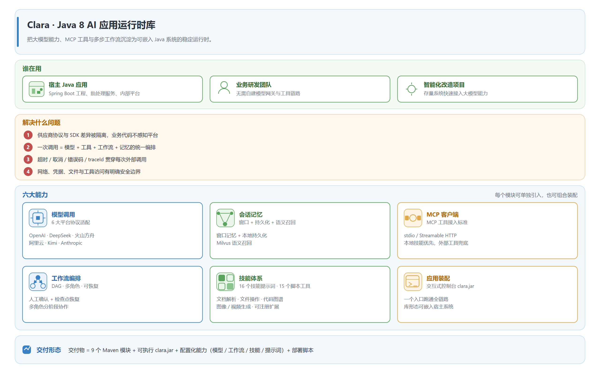
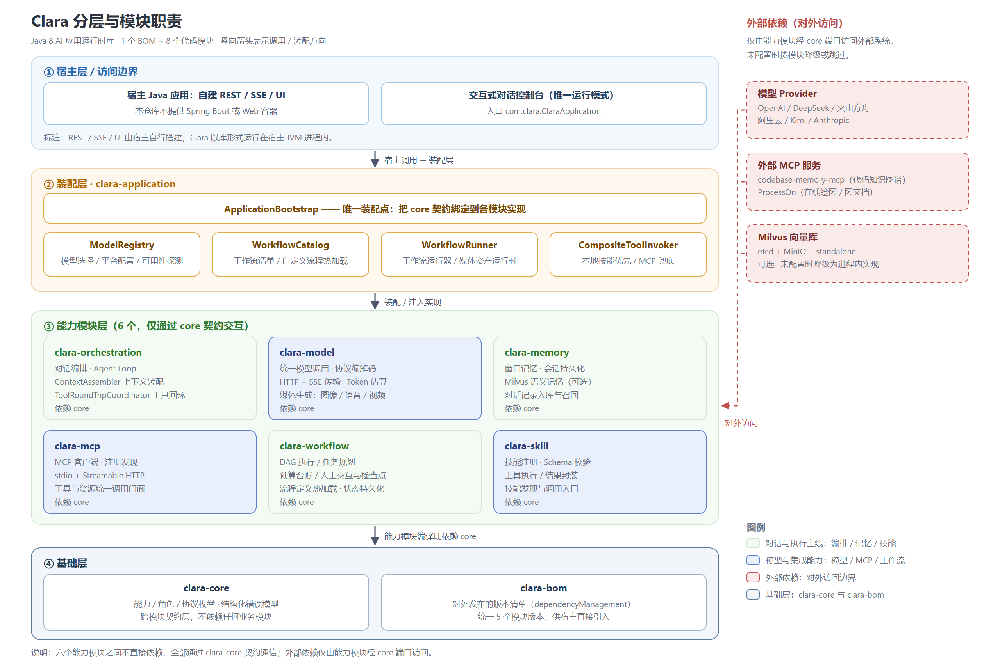
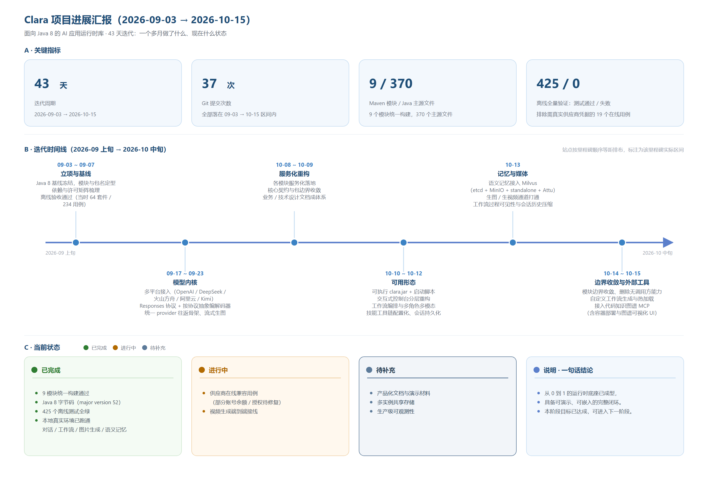
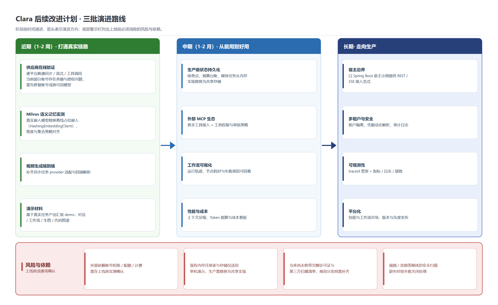

# Clara 项目进展汇报

> 报告周期：2026-09-03 ~ 2026-10-15（43 天）｜ 汇报人：____ ｜ 版本：0.1.0-SNAPSHOT

## 一、一句话介绍

**Clara 是一套面向 Java 8 的 AI 应用运行时库**：把大模型调用、会话记忆、外部 MCP 工具、多步工作流与技能体系沉淀成一层稳定的运行时，让任何 Java 系统都能用统一接口获得智能体能力，而不必关心各家模型的协议差异。

（矢量版：`diagrams/01-overview.svg`）

## 二、为什么做这个项目

| 现状痛点 | Clara 的做法 |
| --- | --- |
| 每个业务系统各自接模型、各自处理超时重试，重复造轮子 | 提供统一的模型调用内核与稳定 API，业务只写业务 |
| 供应商协议、SDK 类型泄漏到业务代码，换模型要改业务 | 协议与 SDK 全部隔离在 clara-model 内，业务代码零感知 |
| 一次请求要串起模型、工具、记忆、多步流程，散落各处 | 以「对话编排（Agent Loop）」为核心链路统一收敛 |
| 出错时只有一句异常，无法定位是哪个环节、哪次调用 | 超时、取消、结构化错误码与 traceId 贯穿每次外部调用 |

## 三、交付物与总体架构

（矢量版：`diagrams/02-architecture.svg`；仓库原始架构总览：`docs/diagrams/architecture.svg`）

**交付物**：9 个 Maven 模块 + 可执行 `clara.jar` + 配置化能力（模型 / 工作流 / 技能 / 提示词）+ 部署脚本。

| 模块 | 职责 |
| --- | --- |
| clara-bom | 对外发布的版本清单（dependencyManagement） |
| clara-core | 能力/角色/协议枚举、结构化错误模型、跨模块契约（不依赖任何业务模块） |
| clara-model | 模型调用内核：协议编解码、HTTP/SSE 传输、Token 估算、媒体生成 |
| clara-memory | 窗口记忆、会话持久化、语义记忆（Milvus） |
| clara-mcp | MCP 客户端：注册发现、能力目录、stdio / Streamable HTTP 传输 |
| clara-workflow | 工作流定义与 DAG 执行、任务规划、预算台账、人工交互与检查点 |
| clara-orchestration | 对话编排、上下文组装、工具往返、技能匹配 |
| clara-skill | 技能注册表、Schema 校验、工具执行 |
| clara-application | 应用装配、交互式控制台入口、文档解析 |

**分层原则**：core 只提供契约；能力模块按需相互依赖；orchestration 只通过接口使用能力，不接触实现；application 是唯一装配点。

## 四、当前进度

（矢量版：`diagrams/03-progress-timeline.svg`）

### 4.1 关键指标（2026-10-15 实测）

| 指标 | 数值 |
| --- | --- |
| 迭代周期 | 43 天（2026-09-03 ~ 2026-10-15） |
| 提交次数 | 37 次 |
| Maven 模块 | 9 个（1 个 BOM + 8 个代码模块） |
| Java 源文件 | 370 个主源文件 + 84 个测试源文件 |
| 测试 | 425 个离线用例全绿（0 失败 / 0 错误 / 0 跳过） |
| 文档 | 24 篇设计文档（架构 / 业务 / 技术 / 迁移），约 8000 行 |
| 可演示能力 | 8 个内置工作流、16 个技能提示词、15 个脚本工具 |

> 注：另有 19 个「供应商在线兼容用例」需要真实账号凭据，当前因部分账号存在余额/授权问题未纳入离线验收。`mvn test` 在无账号凭据时会因这类用例失败，离线验收请排除该套件。

### 4.2 已验证可运行（本地真实环境）

- **多平台模型接入**：OpenAI / DeepSeek / 火山方舟 / 阿里云 / Kimi / Anthropic，覆盖 Completion 与 Responses 两套协议，同步与流式均可用。
- **交互式控制台**：`java -jar clara.jar` 单一入口，支持 `/model` 切模型、执行中 ESC 取消、完整日志落盘、按工作目录续接会话历史。
- **工作流编排**：DAG 执行、条件与循环节点、多角色评审、人工确认挂起与恢复、预算与检查点。
- **技能与工具**：本地技能优先、外部 MCP 工具兜底；文件操作、目录扫描、文档解析、文本检索、代码知识图谱等工具已可调用。
- **记忆**：窗口记忆 + 会话持久化（SQLite 风格本地存储）+ Milvus 语义召回（etcd + MinIO + Milvus standalone + Attu 一套 compose 起）。
- **媒体生成**：文生图、图生图、图片理解已跑通；产物落成受控媒体资产（`.clara/assets`）。
- **外部工具接入**：codebase-memory-mcp 代码知识图谱（容器部署 + 图谱可视化 UI），读代码先查图谱再读文件，显著降低上下文开销。
- **配置化**：模型 Provider、工作流、技能提示词、MCP 服务端全部通过 `config/` 下的 YAML/JSON 声明，支持自定义工作流生成与热加载。

### 4.3 工程质量

- 全模块在单一 Maven reactor 中统一构建，产物为 **Java 8 字节码（major version 52）**，可嵌入存量 Java 8 系统。
- 核心 API 不暴露任何供应商 SDK 类型；模型通过 provider + model 显式选择，不做静默降级。
- 安全边界明确：凭据仅通过 secretRef 引用、外部 HTTP 走 HTTPS + origin 白名单、请求/响应/文件/媒体均有上限、工作区写入路径校验防越界。
- 设计文档与代码同步：架构、业务、技术、迁移四类文档齐备，迁移任务 25 项全部 DONE。

## 五、后续改进计划

（矢量版：`diagrams/04-roadmap.svg`）

### 近期（1-2 周）· 打通真实链路

1. **供应商在线验证**：逐平台跑通同步 / 流式 / 工具调用；先修复账号余额与授权问题（或改用账号内可用模型）。
2. **Milvus 语义记忆实测**：把离线占位嵌入（HashingEmbeddingClient）换成真实嵌入模型，对齐向量维度与集合策略。
3. **视频生成端到端**：补齐异步任务 provider 适配与回调解析实现，让 `video_generation` 工作流真正产出视频。
4. **汇报演示材料**：用真实任务产出 demo（对话 + 工作流 + 生图 + 代码图谱）。

### 中期（1-2 月）· 从「能跑」到「好用」

1. **生产级状态持久化**：检查点、预算台账、媒体任务从内存实现替换为共享存储，支持多实例与重启恢复。
2. **外部 MCP 生态**：接入更多外部工具，并补齐工具权限、审批与审计策略。
3. **工作流可视化**：运行轨迹、节点耗时、失败原因可回看，降低排障成本。
4. **性能与成本**：上下文压缩、Token 预算与成本看板。

### 长期 · 走向生产平台

1. **宿主接入范式**：提供 Spring Boot 宿主示例，示范 REST / SSE 边界接入。
2. **多租户与安全**：租户隔离、凭据动态解析、审计日志。
3. **可观测性**：traceId 贯穿调用链，补指标 / 日志 / 链路三件套。
4. **平台化**：技能与工作流市场、版本与灰度发布。

## 六、风险与依赖

| 风险 | 影响 | 应对 |
| --- | --- | --- |
| 外部供应商账号权限 / 配额 / 计费未实测 | 上线后可能批量失败 | 上线前逐平台实测；把账号可用性做成启动自检 |
| 内存注册表与存储仅适用单机 | 多实例部署会丢状态 | 中期替换为共享实现（Redis / DB / 对象存储） |
| 仓库未附完整许可证与第三方归属清单 | 商用分发有合规风险 | 分发前补齐 LICENSE / NOTICE / 依赖清单 |
| 媒体安全扫描缺失 | 图片 / 视频内容不受控 | 未配置扫描器时按失败关闭处理，不落库 |

## 七、小结

一个月内，Clara 从零完成了「Java 8 AI 运行时底座」的建设：9 个模块、370 个主源文件、425 个离线用例全绿，模型调用、记忆、MCP、工作流、技能、编排六条能力线全部打通，并已在本地真实环境跑通对话、工作流、生图与语义记忆。

下一步的重点是**从「功能打通」走向「真实链路与生产可用」**：先把供应商在线验证与视频链路补齐，再把状态存储、可观测性与安全合规补上。
