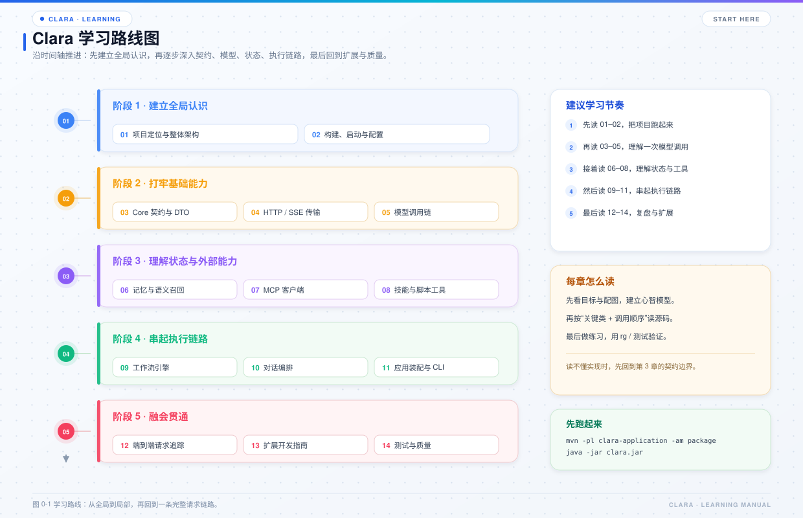
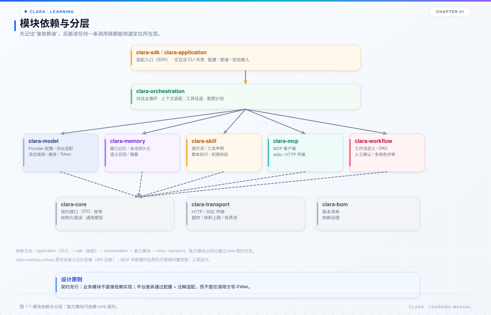

# 第 1 章 项目定位与整体架构

## 本章目标

- 说清 Clara 是什么、不是什么，避免把它当成开箱即用的 Web 服务。
- 记住各 Maven 模块的职责和依赖方向。
- 建立三条阅读主线：启动线、请求线、扩展线。



*图 1-1 全书学习路线。*

## 1.1 Clara 是什么

Clara 是一套面向 Java 8 的本地 AI 智能体运行时与控制台。它把下面这些能力拆成独立模块：

- 模型调用：多平台、多协议、流式输出、故障切换。
- 上下文管理：窗口裁剪、历史压缩、语义召回、提示词匹配。
- 工具调用：本地脚本、内置工具、MCP 外部工具。
- 工作流：YAML 定义、节点执行、暂停恢复、人工确认。
- 技能：提示词、工具声明、Schema 校验、权限控制。
- 代码知识图谱：优先查图谱、未覆盖时回退本地文件。
- 可观测：Span、JSONL、`/trace`、Prometheus、OTLP。

它既可以整套运行，也可以把某个模块作为 Maven 依赖嵌入 Java 系统。

## 1.2 Clara 不是什么

这一点必须尽早建立：

- **不是 Spring Boot 应用**：仓库没有 Web 容器、没有内置 REST Controller。
- **不是开箱即用的 SaaS**：没有登录、租户、计费、前端页面。
- **不是“所有能力强制开启”**：MCP、Milvus、代码图谱、OTLP 都可以关闭。
- **不是“模型调用即全部”**：真正的价值在上下文装配、工具往返、工作流和故障恢复。

当前最小可运行入口是 `com.clara.ClaraApplication`，它提供交互式 CLI。REST / SSE 接入应由宿主应用基于 `ApplicationBootstrap` 和 `ConversationRequest` 自行实现。



*图 1-2 模块依赖与分层。*

## 1.3 模块职责

| 模块 | 职责 | 关键入口 |
| --- | --- | --- |
| `clara-bom` | 对外发布的版本清单 | `clara-bom/pom.xml` |
| `clara-core` | 跨模块契约、DTO、枚举、错误模型、通用工具 | `com.clara.core.*`、`com.clara.dto.*` |
| `clara-transport` | 通用 HTTP / SSE、超时、体积上限、有界流 | `JdkHttpTransport`、`HttpCall`、`DefaultSseEventParser` |
| `clara-model` | Provider 配置、请求编码、响应解码、流式模型、探活、媒体模型 | `CompatibleStream`、`ProviderRequestEncoder`、`ProviderResponseDecoder` |
| `clara-memory` | 窗口记忆、会话持久化、摘要压缩、语义记忆、Milvus | `DefaultWindowMemory`、`ConversationStore`、`MilvusSemanticMemoryStore` |
| `clara-mcp` | MCP 注册、发现、能力快照、网关、stdio / Streamable HTTP | `DefaultMcpDiscoveryService`、`DefaultMcpGateway` |
| `clara-workflow` | YAML 定义、节点引擎、检查点、人工交互、动态计划 | `WorkflowDefinitionLoader`、`DefaultWorkflowEngine`、`WorkflowRunner` |
| `clara-skill` | 技能注册、Schema 校验、权限、脚本执行 | `SkillRegistry`、`DefaultToolExecutor` |
| `clara-orchestration` | 对话主循环、上下文装配、工具往返、意图计划 | `DefaultConversationOrchestrator`、`ContextAssembler` |
| `clara-application` | 总装配、配置、控制台、图谱 / 观测接入、媒体落盘 | `ApplicationBootstrap`、`ClaraApplication` |

## 1.4 依赖方向

最重要的约束只有一句：**依赖只能向下，装配只能发生在 application。**

```text
clara-application
    ├── clara-orchestration
    ├── clara-model
    ├── clara-memory
    ├── clara-skill
    ├── clara-mcp
    ├── clara-workflow
    ├── clara-transport
    └── clara-core
```

更准确地说：

- `clara-core` 不依赖任何业务模块。
- `clara-transport` 只依赖 `clara-core`。
- 能力模块按需依赖 `clara-core` / `clara-transport`。
- `clara-orchestration` 只通过接口使用能力模块。
- `clara-application` 是唯一知道“用哪个实现”的地方。

这套结构带来的直接好处：替换模型协议、向量库、工具执行器时，通常只改装配点和对应模块，不需要动 Agent Loop。

## 1.5 包名阅读提示

| 包 | 含义 |
| --- | --- |
| `com.clara.core.*` | 跨模块契约，先看接口签名就能知道能力边界 |
| `com.clara.dto.*` | 跨模块数据对象 |
| `com.clara.enums.*` | 跨模块枚举 |
| `com.clara.exception.*` | 结构化错误与错误码 |
| `com.clara.kernel.*` | 模型内核与协议实现，不是“业务内核” |
| `com.clara.model.*` | 模型能力实现：配置、探活、嵌入、视频 |
| `com.clara.orchestration.*` | 编排协作者，按 `context / tool / capability / intent / record` 分包 |
| `com.clara.mcp.api.*` | MCP 对外接口，统一 `I` 前缀 |
| `com.clara.adapter.console.*` | 终端适配层，只负责输入、颜色、日志、命令分发 |

一个常见误解是把 `com.clara.kernel` 当成“业务核心”。它不是：它属于 `clara-model`，负责模型协议编解码和底层调用适配；真正的跨模块契约在 `clara-core`。

## 1.6 三条阅读主线

### 启动线

```text
ClaraApplication.main
  → ConfigLocator
  → ModelAvailabilityManager
  → ModelRegistry.select
  → ApplicationBootstrap
  → loadMcpServers
  → 会话循环
```

### 请求线

```text
ConsoleInput
  → ClaraApplication
  → DefaultConversationOrchestrator.converse
  → ContextAssembler.assemble
  → CapabilityDispatcher.invoke
  → ToolRoundTripCoordinator.perform（可选）
  → ConversationResult
  → ConsoleView
```

### 扩展线

```text
新增模型平台  → config/model-providers + 注解规则
新增脚本工具  → config/skill/scripts + --describe
新增 MCP 服务 → config/mcp/*.json
新增工作流    → config/workflow/*.yml
新增记忆后端  → 实现 core / memory 接口 + application 装配
新增宿主入口  → 使用 ApplicationBootstrap，不要复制 Agent Loop
```

## 1.7 源码阅读路线

建议按下面的顺序打开文件，而不是从目录树平铺开始：

1. `clara-application/src/main/java/com/clara/ClaraApplication.java`：看主流程和启动顺序。
2. `clara-application/src/main/java/com/clara/ApplicationBootstrap.java`：看谁 new 了谁。
3. `clara-orchestration/src/main/java/com/clara/orchestration/DefaultConversationOrchestrator.java`：看 Agent Loop。
4. `clara-core/src/main/java/com/clara/core`：回到契约，确认边界。
5. 再按兴趣进入 model / memory / mcp / skill / workflow。

## 1.8 常见误区

- **误区：所有模块都依赖 application。** 事实相反，能力模块不知道 application 的存在。
- **误区：接口一定有很多实现。** 很多接口当前只有一个默认实现；接口的价值是钉死依赖方向和留出替换点。
- **误区：CLI 就是框架本身。** CLI 只是 `clara-application` 提供的一个宿主适配层。
- **误区：配置改完一定立即生效。** 模型、MCP、内置工作流通常需要重启或 `/init`；prompt、scripts、custom workflow 才热加载。

## 1.9 练习

1. 画出 `clara-core`、`clara-orchestration`、`clara-application` 三者的依赖箭头，并标注“谁 new 谁”。
2. 用 IDE 搜索 `new ApplicationBootstrap`，确认生产代码和测试分别在哪里创建它。
3. 找出 `clara-orchestration` 中所有 `import com.clara.` 的语句，判断它是否直接依赖了某个实现模块。
4. 用一句话解释：为什么“新增一个模型平台”通常不需要改 `DefaultConversationOrchestrator`？

## 1.10 自检题

- Clara 当前的运行形态是什么？如果要提供 REST 接口，应该从哪里接？
- `clara-bom` 有业务代码吗？它的作用是什么？
- 为什么 `clara-core` 不能依赖 `clara-model`？
- `com.clara.kernel` 在哪个模块？它和 `clara-core` 的区别是什么？