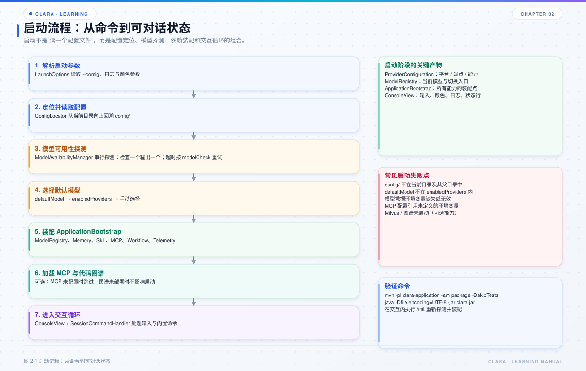
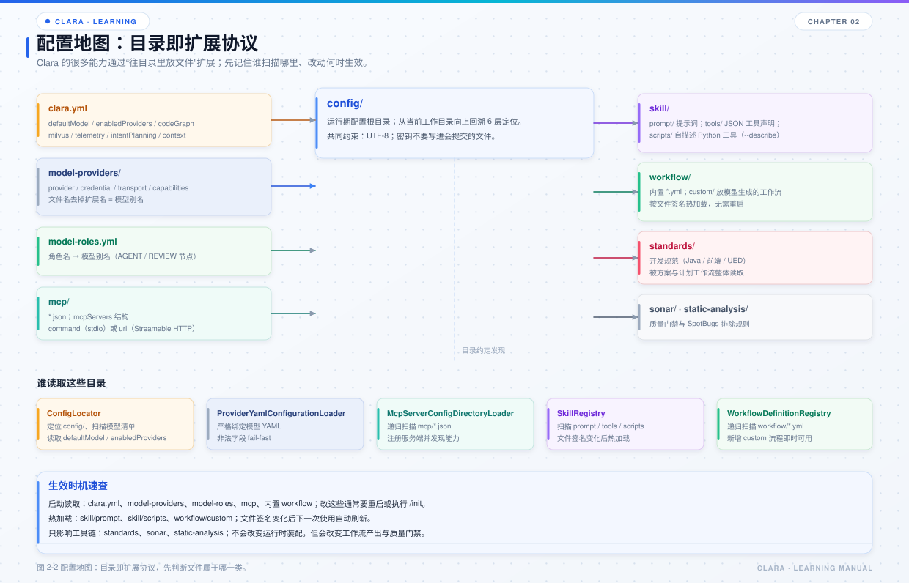

# 第 2 章 构建、启动与配置

## 本章目标

- 能把项目构建成可执行 `clara.jar` 并启动。
- 理解启动时的真实顺序：配置定位、模型探活、装配、会话循环。
- 记住 `config/` 各目录由谁读取、改动何时生效。



*图 2-1 启动流程：从命令到可对话状态。*



*图 2-2 配置目录与加载者。*

## 2.1 环境要求

- JDK 8 或更高版本，编译目标是 Java 8 字节码。
- Maven 3.3.9 或更高版本。
- Python 3：文件处理、搜索、浏览器自动化等脚本工具需要。
- Docker（可选）：Milvus、代码知识图谱、Prometheus / Tempo / Grafana。
- 使用远程模型、远程 MCP 或 Milvus 时需要网络、账号与凭据。

## 2.2 构建

完整构建：

```powershell
mvn clean package -DskipTests
```

只构建可执行 jar：

```powershell
mvn -q -pl clara-application -am package -DskipTests
```

产物在仓库根目录的 `clara.jar`，入口为 `com.clara.ClaraApplication`。

只编译不打包：

```powershell
mvn -q -DskipTests compile
```

运行测试并生成 JaCoCo 报告：

```powershell
mvn test
```

## 2.3 启动

Windows：

```powershell
clara.bat
```

Linux / macOS：

```bash
./clara.sh
```

直接运行 jar：

```powershell
java -Dfile.encoding=UTF-8 -jar clara.jar
```

`-Dfile.encoding=UTF-8` 不要省略。Milvus Java SDK 在 BM25 检索中使用平台默认字符集编码文本；中文 Windows 默认 GBK 时可能导致 Milvus 分词失败，甚至让服务端 abort。

## 2.4 启动顺序

`ClaraApplication.main` 的顺序可以概括为：

```text
1. 由工作目录推导 conversationId
2. 解析启动参数 LaunchOptions
3. 打开终端、ConsoleView、ConsoleInput、ESC 监听
4. ModelAvailabilityManager 按 modelCheck 策略检查全部模型配置，并把结果写回 clara.yml
5. 选择本次启动使用的模型
6. 启动 TelemetryRuntime
7. 创建 ApplicationBootstrap（装配各模块）
8. ModelRegistry.select 选中模型
9. 创建 SessionCommandHandler
10. 打印横幅、MCP 状态、代码图谱状态、sessionId、最近历史、命令提示
11. 进入 loop，逐行处理输入
12. 退出或 /init 时关闭 bootstrap 与 telemetry
```

几个容易忽略的点：

- **构造 `ApplicationBootstrap` 不访问网络**：MCP 连接推迟到 `loadMcpServers`，历史目录和锁也推迟到首次真正读写。
- **启动探活会写回 `clara.yml`**：可用模型按首字符响应时间排序；当前 `defaultModel` 仍可用时保持不变，不可用才切到最快模型。
- **`sessionId` 由工作目录生成**：同一目录再次进入会续接同一份历史。
- **`/init` 会重建模型、技能、MCP 连接**：但保留当前会话。

## 2.5 模型可用性检查

`ModelAvailabilityManager.checkAndPersist` 做五件事：

1. 先本地预扫描配置，读取 `credential.environmentVariable`，确定列宽。
2. 对每个模型：环境变量缺失则直接“跳过”，不发请求。
3. 环境变量存在则用 `StreamingModelProbe` 发一个最小流式请求，等待首个正文或思维链字符；等待上限取 `modelCheck.timeoutMillis`（默认 60000ms）。
4. 只有“等待首个响应超时”会按 `modelCheck.retries`（默认 1）重试；凭据错误、4xx、余额不足等不重试，避免无意义地拖长启动。
5. 每条结论在检查结束后立即输出，不攒到最后；最后按首字符响应时间排序并写回 `defaultModel`。

同平台去重：一个 provider 配了多条时只探测一个代表——优先 `RESPONSE` 协议，没有时取第一条；其余同平台配置复用代表结果（不单独发请求），并继续保留在 `enabledProviders` 中。代表不可用时，同平台其余配置也不会被写入启用列表。

判定口径：

- 收到首个非空 `TEXT_DELTA`：可用。
- 只收到 `REASONING_DELTA`：也视为可用，因为平台、凭据、模型已经确认可用。
- 错误、超时、正常结束但无任何输出：不可用。
- 环境变量缺失：跳过，不发起请求。

超时与重试配置：

```yaml
modelCheck:
  timeoutMillis: 60000
  retries: 1
```

为什么默认不是 30 秒：直连官方接口通常 1~3 秒，但经中转站、代理或平台排队时首字可能到几十秒。30 秒硬超时会把可用模型误判为不可用；遇到「等待首个响应超时」，先调大 `timeoutMillis`，而不是改代码。

这解释了一个常见现象：某个模型在网页上能用，但 Clara 显示不可用。先看启动横幅里的原因，通常是环境变量没进当前进程、余额不足、模型 ID 变更或网络不可达。

## 2.6 配置目录

`config/` 是运行期配置根目录。`ConfigLocator` 会从当前工作目录向上回溯最多 6 层定位 `config/`，所以从模块子目录启动也能找到。

```text
config/
├── clara.yml
├── clara.yml.bak                 # 探活写回时可能产生的备份
├── model-providers/
│   └── *.yml
├── model-roles.yml
├── mcp/
│   └── *.json
├── skill/
│   ├── prompt/*.json
│   ├── tools/**/*.json
│   └── scripts/**/*.py
├── workflow/
│   ├── *.yml
│   └── custom/*.yml
└── standards/
```

### `clara.yml`

主配置入口，常用节点：

| 节点 | 作用 |
| --- | --- |
| `defaultModel` | 默认模型别名，必须在 `enabledProviders` 中 |
| `enabledProviders` | 哪些模型会被加载、`/model` 会列出哪些、启动脚本检查哪些凭据 |
| `codeGraph` | 代码图谱总开关、每轮补充、自动挂载、自动导入 |
| `context.alwaysPrompts` | 每轮固定注入的提示词，不参与相似度检索 |
| `intentPlanning` | 复杂任务识别、计划步数、修正次数 |
| `milvus` | 语义记忆开关、BM25 / vector 模式、集合与分词器 |
| `telemetry` | Span、JSONL、采样、OTLP、Prometheus |
| `modelCheck` | 启动检查的等待超时与超时重试次数 |

`enabledProviders` 同时决定三件事：加载哪些配置、列出哪些模型、检查哪些凭据。未启用的配置不会被加载。

### `model-providers/*.yml`

一个文件对应一个模型别名，别名是去掉扩展名的文件名。关键结构：

```yaml
provider: DEEPSEEK
credential:
  secretRef: deepseek
  environmentVariable: CLARA_DEEPSEEK_API_KEY
transport:
  allowedOrigins: [https://api.deepseek.com]
  connectTimeoutMillis: 10000
  readTimeoutMillis: 600000
  maxRequestBytes: 8388608
  maxResponseBytes: 33554432
  allowHttp: false
capabilities:
  CHAT:
    endpoint: https://api.deepseek.com/responses
    modelId: deepseek-v4-pro
    apiProfile: RESPONSE
    parameters:
      maxTokens: 393216
```

关键字段：

| 字段 | 说明 |
| --- | --- |
| `provider` | `OPENAI`、`DEEPSEEK`、`VOLCENGINE`、`KIMI`、`ANTHROPIC`、`ALIBABA` |
| `credential.secretRef` | 凭据引用名，用于日志与解析，不直接保存明文 |
| `credential.environmentVariable` | 推荐方式：从环境变量读取 Key |
| `transport.allowedOrigins` | 端点白名单，防止把密钥发到意外地址 |
| `transport.allowHttp` | 是否允许明文 HTTP；生产保持 `false` |
| `transport.maxResponseBytes` | 响应体上限，影响单次输出预算 |
| `capabilities` | 能力表：`CHAT`、`IMAGE`、`VIDEO`、`AUDIO_TRANSCRIPTION`、`SPEECH` |

### `model-roles.yml`

把工作流中的角色名映射到模型别名：

```yaml
architect: deepseek-response
reviewer: volcengine-response
tester: deepseek-completion
```

未声明的角色会直接当作模型别名解析；仍解析不到时 fail-fast，不静默降级。

### `mcp/*.json`

协议兼容 Claude Desktop / VS Code 的 `mcpServers` 结构：

```json
{
  "mcpServers": {
    "local-tool": {
      "command": "python",
      "args": ["server.py"]
    },
    "remote-tool": {
      "url": "https://example.com/mcp",
      "headers": {"Authorization": "Bearer ${MCP_TOKEN}"}
    }
  }
}
```

`command` 用于 stdio 子进程，`url` 用于 Streamable HTTP。未配置任何服务端时，Clara 只使用内置工具和技能。

### `skill/`

- `prompt/`：提示词 JSON，含 `id`、`description`、`segments`。
- `tools/`：JSON 工具声明，适合内置工具或简单声明式工具。
- `scripts/`：Python 脚本，通过 `--describe` 自描述工具元数据。

运行期目录覆盖内置目录的同名项；修改 prompt 或脚本后，下一次使用会自动重载。

### `workflow/`

- `*.yml`：随应用发布的流程。
- `custom/*.yml`：用户或模型生成的流程，按文件签名热加载。

### `standards/` 与 `deploy/` 下的质量配置

- `standards/`：开发规范，被方案与计划工作流读取。
- `deploy/sonar/quality-profile-java.xml`：SonarQube 质量配置，由 `deploy/sonar` 下的脚本导入。
- `deploy/static-analysis/spotbugs-exclude.xml`：SpotBugs 排除规则，由 Maven / SpotBugs 读取。

## 2.7 什么时候生效

| 配置 | 生效时机 |
| --- | --- |
| `clara.yml` | 启动读取；`/init` 重新加载 |
| `model-providers/` | 启动扫描；`/model` 切换时按需加载 |
| `model-roles.yml` | 启动加载 |
| `mcp/*.json` | 启动时 `loadMcpServers`；`/init` 重连 |
| `skill/prompt/` | 下一次取值时按签名热加载 |
| `skill/scripts/` | 下一次查找工具时按签名热加载 |
| `workflow/*.yml` | 启动加载；注册表刷新时重扫 |
| `workflow/custom/*.yml` | 运行期发布后即时可见 |
| `standards/` | 工作流运行时读取 |
| `deploy/sonar/`、`deploy/static-analysis/` | 执行扫描时读取（不属于运行期配置） |

## 2.8 常见启动问题

| 现象 | 优先检查 |
| --- | --- |
| 提示找不到 `config/` | 当前工作目录是否在仓库内；`ConfigLocator` 最多向上找 6 层 |
| 某个模型显示“跳过” | 对应环境变量是否在当前进程可见；设置后要重启 IDE / 终端 |
| 某个模型显示“不可用” | 启动横幅里的平台错误、HTTP 状态码、余额、模型 ID、网络 |
| 模型列表为空 | `enabledProviders` 是否写错；别名是否与文件名一致 |
| `/model` 看不到某配置 | 该别名未加入 `enabledProviders` |
| 启动后历史不续接 | 是否在同一工作目录启动；`sessionId` 由目录推导 |
| Milvus 报编码错误 | 是否加了 `-Dfile.encoding=UTF-8` |

## 2.9 练习

1. 只构建 `clara-application`，确认根目录生成 `clara.jar`。
2. 把 `enabledProviders` 改成只保留一个模型，观察启动检查列表和 `/model` 的变化。
3. 临时改一个 prompt 文件，在对话中触发对应技能，确认无需重启即可生效。
4. 在 `config/workflow/custom/` 放一个最小 YAML，确认 `run_workflow` 的工具描述里出现新流程。

## 2.10 自检题

- `enabledProviders` 影响哪三件事？
- 为什么模型探活要“检查一个输出一个”，而不是全部检查完再输出？
- `defaultModel` 在什么情况下会被自动改写？
- 哪些配置是热加载的？哪些必须重启或 `/init`？