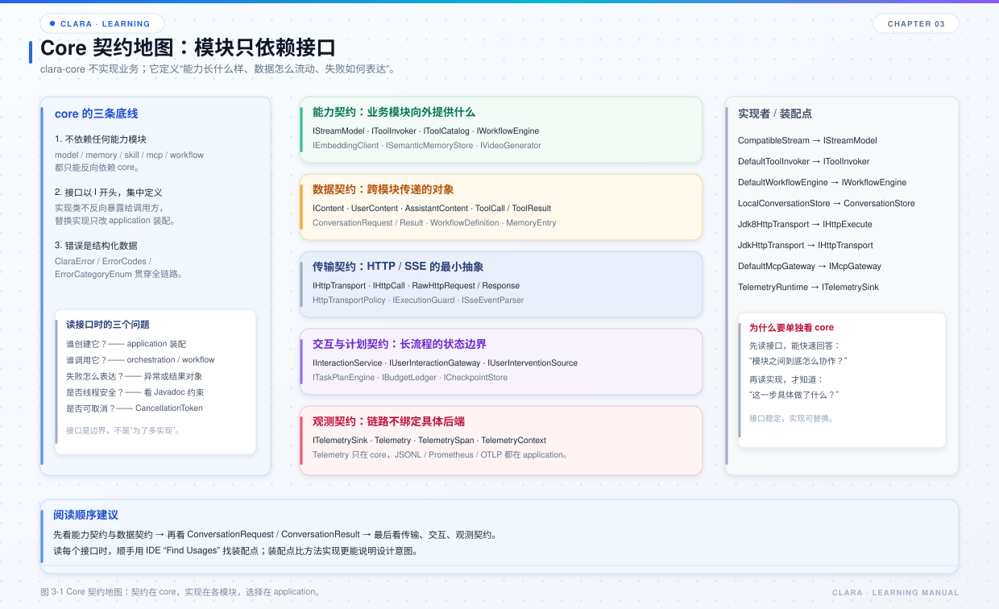

# 第 3 章 Core 契约与 DTO

## 本章目标

- 理解 `clara-core` 为什么是“契约层”，而不是“工具类集合”。
- 掌握能力契约、数据契约、传输契约、交互契约、观测契约的分组。
- 能通过接口和 DTO 判断一次跨模块调用由谁发起、谁实现、失败如何表达。

*图 3-1 Core 契约地图：契约在 core，实现在各模块，选择在 application。*

## 3.1 先给结论

`clara-core` 解决三件事：

1. **定义能力边界**：一个模块向外提供什么，用接口表达。
2. **定义数据形状**：跨模块传递的消息、请求、结果、错误，用 DTO / 枚举表达。
3. **定义失败语义**：错误码、分类、可重试性、安全文案，用 `ClaraError` / `ClaraException` 表达。

它不负责：

- 发起 HTTP 请求；
- 读写文件或数据库；
- 调用模型；
- 装配具体实现。

这些都在能力模块中实现、由 `clara-sdk` 完成装配；`clara-application` 只负责交互展示。

## 3.2 五组契约

### 能力契约

| 接口 | 实现位置 | 作用 |
| --- | --- | --- |
| `IStreamModel` | `clara-model` / `CompatibleStream` | 同步 / 流式模型调用 |
| `IToolInvoker` | `clara-skill` / `DefaultToolInvoker` | 统一工具调用入口 |
| `IToolCatalog` | `clara-skill` / `RegistryToolCatalog` | 向模型暴露工具声明 |
| `IWorkflowEngine` | `clara-workflow` / `DefaultWorkflowEngine` | 工作流执行 |
| `IEmbeddingClient` | `clara-model` | 文本向量化 |
| `ISemanticMemoryStore` | `clara-memory` | 语义记忆读写 |
| `IVideoGenerator` | `clara-model` | 视频生成 |

阅读这些接口时先问三个问题：

- 谁创建它？——通常是 `ApplicationBootstrap`。
- 谁调用它？——编排、工作流或另一个能力模块。
- 失败如何表达？——抛 `ClaraException`，还是返回结果对象。

### 数据契约

消息内容由 `IContent` 表达，具体实现包括：

- `SystemContent`
- `UserContent`
- `UserVisionContent`
- `AssistantContent`
- `ToolContent`
- `ToolCallContent`

`IContent` 的一个重要设计是“协议自渲染”：每种内容自己知道在 Chat Completions 和 Responses 两种协议下长什么样，编码器不需要写 `instanceof` 分支。

跨模块 DTO 还包括：

- `ConversationRequest` / `ConversationResult`：编排入口的入参和出参。
- `ToolCall` / `ToolResult` / `ResponsesToolCall`：工具调用与结果。
- `MemoryEntry` / `MemoryMatch` / `SemanticMemoryQuery`：记忆读写。
- `WorkflowDefinition` / `WorkflowResult` / `ExecutionScope`：工作流定义与执行状态。
- `InteractionRequest` / `InteractionResponse`：人工交互。

### 传输契约

| 接口 / 类型 | 作用 |
| --- | --- |
| `IHttpTransport` | 创建一次 HTTP 调用 |
| `IHttpCall` | 执行、取消、读取响应 |
| `RawHttpRequest` / `RawHttpResponse` | 与协议无关的原始请求 / 响应 |
| `HttpTransportPolicy` | 超时、体积、origin 白名单、SSE 配置 |
| `IExecutionGuard` | 取消、截止时间检查 |
| `ISseEventParser` | SSE 事件解析 |

这些契约让 `clara-transport` 可以被模型和 MCP 同时复用。

### 交互与计划契约

- `IInteractionService`：人工交互的注册、等待、恢复。
- `IUserInteractionGateway`：宿主把用户答案送回来。
- `IUserInterventionSource`：模型思考 / 工具执行期间追加输入。
- `ITaskPlanEngine`：动态执行计划。
- `IBudgetLedger` / `IExecutionLedger`：预算与执行记录。
- `ICheckpointStore`：工作流检查点。

### 观测契约

- `ITelemetrySink`：Span 事件的接收端。
- `Telemetry`：创建 Span、维护线程内父子关系。
- `TelemetrySpan`：一个进行中的阶段。
- `TelemetryContext`：跨线程传递 traceId / spanId。

`core` 只定义“怎么记”，不定义“记到哪里”。JSONL、Prometheus、OTLP 的实现与装配都在 `clara-sdk`。

## 3.3 错误模型

`ClaraError` 的字段值得记住：

| 字段 | 用途 |
| --- | --- |
| `code` | 稳定错误码，用于分支判断 |
| `category` | 错误分类，用于决定是否切换模型、是否重试 |
| `safeMessage` | 可安全展示给用户的文案 |
| `retryable` | 是否可重试 |
| `traceId` | 链路标识 |
| `provider` / `providerCode` | 平台与平台错误码 |
| `retryAfterMillis` | 建议等待时间 |
| `safeDetails` | 可安全外发的细节 |

两个约定：

- **不要用异常文本做业务判断**：用 `code` 和 `category`。
- **不要把密钥、完整请求体写进 `safeMessage`**：它是给用户看的。

`ClaraException` 是携带 `ClaraError` 的运行时异常。业务模块通过错误工厂构造它，编排层再根据错误分类决定重试、切换模型或直接失败。

## 3.4 注解驱动的协议适配

Clara 没有在编码器里写大量 `if (provider == OPENAI)`。平台差异通过字段注解表达：

- `@ProviderAdapter`：字段在哪个平台、哪种能力下是否支持、默认值、取值范围。
- `@ProtocolField`：同一字段在不同协议（Completion / Response）下的线格式名。
- `@ResponseAdapter` / `@ProtocolResponse`：响应侧的字段映射。

编码器读取注解后完成三件事：

1. 决定字段是否下发；
2. 应用默认值；
3. 做 `allowed / min / max` 校验。

这样新增平台通常只需要加配置和少量字段规则，不需要复制整套请求编码逻辑。

## 3.5 `ConversationRequest` 与 `ConversationResult`

`ConversationRequest` 是编排入口的入参载体，关键字段：

| 字段 | 说明 |
| --- | --- |
| `conversationId` | 会话标识，不能为空 |
| `provider` / `model` | 决定窗口记忆归属 |
| `capabilityKind` | 本次调用能力：CHAT / IMAGE / VIDEO 等 |
| `userInput` | 本轮用户输入 |
| `attachments` | 图片 URL 或 data URI |
| `providerConfiguration` | 绑定平台配置 |
| `control` | 窗口、压缩、召回设置 |
| `stream` / `observer` | 是否流式、流式事件接收方 |
| `planningEnabled` | 是否启用意图计划 |
| `maxToolRoundTrips` | 最大工具往返次数 |
| `runtimeHint` | 只作用于本轮的临时系统提示 |
| `cancellationToken` | 外部取消令牌 |
| `userIntervention` | 执行期用户补充来源 |

`ConversationResult` 是返回载体，关键字段：

- `content`：最终正文或能力产出；
- `reasoning`：思维链累积文本；
- `status`：`COMPLETED` / `FAILED` / `CANCELLED`；
- `toolRoundTrips`：工具往返次数；
- `usage`：最后一次模型调用的 token 用量；
- `error`：结构化错误；
- `pausedForUserInput`：是否因等待人工输入而提前结束。

宿主接入时，最稳妥的方式是只依赖这两个对象，不要直接操作内部状态。

## 3.6 契约设计的四条经验

- **接口放在使用方需要的地方**：`core` 只放跨模块契约，不把实现细节泄漏出去。
- **DTO 不可变优先**：消息内容、错误、结果尽量不可变，减少跨线程污染。
- **失败语义前置**：接口 Javadoc 明确写“抛出什么、何时返回 null、是否线程安全”。
- **不要为了多实现而造接口**：有些接口只有一个默认实现，但它是依赖方向的锚点，仍然有价值。

## 3.7 源码阅读路线

1. `clara-core/src/main/java/com/clara/core`：按子包看接口。
2. `clara-core/src/main/java/com/clara/dto`：看请求、结果、消息、工作流 DTO。
3. `clara-core/src/main/java/com/clara/exception`：看 `ClaraError`、`ClaraException`、`ErrorCodes`。
4. `clara-core/src/main/java/com/clara/core/annotation`：看 `@ProviderAdapter`、`@ProtocolField`。
5. 回到 `clara-sdk/src/main/java/com/clara/ApplicationBootstrap.java`，用 IDE “Find Usages” 找每个接口的装配点。

## 3.8 练习

1. 找出 `IContent` 的所有实现类，说明每个类对应哪种消息。
2. 找出 `ConversationRequest` 的所有字段，判断哪些由 CLI 填充、哪些由宿主填充。
3. 选一个错误码，追踪它从产生到展示给用户的完整路径。
4. 解释 `@ProviderAdapter` 与 `@ProtocolField` 的区别；如果新增一个平台，通常需要改哪一个？

## 3.9 自检题

- 为什么 `core` 不能依赖 `model`？
- `ClaraError.category` 在故障切换中起什么作用？
- `IContent` 为什么要自己负责协议渲染？
- `ConversationRequest.runtimeHint` 与普通 system prompt 有什么区别？