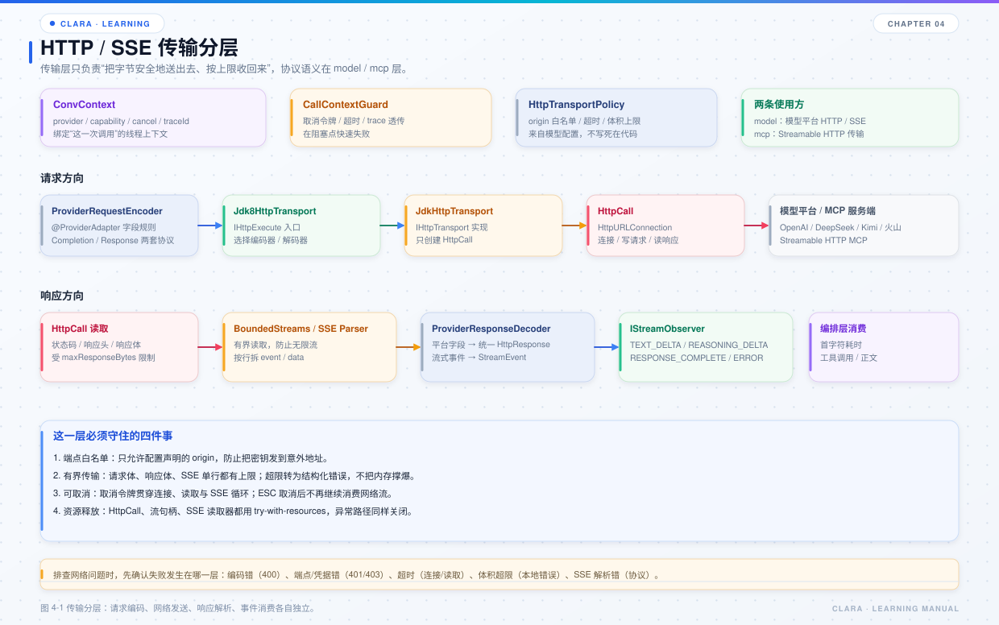

# 第 4 章 HTTP / SSE 传输

## 本章目标

- 分清“模型侧传输适配器”和“通用 HTTP 传输实现”。
- 理解一次请求从编码、发送、读取到 SSE 解析的完整路径。
- 知道超时、体积上限、取消、端点白名单分别在哪一层处理。



*图 4-1 传输分层：请求编码、网络发送、响应解析、事件消费各自独立。*

## 4.1 两个容易混淆的类

Clara 里有两个名字很像的传输类：

| 类 | 模块 | 角色 |
| --- | --- | --- |
| `com.clara.kernel.http.execute.Jdk8HttpTransport` | `clara-model` | 模型侧适配器：从 `ConvContext` 取配置，编码请求、解码响应、桥接流式事件 |
| `com.clara.transport.http.JdkHttpTransport` | `clara-transport` | 通用 HTTP 实现：只创建一次性的 `HttpCall` |

关系是：

```text
CompatibleStream
  → kernel.Jdk8HttpTransport（模型适配）
      → transport.JdkHttpTransport（通用传输）
          → HttpCall（一次调用）
              → HttpURLConnection
```

`clara-mcp` 的 Streamable HTTP 也直接复用 `clara-transport` 的通用实现。这样模型和 MCP 不需要各自维护一套连接、超时和体积控制。

## 4.2 请求方向

一次模型请求的主要步骤：

1. `HttpRequest` 等请求对象通过注解描述字段规则。
2. `ProviderRequestEncoder` 根据当前平台、能力和协议，把请求编码为 JSON。
3. `kernel.Jdk8HttpTransport` 从 `ConvContext` 取出 provider 配置和传输策略。
4. 创建 `CallContextGuard`，把取消令牌、截止时间和 trace 信息接入通用传输。
5. `transport.JdkHttpTransport` 创建 `HttpCall`。
6. `HttpCall` 校验端点、设置超时、写入请求体、读取响应。

关键点：

- 平台差异在编码器之前就被注解消化，`CompatibleStream` 不含任何平台分支。
- 请求体大小在发送前检查，超过 `maxRequestBytes` 直接失败。
- 端点必须命中 `allowedOrigins`；`allowHttp=false` 时禁止明文 HTTP。

## 4.3 响应方向

同步响应：

```text
HttpCall 读取字节
  → BoundedStreams 检查体积
  → RawHttpResponse
  → ProviderResponseDecoder
  → HttpResponse
```

流式响应：

```text
HttpCall 读取 SSE 字节
  → DefaultSseEventParser 按行拆 event / data
  → ISseEventListener 回调
  → StreamAssembler 组装增量
  → StreamEvent（TEXT_DELTA / REASONING_DELTA / RESPONSE_COMPLETE / ERROR）
  → IStreamObserver
```

`IStreamObserver` 的回调运行在读取线程上。不要在里面执行耗时操作，否则会阻塞整个流。

## 4.4 传输策略

`HttpTransportPolicy` 是一次传输的不可变策略，包含：

| 字段 | 作用 |
| --- | --- |
| `endpointPolicy` | 允许访问的主机与协议 |
| `connectTimeoutMillis` | 连接超时 |
| `readTimeoutMillis` | 读取超时 |
| `maxRequestBytes` | 请求体上限 |
| `maxResponseBytes` | 响应体上限 |
| `defaultHeaders` | 默认请求头 |
| `sseParserConfig` | SSE 单行、单事件、总字节、事件数上限 |

`SseParserConfig` 的默认值：

- 单行 64 KB；
- 单事件 1 MB；
- 最多 200,000 个事件；
- 总字节 32 MB；
- 默认不派发没有空行收尾的 EOF 残事件。

这些上限不是“保险丝”摆设。一次异常的平台响应可能返回几十 MB 的 SSE 外壳，如果不限制，会直接把内存和后续模型请求撑爆。

## 4.5 取消与超时

取消链路：

```text
用户按 ESC
  → CancellationToken.cancel
  → CallContextGuard.check
  → HttpCall.cancel
  → HttpURLConnection.disconnect
  → SSE 读取循环退出
```

关键设计：

- 取消令牌贯穿整轮，不因模型切换而丢失。
- `HttpCall` 只能执行一次；重复执行会失败，避免重试时复用已关闭的连接。
- 取消后不再继续消费网络流，避免“用户已经取消，后台还在读”。
- 超时同时存在于连接、读取和逻辑截止时间三个层面。

## 4.6 错误映射

传输层会把底层异常映射为结构化错误：

| 场景 | 错误类型 |
| --- | --- |
| 端点不在白名单 | `ENDPOINT_DENIED` |
| 请求体超限 | `REQUEST_TOO_LARGE` |
| 响应体超限 | `RESPONSE_TOO_LARGE` |
| 连接 / 读取超时 | `TIMEOUT` |
| 用户取消 | `CANCELLED` |
| SSE 非法 UTF-8 / 协议错误 | `PROTOCOL_ERROR` |
| 其它 IO 失败 | `IO_ERROR` |

模型侧再把通用传输异常映射回模型领域错误码。这样编排层不需要知道 `HttpURLConnection` 的存在。

## 4.7 排查网络问题

先定位失败发生在哪一层：

| 现象 | 可能原因 |
| --- | --- |
| 400 | 请求编码错、字段不允许、模型 ID 或参数不匹配 |
| 401 / 403 | 凭据缺失、Key 错误、余额不足、权限不足 |
| 429 | 限流；可结合 `retryAfterMillis` |
| 连接超时 | 网络、代理、DNS、端点不可达 |
| 读取超时 | 平台响应慢、流长时间无数据 |
| 响应体超限 | 单次输出过大、SSE 外壳过大 |
| SSE 协议错误 | 平台返回的不是事件流，或 UTF-8 非法 |
| 取消 | 用户主动取消或宿主关闭 |

如果错误信息里出现“响应体过大”，先看第 10 章的上下文超限恢复策略，不要只调大上限。

## 4.8 源码阅读路线

1. `clara-core/src/main/java/com/clara/core/transport`：先看接口和策略。
2. `clara-transport/src/main/java/com/clara/transport/http/HttpCall.java`：看一次调用如何执行。
3. `clara-transport/src/main/java/com/clara/transport/http/DefaultSseEventParser.java`：看 SSE 状态机。
4. `clara-transport/src/main/java/com/clara/transport/io/BoundedStreams.java`：看有界读取。
5. `clara-model/src/main/java/com/clara/kernel/http/execute/Jdk8HttpTransport.java`：看模型侧适配。
6. `clara-model/src/main/java/com/clara/kernel/message/provider`：看编码器 / 解码器。

## 4.9 练习

1. 找出 `HttpTransportPolicy` 的所有构造点，说明每个值来自哪份配置。
2. 跟踪一次流式调用，列出从 `HttpCall` 到 `IStreamObserver` 的所有类。
3. 把 `maxResponseBytes` 临时调小，观察错误类型和日志；再恢复。
4. 解释为什么 `HttpCall` 设计成“一次性”的。

## 4.10 自检题

- `kernel.Jdk8HttpTransport` 和 `transport.JdkHttpTransport` 各自负责什么？
- SSE 单行、单事件、总字节上限分别防止什么问题？
- 取消是如何从用户按键传到 `HttpURLConnection` 的？
- 为什么流式失败通常以 `ERROR` 事件表达，而不是直接抛异常？