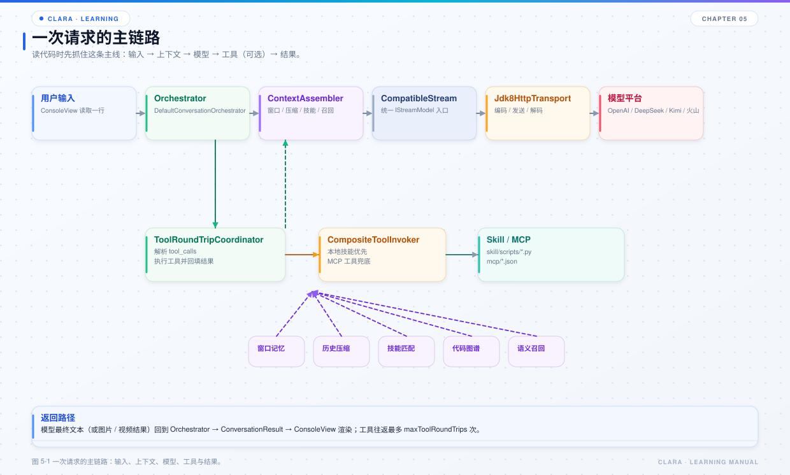

# 第 5 章 模型调用链

## 本章目标

- 理解 Clara 如何用“配置 + 注解”消化平台差异。
- 掌握一次模型调用从 `IStreamModel` 到平台再回到 `HttpResponse` 的路径。
- 知道模型探活、首字符响应、故障切换和媒体能力的边界。



*图 5-1 一次请求的主链路：输入、上下文、模型、工具、结果。*

## 5.1 模型层的职责

`clara-model` 负责：

- 读取 Provider YAML；
- 把统一请求编码为平台线格式；
- 把平台响应解码为统一响应；
- 提供同步 / 流式模型入口；
- 启动探活；
- Embedding；
- 图片 / 视频等媒体能力。

它不负责：

- 决定什么时候调用模型（编排层）；
- 管理会话历史（memory）；
- 选择工具（skill / mcp）；
- 展示结果（application）。

## 5.2 配置模型

每个 `config/model-providers/*.yml` 描述“平台 + 能力”：

```yaml
provider: DEEPSEEK
credential:
  secretRef: deepseek
  environmentVariable: CLARA_DEEPSEEK_API_KEY
transport:
  allowedOrigins: [https://api.deepseek.com]
  connectTimeoutMillis: 10000
  readTimeoutMillis: 600000
  maxRequestBytes: 8388608
  maxResponseBytes: 33554432
  allowHttp: false
capabilities:
  CHAT:
    endpoint: https://api.deepseek.com/responses
    modelId: deepseek-v4-pro
    apiProfile: RESPONSE
    parameters:
      maxTokens: 393216
```

关键对象：

| 对象 | 作用 |
| --- | --- |
| `ProviderConfiguration` | 平台级配置：凭据、传输、能力映射 |
| `ProviderCapabilityConfiguration` | 单个能力的端点、模型、协议、参数 |
| `ModelConfig` | 编排层使用的模型视图 |
| `ModelRegistry` | 按别名加载配置、缓存、维护当前模型 |
| `ModelAvailabilityManager` | 启动探活、排序、写回默认模型 |
| `ModelFailover` | 判断失败是否值得切换、给出尝试顺序 |

`ModelRegistry` 的当前模型与配置路径是一个逻辑单元，读写都在同一把锁下，避免读到“别名已换、路径没换”的中间状态。

## 5.3 统一入口

`CompatibleStream` 是 `IStreamModel` 的唯一实现，只做一层转发：

```java
public <R extends IResponse> R chat(IRequest request, Class<R> responseType) {
    return transport.execute(request, responseType);
}

public <R extends IResponse> IStreamHandle chat(
        IRequest request, Class<R> responseType, IStreamObserver observer) {
    return transport.stream(request, responseType, observer);
}
```

它故意不包含任何平台分支。平台差异在请求编码和响应解码中消化。

## 5.4 注解驱动

Clara 用两组注解描述平台差异：

- `@ProviderAdapter`：字段在哪个平台、哪种能力下是否支持、默认值、取值范围。
- `@ProtocolField`：同一字段在 Completion / Response 两种协议下的线格式名。

编码流程：

```text
IRequest
  → ProviderRequestEncoder 选择协议编码器
  → AbstractRequestEncoder 反射读取注解
  → 应用默认值 / 丢弃不支持字段 / 校验取值范围
  → JSON 请求体
```

解码流程：

```text
RawHttpResponse
  → ProviderResponseDecoder 选择协议解码器
  → AbstractResponseDecoder 按注解映射字段
  → HttpResponse
```

这样新增平台通常只改配置和少量字段规则，不需要在 `CompatibleStream` 里加 `if/else`。

## 5.5 同步与流式

同步调用适合：

- 短请求；
- 不需要实时展示；
- 后台任务。

流式调用适合：

- CLI 实时输出；
- 思维链展示；
- 首字符响应测量；
- 工具调用增量解析。

流式事件类型：

| 事件 | 含义 |
| --- | --- |
| `TEXT_DELTA` | 正文增量 |
| `REASONING_DELTA` | 思维链增量 |
| `RESPONSE_COMPLETE` | 完整响应 |
| `ERROR` | 流失败 |

`FirstTokenObserver` 记录首个非空正文 / 思维链字符的时间，用于控制台和 Span。`StreamingToolCallObserver` 在流式过程中合并工具调用片段，避免最后一个事件才拿到完整参数。

## 5.6 模型探活

`StreamingModelProbe` 发一条最小请求：

```text
只输出数字 1，不要输出其他内容。
```

判定：

- 收到首个非空正文：可用；
- 只收到思维链：也视为可用；
- 错误、超时、正常结束但无任何输出：不可用；
- 环境变量缺失：直接跳过，不发请求。

`PROBE_MAX_TOKENS` 不能设得太小。推理模型的思维链也计入输出 token，预算太小会只产出思维链、正文为空并以 `LENGTH` 结束，从而把可用模型误判为不可用。

## 5.7 故障切换

`ModelFailover` 只回答两个问题：

1. **这次失败是否属于“当前模型用不了”？**
2. **按什么顺序尝试下一个？**

值得切换的错误：

- 鉴权 / 授权：401、403；
- 限流：429；
- 超时；
- 外部服务失败 / 5xx；
- 连接失败、响应协议不符；
- 凭据不可用。

不值得切换的错误：

- 用户取消；
- 入参非法；
- 请求 / 响应体积超限；
- 内容安全；
- 能力不支持；
- 内部错误；
- 副作用未知。

切换顺序：

```text
当前模型
  → 启动期按首字符响应时间升序排列的可用模型
  → 去重后依次尝试
```

如果本轮已经执行过工具调用，通常不再切换，避免重复副作用。取消令牌贯穿整轮，不因切换模型而丢失。

## 5.8 图片与视频

图片：

- 文生图走 `IMAGE` 能力；
- 图生图可能走 multipart 图片编辑接口；
- 产物由 `ImageStore` 落到 `.clara/media/images`；
- 平台未返回 token 时，用量台账单独计“张数”。

视频：

- 视频不是同步聊天协议，而是“提交任务 + 轮询任务”；
- `ArkVideoTaskClient` 负责提交与查询；
- 产物由 `VideoDownloader` 下载到 `.clara/media/videos`；
- 成本高，工作流必须先经过 `HUMAN` 节点确认；
- 动作层会检查人工确认标记，避免模型绕过工作流直接调用。

## 5.9 上下文窗口与输出预算

模型配置中的 `maxTokens` 只是“平台允许的最大输出”，实际单次输出还要受传输层响应体积上限约束。

编排层会：

- 取配置值；
- 按 `maxResponseBytes / 每 token 估算字节数` 收敛；
- 得到单次调用的安全输出上限；
- 超过时提示“单次输出上限已收敛”。

这解释了一个常见疑问：为什么配置写了 393216，实际日志显示的输出上限更小。不是配置没生效，而是防止一次输出把 SSE 响应体撑爆。

## 5.10 排查模型问题

| 现象 | 优先检查 |
| --- | --- |
| 模型不在列表 | `enabledProviders`、文件别名 |
| 启动显示跳过 | 环境变量是否在当前进程可见 |
| 启动显示不可用 | 平台错误、HTTP 状态、余额、模型 ID、网络 |
| 首字很慢 | 平台排队、思维链、代理、网络；看 Span 的 `first_token_ms` |
| 回复被截断 | `finish_reason=LENGTH`；看续写逻辑和输出上限 |
| 换模型后历史没了 | 窗口记忆按“会话 + 供应商 + 模型”隔离，这是预期行为 |
| 图片生成失败 | 能力配置、平台参数、尺寸 / 质量、余额；文本模型不能替代图片模型 |

## 5.11 源码阅读路线

1. `clara-model/src/main/java/com/clara/model/configuration/ProviderYamlConfigurationLoader.java`
2. `clara-model/src/main/java/com/clara/kernel/config/ProviderConfiguration.java`
3. `clara-model/src/main/java/com/clara/kernel/message/provider/ProviderRequestEncoder.java`
4. `clara-model/src/main/java/com/clara/kernel/message/provider/ProviderResponseDecoder.java`
5. `clara-model/src/main/java/com/clara/model/provider/CompatibleStream.java`
6. `clara-model/src/main/java/com/clara/model/availability/StreamingModelProbe.java`
7. `clara-application/src/main/java/com/clara/config/ModelRegistry.java`
8. `clara-application/src/main/java/com/clara/config/ModelFailover.java`

## 5.12 练习

1. 新增一个模型配置别名，只改 YAML，不改 Java，确认它能被 `/model` 看到。
2. 找一个 `@ProviderAdapter` 字段，说明它在不同平台下的下发差异。
3. 把探活提示词改成更长的内容，观察首字符响应时间变化。
4. 人为制造 401，确认 `ModelFailover.isUnavailable` 会返回 true，并观察切换顺序。

## 5.13 自检题

- 为什么 `CompatibleStream` 不需要知道平台？
- `@ProviderAdapter` 和 `@ProtocolField` 分别解决什么问题？
- 模型探活为什么把“只收到思维链”也判为可用？
- 哪些错误不应该触发模型切换？
- 配置的 `maxTokens` 为什么可能被收敛？