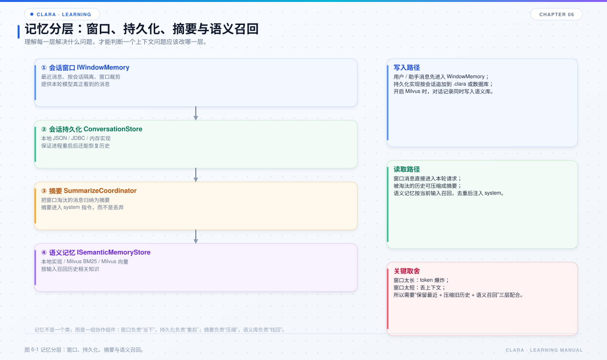

# 第 6 章 记忆与语义召回

## 本章目标

- 分清窗口记忆、持久化存储、摘要压缩、语义记忆四层。
- 理解为什么换模型后历史会“消失”，以及这是不是 bug。
- 掌握语义召回的去重、阈值、候选位和 Milvus 两种模式。



*图 6-1 记忆分层：窗口、持久化、摘要与语义召回。*

## 6.1 为什么需要四层

模型一次只能看有限上下文，但对话可能很长。Clara 用四层配合：

| 层 | 解决什么问题 | 典型实现 |
| --- | --- | --- |
| 窗口记忆 | 本轮到底带哪些消息 | `DefaultWindowMemory` |
| 持久化 | 进程退出后历史还在不在 | `LocalConversationStore` / `JdbcConversationStore` |
| 摘要压缩 | 被窗口淘汰的内容如何保留要点 | `WindowCompressionCoordinator` / `DefaultSummarizeCoordinator` |
| 语义记忆 | 很久以前的相关内容如何找回 | `LocalSemanticMemoryStore` / `MilvusSemanticMemoryStore` |

## 6.2 窗口记忆

`DefaultWindowMemory` 以「会话 + 供应商 + 模型」为单位：

```java
new DefaultWindowMemory(conversationId, provider, model, store)
```

这带来一个重要行为：**切换模型会切换窗口记忆键**。切到另一个模型时，历史看起来“消失”了；切回原模型，原上下文会恢复。这是隔离设计，不是丢数据。

窗口记忆的职责：

- 首次访问时从 `ConversationStore` 恢复历史；
- `append` 追加消息并更新版本；
- `window` 按 `WindowPolicy` 和 token 估算裁剪，不修改存储；
- `clear` 清空当前键的历史。

## 6.3 持久化

`ConversationStore` 有三种实现：

- `InMemoryConversationStore`：测试 / 临时会话；
- `LocalConversationStore`：本地文件；
- `JdbcConversationStore`：数据库。

本地文件的落盘位置：

```text
<工作目录>/.clara/state/conversations/
```

`LocalConversationStore` 的实现要点：

- 文件名是 `sha256(conversationId + provider + model).bin`；
- 目录级排他锁，避免同一目录多个 Clara 实例同时写；
- 临时文件 + `force` + 原子替换，避免半个 JSON；
- 快照带版本号，追加时做乐观并发校验；
- `ConversationCodec` 在每条消息上附加 `clara_usage`，保存 token 用量。

`BoundedCachingConversationStore` 是带缓存和容量上限的装饰器，用于减少频繁读盘。

## 6.4 摘要压缩

当窗口淘汰消息时，`WindowCompressionCoordinator` 可以调用 `DefaultSummarizeCoordinator`，把被淘汰的消息组总结成摘要。

关键设计：

- 摘要只针对“被淘汰”的部分，不重复总结当前窗口；
- 摘要作为 system 内容注入，不写回原始历史；
- 压缩失败不应阻断对话，最多退化为“没有摘要”；
- `/compress` 和 `/compact` 可以手动触发当前上下文压缩。

为什么不能只保留最近两条？那会把“任务目标、已确认参数、已读文件结论”全部丢掉，模型会反复问同样的问题。摘要是在“保留最近窗口”和“保留全部历史”之间的折中。

## 6.5 语义召回

启用 Milvus 后，`ConversationIndexingWindowMemory` 会在追加消息时把内容写入语义库，来源为 `CONVERSATION`。

召回流程：

```text
用户输入
  → embedding
  → ISemanticMemoryStore.search
  → 候选按分数排序
  → 去掉本轮窗口里已经可见的内容
  → 过相似度阈值
  → 注入 system
```

几个容易误解的点：

- **命中但被丢弃是正常的**：本轮上下文里已经有的内容不应重复注入，否则白占 token。
- **候选位不是 topK 本身**：`candidateLimit` 会在 `retrievalCount` 基础上为本轮可见消息预留位置，避免最近几条高相似度消息把候选位占满，导致旧知识进不来。
- **阈值默认 0.70**：分数不过阈值不会注入；控制台会显示召回条数、过阈值条数和最高分。
- **召回失败不影响对话**：语义库不可用时，本轮只是没有补充信息。

## 6.6 Milvus 两种模式

`config/clara.yml` 的 `milvus.mode`：

| 模式 | 原理 | 适用 |
| --- | --- | --- |
| `bm25` | Milvus 内置全文检索，中文按 analyzer 分词 | 推荐；不依赖嵌入服务 |
| `vector` | 嵌入向量相似度 | 需要可用的 embeddings 端点 |

为什么默认推荐 BM25：

- 多数模型平台没有稳定的 embeddings 端点；
- 离线占位嵌入没有语义，分数很难过阈值；
- BM25 直接按词命中打分，相关文档能稳定过阈值；
- BM25 正文走 SDK 的 `String.getBytes()`，要求 JVM 默认字符集为 UTF-8，所以启动参数不能省 `-Dfile.encoding=UTF-8`。

`recreateOnSchemaMismatch=true` 时，集合结构与当前模式不一致会自动删除重建。注意：重建会清空该集合里的历史记录。

## 6.7 观测召回

控制台和日志会显示类似：

```text
[向量] 命中 3 条（9ms）
       召回 3 条 / 过阈值 3 条（阈值 0.70，最高分 0.970）
```

阅读方式：

- “召回 N 条”是存储层返回的候选数；
- “过阈值 N 条”是实际注入的条数；
- “窗口外召回”表示已经去掉本轮可见内容；
- 如果长期“召回 0 条”，先检查 Milvus 是否启用、集合是否有数据、embedding 是否可用；
- 如果“有候选但过阈值 0 条”，说明分数不够，考虑换 BM25 或调阈值。

## 6.8 常见问题

| 现象 | 原因 | 处理 |
| --- | --- | --- |
| 换模型后历史不见 | 窗口键包含 provider + model | 切回原模型；或接受隔离 |
| 历史文件存在但读不到 | 工作目录变了，sessionId 变了 | 在同一目录启动 |
| 语义库有数据但召回 0 | 集合 / 会话过滤、阈值、模式不匹配 | 看控制台 `[向量]` 行和 Milvus 集合 |
| 召回内容重复 | 本轮可见内容没去重 | 检查 `visibleMessages` 是否传入 |
| BM25 让 Milvus abort | JVM 默认字符集不是 UTF-8 | 加 `-Dfile.encoding=UTF-8` |
| 压缩后模型忘事 | 摘要丢了关键约束 | 调窗口策略或把关键约束写入常驻提示词 |

## 6.9 源码阅读路线

1. `clara-core/src/main/java/com/clara/core/memory`：先看 `IWindowMemory`、`ISemanticMemoryStore`。
2. `clara-memory/src/main/java/com/clara/memory/window/DefaultWindowMemory.java`
3. `clara-memory/src/main/java/com/clara/memory/persistence/local/LocalConversationStore.java`
4. `clara-memory/src/main/java/com/clara/memory/semantic/milvus/MilvusSemanticMemoryStore.java`
5. `clara-orchestration/src/main/java/com/clara/orchestration/context/WindowCompressionCoordinator.java`
6. `clara-orchestration/src/main/java/com/clara/orchestration/context/SemanticRecallCoordinator.java`

## 6.10 练习

1. 在同一目录切换两个模型，观察历史是否隔离；再切回，确认原上下文恢复。
2. 关闭 Milvus，比较 `[向量]` 行和对话行为的变化。
3. 把 `similarityThreshold` 调高 / 调低，观察“过阈值条数”。
4. 手动执行 `/compress`，对比压缩前后的 system 内容和 token 估算。

## 6.11 自检题

- 窗口记忆的键为什么包含 provider 和 model？
- 本地历史文件名如何生成？为什么需要原子替换？
- 语义召回为什么要丢掉“本轮已经可见”的内容？
- BM25 和 vector 模式的核心差异是什么？
- 压缩失败时，为什么不应该让整轮对话失败？