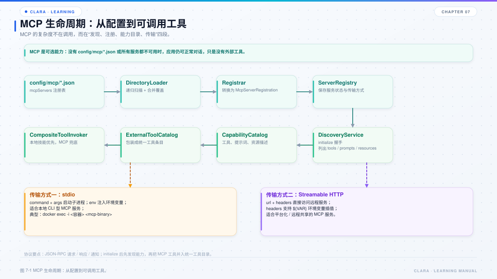

# 第 7 章 MCP 客户端

## 本章目标

- 理解 MCP 在 Clara 中的位置：把外部服务端变成模型可调用的工具。
- 掌握“配置 → 注册 → 发现 → 快照 → 工具目录 → 网关调用”的完整链路。
- 知道 stdio 和 Streamable HTTP 两种传输的差异，以及契约校验为什么严格。



*图 7-1 MCP 生命周期：从配置到可调用工具。*

## 7.1 一句话理解 MCP

`clara-mcp` 做的事情可以压成一句话：**把外部 MCP 服务端变成“模型看得见、叫得动、校验得住”的工具。**

它做了三个分离：

1. **发现与调用分离**：启动时连一次服务端，把“你会什么”固化成快照；对话中只拿快照办事。
2. **能力与路由分离**：能力快照是契约；扁平工具名路由表只负责快速分派。
3. **传输 / 协议 / 业务分离**：
   - `IMcpTransport` 只管收发字节；
   - `IMcpClient` 只管 MCP 方法语义；
   - `Registry / Catalog / Gateway` 才管“能不能调、调的是谁”。

## 7.2 边界

| 是 clara-mcp 的职责 | 不是 clara-mcp 的职责 |
| --- | --- |
| 描述怎么连：配置 → 注册项 | 决定什么时候调工具（编排层） |
| 连上后问清能力并固化快照 | 决定给模型看哪些提示词（skill / 编排层） |
| 把快照翻译成工具声明、按名分派 | 处理对话上下文与历史 |
| 调用前做契约校验 | 实现具体业务工具（服务端自己实现） |

一个容易看漏的边界：**工具声明在 `clara-application` 的 `McpToolCatalog`，不在 `clara-mcp`。** 因为“工具声明长什么样”由模型协议决定，属于宿主适配；`clara-mcp` 只提供能力快照。

## 7.3 配置与注册

`config/mcp/*.json` 递归扫描，结构兼容 Claude Desktop / VS Code：

```json
{
  "mcpServers": {
    "local-tool": {
      "command": "python",
      "args": ["server.py"],
      "env": {"MCP_TOKEN": "${MCP_TOKEN}"}
    },
    "remote-tool": {
      "url": "https://example.com/mcp",
      "headers": {"Authorization": "Bearer ${MCP_TOKEN}"}
    }
  }
}
```

加载链路：

```text
McpServerConfigDirectoryLoader
  → McpServerConfigLoader
  → McpServerRegistrar
  → IMcpServerRegistry.register
```

`command` 用于 stdio 子进程，`url` 用于 Streamable HTTP。未配置任何服务端时，Clara 只使用内置工具和技能，不影响对话。

## 7.4 发现与快照

启动时 `DefaultMcpDiscoveryService` 会：

1. 建立客户端；
2. `initialize` 协商协议版本；
3. 分页 `tools/list`、`resources/list`、`prompts/list`；
4. 记录服务端身份（name + version）；
5. 为每个能力计算 `schemaHash`；
6. 发布快照到 `IMcpCapabilityCatalog`。

快照里固化了三类契约锚点：

| 锚点 | 作用 | 不一致时的后果 |
| --- | --- | --- |
| `protocolVersion` | 客户端与服务端说同一种协议 | `MCP_PROTOCOL_INCOMPATIBLE`，标记不兼容 |
| 服务端身份 | 防止“同名换了实现” | `MCP_SERVER_IDENTITY_CHANGED`，标记需复核 |
| 每个能力的 `schemaHash` | 防止模型拿着旧入参契约调用 | `MCP_SCHEMA_MISMATCH`，直接拒绝 |

当前支持的协议版本列表由 `ApplicationBootstrap` 配置，默认只支持 `2024-11-05`。服务端协商出其它版本会被标记为不兼容。

## 7.5 工具目录

`ExternalToolCatalog` 维护“扁平工具名 → 服务端快照 + 能力”的路由。

当模型请求调用某个工具时：

```text
工具名
  → ExternalToolCatalog 查找绑定
  → IMcpGateway.callTool
  → 绑定到具体服务端与能力
```

本地工具和外部工具的统一入口是 `CompositeToolInvoker`：

- 先查技能注册表，命中就走本地；
- 否则查 `ExternalToolCatalog`，命中就走 MCP；
- 两边都没有则返回结构化“工具未找到”。

## 7.6 调用前校验

`DefaultMcpGateway` 在真正发出 `tools/call` 前逐层检查：

1. 注册项存在；
2. 注册状态为 `ACTIVE`；
3. 快照存在且健康；
4. 工具存在且 `schemaHash` 一致；
5. 重新初始化后协议版本与服务端身份仍然一致。

任何一层不通过都直接拒绝，不把旧契约请求发给服务端。

这看起来严格，但能避免“模型按旧 Schema 传参、服务端按新 Schema 解析”的难查问题。宁可显式失败并提示刷新，也不要“看起来能跑但偶尔错”。

## 7.7 两种传输

### stdio

- 启动本地子进程；
- 通过逐行 JSON-RPC 通信；
- 可执行文件必须在允许清单内；
- 适合本地工具、代码图谱容器等。

代码图谱当前通过 stdio 调用 Docker 容器：

```json
{
  "command": ["docker", "exec", "-i", "clara-codebase-memory-mcp", "codebase-memory-mcp"]
}
```

### Streamable HTTP

- 通过 HTTP 端点发 JSON-RPC；
- 支持流式响应；
- 适合远程 MCP 服务端；
- 复用 `clara-transport` 的 HTTP / SSE 能力。

两者都受消息体积上限、超时、取消与关闭语义约束。

## 7.8 代码知识图谱的接入位置

代码图谱有两个使用点：

1. **提示词前补充**：`CodeGraphSupplement` 实现 `IContextSupplementProvider`，每轮按输入查一次图谱，命中就把结构化事实注入 system。
2. **模型按需调用**：常驻提示词 `code_graph_guide` 告诉模型“先查图谱，图谱没有再查本地文件”，模型在工具往返中调用 `code_graph`。

相关开关在 `config/clara.yml` 的 `codeGraph`：

| 配置 | 作用 |
| --- | --- |
| `enabled` | 总开关 |
| `supplement` | 是否每轮自动查询并注入；默认关闭，避免拖慢首字响应 |
| `autoMount` | 启动时确保容器能看到当前工作目录 |
| `autoImport` | 启动时后台导入当前目录 |
| `mcpServer` | MCP 注册键 |
| `supplementMaxChars` | 单轮补充内容上限 |

手动操作：

- `/graph`：查看当前工作目录的图谱状态；
- `/graph import`：同步导入当前目录，大仓库可能耗时数分钟。

## 7.9 失败排查

| 现象 | 优先检查 |
| --- | --- |
| 启动显示“未接入 MCP” | `config/mcp` 是否为空、JSON 是否合法、命令是否存在 |
| 服务端注册失败 | command 路径、容器是否运行、工作目录是否挂载 |
| 工具列表为空 | 发现是否成功；服务端是否声明 tools |
| 调用报 schema mismatch | 服务端工具 Schema 变了，刷新快照 |
| 调用报 identity changed | 服务端换了实现但 name/version 没变，复核后刷新 |
| HTTP MCP 超时 | 端点、代理、鉴权头、超时配置 |
| 图谱查询“容器看不到目录” | 容器挂载根是否覆盖当前工作目录 |

## 7.10 源码阅读路线

1. `clara-mcp/src/main/java/com/clara/mcp/api`：先看所有 `I` 接口。
2. `clara-mcp/src/main/java/com/clara/mcp/registry/config/McpServerConfigDirectoryLoader.java`
3. `clara-mcp/src/main/java/com/clara/mcp/registry/DefaultMcpDiscoveryService.java`
4. `clara-mcp/src/main/java/com/clara/mcp/client/gateway/DefaultMcpGateway.java`
5. `clara-mcp/src/main/java/com/clara/mcp/tool/ExternalToolCatalog.java`
6. `clara-application/src/main/java/com/clara/tool/McpToolCatalog.java`
7. `clara-application/src/main/java/com/clara/ApplicationBootstrap.java` 的 `loadMcpServers`

## 7.11 练习

1. 配一个最小 stdio MCP 服务端，确认启动横幅出现“服务端数 / 工具数”。
2. 故意改坏一个 JSON 字段，观察是否只影响该服务端。
3. 调用一个不存在的工具，确认返回的是结构化错误，而不是整轮崩溃。
4. 画出一个工具名从 `ExternalToolCatalog` 到服务端的完整路径。

## 7.12 自检题

- 为什么发现和调用要分离？
- 快照里的三个契约锚点分别防止什么问题？
- 工具声明为什么放在 `clara-application`，而不是 `clara-mcp`？
- stdio 和 Streamable HTTP 分别适合什么场景？
- 图谱查询失败为什么不应影响普通对话？