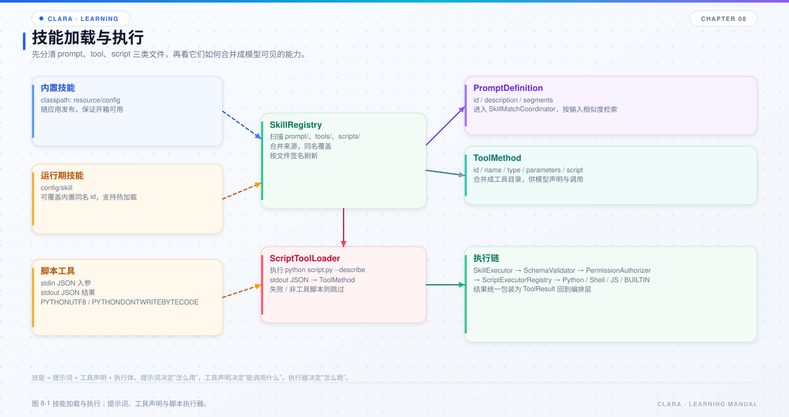

# 第 8 章 技能与脚本工具

## 本章目标

- 理解技能 = 提示词 + 工具声明 + 执行体 + 匹配。
- 掌握工具从发现、Schema 校验、权限检查到脚本执行的链路。
- 能新增一个 Python 脚本工具，并让模型在合适的输入下调用它。



*图 8-1 技能加载与执行。*

## 8.1 技能由什么组成

Clara 的“技能”不是单一文件，而是四类东西的组合：

| 组成 | 位置 | 作用 |
| --- | --- | --- |
| 提示词 | `config/skill/prompt/*.json` | 告诉模型某类任务怎么做 |
| 工具声明 | `config/skill/tools/**/*.json` | 声明工具名、描述、入参 Schema |
| 脚本工具 | `config/skill/scripts/**/*.py` | 声明与执行体同文件，通过 `--describe` 输出元数据 |
| 匹配 | `SkillMatchCoordinator` | 按用户输入检索提示词和工具 |

技能描述会被向量化写入语义记忆（来源 `PROMPT` / `TOOL_DESCRIPTION`），用于按输入相似度匹配。

## 8.2 注册表

`SkillRegistry` 同时扫描两个来源：

- 内置目录：classpath 下的 `config`；
- 运行期目录：当前工作目录下的 `config/skill`。

规则：

- 运行期目录覆盖内置目录的同名项；
- `prompt/`、`tools/`、`scripts/` 分别扫描；
- 每次读取先比对文件签名（修改时间:大小），发现新增 / 修改 / 删除就自动重扫；
- 签名一致时只做一次目录列举和 stat，不重复解析。

这意味着：

- 改 prompt 或脚本，下一次使用自动生效；
- 改工具声明后不需要重启；
- 但 `clara.yml`、模型配置、MCP 配置仍然需要重启或 `/init`。

## 8.3 提示词

`config/skill/prompt/*.json` 的最小结构：

```json
{
  "id": "sample_assistant",
  "description": "示例验证用的助手人设提示词：简洁、中文、可调用工具完成任务。",
  "segments": [
    {
      "role": "system",
      "content": "你是一个用于能力验证的助手。请用简洁的中文回答；当需要读写外部文件或访问网络时，优先调用已提供的工具，再基于工具结果作答。"
    }
  ]
}
```

两类提示词要分清：

- **常驻提示词**：`config/clara.yml` 的 `context.alwaysPrompts`，每轮原样注入，不参与相似度检索。适合“读代码先查图谱”这类固定约定。
- **技能提示词**：按用户输入检索注入，受阈值和条数上限影响。适合随输入变化的用法说明。

## 8.4 工具声明

`config/skill/tools/**/*.json` 适合声明式工具：

```json
{
  "id": "run_workflow",
  "name": "run_workflow",
  "type": "BUILTIN",
  "description": "运行一个已配置的工作流……",
  "parameters": "{\"type\":\"object\",\"properties\":{\"workflow\":{\"type\":\"string\"}},\"required\":[\"workflow\"]}",
  "script": "run_workflow",
  "metadata": {"domain": "workflow"}
}
```

关键字段：

- `id` / `name`：工具标识；
- `type`：`BUILTIN`、`PYTHON`、`SHELL`、`JAVASCRIPT` 等；
- `description`：模型选择工具的主要依据；
- `parameters`：JSON Schema 字符串；
- `script`：执行体标识。

内置工具包括：

- `run_workflow`：运行工作流；
- `publish_workflow`：校验并发布自定义工作流；
- `validate_execution_plan`：校验动态执行计划格式。

## 8.5 脚本工具

`config/skill/scripts/**/*.py` 的约定：

- 文件内定义 `_TOOL` 字典；
- 调用 `python script.py --describe` 时，把 `_TOOL` 以 JSON 打到 stdout；
- 正常执行时从 stdin 读取参数 JSON，把结果 JSON 打到 stdout；
- 共享辅助模块以下划线开头，`--describe` 无输出，加载器会跳过。

最小示例：

```python
import json
import sys

_TOOL = {
    "id": "hello_tool",
    "name": "hello_tool",
    "type": "PYTHON",
    "description": "返回一句问候。入参：name(可选)。",
    "parameters": {
        "type": "object",
        "properties": {"name": {"type": "string"}},
        "required": [],
    },
    "metadata": {"domain": "sample"},
}

if "--describe" in sys.argv:
    print(json.dumps(_TOOL, ensure_ascii=False))
    sys.exit(0)

payload = json.load(sys.stdin)
name = payload.get("name") or "world"
print(json.dumps({"message": "hello " + name}, ensure_ascii=False))
```

请求里通常还需要 `purpose` 字段，用于向用户说明本次调用目的；具体以脚本 Schema 为准。

## 8.6 执行链

`DefaultToolExecutor.execute` 的顺序：

```text
定位工具方法
  → 权限校验
  → 入参 Schema 校验
  → 按 type 分派到脚本执行器
  → 执行
  → 输出 JSON 校验
```

关键点：

- 入参在调用脚本前一律先做严格 JSON 解析，拒绝尾随内容；
- Schema 校验支持 `type / properties / required / items / enum / additionalProperties` 等常见关键字；
- 输出必须是合法 JSON；
- 执行器按 `ScriptTypeEnum` 分派，新增脚本类型不需要改 `DefaultToolExecutor`；
- 取消令牌随执行描述下发，脚本可在检查点终止。

## 8.7 技能匹配

`SkillMatchCoordinator.match` 做三件事：

1. 把用户输入向量化；
2. 在语义记忆中检索提示词和工具描述；
3. 过阈值后返回命中的提示词和工具声明。

匹配结果会进入本轮 system 指令和工具列表。常驻提示词不参与这一步。

为什么有时“技能没生效”：

- 用户输入与技能描述相似度不够；
- 阈值过高；
- 技能描述写得太泛，区分度低；
- 该技能是常驻提示词，不走检索；
- 脚本 `--describe` 失败，工具根本没被加载。

## 8.8 安全与权限

`SkillPermissionAuthorizer` 负责工具级权限检查。默认实现放行，但接口留出了替换点。

生产环境应关注：

- 脚本能否执行任意命令；
- 文件工具是否限制在工作区内；
- 网络工具是否允许访问任意 URL；
- 工具是否会写入敏感目录；
- `purpose` 是否展示给用户，便于审计。

## 8.9 排查工具问题

| 现象 | 优先检查 |
| --- | --- |
| 模型看不到工具 | `--describe` 是否输出合法 JSON；文件签名是否变化 |
| 工具调用报 Schema 错 | 模型入参是否符合 `parameters` |
| 工具执行报错 | 脚本 stderr、退出码、Python 是否在 PATH |
| 工具结果不是 JSON | 脚本 stdout 是否混入日志 |
| 修改脚本不生效 | 文件签名是否变化；是否被内置同名项覆盖 |
| 工具被误调用 | 描述是否过于宽泛；是否应该改成常驻提示词或收窄 Schema |

## 8.10 源码阅读路线

1. `clara-skill/src/main/java/com/clara/skill/registry/SkillRegistry.java`
2. `clara-skill/src/main/java/com/clara/skill/registry/ScriptToolLoader.java`
3. `clara-skill/src/main/java/com/clara/skill/tool/DefaultToolExecutor.java`
4. `clara-skill/src/main/java/com/clara/skill/tool/script/PythonScriptExecutor.java`
5. `clara-skill/src/main/java/com/clara/skill/executor/SkillSchemaValidator.java`
6. `clara-orchestration/src/main/java/com/clara/orchestration/skill/SkillMatchCoordinator.java`

## 8.11 练习

1. 新增一个 `hello_tool.py`，确认 `--describe` 输出合法 JSON。
2. 在对话中让模型调用它，观察控制台的 `[tool]` 行和结果回填。
3. 故意把 `parameters` 改错，确认 Schema 校验能拦住。
4. 把工具描述改得更具体，比较匹配效果。

## 8.12 自检题

- 常驻提示词和技能提示词的区别是什么？
- 脚本工具的声明和执行体为什么放在同一个文件？
- `DefaultToolExecutor` 的执行链有哪几步？
- 技能匹配失败通常有哪些原因？
- 为什么工具输出必须是合法 JSON？