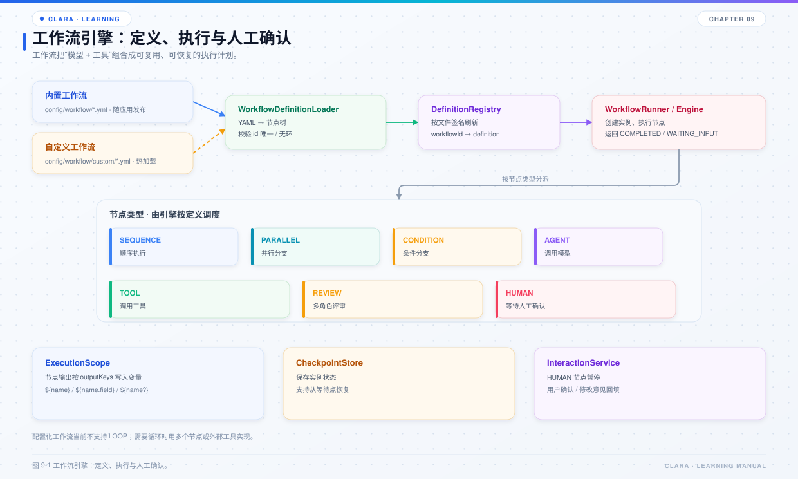

# 第 9 章 工作流引擎

## 本章目标

- 理解为什么需要工作流，而不是全部交给模型自由发挥。
- 掌握 YAML 定义、节点类型、变量解析、检查点与恢复。
- 能读懂 `video_generation.yml` 这种带人工确认的流程。



*图 9-1 工作流引擎：定义、执行与人工确认。*

## 9.1 为什么需要工作流

模型擅长“根据上下文决定下一步”，但不擅长保证：

- 步骤顺序固定；
- 某一步必须人工确认；
- 长流程可暂停、恢复；
- 失败后可定位到具体节点；
- 中间产物不全部回灌给模型。

工作流把这些要求变成配置和引擎语义。

## 9.2 YAML 结构

`WorkflowDefinitionLoader` 读取 YAML：

```yaml
workflowId: video_generation
version: "1.2.1"
description: 文生视频
outputs: [prompt, video]
inputSchema:
  type: object
  required: [subject]
  properties:
    subject:
      type: string
root:
  id: root
  type: SEQUENCE
  children:
    - id: refine
      type: AGENT
      outputKeys: [prompt]
      prompt: video_generator
      promptVars:
        subject: "${subject}"
    - id: review_prompt
      type: HUMAN
      inputKey: promptFeedback
```

顶层字段：

| 字段 | 说明 |
| --- | --- |
| `workflowId` | 必填，工作流标识 |
| `version` | 缺省 `1.0.0` |
| `description` | 说明 |
| `inputSchema` / `outputSchema` | 可选，用于说明和校验 |
| `outputs` | 对外输出变量键；不回传未声明的中间产物 |
| `root` | 节点树 |

节点通用字段：

- `id`：必填；
- `type`：必填；
- `outputKeys`：动作节点声明输出键；
- `idempotencyKey`：缺省为 id；
- `children`：子节点；
- 其它字段（`prompt`、`tool`、`arguments` 等）作为动作属性透传。

## 9.3 节点类型

| 类型 | 作用 |
| --- | --- |
| `SEQUENCE` | 顺序执行子节点 |
| `PARALLEL` | 并行执行子节点并合并作用域 |
| `CONDITION` | 按条件选择分支 |
| `LOOP` | 有最大迭代次数与退出条件 |
| `AGENT` | 调用模型，支持 `prompt` / `promptText` / 角色 / 模型 / 能力 |
| `TOOL` | 调用工具 |
| `REVIEW` | 多角色讨论并汇总 |
| `HUMAN` | 等待人工输入 |

约束：

- 动作节点必须且只能声明一个输出键；
- 动作返回 `{"output": 值}` 时，会被 `OutputKeyedAction` 重键为声明的输出键；
- `PARALLEL` 的子节点输出键必须唯一；
- 配置非法时 fail-fast，错误信息包含文件路径和节点 id。

## 9.4 变量解析

`WorkflowVariableResolver` 支持：

- `${name}`：取顶层变量；
- `${name.field}`：在 Map 中逐级下钻；
- `${name?}`：可选变量，缺失返回 null；
- 整个字符串恰为一个 `${...}` 时，返回原始对象（可能是 List / Map）；
- 否则做字符串替换，非字符串对象序列化为 JSON 文本。

解析不到且不带 `?` 时抛异常，避免静默传空。

## 9.5 执行与检查点

`DefaultWorkflowEngine`：

- 用节点路径作为执行键，例如 `root/step1/0/child`；
- 已完成节点记录在 `ExecutionScope` 中，恢复时跳过，避免重复副作用；
- 每次状态变化写检查点；
- 检查点用期望版本做乐观并发写入；
- 版本不一致抛冲突错误。

注意：默认 `InMemoryCheckpointStore` 是进程内实现。进程重启后实例状态不会自动恢复；如需跨进程恢复，应替换 `ICheckpointStore`。

## 9.6 HUMAN 节点与人工确认

执行到 `HUMAN` 节点时：

1. 作用域里没有对应输入键，抛出 `WaitingInputSignal`；
2. 引擎把实例状态写为 `WAITING_INPUT`，返回等待节点与输入键；
3. `WorkflowRunner` 把结果整理成 JSON，包含 `waitingForUser=true`、`display`、`nextAction`；
4. `ToolRoundTripCoordinator` 检测到 `waitingForUser`，结束本轮并返回 `pausedForUserInput=true`；
5. 下一轮用户确认后，模型按 `nextAction` 用同一 `instanceId` 调用 `run_workflow` 恢复。

```json
{
  "workflowId": "video_generation",
  "instanceId": "video_generation-1712345678901",
  "status": "WAITING_INPUT",
  "waitingNodeId": "review_prompt",
  "waitingInputKey": "promptFeedback",
  "waitingForUser": true,
  "display": "请确认是否生成视频……",
  "nextAction": {
    "tool": "run_workflow",
    "arguments": {
      "workflow": "video_generation",
      "instanceId": "video_generation-1712345678901",
      "inputs": {"promptFeedback": "approve"}
    }
  }
}
```

`PendingWorkflowRegistry` 会按会话保存待确认实例 30 分钟，并把它注入下一轮的临时系统提示，防止模型在故障转移或上下文压缩后忘记续接。

## 9.7 视频工作流的保护

`config/workflow/video_generation.yml` 是典型例子：

```text
AGENT 优化提示词
  → HUMAN 等待确认
  → CONDITION 是否 approve
      → 是：AGENT（VIDEO）生成视频
      → 否：AGENT 按反馈修改 → HUMAN 再确认 → CONDITION
```

保护点：

- 视频生成属于高成本操作，必须人工确认；
- 动作层检查 `ExecutionScope.CONTROL_HUMAN_CONFIRMED`，避免模型绕过工作流直接调用；
- 生成完成后视频下载到 `.clara/media/videos`；
- 结果里带上平台返回的 token 用量（如果平台返回）。

## 9.8 自定义工作流

`PublishWorkflowTool` 支持模型生成并发布自定义工作流：

1. 把 YAML 写到系统临时文件；
2. 用加载器解析校验；
3. 通过后原子移动到 `config/workflow/custom/<workflowId>.yml`；
4. 注册表签名变化，下一次 `run_workflow` 自动看到新流程。

`WorkflowRunner` 只回传 `outputs` 声明的变量，并对超过 20000 字符的字符串截断，避免把批量读取的源码等中间产物整体回灌给模型。

## 9.9 常见问题

| 现象 | 原因 | 处理 |
| --- | --- | --- |
| 工作流加载失败 | YAML 缺字段、类型未知、输出键为空 | 看错误里的文件路径和节点 id |
| 恢复时版本冲突 | 另一个实例改了检查点 | 重新读取或避免并发恢复 |
| 重启后无法恢复 | 默认检查点是内存实现 | 替换 `ICheckpointStore` |
| 模型没有续接人工确认 | 没用同一 `instanceId` | 按 `nextAction` 调用 |
| 工作流输出太大 | 未声明 `outputs` 或输出字符串过长 | 声明输出键；必要时在节点内截断 |
| 自定义流程不出现 | 文件未通过校验或没放到 `custom/` | 看发布工具返回的错误 |

## 9.10 源码阅读路线

1. `clara-workflow/src/main/java/com/clara/workflow/definition/WorkflowDefinitionLoader.java`
2. `clara-workflow/src/main/java/com/clara/workflow/node/WorkflowNodes.java`
3. `clara-workflow/src/main/java/com/clara/workflow/engine/DefaultWorkflowEngine.java`
4. `clara-workflow/src/main/java/com/clara/workflow/runtime/WorkflowRunner.java`
5. `clara-workflow/src/main/java/com/clara/workflow/runtime/WorkflowVariableResolver.java`
6. `clara-workflow/src/main/java/com/clara/workflow/interaction/InteractionResumeCoordinator.java`
7. `config/workflow/video_generation.yml`

## 9.11 练习

1. 写一个两节点工作流：AGENT 生成一句话，TOOL 写入文件。
2. 加一个 `HUMAN` 节点，确认 `WAITING_INPUT` 的返回结构。
3. 用同一 `instanceId` 恢复，确认完成节点不会重复执行。
4. 故意把 `outputKeys` 写成两个，观察加载错误。

## 9.12 自检题

- 工作流解决的是“模型不擅长什么”？
- `HUMAN` 节点暂停后，谁负责把确认结果送回？
- 默认检查点为什么不能跨进程恢复？
- `outputs` 声明对上下文控制有什么作用？
- 视频工作流为什么必须经过人工确认？