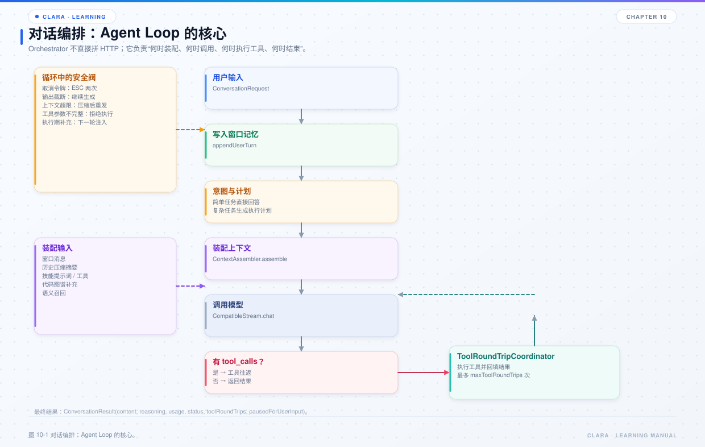

# 第 10 章 对话编排

## 本章目标

- 理解 Agent Loop 的完整循环和退出条件。
- 掌握上下文装配顺序，以及为什么 system 内容要按固定顺序拼接。
- 理解工具往返、输出截断、上下文超限、执行期干预和调用记录。



*图 10-1 对话编排：Agent Loop 的核心。*

## 10.1 编排层做什么

`clara-orchestration` 只做组合：

- 绑定会话上下文；
- 恢复历史；
- 装配本轮上下文；
- 调用模型；
- 执行工具并回填；
- 处理截断、超限、干预、取消；
- 返回 `ConversationResult`。

它不 new 具体 Provider、Store、Transport，只依赖 `clara-core` 的接口。

## 10.2 一次 `converse` 的步骤

```text
validateRequest
  → createContext（ConvContext）
  → windowMemoryFactory.create（会话 + provider + model）
  → appendUserTurn
  → prepareIntent（可选）
  → agentLoop
      → appendInterventions
      → buildRequest
      → invokeModel
      → 记录 usage / call record
      → 有工具调用？执行并回填，继续
      → 无工具调用？完成
  → completedResult / failureResult / cancelled
```

`agentLoop` 的退出条件：

- 没有工具调用，且输出未被截断：完成；
- 工具结果要求人工确认：本轮提前结束，`pausedForUserInput=true`；
- 达到最大工具往返次数：失败；
- 取消：返回 `CANCELLED`；
- 模型无响应：返回 `FAILED`；
- 不可恢复的异常：向上抛或转为失败结果。

## 10.3 上下文装配顺序

`ContextAssembler.assemble` 的顺序：

1. 读取完整历史，过滤非法的空 assistant 消息；
2. 按 `WindowPolicy` 裁剪窗口；
3. 压缩历史工具结果，避免超长工具输出占满 token；
4. 对被窗口淘汰的消息生成摘要；
5. 按用户输入匹配技能，得到提示词与工具声明；
6. 查询外部知识补充（如代码图谱）；
7. 从语义记忆召回被淘汰的历史知识；
8. 按固定顺序拼接 system，并把 system 放到消息首位。

`WindowPolicy` 受这些维度影响：

- 上下文窗口 token 上限；
- 最大消息条数；
- 最大字节数；
- 窗口 token 百分比；
- 最近保留轮数。

## 10.4 system 内容的顺序

`systemText` 的拼接顺序是刻意设计的：

| 顺序 | 内容 | 是否每轮固定 |
| --- | --- | --- |
| 1 | `extraPrompts`：本轮计划、工作流续接提示、续写指令 | 否 |
| 2 | `basePrompts`：常驻约定，如“读代码先查图谱” | 是 |
| 3 | 技能提示词：按输入相似度匹配 | 否 |
| 4 | 图谱补充信息：从代码知识图谱查到的事实 | 否 |
| 5 | 窗口淘汰消息的摘要 | 否 |
| 6 | 语义记忆召回内容 | 否 |

为什么把常驻提示词单独一条通道：技能提示词靠向量检索，受阈值和条数上限影响，同一句“先查图谱”可能有时注入、有时不注入；固定约定必须每轮稳定出现。

## 10.5 工具往返

`ToolRoundTripCoordinator` 负责：

- 检测响应中的工具调用；
- 逐个执行；
- 按 `callId` 构造结果消息；
- 把“助手工具调用消息 + 工具结果消息”写回历史；
- 检测 `waitingForUser=true`，让本轮提前结束。

容错语义：

- 单个工具失败不会中断整轮；
- 错误文本作为该调用的结果回填；
- 模型可以据此修正参数、换工具或向用户解释。

工具往返上限由 `ConversationRequest.maxToolRoundTrips` 控制，超过则失败，避免模型无限调用。

## 10.6 输出截断

当 `finish_reason=LENGTH`：

- **带工具调用**：直接失败。参数可能不完整，不能执行写文件 / 改代码等有副作用的操作。
- **只是正文**：保存已生成部分，最多续写两次。续写提示会要求模型从中断处继续，并使用 `file_ops` 分段写入长文档。

为什么不能无限续写：模型可能反复触发长度上限，形成无限循环。

## 10.7 上下文超限

`ContextOverflowPolicy` 区分两类失败：

- **上下文过长**：压缩输入（窗口、工具结果），再重试；
- **响应体过大**：只收紧单次输出上限，不压缩输入，避免丢掉刚收集到的工具结果。

重试次数有上限。超过上限后失败，不再无限重试。

## 10.8 执行期用户干预

`UserInterventionBuffer` 允许用户在模型思考或工具执行期间追加说明：

- 编排在每次模型请求前 drain 补充；
- 每条补充作为独立 user 消息写入历史；
- 若最终答复生成期间收到补充，最多再请求模型两次；
- 补充不会中断当前模型调用，只在下一个检查点生效。

这让用户可以在“模型跑偏”时及时纠偏，而不必等整轮结束。

## 10.9 取消

取消令牌贯穿整轮：

- 请求可以携带外部取消令牌；
- 编排在循环开始、工具执行前后检查；
- 传输层在连接、读取、SSE 循环中检查；
- 取消后返回 `CANCELLED`，不继续产生副作用。

CLI 中按两次 ESC 触发取消，第一次只提示，避免误触。

## 10.10 调用记录与用量

- `CallRecordPublisher` 在每次模型响应后生成调用记录；
- `InMemoryCallRecordSink` 保留最近若干条；
- `TokenUsage` 随 assistant 消息持久化；
- `/usage` 展示历史估算与本次进程累计；
- 图谱查询、视频生成等能力有独立用量台账，不与文本 token 混在一起。

## 10.11 常见问题

| 现象 | 原因 | 处理 |
| --- | --- | --- |
| 模型反复调用工具 | 工具结果不清晰、Prompt 不足、上限太高 | 改工具描述 / 收紧上限 |
| 一轮很久不结束 | 工具慢、模型输出长、上下文大 | 看 `/trace` 和工具日志 |
| 工具失败但对话继续 | 设计如此：错误回填给模型 | 看工具结果里的 error |
| 回复半截 | 输出被截断 | 看续写逻辑和输出上限 |
| 爆 token | 上下文超限 | 压缩窗口、工具结果、摘要 |
| 人工确认后不继续 | 没用同一 instanceId | 按 `nextAction` 恢复 |

## 10.12 源码阅读路线

1. `clara-orchestration/src/main/java/com/clara/orchestration/DefaultConversationOrchestrator.java`
2. `clara-orchestration/src/main/java/com/clara/orchestration/context/ContextAssembler.java`
3. `clara-orchestration/src/main/java/com/clara/orchestration/tool/ToolRoundTripCoordinator.java`
4. `clara-orchestration/src/main/java/com/clara/orchestration/intent/IntentPlanCoordinator.java`
5. `clara-orchestration/src/main/java/com/clara/orchestration/record/CallRecordPublisher.java`
6. `clara-orchestration/src/main/java/com/clara/orchestration/ContextOverflowPolicy.java`

## 10.13 练习

1. 用 `/trace` 看一轮带工具调用的 Span 树，标出每个阶段耗时。
2. 构造一个超长工具结果，观察 `ToolOutputCompactor` 如何压缩。
3. 在模型思考期间追加一句约束，确认下一轮请求能看到它。
4. 把 `maxToolRoundTrips` 调小，观察达到上限后的返回。

## 10.14 自检题

- Agent Loop 的退出条件有哪些？
- 为什么 system 内容要按固定顺序拼接？
- 带工具调用的输出被截断时，为什么不能继续执行？
- 上下文超限和响应体超限的处理策略有什么不同？
- 执行期用户干预在什么时机进入历史？