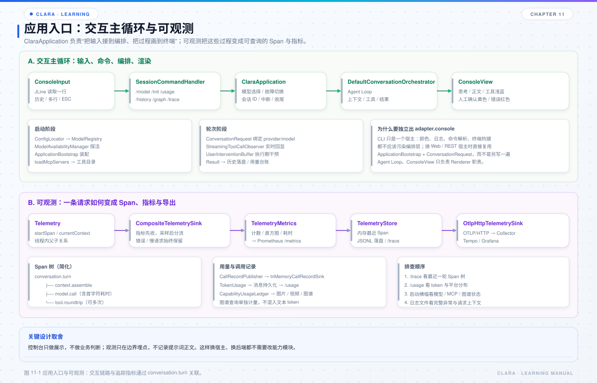

# 第 11 章 应用装配、CLI 与可观测

## 本章目标

- 理解 `ClaraApplication` 与会话命令的职责边界。
- 掌握 `ApplicationBootstrap` 装配了哪些组件、顺序为什么重要。
- 理解 Telemetry 的装配顺序、Span 树和几种导出方式。



*图 11-1 应用入口与可观测：交互链路在左侧，追踪与指标在右侧。*

## 11.1 ClaraApplication 的定位

`ClaraApplication` 是交互式对话入口：

- 解析启动参数；
- 检查模型可用性；
- 装配 `ApplicationBootstrap`；
- 逐行读取输入；
- 处理内置命令；
- 渲染流式输出、工具调用、错误和状态；
- 退出或 `/init` 时释放资源。

它不承载业务能力：配置定位交给 `ConfigLocator`，显示交给 `ConsoleView`，命令处理交给 `SessionCommandHandler`，模型状态交给 `ModelRegistry`。

## 11.2 ApplicationBootstrap 装配顺序

构造 `ApplicationBootstrap` 时大致按下面的顺序：

1. 读取 Milvus 配置，决定语义记忆实现；
2. 创建 token 估算器；
3. 创建统一模型入口 `CompatibleStream`；
4. 创建技能注册表并 reload；
5. 创建 MCP 注册表、能力目录、发现服务、网关、外部工具目录；
6. 创建工具执行器、内置工具；
7. 创建窗口记忆工厂、语义召回、技能匹配、上下文装配；
8. 创建编排器、工具往返协调器、调用记录接收方；
9. 创建工作流引擎、动作工厂、定义注册表、运行器；
10. 注册内置工具：`run_workflow`、`publish_workflow`、`validate_execution_plan`。

顺序重要，因为后面的组件依赖前面的组件。例如：

- `ContextAssembler` 需要技能匹配和图谱补充；
- `ToolRoundTripCoordinator` 需要统一的 `IToolInvoker`；
- 工作流动作工厂需要编排器和模型注册表；
- `run_workflow` 需要 `WorkflowRunner` 已经就绪。

构造本身不访问网络，MCP 连接推迟到 `loadMcpServers`；历史目录和文件锁也推迟到首次真正读写。

## 11.3 会话命令

| 命令 | 作用 |
| --- | --- |
| `/?` / `/help` | 显示命令帮助 |
| `/model` | 重新选择模型 |
| `/init` | 重新检测模型、重建技能 / MCP 连接，保留当前会话 |
| `/compress` / `/compact` | 压缩当前上下文为摘要 |
| `/new` | 开始新对话，旧历史保留 |
| `/usage` / `/tokens` | 统计 token 用量与平台分布 |
| `/history` | 查看历史聊天记录 |
| `/history clear` | 清空全部历史 |
| `/history clear -n N` | 清理最早 N 条 |
| `/history clear -t N` | 清理最新 N 条 |
| `/graph` | 查看当前工作目录的图谱状态 |
| `/graph import` | 导入当前工作目录 |
| `/trace` | 查看最近一轮执行链路 |
| `/trace list` | 列出最近链路 |
| `/trace <traceId>` | 查看指定链路 |
| `/log` / `/verbose` | 切换精简 / 全量日志 |
| `/color` | 开关彩色输出 |
| `exit` / `quit` / `/exit` | 结束会话 |

输入体验：

- `Enter` 发送；
- `Shift+Enter` / `Ctrl+Enter` 换行；
- 上 / 下方向键召回历史输入；
- 执行中连按两次 ESC 取消本轮。

## 11.4 控制台渲染

`ConsoleView` 负责：

- 彩色输出；
- 思考、正文、工具调用、错误、状态行的区分；
- 启动横幅；
- 历史记录展示；
- 用量趋势图；
- 日志落盘。

几个约定：

- 工具调用使用浅蓝色，便于和正文区分；
- 需要人工确认的提示使用黄色；
- 错误使用红色；
- 模型不可用时只显示平台错误信息和 HTTP 状态码，不显示 RequestID；
- 可用 / 不可用 / 跳过必须带颜色标记。

控制台只是展示层。换 Web / REST 宿主时，应复用 `ApplicationBootstrap` 和 `ConversationRequest`，而不是复制 Agent Loop。

## 11.5 启动横幅

启动横幅会打印：

- Python 运行时；
- 凭据环境变量检查（按变量名去重）；
- 模型可用性检查（可用 / 跳过 / 不可用，带颜色与原因；超时按 `modelCheck` 重试）；
- 当前默认模型与首字符响应时间；
- MCP 服务端与外部工具数量；
- 代码图谱状态；
- 当前 `sessionId`；
- 最近几条历史；
- 自定义工作流清单。

这些信息不是装饰。排查“为什么模型没被调用”“为什么工具不可见”“为什么历史没续接”时，先看启动横幅通常比翻代码更快。

## 11.6 代码图谱初始化

`prepareCodeGraph` 在启动时做两步：

1. **挂载检查**：`autoMount=true` 时确保图谱容器能看到当前工作目录；缺挂载会补一条只读挂载。
2. **导入检查**：`autoImport=true` 时幂等导入当前目录；已导入只提示，没导入则后台发起，不阻塞启动。

为什么挂载排在导入前面：容器看不到目录时，导入会直接失败。

日志会打印每一步的耗时和结果；这是排查“图谱为什么没命中”的第一现场。

## 11.7 MCP 接入

`loadMcpServers` 完成：

```text
扫描 config/mcp
  → 注册服务端
  → 发现能力
  → 发布快照
  → 登记外部工具
```

失败只影响 MCP 接入，不影响对话。启动横幅会显示“服务端数 / 工具数”或失败原因。

## 11.8 可观测装配

`TelemetryRuntime.start` 的顺序：

1. 创建 `TelemetryMetrics`；
2. 创建 `TelemetryStore`（内存最近 Span + JSONL）；
3. 创建 `OtlpHttpTelemetrySink`（可选）；
4. 创建 `SamplingTelemetrySink`；
5. 用 `CompositeTelemetrySink` 组合：指标在前，采样器在后；
6. 创建 `Telemetry`；
7. 启动 Prometheus HTTP 端点（可选）。

为什么指标在采样器之前：token / 错误计数必须全量；采样只影响链路明细，不应影响指标。

采样规则：

- 成功链路按 `sampleRate` 保留；
- 错误、取消、慢请求始终保留；
- `slowTraceMillis` 控制慢请求阈值。

## 11.9 Span 树

一次对话的简化 Span 树：

```text
conversation.turn
  ├── context.window
  ├── context.compress
  ├── context.skill
  ├── context.code_graph
  ├── context.recall
  ├── model.call
  └── tool.roundtrip
```

关键属性：

- `conversationId`、`provider`、`model`、`capability`；
- `first_token_ms`；
- `input_tokens` / `output_tokens` / `total_tokens`；
- `finish_reason`；
- 工具往返次数、调用数、消息数；
- 错误分类与错误码。

`/trace` 读取内存中的最近 Span；JSONL 落盘在 `<工作目录>/.clara/telemetry`；Prometheus 抓取 `/metrics`；OTLP 导出到 Collector，再进入 Tempo / Grafana。

## 11.10 嵌入宿主系统

最小方式：

```java
try (ApplicationBootstrap bootstrap = new ApplicationBootstrap()) {
    bootstrap.modelRegistry().select(modelConfigPath);
    ConversationResult result = bootstrap.orchestrator().converse(request);
    System.out.println(result.getContent());
}
```

注意：

- 生产环境要自己管理 `ProviderConfiguration` 的生命周期；
- 请求必须绑定 `providerConfiguration` 和 `capabilityKind`；
- 需要流式时传入 `observer`；
- 需要取消时传入 `cancellationToken`；
- 需要执行期干预时传入 `userIntervention`。

## 11.11 常见问题

| 现象 | 优先检查 |
| --- | --- |
| 启动横幅没有模型 | `enabledProviders`、配置目录 |
| 控制台没有颜色 | `/color`、终端能力、`forcedColor` |
| `/trace` 为空 | telemetry 是否启用、是否刚启动 |
| Prometheus 抓不到 | `prometheus.host` 是否为 `0.0.0.0`、端口是否占用 |
| OTLP 无数据 | endpoint、网络、Collector 是否启动 |
| `/graph` 失败 | 容器挂载、MCP 注册、工作目录 |
| `/init` 后会话丢了 | `/init` 应保留会话；检查是否误用了 `/new` |

## 11.12 源码阅读路线

1. `clara-application/src/main/java/com/clara/ClaraApplication.java`
2. `clara-sdk/src/main/java/com/clara/ApplicationBootstrap.java`
3. `clara-application/src/main/java/com/clara/adapter/console/SessionCommandHandler.java`
4. `clara-application/src/main/java/com/clara/adapter/console/ConsoleView.java`
5. `clara-sdk/src/main/java/com/clara/telemetry/TelemetryRuntime.java`
6. `clara-sdk/src/main/java/com/clara/telemetry/TelemetryStore.java`
7. `clara-sdk/src/main/java/com/clara/telemetry/TelemetryHttpServer.java`

## 11.13 练习

1. 启动后执行 `/trace`，对照本章 Span 树，找出耗时最长的阶段。
2. 关闭 `telemetry.enabled`，确认 `/trace` 和指标端点的变化。
3. 打开 Prometheus 端点，访问 `/metrics`，找到 token 计数指标。
4. 把 `sampleRate` 调低，观察成功链路和错误链路的保留差异。

## 11.14 自检题

- `ClaraApplication` 和 `ApplicationBootstrap` 的职责边界是什么？
- 为什么 MCP 连接要推迟到 `loadMcpServers`？
- 指标接收端为什么放在采样器之前？
- `/trace` 的数据来自哪里？
- 嵌入宿主时，哪些对象必须由宿主自己管理生命周期？