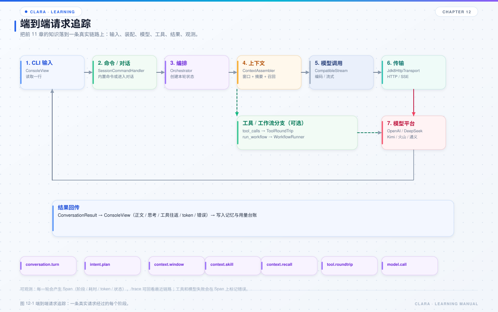

# 第 12 章 端到端请求追踪

## 本章目标

- 把前面各章的类串成一条真实请求。
- 能根据现象判断问题落在“输入、上下文、模型、工具、工作流、渲染”哪一段。
- 学会用 `/trace`、日志和启动横幅做证据链。



*图 12-1 端到端请求追踪。*

## 12.1 场景 A：让 Clara 分析一个类的引用

用户输入：

```text
帮我分析一下 PackageRuleDescriptionService 这个类被哪些类使用过
```

### 第 1 步：输入

- `ConsoleInput` 读取一行；
- `SessionCommandHandler` 判断不是 `/` 命令；
- `ClaraApplication` 构造 `ConversationRequest`，填入 `conversationId`、`provider`、`model`、`capabilityKind=CHAT`、`userInput`。

### 第 2 步：绑定上下文

- `DefaultConversationOrchestrator.converse` 校验请求；
- `ConvContext` 绑定 provider 配置、能力、取消令牌、traceId；
- `WindowMemoryFactory` 按“会话 + provider + model”创建窗口记忆。

### 第 3 步：追加用户消息

- `appendUserTurn` 把用户输入写入窗口记忆；
- 如果用户带图片，构造 `UserVisionContent`；否则构造 `UserContent`。

### 第 4 步：意图计划

- `IntentPlanCoordinator.prepare` 判断是简单任务还是复杂任务；
- “分析一个类的引用”通常是多步骤任务，可能生成执行计划；
- 计划经 `ExecutionPlanValidator` 校验后，作为本轮 `extraPrompts` 注入，不写入历史。

### 第 5 步：上下文装配

- 读取历史；
- 按窗口策略裁剪；
- 压缩历史工具结果；
- 对淘汰消息生成摘要；
- 技能匹配：可能命中 `code_graph_guide` 或相关提示词；
- 图谱补充：如果 `codeGraph.supplement=true`，先查一次图谱；
- 语义召回：从 Milvus 找回被窗口淘汰的相关历史；
- 拼接 system：extra → base → skill → graph → summary → recall。

### 第 6 步：模型调用

- `CapabilityDispatcher.invoke` 调用 `IStreamModel`；
- `CompatibleStream` 转发到 `kernel.Jdk8HttpTransport`；
- 请求编码、发送、SSE 解析；
- `FirstTokenObserver` 记录首字符；
- `StreamingToolCallObserver` 合并工具调用；
- `CallRecordPublisher` 记录调用；
- token 用量累加。

### 第 7 步：工具往返（可能多轮）

模型可能调用：

- `code_graph`：查图谱中的类、方法、引用关系；
- `text_search`：图谱没覆盖时，在本地文件里搜索；
- `file_ops`：读取源码、确认实现；
- `run_command`：执行必要的命令。

`ToolRoundTripCoordinator`：

- 执行工具；
- 把结果按 `callId` 回填；
- 写回历史；
- 回到模型，直到没有工具调用。

### 第 8 步：完成

- 模型给出最终答复；
- `ConversationResult` 包含正文、思维链、状态、工具往返次数、token 用量；
- assistant 消息写入窗口记忆；
- 本地历史落盘；
- `ConsoleView` 渲染正文、工具调用和状态行。

### 失败点速查

| 阶段 | 失败表现 | 优先看 |
| --- | --- | --- |
| 输入 | 命令没被识别 | `SessionCommandHandler` |
| 绑定 | provider 为空、模型不存在 | `ModelRegistry`、启动横幅 |
| 上下文 | 爆 token、摘要失败 | `ContextAssembler`、`WindowPolicy` |
| 模型 | 401/403/429/超时 | 传输错误、`/trace` 的 `model.call` |
| 工具 | Schema 错、脚本失败 | 工具结果里的 error |
| 图谱 | 容器看不到目录 / 未导入 | `/graph`、启动图谱日志 |
| 渲染 | 有结果但没显示 | `ConsoleView`、日志模式 |

## 12.2 场景 B：视频生成与人工确认

用户输入：

```text
生成一个 5 秒的产品展示视频，主题是智能音箱
```

### 第 1 步：模型选择工作流

模型看到 `run_workflow` 的工具描述，决定调用：

```json
{
  "workflow": "video_generation",
  "inputs": {"subject": "智能音箱产品展示，5 秒"}
}
```

### 第 2 步：工作流执行到 HUMAN

`video_generation.yml`：

```text
AGENT 优化提示词
  → HUMAN 等待确认
  → CONDITION
```

`WorkflowRunner` 返回：

```json
{
  "status": "WAITING_INPUT",
  "waitingForUser": true,
  "display": "请确认提示词和参数……",
  "nextAction": {"tool": "run_workflow", "arguments": {...}}
}
```

### 第 3 步：本轮提前结束

`ToolRoundTripCoordinator.userInputRequest` 检测到 `waitingForUser=true`，返回提示文本；编排把 `pausedForUserInput=true` 放进 `ConversationResult`，本轮结束。

**关键：模型不能自己批准。** 必须由用户下一轮输入“同意”或修改意见。

### 第 4 步：恢复

用户输入“同意”后，模型按 `nextAction` 用同一 `instanceId` 调用 `run_workflow`：

```json
{
  "workflow": "video_generation",
  "instanceId": "video_generation-1712345678901",
  "inputs": {"promptFeedback": "approve"}
}
```

工作流继续执行视频节点，产物下载到 `.clara/media/videos`。

### 失败点速查

| 阶段 | 失败表现 | 优先看 |
| --- | --- | --- |
| 工作流选择 | 模型没调用 `run_workflow` | 工具描述、常驻提示词 |
| 人工确认 | 模型自己往下执行 | `waitingForUser` 检测、动作层确认标记 |
| 恢复 | 新实例而不是续接 | 是否传了同一 `instanceId` |
| 视频平台 | 403 / 余额 / 参数错误 | 平台配置、错误码 |
| 下载 | 平台成功但本地无文件 | `VideoDownloader`、工作目录权限 |

## 12.3 用 `/trace` 做证据链

一次请求结束后执行：

```text
/trace
```

你会看到类似：

```text
conversation.turn        12.4s
  context.window          18ms
  context.skill          420ms
  context.code_graph     2.1s
  context.recall          35ms
  model.call             8.2s
  tool.roundtrip         1.3s
  model.call             2.4s
```

阅读方法：

- `context.code_graph` 很慢：考虑关闭 `supplement`，让模型按需调用；
- `context.recall` 很慢：检查 Milvus；
- `model.call` 很慢但首字符快：模型在生成大量正文；
- `model.call` 首字符慢：平台排队、思维链、网络；
- `tool.roundtrip` 很慢：脚本或外部服务慢。

## 12.4 日志与终端的分工

- **终端**：给用户看的过程，受 `/log`、`/color` 影响；
- **详细日志**：完整记录，始终落盘；
- **Span**：结构化耗时与属性；
- **调用记录**：模型请求 / 响应的摘要；
- **JSONL**：可离线分析。

排查顺序建议：

1. 启动横幅：模型、MCP、图谱是否正常；
2. `/trace`：哪一段慢或失败；
3. 详细日志：异常栈、请求上下文；
4. 平台返回：HTTP 状态、错误码、余额；
5. 配置：模型、MCP、工作流是否指向预期文件。

## 12.5 一次请求的“责任田”

| 问题 | 应该改哪里 |
| --- | --- |
| 模型选错 | 工具描述、常驻提示词、意图计划 |
| 上下文太大 | 窗口策略、工具结果压缩、摘要 |
| 工具参数错 | 工具 Schema、工具描述 |
| 工作流步骤错 | YAML 定义、节点输出键 |
| 人工确认被绕过 | 工作流 HUMAN 节点、动作层检查 |
| 终端显示乱 | `ConsoleView` |
| 指标缺失 | `TelemetryRuntime`、采样配置 |
| 历史丢失 | 工作目录、窗口键、存储实现 |

## 12.6 练习

1. 用 `/trace` 记录一次“分析类引用”的完整 Span 树，标注每个阶段对应的类。
2. 人为让图谱不可用，观察模型是否回退到 `text_search`。
3. 走一遍视频工作流，确认“未确认时不会调用视频平台”。
4. 把一次失败请求的日志、Span、平台错误整理成一条证据链。

## 12.7 自检题

- 一条用户输入从终端到模型，经过哪些类？
- 工具往返失败时，为什么整轮不一定失败？
- 工作流暂停后，为什么不能由模型自己确认？
- `/trace` 中最能反映“首字慢”的字段是什么？
- 如果最终有结果但终端没显示，应该先看哪一层？