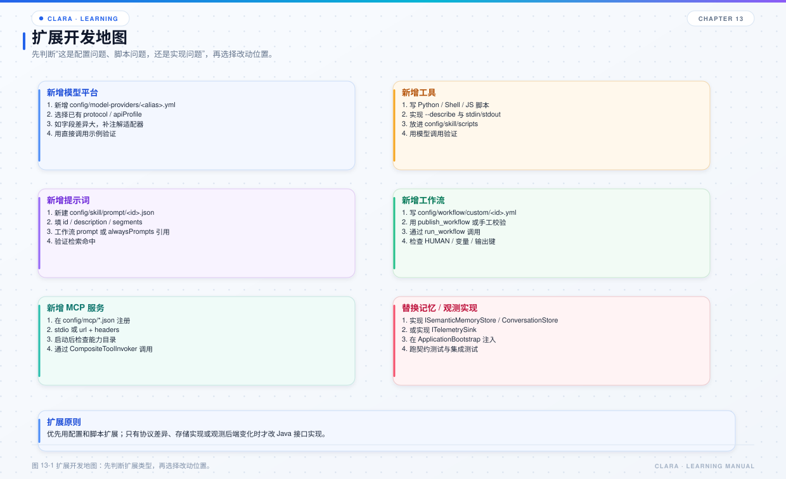

# 第 13 章 扩展开发指南

## 本章目标

- 面对一个新需求，能判断它应该落在哪个模块。
- 掌握新增模型、工具、MCP、工作流、记忆后端、观测接收端的标准做法。
- 知道哪些地方不能改，避免破坏契约。



*图 13-1 扩展开发地图。*

## 13.1 先判断扩展类型

| 需求 | 优先改哪里 | 通常不需要改 |
| --- | --- | --- |
| 同一平台新增一个模型 | `config/model-providers/*.yml` | Java 代码 |
| 接入一个全新平台 | `ModelProviderEnum` + 注解规则 + 配置 | 编排层 |
| 新增一个脚本工具 | `config/skill/scripts/**.py` | `DefaultToolExecutor` |
| 新增一个声明式工具 | `config/skill/tools/**.json` | 注册表 |
| 接入外部 MCP | `config/mcp/*.json` | `clara-mcp` |
| 新增工作流 | `config/workflow/*.yml` | 引擎 |
| 让模型生成工作流 | `publish_workflow` + `custom/` | 手动拷贝 |
| 换语义库 | 实现 `ISemanticMemoryStore` + 装配 | 编排层 |
| 换观测后端 | 实现 `ITelemetrySink` + `TelemetryRuntime` | 业务模块 |
| 做 Web / REST 宿主 | `ApplicationBootstrap` + `ConversationRequest` | `ClaraApplication` |

## 13.2 新增模型别名（同平台）

这是最常见的扩展，只改配置：

1. 复制一个现有 YAML；
2. 修改文件名（别名）；
3. 修改 `provider`、`endpoint`、`modelId`、`apiProfile` / `protocol`；
4. 确认 `credential.environmentVariable`；
5. 把别名加入 `config/clara.yml` 的 `enabledProviders`；
6. 启动或 `/init`，确认可用性检查。

注意：

- 文件名就是别名，不要和已有别名冲突；
- `allowedOrigins` 必须覆盖 endpoint；
- `maxResponseBytes` 会影响单次输出预算；
- 不要提交包含明文密钥的本地配置。

## 13.3 接入全新平台

如果 `ModelProviderEnum` 中没有该平台，需要：

1. 在 `clara-core` / `clara-enums` 中增加平台枚举；
2. 在请求 / 响应字段上补充 `@ProviderAdapter` 规则；
3. 如果协议不同，补充 `@ProtocolField` 或新的编码器 / 解码器；
4. 增加 YAML；
5. 在 `enabledProviders` 中启用；
6. 用探活和一条最小对话验证。

原则：**平台差异放注解和配置，不要放 `CompatibleStream` 或编排层。**

## 13.4 新增脚本工具

步骤：

1. 在 `config/skill/scripts/<domain>/` 下创建 `.py`；
2. 定义 `_TOOL` 字典（id、name、type、description、parameters、metadata）；
3. 支持 `--describe` 输出 JSON；
4. 正常执行时从 stdin 读参数，stdout 输出 JSON；
5. 错误写到 stderr，不要混入 stdout；
6. 用 `python script.py --describe` 自测；
7. 在对话中让模型调用，确认工具可见。

要点：

- 描述要写清“什么时候用、什么时候不用”，这是模型选择工具的主要依据；
- `parameters` 要尽量收窄，减少误调用；
- 输出必须是合法 JSON；
- 涉及文件 / 命令时，注意工作区边界和权限。

## 13.5 新增声明式工具

如果工具由 Java 内置执行器实现：

1. 在 `config/skill/tools/**/*.json` 增加声明；
2. 在 `ApplicationBootstrap` 注册对应的 `BuiltinToolExecutor`；
3. 实现工具逻辑；
4. 确保返回 JSON；
5. 加测试。

已有内置工具：

- `run_workflow`
- `publish_workflow`
- `validate_execution_plan`

## 13.6 接入 MCP 服务端

1. 在 `config/mcp/*.json` 增加 `mcpServers` 项；
2. stdio 用 `command` / `args` / `env`；
3. HTTP 用 `url` / `headers`；
4. 启动或 `/init`；
5. 看启动横幅的“服务端数 / 工具数”；
6. 让模型调用一个工具验证。

常见坑：

- 命令不在 PATH；
- 容器没运行；
- 工作目录没挂载；
- Header 里有未替换的 `${...}`；
- 服务端协议版本不兼容；
- 工具 Schema 变更后没刷新快照。

## 13.7 新增工作流

1. 在 `config/workflow/` 新建 YAML；
2. 定义 `workflowId`、`version`、`root`；
3. 只用支持的节点类型；
4. 动作节点声明唯一的 `outputKeys`；
5. 用 `${...}` 引用上游输出；
6. 需要人工确认时用 `HUMAN`；
7. 用 `run_workflow` 或直接调用 `WorkflowRunner` 验证。

自定义工作流：

- 放到 `config/workflow/custom/`；
- 注册表按文件签名热加载；
- 也可以让模型用 `publish_workflow` 生成并发布。

## 13.8 换记忆后端

如果要接新的向量库：

1. 实现 `ISemanticMemoryStore`；
2. 实现 `IEmbeddingClient`（如果嵌入方式也变）；
3. 在 `ApplicationBootstrap` 中根据配置选择实现；
4. 保持 `MemoryEntry`、`SemanticMemoryQuery` 的语义；
5. 加集成测试。

不要改编排层的召回逻辑。`SemanticRecallCoordinator` 只依赖接口，换后端不应影响它。

## 13.9 换观测后端

如果要接新的追踪系统：

1. 实现 `ITelemetrySink`；
2. 在 `TelemetryRuntime` 中组合到 `CompositeTelemetrySink`；
3. 决定它在采样器之前还是之后；
4. 保证失败不影响业务；
5. 加关闭逻辑。

指标接收端应放在采样器之前，保证计数全量。

## 13.10 做 Web / REST 宿主

不要在 Controller 里复制 Agent Loop。正确方式：

```java
try (ApplicationBootstrap bootstrap = new ApplicationBootstrap()) {
    bootstrap.modelRegistry().select(modelConfigPath);
    ConversationResult result = bootstrap.orchestrator().converse(request);
}
```

宿主负责：

- HTTP 请求解析；
- 用户 / 会话标识；
- `ProviderConfiguration` 生命周期；
- 流式响应桥接；
- 取消令牌；
- 执行期用户输入；
- 鉴权、限流、审计。

Clara 负责：

- 上下文装配；
- 模型调用；
- 工具往返；
- 工作流；
- 记忆；
- 可观测。

## 13.11 扩展检查清单

- [ ] 新代码是否放在正确的模块？
- [ ] 有没有让能力模块反向依赖 `application`？
- [ ] 有没有把平台差异写成 `if/else`？
- [ ] 有没有绕过 Schema、权限或人工确认？
- [ ] 配置是否加入 `enabledProviders` / 正确目录？
- [ ] 热加载还是重启，是否验证过？
- [ ] 是否加了单元测试或集成测试？
- [ ] 是否更新了 readme / learn 文档？
- [ ] 是否检查了 Sonar / SpotBugs？

## 13.12 练习

1. 只改 YAML，新增一个模型别名并验证 `/model` 能看到。
2. 新增一个脚本工具，让模型在特定输入下调用。
3. 写一个三节点工作流：AGENT → HUMAN → TOOL。
4. 用一个自定义 `ITelemetrySink` 把 Span 打到内存，验证 `TelemetryRuntime` 能组合它。

## 13.13 自检题

- 同一平台新增模型和接入全新平台，改动范围有什么不同？
- 为什么脚本工具的描述如此重要？
- 自定义工作流为什么能热加载？
- 做 Web 宿主时，哪些职责必须由宿主承担？
- 扩展时最容易破坏的架构约束是什么？