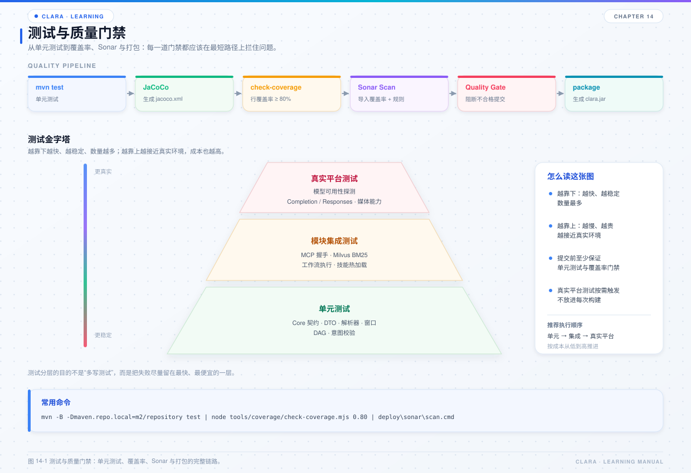

# 第 14 章 测试与质量门禁

## 本章目标

- 了解项目当前的测试结构和技术栈。
- 知道如何按模块跑测试、看覆盖率、执行 Sonar 和 SpotBugs。
- 能为新增能力写出符合项目风格的测试。



*图 14-1 测试与质量门禁。*

## 14.1 技术栈

项目使用：

- JUnit 4.13.2；
- Maven Surefire 3.2.5；
- JaCoCo 0.8.11；
- SpotBugs 4.7.3.6；
- SonarQube（本地脚本 + 质量门禁）。

没有引入 Mockito / AssertJ，测试主要使用手写 fake、内存实现和临时目录。这样测试依赖少、行为可控。

## 14.2 测试目录

测试与源码同模块：

```text
clara-core/src/test/java/com/clara/...
clara-transport/src/test/java/com/clara/...
clara-model/src/test/java/com/clara/...
clara-memory/src/test/java/com/clara/...
clara-mcp/src/test/java/com/clara/...
clara-skill/src/test/java/com/clara/...
clara-workflow/src/test/java/com/clara/...
clara-orchestration/src/test/java/com/clara/...
clara-application/src/test/java/com/clara/...
```

几个代表性测试：

| 模块 | 测试 | 说明 |
| --- | --- | --- |
| core | `ClaraExceptionTest` | 错误模型 |
| transport | `DefaultSseEventParserTest` | SSE 边界 |
| model | `StreamingModelProbeTest` | 探活判定 |
| memory | `LocalConversationStoreTest` | 本地持久化 |
| mcp | `DefaultMcpGatewayTest` | 契约校验 |
| skill | `SkillSchemaValidatorTest` | Schema 校验 |
| workflow | `DefaultWorkflowEngineTest` | 暂停 / 恢复 |
| orchestration | `DefaultConversationOrchestratorLoopTest` | Agent Loop |
| application | `ApplicationBootstrapMcpConfigTest` | MCP 装配 |

## 14.3 运行测试

全量：

```powershell
mvn test
```

单模块：

```powershell
mvn -pl clara-orchestration -am test
```

单个测试类：

```powershell
mvn -pl clara-orchestration -Dtest=DefaultConversationOrchestratorLoopTest test
```

跳过测试构建：

```powershell
mvn -q -pl clara-application -am package -DskipTests
```

## 14.4 覆盖率

`mvn test` 会生成各模块的 JaCoCo 报告：

```text
<module>/target/site/jacoco/index.html
<module>/target/site/jacoco/jacoco.xml
```

项目提供的汇总门禁：

```powershell
node tools/coverage/check-coverage.mjs
```

默认阈值 80%，也可以显式传：

```powershell
node tools/coverage/check-coverage.mjs 0.85
```

口径是“各模块 LINE 计数器的合计行覆盖率”。注意：

- 报告必须先由 `mvn test` 生成；
- 新增模块如果没有测试报告，不会被统计；
- 覆盖率不是目的，关键路径的行为断言更重要。

## 14.5 SonarQube

本地扫描脚本：

```powershell
deploy\sonar\scan.cmd -RunTests -Open
```

或：

```powershell
powershell -ExecutionPolicy Bypass -File deploy\sonar\scan.ps1 -RunTests
```

前置条件：

- 本地 SonarQube 已启动（默认 `http://localhost:9100`）；
- Token 在 `.local/sonar-token.txt` 或 `SONAR_TOKEN`；
- 项目键固定为 `com.clara:clara`。

质量门禁：

```powershell
deploy\sonar\gate.cmd
```

`Clara Gate` 与 `Sonar way` 的主要差异是覆盖率口径：使用 `new_line_coverage >= 80`。

## 14.6 SpotBugs

SpotBugs 配置在根 `pom.xml`，排除规则在：

```text
deploy/static-analysis/spotbugs-exclude.xml
```

执行：

```powershell
mvn spotbugs:check
```

注意：

- 不要为了通过检查而盲目加排除；
- 先判断是真实缺陷、误报，还是设计取舍；
- 排除项要写清原因。

## 14.7 怎么写测试

### 优先测行为，不测实现细节

好的测试：

```java
@Test
public void shouldReturnWaitingInputWhenHumanNodeHasNoInput() {
    // 构造最小工作流
    // 执行
    // 断言 status = WAITING_INPUT
    // 断言 waitingInputKey
}
```

不好的测试：

- 断言私有方法调用次数；
- 断言日志文本的每个字符；
- 依赖真实网络、真实模型、真实 Milvus；
- 依赖执行顺序或系统时间。

### 用 fake 替代外部依赖

项目已有做法：

- `InMemoryConversationStore`；
- `LocalSemanticMemoryStore`；
- fake `IMcpClientFactory`；
- fake `IStreamModel`；
- 临时目录 + `TemporaryFolder`。

### 并发测试要可控

涉及线程池、超时、取消时：

- 用 latch / future 控制时序；
- 不要用 `Thread.sleep` 猜时间；
- 断言最终状态，不依赖中间调度顺序；
- 测试结束要关闭线程池和临时资源。

### 文件测试

- 使用 `TemporaryFolder` 或 `@TempDir`（当前 JUnit 4，优先 `TemporaryFolder`）；
- 显式指定 UTF-8；
- 测试结束清理；
- 不要写到仓库真实目录。

## 14.8 新增功能的测试清单

- [ ] 正常路径；
- [ ] 参数非法；
- [ ] 外部依赖失败；
- [ ] 取消 / 超时；
- [ ] 边界值（空、超长、超大）；
- [ ] 并发（如果涉及共享状态）；
- [ ] 资源释放（流、文件、线程池）；
- [ ] 结构化错误码；
- [ ] 日志不泄漏密钥。

## 14.9 常见问题

| 现象 | 原因 | 处理 |
| --- | --- | --- |
| 测试在 Windows 失败 | 路径分隔符、编码、换行 | 用 `Path` / UTF-8 |
| 测试偶发失败 | 线程时序、端口占用 | 用 latch、随机端口、超时 |
| 覆盖率为 0 | 没跑 `mvn test` | 先生成报告 |
| Sonar 多出一个项目 | 项目键写错 | 固定 `com.clara:clara` |
| SpotBugs 报误报 | 规则过严 | 评估后写排除并注明原因 |
| MCP 测试连真实服务 | 没注入 fake 工厂 | 用包内可见构造器注入 fake |

## 14.10 源码阅读路线

1. 根 `pom.xml`：Surefire、JaCoCo、SpotBugs 配置。
2. `sonar-project.properties`：扫描范围与质量门禁。
3. `deploy/sonar/scan.ps1`：本地扫描流程。
4. `tools/coverage/check-coverage.mjs`：覆盖率门禁口径。
5. 各模块 `src/test`：挑一个测试看 fake 的写法。

## 14.11 练习

1. 只跑 `clara-orchestration` 的测试，确认耗时和结果。
2. 生成 JaCoCo 报告，打开一个模块的 HTML，找未覆盖的分支。
3. 执行覆盖率门禁，记录当前总覆盖率。
4. 为一个工具类补一个边界测试，确认覆盖率变化。
5. 执行 Sonar 扫描，处理一个真实问题而不是加排除。

## 14.12 自检题

- 项目为什么用手写 fake 而不是 Mockito？
- 覆盖率的统计口径是什么？
- Sonar 项目键为什么不能写成 `com.clara:clara-parent`？
- 并发测试为什么不应依赖 `Thread.sleep`？
- 新增功能最少应该覆盖哪些测试场景？