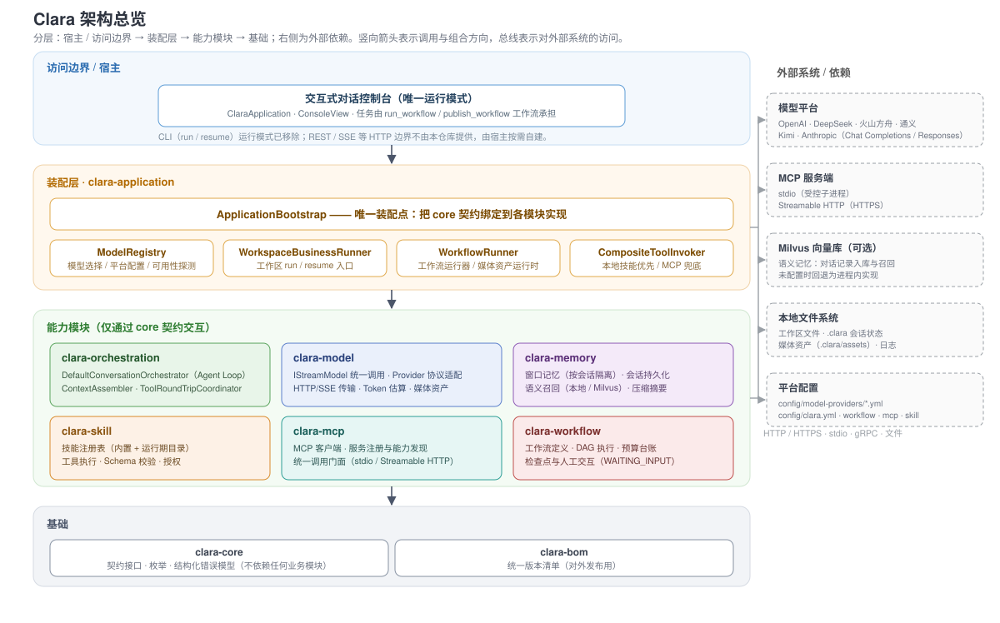
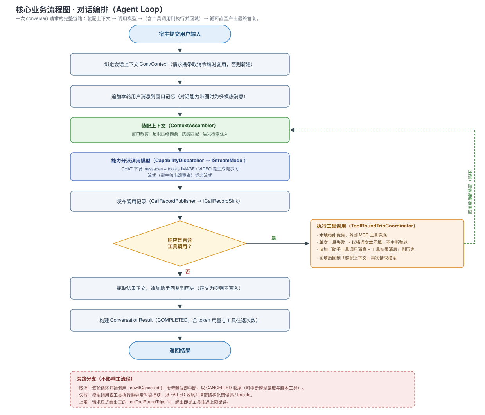
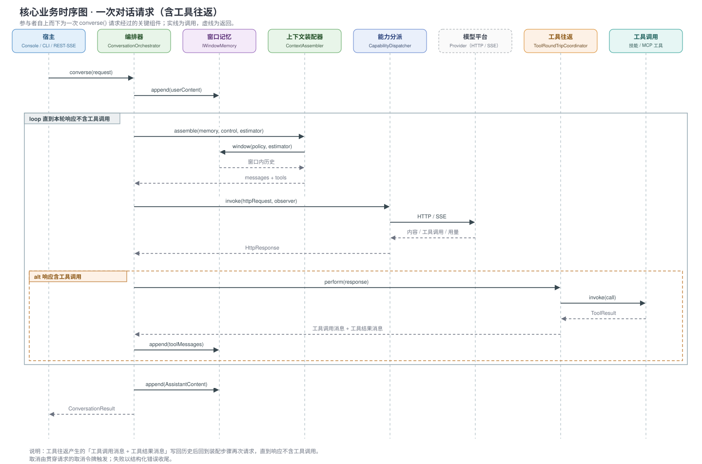

# Clara

Clara 是一套面向 Java 8 的 AI 应用运行时库。它提供模型调用、会话记忆、MCP 客户端、工作流编排、任务规划、技能注册与执行、工作区文档读写与媒体生成等能力，并拆分为可独立复用的 Maven 模块，便于嵌入 Java 系统。

> Clara 当前是「库 + 控制台」形态，不是开箱即用的独立服务。仓库没有 Spring Boot 或 Web 容器；clara-application 提供交互式控制台与装配入口，REST / SSE 等边界由宿主应用按需自建。宿主负责装配、配置、鉴权、持久化与交互 UI。

## 项目目标

- 以 Java 8 API 与字节码为基线，提供统一、稳定的 AI 能力接口。
- 隔离不同模型供应商的协议与 SDK，避免供应商类型泄漏到业务代码。
- 让超时、取消、租户身份与可观测信息贯穿每次外部调用。
- 为有状态、长耗时、需要人工确认的业务提供重试、恢复与幂等能力。
- 为网络、凭据、文件系统与工具访问建立明确安全边界。

## 架构



### 模块说明

| 模块 | 职责 | 主要使用场景 |
| --- | --- | --- |
| clara-bom | 统一管理各模块版本 | 外部项目通过 dependencyManagement 导入 |
| clara-core | 能力/角色/协议及各领域枚举（document / interaction / memory / planner / skill / workflow）、结构化错误模型与跨模块契约（含媒体契约与值对象） | 所有模块的公共基础 |
| clara-transport | 通用 HTTP / SSE 传输实现（连接与超时、体积上限、SSE 解析、有界流、端点与请求头校验） | 模型调用与 MCP 调用共享同一套传输语义 |
| clara-model | 调用上下文、Provider 配置、模型调用实现（协议编解码、Token 估算、嵌入、传输适配） | 同步/流式对话、Embedding、Token 估算与 OpenAI/DeepSeek/火山方舟/阿里云/Kimi/Anthropic 协议适配 |
| clara-memory | 窗口记忆、会话持久化、语义记忆 | 消息/Token 窗口裁剪、本地/JDBC 会话存储、Milvus 召回 |
| clara-mcp | MCP 客户端、服务注册表、能力目录、协议传输适配与外部工具路由 | stdio 或 Streamable HTTP 接入外部 MCP 工具、资源与提示词 |
| clara-workflow | 工作流定义、DAG 执行、任务规划、预算台账、人工交互网关、内置动作与运行支撑 | 多步骤任务、并行/条件/循环节点、失败恢复与 WAITING_INPUT 挂起 |
| clara-orchestration | 对话编排、上下文组装、工具往返、技能匹配 | 组合模型、记忆、技能、工具与工作流 |
| clara-skill | 技能注册表、执行器、Schema 校验与工具执行 | 业务能力封装为可版本化、可授权的技能 |
| clara-application | 应用装配、交互式控制台入口、文档解析、会话/工具/媒体装配 | 构建可执行 clara.jar |

### 模块依赖

- **clara-core 不依赖任何业务模块**，只提供契约、枚举与错误模型。
- **clara-transport 只依赖 core**，提供通用 HTTP / SSE 实现；model 与 mcp 依赖 transport。
- 各能力模块（model / memory / mcp / workflow / skill）依赖 core，并按需相互依赖（如 memory 依赖 model）。
- **clara-orchestration 仅通过接口使用各能力**，不接触 Provider / Store / Transport 实现。
- **clara-application 负责整体装配**，业务模块不得反向依赖应用模块。

### clara-bom 是否参与构建

仓库内部由根 pom.xml 统一聚合与版本管理，clara-bom 只作为对外发布的版本清单。对外发布时建议保留；若项目永远只在仓库内使用，可删除 clara-bom 并从根 POM 的 modules 中移除。

## 核心业务流程

Clara 的核心业务是**对话编排**：一次用户请求依次经过「装配上下文 → 调用模型 →（若响应要求调用工具则执行工具并回填）→ 循环直至产出最终答复」。交互式对话与工作区 run / resume 最终都收敛到同一条编排链路（`DefaultConversationOrchestrator.converse`）。

### 流程图



要点：

- **循环的出口**是「响应不含工具调用」——此时才提取正文并结束本轮。
- **工具往返**：本地技能优先、外部 MCP 工具兜底；单次工具失败以错误文本回填而不中断整轮，让模型可据错误自行修正。
- **取消**：请求携带的取消令牌贯穿全链路，令牌置位后模型读取与脚本工具在检查点立即终止，以 CANCELLED 收尾。
- **失败**：模型调用或工具执行异常被捕获，以 FAILED 收尾并携带结构化错误码与 traceId。

### 时序图



一次请求的关键交互：宿主调用编排器 → 编排器写入用户消息 → 循环内装配上下文并调用模型 → 模型返回内容或工具调用 → 命中工具调用时由工具往返协调器执行本地技能 / MCP 工具并回填历史 → 直到不再有工具调用，追加助手回复并返回结果。

## 构建要求

- JDK 8 或更高（JDK 9+ 自动启用 release=8）。
- Maven 3.3.9 或更高。
- 源文件编码 UTF-8。
- 产物为 Java 8 class-file 版本 52。
- 使用远程模型、远程 MCP 或 Milvus 时需要对应网络与凭据。

## 构建与验证

```powershell
mvn clean verify
```

只构建某模块并测试：

```powershell
mvn -pl clara-model -am test
```

打包可执行 fat jar（输出 clara.jar）：

```powershell
mvn -q -pl clara-application -am package -DskipTests
```

安装到本地 Maven 仓库：

```powershell
mvn clean install
```

项目未发布到公共中央仓库，外部项目使用前需先 mvn install 或由团队部署内部仓库。

## 快速开始

### 1. 构建 jar

```powershell
mvn -q -pl clara-application -am package -DskipTests
```

### 2. 准备模型 Provider 配置

clara.jar 启动时扫描 config/model-providers 下的 *.yml / *.yaml（排除 examples 目录与 *.example.yml）。首次使用可复制示例并填入真实模型 ID 与凭据：

```powershell
Copy-Item config/model-providers/examples/openai.example.yml `
    config/model-providers/local/openai.yml
```

local 目录已在 .gitignore 中忽略，适合保存本机真实配置；examples 只保留占位值。

### 3. 交互式对话

```powershell
java -jar clara.jar
```

或使用启动脚本（脚本将启动目录设为 CLARA_WORK_DIR）：

```powershell
# Windows
clara.bat

# Linux / macOS
./clara.sh
```

对话内可用命令：

| 命令 | 作用 |
| --- | --- |
| /model | 选择并切换模型 |
| /log（/verbose） | 切换精简/完整日志 |
| /color | 开关 ANSI 颜色 |
| ESC（执行中连按两次） | 取消本轮正在进行的模型调用与工具执行 |
| exit / quit（/exit） | 退出 |

完整日志始终写入 logs 目录下 clara-时间戳.log。

执行中可按 ESC 请求取消：首次 ESC 仅提示（防误触），5 秒内再按一次 ESC（或回车 / y）才真正取消；取消后本轮模型流式读取与正在运行的脚本工具都会在检查点立即终止，本轮以 `CANCELLED` 状态收尾。该能力依赖终端原始模式（JLine），在非交互环境（如把标准输入重定向）下会提示不可用并自动跳过。

对话历史按工作目录持久化：会话标识由工作目录推导（启动横幅的 `sessionId`），历史写入 `<工作目录>/.clara/state/conversations`，因此**退出后再次进入同一目录会续接上次的上下文**（换目录即换上下文）。删除该目录即清空历史；同一目录下同时只允许一个 Clara 实例（历史目录有排他锁），第二个实例会提示并降级为进程内历史（本次退出即丢失）。

### 4. 自然语言提交任务

clara.jar 只有交互式对话一个入口（com.clara.ClaraApplication），任务用自然语言描述，由模型选择工具或工作流执行：

```powershell
java -jar clara.jar
```

- 读取本地目录、整理技术文档、生成需求与技术方案、生成开发计划、生成 / 编辑 / 识别图片等，直接说明诉求即可（模型会调用 run_workflow 工作流）。
- 需要固定流程时，可让模型生成自定义工作流（内置工具 publish_workflow），或直接写入 config/workflow/custom，随后在对话里按名调用。
- 交互指令、取消、日志与目录结构见「3. 交互式对话」。

> 历史说明：早期版本另有 `run` / `resume` 子命令与 `--ui plain|json-detached|json-stream` 等 CLI 选项（clara-application 的 adapter/cli 适配层）。该适配层已删除——它没有生产调用方（jar 入口一直是 ClaraApplication），相应能力改由工作流承担。

## 模型 Provider 配置

推荐用 YAML 描述平台配置。每个「平台 + 调用方式（协议）」一个文件（同一平台可拆成 completion / response 等调用方式），例如：

```text
config/model-providers/
|-- examples/
|   |-- openai.example.yml
|   |-- deepseek.example.yml
|   `-- volcengine.example.yml
`-- local/
    `-- README.md
```

主要节点：

| 节点 | 说明 |
| --- | --- |
| provider | 平台枚举：OPENAI、DEEPSEEK、VOLCENGINE、ALIBABA、KIMI、ANTHROPIC |
| credential.secretRef | 凭据引用名，文件内唯一稳定 |
| credential.environmentVariable | 推荐：从环境变量读取 API Key |
| credential.apiKey | 仅限被 Git 忽略的本地文件 |
| transport.allowedOrigins | HTTP 来源白名单，只写协议、主机、可选端口 |
| transport.connectTimeoutMillis | 建连超时（毫秒） |
| transport.readTimeoutMillis | 读取超时（毫秒） |
| transport.maxRequestBytes | 请求体最大字节数 |
| transport.maxResponseBytes | 响应体最大字节数 |
| transport.allowHttp | 是否允许明文 HTTP，生产保持 false |
| transport.headers | 平台默认请求头，调用方同名头优先 |
| capabilities.<name>.endpoint | 能力 API 地址 |
| capabilities.<name>.modelId | 账号实际可用的模型或 endpoint ID |
| capabilities.<name>.apiProfile | 协议版本标识 |
| capabilities.<name>.parameters | 能力级默认参数 |

示例见 config/model-providers/examples/openai.example.yml。

### Java 加载示例

```java
import com.clara.kernel.config.ProviderConfiguration;
import com.clara.model.configuration.ProviderYamlConfigurationLoader;
import java.nio.file.Paths;

ProviderYamlConfigurationLoader loader = new ProviderYamlConfigurationLoader();
try (ProviderConfiguration provider = loader.load(
        Paths.get("config/model-providers/local/openai.yml"))) {
    // 在 provider 关闭前完成模型注册与调用
}
```

配置加载默认拒绝超过 1 MiB 的文件、未知字段、非 HTTPS URI、非法扩展名与越界扫描，且只加载明确指定的单个文件。

模型配置由 `ConfigLocator` 定位（`config/model-providers/**`，按 `config/clara.yml` 的 `enabledProviders` 过滤启用项），加载、缓存与生命周期由 `ModelRegistry` 统一负责。

### 模型不可用时的自动切换

启动期可用性检查除了给出「哪些模型可用」，还给出它们的首字符响应时间顺序；该顺序在会话期间同时用作故障转移顺序：

- 某一轮若失败原因属于「当前模型用不了」（401 / 403 / 429 / 5xx、连接失败、超时、凭据不可用，或模型一个字节都没回），自动按响应时间顺序切到下一个可用模型重试，并打印一行 `[failover] 已切到 <别名>`。
- 切换会写入会话当前模型（后续轮次默认用它）；不做静默切换，每次切换都有一行说明。
- 只有「模型不可用」才换：入参非法、内容安全、体积超限、用户取消等一律如实报错；换模型解决不了这些，硬换只会把真实失败原因掩盖掉。
- 本轮已经执行过工具调用的不再换（工具可能有副作用，重放等于把副作用重做一遍），直接报错。
- 试完全部可用模型仍失败时，提示用 `/model` 手动指定，或检查网络与凭据。
- 会话历史按「会话 + 平台 + 模型」隔离：切到新模型后，它读到的是自己那份历史（可能为空）；用 `/model` 切回原模型即恢复原上下文。

## 会话上下文

ConvContext 标识一次对话会话，CallContext 标识会话中的一次调用，二者贯穿传输、SSE 解析与外部调用。

| 类型 | 字段 | 说明 |
| --- | --- | --- |
| ConvContext | userId | 发起会话的用户，可空 |
| ConvContext | convId | 会话标识，与 clara-memory 会话 ID 同源同值 |
| ConvContext | historyCall | 已登记的历史调用 |
| CallContext | traceId | 端到端跟踪标识，每次调用自动生成 |
| CallContext | deadlineEpochMillis | 绝对截止时间（Unix epoch 毫秒） |
| CallContext | cancellationToken | 协作式取消信号 |

```java
import com.clara.context.ConvContext;
import com.clara.enums.CapabilityKindEnum;

ConvContext conversation = new ConvContext(
        "user-1001",
        "conversation-42",
        providerConfiguration,
        CapabilityKindEnum.CHAT);

CallContext call = conversation.newCall(30_000L);
conversation.cancel(); // 中止整个会话
```

注意：newCall 每次生成新 traceId 并复用会话取消令牌；取消是协作式的；ConvContext 通过 ThreadLocal 绑定当前线程，跨线程需显式 bind 并在 finally 中 clear；取消幂等。

## 错误处理

Clara 使用 ClaraException 携带结构化 ClaraError，主要字段：

| 字段 | 说明 |
| --- | --- |
| code | 稳定错误码，供分支判断 |
| category | 配置/校验/认证/授权/能力/限流/超时/取消/冲突/资源限制/内容安全/外部服务等 |
| safeMessage | 可安全跨越系统边界的文案 |
| retryable | 是否可重试恢复 |
| provider / providerCode | 供应商及其原始错误码 |
| retryAfterMillis | 建议等待毫秒数 |
| traceId | 跟踪标识 |
| safeDetails | 可安全外发的补充信息 |

系统边界统一转换错误：可恢复错误做有上限退避；认证/授权直接失败；日志保留错误码与 traceId，不记录 API Key、Authorization 头或完整响应正文。

## 会话记忆

- 消息窗口：适合限制历史消息数量的场景。
- Token 窗口：适合上下文受限、动态裁剪的场景。
- InMemoryConversationStore 仅进程内有效，重启丢失。
- 需要跨进程恢复时使用持久化 ConversationStore。
- 限制内存驻留可用 BoundedCachingConversationStore 包装，支持 LRU 与条数上限。
- 关闭应用时显式关闭 Closeable 存储。

### 语义记忆与 Milvus（可选）

语义记忆用于长程/跨窗口关联：把对话记录沉淀到 Milvus，并每轮按输入召回相关历史注入上下文。默认关闭，开启方式：

1. 起服务：`docker compose -f deploy/docker-compose.yml up -d`（etcd + MinIO + milvus standalone，gRPC 端口 19530）。
2. 在 `config/clara.yml` 增加 `milvus` 节点（字段与注释见该文件），确保可连上；启动横幅的 `semantic` 一行会显示最终用的是 `local` 还是 `milvus`，据此确认是否生效。

开启后：所有对话记录（按会话隔离，来源 CONVERSATION）写入 Milvus；每轮按输入召回历史上下文注入提示词（默认召回 3 条、阈值 0.7，见 `ContextControlConfig`）。召回方式由 `milvus.mode` 决定：全文检索（BM25）或向量相似度。

注意事项：

- 集合名默认按「项目名 + `_conversations`」生成（即按项目隔离）：项目名取「工作目录的目录名」——优先启动脚本注入的 `CLARA_WORK_DIR`，未注入时用进程当前工作目录，即「从哪个目录启动，就以该目录名为项目名」。**Milvus 集合名只允许 ASCII（字母 / 数字 / 下划线）**，故目录名含中文等非 ASCII 字符时会用拼音转写为英文（如 `我的项目 → wodexiangmu`），其余非法字符折叠为下划线；转写后仍为空时退化为 `p + 目录路径哈希前 12 位`。不同项目使用各自独立的集合，避免互相串数据；也可在 `milvus.collection` 显式指定固定集合名。
- 检索模式（`milvus.mode`）：
  - `bm25`（默认，推荐）：用 Milvus 内置 BM25 全文检索，中文按 `milvus.analyzer`（默认 `chinese`，jieba）分词；不依赖任何嵌入服务，集合里也不存向量。
  - `vector`：把输入向量化后按余弦相似度检索，需要有可用的嵌入服务。离线占位嵌入 `HashingEmbeddingClient` 没有语义（实测同一问题与历史记录的最高余弦分只有 0.08 左右），永远过不了 0.70 的召回阈值，表现为 `[向量]` 一直「召回 0 条」；没有可用 embeddings 端点时不要用这个模式。
  - 两种模式的集合结构不同，**切换模式（或改 `analyzer` / `dimension`）必须重建集合**：把 `milvus.recreateOnSchemaMismatch` 设为 `true`，启动时检测到结构不匹配就自动删除旧集合并按新结构重建。注意重建会清空该集合里的历史记录。
  - 分数口径：BM25 原始分没有上界，回给上层前按 `score / (score + 1)` 单调压到 (0, 1)，所以阈值 0.70 约等于原始分 2.33（实测相关文档 4~7 分、无关文档 1 分上下）。
- **JVM 默认字符集必须是 UTF-8**（`clara.bat` / `clara.sh` 已带 `-Dfile.encoding=UTF-8`）：milvus-sdk-java 拼全文检索占位符时用的是 `String.getBytes()`（平台默认字符集）而不是 UTF-8。中文 Windows 默认 GBK，中文正文会以 GBK 字节发出，Milvus 的 jieba 分词器读到非法 UTF-8 会 panic，并把**整个 Milvus 服务端 abort**（不是这一次检索失败，而是整个记忆库掉线）。手工 `java -jar` 启动时务必自己加该参数；启动期检测到默认字符集不是 UTF-8 且模式为 BM25 时会打印警告。
- `milvus.dimension` 仅向量模式使用，必须与嵌入模型输出维度一致；默认离线占位嵌入 `HashingEmbeddingClient` 为 1024。
- 不写 `milvus` 节点、或写 `enabled: false` 时保持原样：语义记忆用进程内实现，不写对话记录。
- Milvus 连不上时启动会提示并回退为进程内实现（本次不写对话记录），不阻断对话。

## MCP

clara-mcp 支持 stdio 与 Streamable HTTP，围绕注册、初始化、能力发现、目录与统一调用组织：

1. 注册 MCP 服务及传输配置。
2. 建立传输，完成协议初始化与版本协商。
3. 发现并缓存 tools、resources、resource templates 与 prompts。
4. 保存为带版本信息的目录快照。
5. 通过 IMcpGateway 执行工具、读资源、取提示词。
6. 配置变更时重连或刷新；关闭时释放子进程与连接。

注意：stdio 会启动受控子进程，应限制可执行文件路径与工作目录；Streamable HTTP 应使用 HTTPS；发现结果可能过期；InMemoryMcpServerRegistry 适合单实例。

接入外部 MCP 服务端（启动时自动完成）：

- 注册项写在 `config/mcp/*.json` 的 `mcpServers` 映射下，每项给 `command` + `args` + `env`（stdio）或 `url`（Streamable HTTP）。
- 启动时由 `ApplicationBootstrap.loadMcpServers()` 注册 → 握手发现 → 登记工具，横幅打印 `mcp : N 个服务端 / M 个外部工具`。
- 下发给模型的工具声明由 `CompositeToolCatalog` 合并「本地技能工具 + 外部 MCP 工具」，**同名时本地优先**，与 `CompositeToolInvoker` 的调用路由顺序一致。
- stdio 的首项命令必须命中允许清单：清单取自 `config/mcp` 里声明的命令、环境变量 `CLARA_MCP_ALLOWED_EXECUTABLES`（分号或逗号分隔）与 `node` 兜底，逐项按 PATH / PATHEXT 解析成绝对路径；配置里可以写 `npx` 这类裸命令名，工厂会在清单内按文件名解析成绝对路径。
- 子进程在继承父进程环境的基础上叠加配置里的 `env`，因此服务端能取到 `PATH`、`USERPROFILE` 等变量。

### 代码知识图谱（可选）

接入 [codebase-memory-mcp](https://github.com/DeusData/codebase-memory-mcp) 后，读代码会优先走本机知识图谱：

- 部署（二选一）：`deploy/codebase-memory-mcp/install.ps1` 装到宿主；`deploy/codebase-memory-mcp/install-docker.ps1` 走 Docker Compose —— 容器常驻并把待分析仓库只读挂到 `/work/repo`，宿主按 `docker exec -i <容器> codebase-memory-mcp` 调用，宿主不需要留安装目录。细节见 `deploy/codebase-memory-mcp/readme.md`。图谱可视化：容器部署会把 UI 发布到宿主回环，浏览器打开 `http://127.0.0.1:9749/`；宿主安装用 `codebase-memory-mcp daemon start` 后访问同一地址。
- 技能脚本 `config/skill/scripts/code-graph/code_graph.py`（工具名 `code_graph`）：`op=read` 对代码文件先取图谱大纲，图谱未覆盖（未索引 / 不在索引范围 / 图谱不可用）时回退本地文件读取，返回里 `source` 标明每条信息来自 `graph` 还是 `file`；`.md` / `.txt` 这类散文文件不查图谱、直接返回原文。
- 其余 `op` 直通图谱能力：`index`（建 / 重建索引）、`status`、`search`、`outline`、`snippet`、`trace`（`inbound` 查调用方、`outbound` 查被调用方；只跟 `CALLS` 边、会漏掉 `USAGE`，不能当完整引用清单）、`query`（只读 Cypher）。完整问「谁引用了 X」用 `query`，例如 `MATCH (c:Class)-[:DEFINES_METHOD]->(m)-[r]->(n) WHERE n.name='X' RETURN DISTINCT c.qualified_name`。图谱的 Cypher 只支持子集：标签写成 `n:Class` 或 `(c:Class {name:'X'})`，**不支持列表下标**（如 `labels(n)[0]`，写它整条语句会报 `not fully parsed`）。
- 会话提示 `config/skill/prompt/code_graph_guide.json` 约定「先查图谱 → 没覆盖再读文件 → 最后才整文件读取」；它由 `config/clara.yml` 的 `context.alwaysPrompts`（默认 `[code_graph_guide]`）常驻注入每轮 system 指令——按输入相似度检索那套指望不上（有阈值与条数上限），故单列一条不参与检索的通道；图谱关闭时该条自动跳过。
- `analyze_repo_docs`、`design_business_solution` 两个工作流的读取节点也已改用 `code_graph`。
- 每轮预取图谱补充信息（`codeGraph.supplement`）默认关，交给模型按需调 `code_graph`：这笔查询压在每轮模型开始之前，实测大仓库（lippo-life，约 2 万个符号）单次要 20 秒以上（换项目、换关键词都稳定 20 秒左右，不是冷启动；同库按符号名的 `search_graph` 只要 3 秒），会把首字响应从 1~2 秒拖到 20 秒+。小仓库想恢复「先查再答」把它设回 `true` 即可。
- 每轮对话还会在控制台打印知识源命中情况，便于直接观察执行：

  ```
    [图谱]    命中 1 条（320ms）
              pattern=ContextAssembler
    [提示词]  未命中（33ms）
              阈值 0.70，候选 16 条
    [向量]    命中 2 条（1014ms）
              score=0.812  ...
  ```

  `[图谱]` = 代码知识图谱补充（仅 `codeGraph.supplement: true` 时有这一行）、`[提示词]` = 提示词向量匹配、`[向量]` = 语义记忆（Milvus）召回（仅启用外部向量库时有这一行：`milvus.enabled: false` 时对话记录不进语义库、召回必然为空，这行也不再打印）；命中为绿色，未命中与明细为灰色（`/color` 可关色）。明细行先汇总「召回了几条 / 其中几条因已在本轮上下文被丢弃 / 几条过阈值 / 最高分」，再逐条给出 score 与片段预览（无召回时直接写「语义库里没有本会话可检索的记录」，好区分「库里没数据」和「分数不够」），同一份文本同时写入详细日志。命中内容若本轮请求里已经带着（本轮提问本身、刚返回的工具结果）会被丢弃并单列一行「丢弃 …」、不再重复注入 system 指令：判重只比文本，且与写入端共用同一套「入库文本」折算，所以被压缩或截断过的历史照常召回。缺了这几行，就分不清「模型没用图谱」是没命中、没接线，还是被阈值刷掉了。
- 自动查图谱只认提问里「像代码标识符」的词（类名 / 方法名 / 字段名：驼峰、下划线、字母数字混排），汉字与自然语言词只当分隔符。纯中文整句没有可查的标识符时本轮跳过查询（图谱按符号名与代码内容匹配，整句命中不了，白等一次查询），由模型按 `code_graph_guide` 自己带模式查；图谱自身报错（未索引当前目录、项目登记的根路径已失效）会单独打印原因，不与「零命中」混成一句。
- 启用图谱时会在启动阶段打印初始化日志：`挂载检查`（容器能否看到当前工作目录，带耗时）、`导入检查`（当前项目是否已导入；没导入且开了 `autoImport` 时会在后台发起索引），开了但某步跳过（`autoMount: false` / `autoImport: false`）时会打一行说明原因，免得「图谱怎么没命中」只能靠猜；总开关 `enabled: false` 时整块不打印，关闭的功能不出现在日志里：

  ```
    codegraph      : 初始化：工作目录 E:\workspace_rongshu\lippo-life，autoMount=true autoImport=true
    codegraph      : 挂载检查 830ms：已可见，无需挂载：E:\workspace_rongshu\lippo-life
    codegraph      : 导入检查 3120ms：未导入，已在后台发起导入（大仓库要几分钟，完成后用 /graph 查看）
                     项目：lippo-life
  ```

## 工作流与人工交互

clara-workflow 提供工作流定义、DAG 执行、预算控制、检查点与人工交互恢复。

典型流程：构造并校验工作流定义，按 DAG 拓扑执行；节点需人工确认时写检查点并返回 WAITING_INPUT；收到答案后按实例版本与幂等键恢复。

注意：工作流定义需版本化；预算覆盖耗时、Token 与外部资源；检查点生产环境需持久化；恢复时同时校验 expectedInstanceVersion 与 idempotencyKey。

## 多角色与多模态工作流

工作流定义放在 config/workflow 下的 *.yml / *.yaml。AGENT 节点除 prompt / promptVars 外，支持以下可选属性：

| 属性 | 说明 |
| --- | --- |
| role | 逻辑角色名，经 config/model-roles.yml 映射为模型别名；未映射时角色名直接作别名 |
| model | 模型别名（即 config/model-providers 下配置文件的文件名），优先于 role |
| capability | 能力种类名（CapabilityKindEnum 常量名），缺省 CHAT；IMAGE 走图片生成 |
| attachments | 图片引用数组（公网 URL 或 data:image/<格式>;base64,<编码>），每项可含 ${...} 变量 |

解析优先级：model > role > 会话默认模型。同一工作流的不同节点可绑定不同模型，因此多角色既可共用同一模型，也可各用不同模型。未注册的别名按配置错误直接失败，不做静默降级。

内置示例（config/workflow）：

| 工作流 | 用途 | 输入 |
| --- | --- | --- |
| review_panel | 多角色多轮评审后由主持人汇总结论 | topic |
| image_generation | 文生图，产物落成媒体资产 | subject |
| image_understanding | 图 → 文，图片随对话消息下发给多模态模型 | image |
| image_edit | 图生图（OpenAI 主用、火山回退；参考图支持本地路径 / URL / data URI） | reference、instruction |

交互式对话中用自然语言让助手调用内置工具 run_workflow 即可，例如：

```text
请运行工作流 image_generation，subject 用「一只在雪地里的柴犬」
请运行工作流 image_understanding，image 用 https://example.com/a.png
请运行工作流 review_panel，topic 用「是否引入事件总线」
```

生成类产物由 MediaStore 落成媒体资产，写入工作目录下 .clara/assets（首次用到时创建）；作用域回填 {assetId, storageUri, mimeType, size}，其中 storageUri 形如 clara-media:<sha256>。工作流若通过顶层 outputs 声明对外输出键，则只回传这些变量。

说明：

- 图片识别使用该节点绑定的对话模型，需选择多模态模型；图生图的参考图字段目前仅 VOLCENGINE 已声明协议适配。
- 角色名需能解析到模型别名（见 config/model-roles.yml），否则该节点按配置错误失败。
- 工作流定义与提示词在进程启动时扫描加载，修改配置后需重启进程。
- 视频生成能力尚未接线（缺异步任务 provider 适配与回调解析实现）。

## 技能

clara-skill 将业务能力封装为可注册、可校验、可执行的技能，覆盖版本、权限、Schema 与执行状态。

典型用法：实现技能接口并声明输入/输出与权限，注册到技能注册表，校验与授权后调用；恢复时按版本号确定执行体。

注意：技能接收外部输入先做结构化校验；文件、网络、进程与高风险业务分别授权；执行需携带上下文、租户、截止时间与取消信号；技能注册表（SkillRegistry）为内存实现，仅进程内有效。

## 浏览器自动化（UI 测试）

技能脚本 `config/skill/scripts/browser/browser.py`（工具名 `browser`）用 Playwright 驱动浏览器，让模型直接操作本机 / 内网页面做自动测试：打开页面、读取可交互元素、点击 / 输入 / 选择 / 勾选、断言、截图留证。

- 会话常驻：真正的浏览器跑在后台进程 `_browser_host.py` 里（由工具脚本按需拉起、无窗口运行），同一工作目录的多次调用是同一个浏览器——登录态与页面进度跨调用保留，不必每步重新登录；`op=close` 结束会话，空闲 30 分钟自动退出。状态、截图与后台日志都在工作目录的 `.clara/browser/` 下（`session.json` / `shots/` / `host.log`）。
- 快照驱动定位：`op=open` 与 `op=snapshot` 返回「可交互元素清单」（每个元素带 `ref`、角色、名称、当前值、禁用状态、下拉选项），模型用 `target="ref=e3"` 或 `css=` / `text=` / `role=button[name=提交]` / `label=` / `placeholder=` / `testid=` / `xpath=` 定位；匹配到多个时取第一个可见元素并说明，可用 `index` 指定。页面跳转或重渲染后 `ref` 失效会提示重新快照。
- 断言与证据：`op=expect` 支持 visible / hidden / attached / detached / enabled / disabled / text_contains / value_equals / count / url_contains / title_contains / no_console_errors，返回 `pass` 与实际值；`op=run` 用 `steps=[{op:...},...]` 一次跑多步、失败即停，换页面的步骤会自动带回新快照（`ref` 按新快照重新编号）；失败自动截图并把页面快照一并回传，便于模型自我修正。控制台报错与失败请求按「当前文档」统计，跳转后自动重置。
- 用例可回放：把一次测试写成 JSON 用例文件（内容就是 `steps` 数组，或 `{"name":"..","vars":{..},"steps":[..]}`），用 `op=run` 的 `case=<路径>` 回放；`steps` 里的字符串可用 `{{变量名}}` 引用 `vars`，同一份用例换环境（如基地址）不必改文件。路径按当前工作目录解析，适合随项目版本化（例如放 `ui-tests/login-smoke.json`）。
- 单次调用受框架 30 秒硬超时约束，因此工具内部预算默认 20 秒（`budget_ms` 可调小），超时返回「接着做」的提示——长流程拆成多次调用即可，不用一口气走完。
- 首次使用先自检：`op=doctor` 显示 Python、Playwright、可用浏览器（内置 chromium / 系统 Chrome / 系统 Edge）与会话状态。缺内置浏览器时执行 `python -m playwright install chromium`，或调用时传 `channel="chrome"` / `channel="msedge"` 直接走系统浏览器。
- 默认无头运行；需要盯着执行过程时在 `open` 里传 `headless=false`（或设环境变量 `CLARA_BROWSER_HEADLESS=0`）。技能脚本按目录自动发现，新增 / 修改后重启进程即生效（见「技能」）。

对话里直接说诉求即可，例如：「打开 http://localhost:5174，用 admin/123456 登录，看首页有没有待办列表」「把注册表单填一遍提交，检查有没有报错」。典型调用序列：`open` → `snapshot` → `fill` / `click` → `expect` → `screenshot` → `close`。

## 文档解析与媒体处理

### 工作区文件

- 路径需规范化并校验位于根目录内，拒绝 .. 越界。
- 默认忽略 .git、.svn、target、node_modules 等目录。
- 读取与写入由工作流的工具节点承担（`file_ops` 等脚本工具）：路径先规范化并校验位于工作目录内，越界（`..`）与忽略目录由工具侧统一拦截。

### 文档解析

通过 Apache POI 与 PDFBox 解析 Office 与 PDF。处理外部文件应限制大小、页数、压缩扩展名与耗时，并在隔离环境处理不可信内容。

### 媒体生成

图片生成（工作流 AGENT 节点声明 `capability: IMAGE`）的产物会落成媒体资产；视频生成由工作流 `video_generation` 的 AGENT 节点（`capability: VIDEO`）完成提交与轮询。媒体资产写入受控存储（单机为工作区下 `.clara/assets`），不直接暴露临时 URL。

## 作为依赖引入

推荐使用方 POM 导入 BOM：

```xml
<dependencyManagement>
    <dependencies>
        <dependency>
            <groupId>com.clara</groupId>
            <artifactId>clara-bom</artifactId>
            <version>0.1.0-SNAPSHOT</version>
            <type>pom</type>
            <scope>import</scope>
        </dependency>
    </dependencies>
</dependencyManagement>
```

再按需选择模块，无需重复声明版本：

```xml
<dependencies>
    <dependency>
        <groupId>com.clara</groupId>
        <artifactId>clara-model</artifactId>
    </dependency>
    <dependency>
        <groupId>com.clara</groupId>
        <artifactId>clara-memory</artifactId>
    </dependency>
</dependencies>
```

除非确实需要整套装配，否则不要默认引入 clara-application，按需引入对应模块即可减少传递依赖。

## 安全与运行时清单

- 凭据只通过 secretRef 引用，由解析器按租户动态解析。
- 外部 HTTP 目标使用精确 origin 白名单，默认只允许 HTTPS。
- 为请求、响应、文件解析、文档页数、MCP 消息与媒体资产设置明确上限。
- 将截止时间与取消信号传递给每个外部调用与长耗时任务。
- 内存注册表/存储/Job 仅用于演示或单机，生产替换为共享实现。
- 恢复、回调、提交与配置变更使用实例版本检查与幂等键。
- 对工作区写入、技能调用、MCP 子进程与文件历史分别授权并审计。
- 关闭应用时显式关闭所有 Closeable 资源。
- 上线前实际验证账号权限、模型 ID、配额、计费与超时/重试映射。

## 当前验证状态

根据本次传输层重构（2026-10-19）离线验证：

- 十个模块在单一 Maven reactor 中编译通过。
- 产物为 Java 8 字节码（major version 52）。
- clara-transport 23 个测试、clara-model 17 个测试、clara-mcp 127 个测试、clara-application 指定 12 个测试全部通过。
- 核心 API 未暴露 Provider SDK 类型；模型调用通过 provider 与 model 标识选择与隔离。

实时验证仍需单独完成：供应商账号权限与配额、流式/工具调用往返、Milvus 版本与集合结构、生产状态持久化与恢复。

## 目录结构

```text
clara/
|-- pom.xml                    # 根 POM，聚合各模块
|-- clara-bom/                 # 版本清单
|-- clara-core/                # 枚举与错误模型
|-- clara-transport/           # 通用 HTTP / SSE 传输实现
|-- clara-model/               # 模型内核、Provider 配置、媒体资产
|-- clara-memory/              # 窗口记忆、会话持久化、语义记忆
|-- clara-mcp/                 # MCP 客户端、注册表与协议传输适配
|-- clara-workflow/            # 工作流引擎、任务规划、人工交互
|-- clara-orchestration/       # 对话编排与能力组合
|-- clara-skill/               # 技能注册、执行与工具
|-- clara-application/         # 应用装配、交互式控制台、工作流自举、文档解析
|-- config/                    # 模型 Provider、MCP、技能与工作流配置
|-- docs/                      # 架构、业务、技术设计与迁移记录
|   `-- diagrams/              # 架构图与核心业务流程图 / 时序图（SVG）
|-- deploy/                    # 部署脚本与依赖编排
|   |-- docker-compose.yml     # Milvus 等本地依赖的 docker-compose 配置
|   |-- codebase-memory-mcp/   # 代码知识图谱 MCP 的部署脚本与说明
|   |   |-- install.ps1        # 装到宿主：下载二进制、注册 MCP、建索引
|   |   |-- install-docker.ps1 # 容器部署：docker compose 起容器并在容器内建索引
|   |   |-- docker-compose.yml # 容器定义：仓库只读挂载 + 索引命名卷 + 图谱 UI 端口
|   |   `-- entrypoint.sh      # 容器内常驻 daemon（图谱 UI），并把 UI 转发到容器网卡
|   `-- observability/         # 本地观测栈：OTel Collector + Tempo + Prometheus + Grafana
|-- sample/                    # 示例应用工程（clara-sample，独立 Maven 工程，不纳入根 POM）
|-- clara.bat / clara.sh       # 启动脚本
`-- clara.jar                  # 构建产物
```

## 延伸阅读

- Java 8 AI 能力迁移架构：docs/migration-design/java8-ai-capability-migration.md
- 迁移任务与验证记录：docs/migration-design/tasks.md
- Java 8 依赖与许可基线：docs/migration-design/java8-dependencies.md
- 技术设计：docs/technical-design/ 下各模块设计文档
- 可观测链路设计（Span / 指标 / JSONL 落盘 / OTLP / /trace）：docs/design/observability-pipeline.md
- 可观测落地：`config/clara.yml` 的 `telemetry` 节点；Prometheus `/metrics` 默认关闭（开启后 9464）；OTLP 默认关闭（开启后导出到 `http://localhost:4318/v1/traces`）
- 本地观测栈部署：deploy/observability/README.md
- 业务设计：docs/business-design/ 下各模块业务文档
- clara-mcp 模块学习指南（设计思想与类架构）：docs/architecture-design/clara-mcp-module-learning-guide.md
- Clara 项目总览学习指南（架构、主链路与扩展点）：docs/architecture-design/clara-project-learning-guide.md

仓库当前未附带完整许可证合规材料。分发或商用前应补齐许可证、NOTICE 与第三方归属清单。
