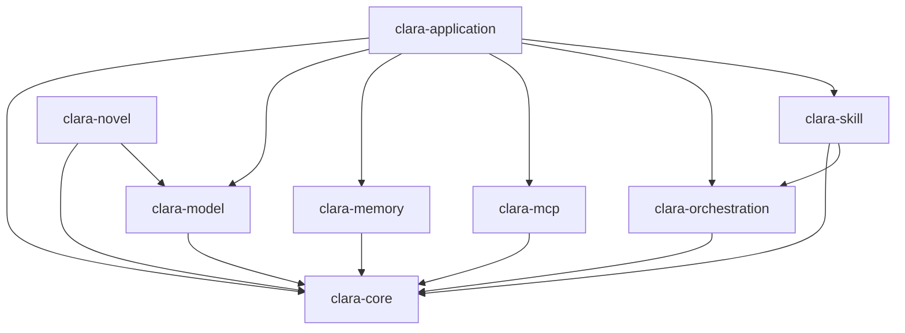

# Clara

Clara 是一套兼容 Java 8 的 AI 能力运行时和领域组件库。它将模型调用、会话记忆、MCP、工作流编排、技能执行、媒体任务和受控工作区等能力拆分为可独立组合的 Maven 模块，便于已有 Java 系统按需接入。

> Clara 当前是组件库，不是开箱即用的独立服务。仓库中没有 `main` 方法、Spring Boot 启动类或 Web 容器。`clara-application` 提供 CLI、REST、SSE 等适配器，但宿主应用仍需负责依赖装配、配置管理、鉴权、持久化和进程生命周期。

## 项目目标

- 在 Java 8 API 和字节码约束下提供统一、类型安全的 AI 能力接口。
- 隔离不同模型供应商的协议与 SDK，避免供应商类型泄漏到公共领域 API。
- 让超时、取消、租户隔离、错误码和可观测信息贯穿一次完整调用。
- 为有状态、长耗时或需要人工确认的业务提供检查点、恢复和幂等能力。
- 对网络、凭据、文件系统和工具调用设置明确的安全边界。

## 模块说明

| 模块 | 作用 | 典型使用场景 |
| --- | --- | --- |
| `clara-bom` | 统一管理 Clara 各模块的版本，不包含业务代码 | 外部项目通过 `dependencyManagement` 导入后，按需声明具体模块 |
| `clara-core` | 公共内核：调用上下文、取消令牌、稳定错误模型、模型与多媒体领域接口、工具定义 | 所有能力模块的基础依赖，也是扩展实现时优先依赖的 API 层 |
| `clara-model` | 模型供应商注册、能力校验、HTTP/SSE 传输及各供应商适配 | 对话、流式对话、Embedding，以及 OpenAI、Anthropic、DeepSeek、火山引擎、阿里云等协议接入 |
| `clara-memory` | 短期消息窗口、Token 窗口、会话持久化和语义记忆 | 保存对话历史、裁剪上下文、JDBC 持久化、本地或 Milvus 语义检索 |
| `clara-mcp` | MCP 客户端、传输、服务注册、能力发现、快照和统一网关 | 通过 stdio 或 Streamable HTTP 调用外部 MCP 工具、资源和提示词 |
| `clara-orchestration` | 工作流、DAG 规划、执行预算、检查点及人工交互 | 多步骤任务、并发节点、失败恢复、暂停等待审批或补充输入 |
| `clara-skill` | 技能注册、校验、生命周期、权限、健康状态和执行 | 将可复用业务能力封装成受治理的技能，并接入编排流程 |
| `clara-application` | 应用层组合：工作区、媒体存储与回调、文档解析、CLI/REST/SSE 适配器 | 在宿主系统中组合全部模块，向命令行或服务接口暴露能力 |
| `clara-novel` | 可执行的小说创作 Agent：故事圣经、大纲、逐章创作、审校和断点恢复 | 使用 OpenAI-compatible 模型创建并持久化中文小说项目 |

模块之间的主要依赖关系如下：



### `clara-bom` 是否必须保留

对仓库内部构建来说，根目录的 `pom.xml` 已经负责聚合模块并提供公共依赖版本，因此 `clara-bom` 不是内部模块编译的必需依赖。

对外发布时，建议保留 `clara-bom`。它让使用方只声明一次 Clara 版本，并保证多个 Clara 模块版本一致。根 POM 是构建用的 parent/aggregator，BOM 是消费端的版本清单，两者用途不同；仅保留根 POM 会迫使外部项目为每个模块分别写版本，或者把内部构建 parent 当成公共 BOM 使用，耦合更重。

如果 Clara 永远只在本仓库内使用、不发布给其他项目，并且所有模块都由根 POM 统一构建，才可以考虑删除 BOM，同时还需从根 POM 的 `<modules>` 中移除 `clara-bom`。

## 环境要求

- JDK 8 或更高版本。
- Maven 3.3.9 或更高版本。
- 源文件编码为 UTF-8。
- 生产代码面向 Java 8 API 和 class-file 版本 52。JDK 9+ 构建时会启用 `release=8`。
- 使用真实模型、远程 MCP 或 Milvus 时，需要相应服务地址、凭据和网络连通性。

## 构建与验证

在仓库根目录执行完整构建：

```powershell
mvn clean verify
```

只构建某个模块并自动构建其依赖：

```powershell
mvn -pl clara-model -am test
```

将所有 Clara 构件安装到本地 Maven 仓库，供同一台机器上的其他项目引用：

```powershell
mvn clean install
```

项目当前没有声明公共 Maven 发布仓库。因此，外部项目使用前需要先执行 `mvn install`，或由团队将构件发布到内部 Maven 仓库。若 Maven 的 `settings.xml` 配置了自定义 `<localRepository>`，还要确保该目录存在且当前用户可访问。

## 在其他项目中引入

推荐先在使用方 POM 中导入 BOM：

```xml
<dependencyManagement>
    <dependencies>
        <dependency>
            <groupId>com.clara</groupId>
            <artifactId>clara-bom</artifactId>
            <version>0.1.0-SNAPSHOT</version>
            <type>pom</type>
            <scope>import</scope>
        </dependency>
    </dependencies>
</dependencyManagement>
```

再按实际需要选择模块，无需重复填写版本：

```xml
<dependencies>
    <dependency>
        <groupId>com.clara</groupId>
        <artifactId>clara-model</artifactId>
    </dependency>
    <dependency>
        <groupId>com.clara</groupId>
        <artifactId>clara-memory</artifactId>
    </dependency>
</dependencies>
```

不要默认依赖 `clara-application` 来间接获得全部模块。业务只需要模型或记忆能力时，直接依赖对应模块可以减少传递依赖和装配复杂度。

## 调用上下文

`InvocationContext` 是跨模块传递的调用边界信息。模型、媒体、MCP、技能和工作流调用应共享或派生该上下文，不要在各层重新生成互不关联的标识。

| 字段 | 是否必填 | 含义 |
| --- | --- | --- |
| `tenantId` | 是 | 租户与数据隔离边界，也是凭据解析的主要维度 |
| `userId` | 否 | 发起调用的用户或服务主体标识 |
| `runId` | 否 | 一次业务运行的关联标识，用于串联计划、技能和工作区操作 |
| `instanceId` | 否 | 可暂停、恢复的业务实例标识，通常对应工作流或技能实例 |
| `traceId` | 是 | 端到端跟踪标识，只用于关联日志和观测，不应替代业务幂等键 |
| `deadlineEpochMillis` | 是 | Unix epoch 毫秒表示的绝对截止时间；到期后调用应尽快失败 |
| `cancellationToken` | 是 | 调用链共享的协作式取消信号，取消后下游任务应停止继续工作 |

```java
import com.clara.kernel.CancellationToken;
import com.clara.kernel.InvocationContext;

CancellationToken cancellation = new CancellationToken();
InvocationContext context = new InvocationContext(
        "tenant-a",
        "user-1001",
        "run-20260907-001",
        "workflow-instance-1",
        "trace-8f13",
        System.currentTimeMillis() + 30_000L,
        cancellation);

InvocationContext child = context.child(
        "run-20260907-001/model",
        null,
        System.currentTimeMillis() + 10_000L);
```

使用时注意：

- 子上下文共享父上下文的租户、用户、跟踪 ID 和取消令牌，且截止时间不能晚于父上下文。
- 超时和取消是协作式机制。长循环、自定义传输或阻塞任务需要主动检查剩余时间和取消令牌。
- `tenantId` 不应直接取自未经认证的请求参数；宿主应用应在认证完成后注入可信租户信息。
- `traceId` 可重复关联一次调用链，但不能作为创建订单、提交任务等操作的幂等键。

## 模型调用

### 供应商与能力

`clara-model` 将公共模型 API 与供应商协议分离。当前代码包含以下接入方向：

| 供应商/协议 | 主要能力 | 说明 |
| --- | --- | --- |
| OpenAI-compatible | 同步对话、流式对话及工具调用 | OpenAI、DeepSeek、火山引擎和阿里云的兼容端点共用基础协议实现 |
| Anthropic | 对话协议适配 | 使用独立的 Anthropic 消息协议 |
| OpenAI | 对话、图片、语音等能力 | 具体可用能力仍取决于账号、模型和端点配置 |
| DeepSeek | 对话与流式对话 | 通过 OpenAI-compatible 配置接入 |
| 火山引擎 | 对话、图片及异步视频任务 | 异步任务需装配媒体任务存储和轮询调度 |
| 阿里云 | 对话、Embedding、图片、音频及视频 | 不同能力可能使用兼容接口或供应商原生接口 |

“代码中存在适配器”不等于目标账号已开通对应模型。上线前应对具体区域、模型 ID、限额、计费状态和响应格式进行真实环境验证。

### 使用 YAML 管理平台配置

推荐将各模型平台拆成独立 YAML 文件，不在 Java 代码中硬编码地址、模型 ID 和参数。仓库提供五个平台的脱敏样例：

```text
config/model-providers/
|-- examples/
|   |-- openai.example.yml
|   |-- deepseek.example.yml
|   |-- volcengine.example.yml
|   |-- alibaba.example.yml
|   `-- anthropic.example.yml
`-- local/
    `-- README.md
```

首次配置时，将需要的平台样例复制到 `local` 目录，一个平台对应一个文件：

```powershell
Copy-Item config/model-providers/examples/openai.example.yml `
    config/model-providers/local/openai.yml
```

`local/*.yml` 和 `local/*.yaml` 已加入 `.gitignore`，用于保存当前机器的真实地址、模型 ID、密钥和参数；不要使用 `git add -f` 强制提交。`examples` 中只允许出现脱敏占位值或环境变量名称。

YAML 顶层结构如下：

| 节点 | 含义 |
| --- | --- |
| `provider` | 平台枚举：`OPENAI`、`DEEPSEEK`、`VOLCENGINE`、`ALIBABA` 或 `ANTHROPIC` |
| `credential.secretRef` | 模型配置引用的凭据名称，同一个平台文件内的能力共用该引用 |
| `credential.environmentVariable` | 推荐方式，从进程环境变量读取真实密钥 |
| `credential.apiKey` | 仅用于被 Git 忽略的单机本地文件；不能与 `environmentVariable` 同时配置 |
| `transport.allowedOrigins` | 平台 HTTP 源白名单，只能写协议、主机和可选端口，不能带 API 路径 |
| `transport.connectTimeoutMillis` | 建立连接超时，单位毫秒 |
| `transport.readTimeoutMillis` | 读取响应超时，单位毫秒；仍会受调用上下文截止时间约束 |
| `transport.maxRequestBytes` | 单次 HTTP 请求体最大字节数 |
| `transport.maxResponseBytes` | 单次 HTTP 响应体最大字节数 |
| `transport.allowHttp` | 是否允许明文 HTTP；生产环境必须为 `false` |
| `capabilities.<name>.endpoint` | 具体能力的完整 API 地址 |
| `capabilities.<name>.taskQueryEndpoint` | 异步媒体任务的查询地址，仅相关能力需要 |
| `capabilities.<name>.modelId` | 账号和区域实际可用的固定模型或 endpoint ID |
| `capabilities.<name>.apiProfile` | 适配器使用的协议版本标识 |
| `capabilities.<name>.parameters` | 能力参数，只允许字符串、数字或布尔值，不允许嵌套对象和列表 |

加载和装配示例：

```java
import com.clara.model.configuration.ProviderConfiguration;
import com.clara.model.configuration.ProviderYamlConfigurationLoader;
import com.clara.model.provider.compatible.OpenAiCompatibleChatModel;
import com.clara.model.provider.http.impl.Jdk8ProviderHttpTransport;
import java.nio.file.Paths;

ProviderYamlConfigurationLoader loader = new ProviderYamlConfigurationLoader();
try (ProviderConfiguration provider = loader.load(
        Paths.get("config/model-providers/local/openai.yml"))) {
    Jdk8ProviderHttpTransport transport = new Jdk8ProviderHttpTransport(
            provider.getTransport().toHttpTransportConfig());

    OpenAiCompatibleChatModel chatModel = new OpenAiCompatibleChatModel(
            provider.toOpenAiCompatibleChatConfig("chat"),
            transport,
            provider.credentialResolver());

    // 在 provider 关闭前完成模型注册和调用；关闭后内联密钥副本会被清零。
}
```

`ProviderConfiguration` 还提供以下类型化转换方法：

- `toOpenAiCompatibleChatConfig`：OpenAI、DeepSeek、火山引擎和阿里兼容对话。
- `toAnthropicChatConfig`：Anthropic Messages。
- `toOpenAiMediaConfig`：OpenAI 图片、转写和语音合成。
- `toVolcengineImageConfig` / `toVolcengineVideoConfig`：火山图片和视频。
- `toAlibabaAudioConfig` / `toAlibabaNativeTaskConfig`：阿里音频及原生图片/视频任务。

加载器默认拒绝超过 1 MiB 的配置文件、符号链接、重复键、未知字段、多文档 YAML、不安全 URI 和非标量扩展参数。它不会扫描整个 `local` 目录，每次只加载明确指定的一个平台文件。

CLI 已保留 `--config` 路径参数，但 Clara 当前没有独立启动进程，`ClaraCli` 接收的是已经装配好的 `WorkspaceBusinessRunner`。因此宿主应用应在创建业务运行器和 CLI 之前调用加载器完成模型注册，不能假设传入 `--config` 后适配器会自动重建模型。

### Java 直接配置示例

下面展示同步对话模型所需的核心装配。生产环境的 `ProviderCredentialResolver` 应从密钥服务、环境注入或加密配置中按租户解析凭据，不要把密钥直接写入代码或 `OpenAiCompatibleChatConfig`。

```java
import com.clara.model.api.ModelProvider;
import com.clara.model.provider.compatible.OpenAiCompatibleChatConfig;
import com.clara.model.provider.compatible.OpenAiCompatibleChatModel;
import com.clara.model.provider.http.impl.Jdk8ProviderHttpTransport;
import com.clara.model.provider.http.impl.Jdk8ProviderHttpTransportConfig;
import com.clara.model.provider.http.ProviderCredentialResolver;
import java.net.URI;
import java.util.Collections;

URI endpoint = new URI("https://api.example.com/v1/chat/completions");

Jdk8ProviderHttpTransportConfig transportConfig =
        new Jdk8ProviderHttpTransportConfig(
                Collections.singleton("https://api.example.com"),
                3_000,
                30_000,
                1024 * 1024,
                4 * 1024 * 1024,
                false);

ProviderCredentialResolver credentials = new ProviderCredentialResolver() {
    @Override
    public char[] resolve(String tenantId, String secretRef) {
        return secretService.resolve(tenantId, secretRef);
    }
};

OpenAiCompatibleChatConfig modelConfig = new OpenAiCompatibleChatConfig(
        ModelProvider.OPENAI,
        endpoint,
        "your-model-id",
        "chat-completions-v1",
        "secret://model/openai/default");

OpenAiCompatibleChatModel model = new OpenAiCompatibleChatModel(
        modelConfig,
        new Jdk8ProviderHttpTransport(transportConfig),
        credentials);
```

配置注意事项：

- `allowedOrigins` 是精确的源白名单，只接受 `scheme://host[:port]`，不能带路径、查询参数或片段。
- 默认应保持 `allowHttp=false`。只有受控的本地开发环境才应开启明文 HTTP。
- 连接超时、读取超时、请求体上限和响应体上限都必须为正数，并根据宿主系统资源上限设置。
- `secretRef` 是凭据引用，不是明文 API Key。凭据解析失败会返回稳定的配置错误。
- 传输层不跟随重定向，避免白名单端点通过重定向绕过目标校验。
- 流式模型应使用对应的 streaming 实现和 SSE 传输，并确保消费方正确处理取消、半包与流结束事件。

## 会话记忆

### 消息数量窗口

适合上下文成本相对稳定、希望按消息条数限制历史记录的场景：

```java
import com.clara.memory.shortterm.MessageWindowChatMemory;

MessageWindowChatMemory memory = MessageWindowChatMemory.builder()
        .id("conversation-1001")
        .maxMessages(20)
        .alwaysKeepSystemMessageFirst(true)
        .build();
```

### Token 数量窗口

适合模型上下文窗口有限、需要按估算 Token 数动态裁剪的场景：

```java
import com.clara.memory.shortterm.TokenWindowChatMemory;

TokenWindowChatMemory memory = TokenWindowChatMemory.builder()
        .id("conversation-1001")
        .maxTokens(8_000, tokenCountEstimator)
        .chatMemoryStore(sharedStore)
        .alwaysKeepSystemMessageFirst(true)
        .build();
```

记忆组件还提供本地会话存储、JDBC 会话存储、本地语义记忆和 Milvus 语义记忆。使用时注意：

- Token 窗口依赖调用方提供的估算器；估算规则应尽量与目标模型一致，并预留回答及工具调用空间。
- 工具调用和工具结果存在关联关系，裁剪时应保持为完整交换，避免留下孤立消息。
- 本地文件存储采用排他锁，更适合单机单进程；多实例部署应选择 JDBC、Milvus 或自行实现共享存储接口。
- `InMemory` 实现只保存于当前进程，重启会丢失，不能承担生产环境的恢复或审计要求。
- 语义记忆查询除向量相似度外还包含租户、会话、模型版本、维度和距离规则，切换 Embedding 模型时应规划重建索引。
- 存储实例实现了 `Closeable` 时，宿主应用必须在关闭阶段释放文件锁、连接或客户端资源。

### 本地持久化与按需缓存

`InMemoryConversationStore` 只保存当前进程中的数据，关闭程序后历史会话会丢失，也没有容量限制。需要在
重启后恢复历史时，应使用 `LocalConversationStore`；它把会话写入工作区的
`.clara/state/conversations`，启动时不会加载所有历史，只在访问指定 `conversationId` 时读取对应文件。

需要降低重复磁盘读取且限制常驻内存时，使用 `BoundedCachingConversationStore` 包装本地存储：

```java
import com.clara.memory.persistence.BoundedCachingConversationStore;
import com.clara.memory.persistence.local.LocalConversationStore;

try (BoundedCachingConversationStore store =
        new BoundedCachingConversationStore(
                new LocalConversationStore(workspace),
                100,      // 最多缓存 100 个会话
                10_000L)) { // 所有缓存会话合计最多保留 10,000 条消息
    ConversationSnapshot snapshot = store.loadSnapshot(conversationId);
    store.append(conversationId, newMessages, snapshot.getVersion());
}
```

该缓存采用按访问顺序的 LRU 淘汰。单个会话的消息数超过总消息上限时，本次仍可读取，但不会放入缓存；
追加或清空成功后，对应缓存会立即失效。关闭缓存存储会同时关闭它包装的 `LocalConversationStore` 并释放目录锁。

当前本地文件格式以“一个会话一个完整快照”保存，因此按需加载的粒度是会话，而不是消息分页。读取单个
超长会话时仍会完整读取并反序列化该会话。生产环境需要同时设置合理的单会话文件上限，使用消息/Token
窗口控制活跃上下文，并对长期历史进行摘要、归档或采用支持分页的自定义 `ConversationStore`。

## MCP

`clara-mcp` 支持 stdio 与 Streamable HTTP 传输，并围绕服务注册、初始化、能力发现、能力快照和统一调用网关组织生命周期。

常规接入顺序：

1. 注册 MCP 服务及传输配置。
2. 创建并启动传输，完成协议初始化和版本协商。
3. 发现服务端声明的 tools、resources、resource templates 和 prompts。
4. 将发现结果保存为带版本信息的快照，供网关校验能力后调用。
5. 通过 `McpGateway` 执行工具、读取资源或获取提示词。
6. 服务配置变化或连接恢复后重新发现，关闭应用时释放传输和子进程。

注意事项：

- stdio 服务属于受控子进程执行，应限制可执行文件、参数、环境变量、工作目录和输出大小。
- Streamable HTTP 端点应使用 HTTPS、目标白名单、超时和响应大小限制。
- 能力快照可能过期；调用前应验证服务版本及能力是否仍匹配。
- 分页资源必须设置页数或项目数上限，避免异常服务无限返回 continuation token。
- `InMemoryMcpServerRegistry` 和内存能力目录不适合多实例共享状态，生产环境应提供持久化实现。

## 工作流与人工交互

`clara-orchestration` 提供工作流定义、DAG 节点执行、预算控制、检查点以及等待人工输入后的恢复能力，适合需要多步骤协作或审批的业务。

一个典型流程是：宿主应用创建工作流定义并校验依赖关系，执行引擎按 DAG 调度节点；节点请求人工确认时写入检查点并返回 `WAITING_INPUT`；收到回答后，使用实例版本和幂等键恢复执行。

重点注意：

- 工作流定义必须是无环图；执行前应完成节点 ID、依赖和输入映射校验。
- 预算应覆盖总耗时、节点数、并发数及外部调用等资源，不能只依赖模型自身限额。
- 检查点是恢复依据。内存检查点仅适用于测试或单进程临时任务，生产环境应使用持久化、可并发控制的实现。
- 恢复请求应同时校验 `expectedInstanceVersion` 和 `idempotencyKey`，防止重复提交或基于旧状态覆盖新结果。
- 人工批准只代表流程可以继续，不应绕过工作区写权限、技能权限或宿主应用的业务授权。

## 技能

`clara-skill` 将业务动作封装为可注册、可校验、可治理的技能，包含技能描述、生命周期、权限、健康检查和执行状态。

常规使用方式是：实现技能接口并声明输入输出及权限，在注册表中注册，通过校验和健康检查后由业务运行器或工作流调用。升级技能时，应保留可识别的版本并明确实例是否允许跨版本恢复。

生产使用应注意：

- 技能输入来自模型或外部请求时必须进行结构和业务校验。
- 文件、网络、进程和高风险业务动作应分别授权，权限检查不能仅依赖提示词约束。
- 技能执行需要遵守 `InvocationContext` 的租户、截止时间和取消信号。
- `InMemorySkillRegistry` 不提供跨进程一致性和重启恢复，多实例部署需要共享注册中心或固定配置来源。

## 工作区、文档与媒体

`clara-application` 提供受策略约束的工作区读写、文件快照与摘要、文档解析、媒体资产管理、媒体回调和异步任务存储等应用层能力。

### 工作区

- 工作区根目录必须由宿主应用确定，外部输入只能选择允许的工作区，不能直接成为任意文件系统根路径。
- 路径解析需要阻止 `..`、符号链接或规范化差异逃逸根目录。
- 搜索当前只支持字面量匹配，不支持正则表达式；传入正则模式会被拒绝。
- 写操作应区分只读、预览和实际应用模式。即使用户批准变更，也必须再次执行路径和权限校验。
- 快照与摘要用于检测并发修改，不等价于完整版本控制；关键项目仍应由 Git 或其他版本系统管理。

### 文档解析

应用模块通过 Apache POI 和 PDFBox 处理常见 Office 与 PDF 文档。解析来自外部的文件时，应限制文件大小、页数、压缩展开量和处理时间，并在隔离环境中处理不可信内容。

### 媒体任务

图片生成/编辑、语音识别、语音合成和视频等能力使用类型化请求；异步供应商任务通过媒体任务存储与调度器完成提交、轮询、取消、截止时间、幂等和结果落库。

- 媒体二进制应通过受控资产存储传递，不要长期保留供应商临时 URL。
- 回调入口必须校验签名、租户和任务状态，并使用回放存储拒绝重复回调。
- 本地媒体任务存储适合单机模式；多实例生产部署需要共享、原子且可恢复的任务存储。
- 轮询必须设置截止时间和退避策略，取消成功也应持久化终态。

## CLI、REST 与 SSE 适配器

`clara-application` 中的适配器不是一个完整服务器，而是供宿主应用调用的协议边界：

- `ClaraCli` 解析命令参数并调用注入的 `WorkspaceBusinessRunner`。
- `WorkspaceRunController` 是不依赖 Web 框架的控制器外观，宿主应用可将其映射到实际 HTTP 路由。
- `WorkspaceRunSseAdapter` 将运行结果和错误转换为带序号的 SSE 事件。
- TUI 当前未实现；选择 `tui` 会提示并回退到普通文本模式。

CLI 核心参数由宿主装配完成后交给 `ClaraCli.execute(...)`：

| 参数 | 含义 |
| --- | --- |
| `run` | 启动工作区业务运行 |
| `resume` | 使用交互回答恢复一个处于等待状态的运行 |
| `--workspace` | 目标工作区路径；必须存在且为可访问的目录 |
| `--tenant` / `--user` | 租户和用户标识；默认分别为 `local` 和 `console`，服务端接入时应替换为认证结果 |
| `--run-id` | 业务运行标识；`run` 未提供时自动生成，`resume` 时必须提供 |
| `--goal` | 本次运行目标 |
| `--skill` | 可选的指定技能 ID |
| `--write-mode read-only` | 禁止工作区写入 |
| `--write-mode preview` | 生成或预览变更但不实际应用，也是默认模式 |
| `--write-mode apply` | 允许进入实际写入模式；真正写入还要求 `--approve-changes` |
| `--ui plain` | 普通文本交互 |
| `--ui json-detached` | 输出单个 JSON 结果，等待输入时由调用方稍后恢复 |
| `--ui json-stream` | 使用逐行 JSON 命令和事件进行交互 |
| `--output json` | 使用 JSON 输出 |
| `--config` | 可选配置文件路径；文件必须已存在且可访问 |
| `--interaction-id` | `resume` 时必填的人工交互标识 |
| `--answer-file` | `resume` 时必填的回答文件路径 |
| `--approve-changes` | 批准实际写入；只能与 `--write-mode apply` 同时使用 |
| `--no-color` | 禁用终端彩色输出 |

REST 或 CLI 暴露到不可信网络前，宿主应用还必须补充认证、授权、限流、请求体限制、审计和敏感信息脱敏。

## 错误处理

Clara 使用 `ClaraException` 携带结构化的 `ClaraError`，主要信息包括：

- `code`：稳定错误码，适合调用方分支判断，不要依赖错误消息文本。
- `category`：配置、认证、授权、限流、外部服务等错误分类。
- `safeMessage`：经过脱敏、可跨系统边界返回的诊断消息；程序分支仍应使用 `code`。
- `retryable`：是否可能通过重试恢复；为 `true` 也不表示可以无上限立即重试。
- `provider` / `providerCode`：供应商及其原始错误码。
- `retryAfterMillis`：建议等待的毫秒数，可以为空；调用方应同时应用自己的退避和总重试上限。
- `traceId`：关联日志和调用链的跟踪标识。
- `safeDetails`：允许跨系统边界传递、不含敏感信息的补充上下文。

建议在系统边界统一转换错误：对可重试错误采用有上限的指数退避，对认证、授权和配置错误直接失败；日志中保留稳定错误码与 `traceId`，但不要记录 API Key、Authorization 头、完整提示词或供应商原始敏感响应。

## 安全与生产部署清单

- 凭据配置只保存 `secretRef`，由 `ProviderCredentialResolver` 按可信 `tenantId` 动态解析。
- 所有外部 HTTP 目标使用精确 origin 白名单，生产环境只允许 HTTPS。
- 为请求、响应、文件、文档页数、MCP 消息和媒体资产设置明确上限。
- 将截止时间和取消令牌传递到每个外部调用与长耗时任务。
- 将内存注册表、内存检查点和本地排他锁存储替换为适合部署拓扑的共享实现。
- 对恢复、回调、任务提交和副作用操作使用独立幂等键，并实施版本检查。
- 对工作区写入、技能调用、MCP 子进程和网络访问分别授权并记录审计事件。
- 关闭应用时显式关闭工作流引擎、传输、存储和其他 `Closeable` 资源。
- 上线前用实际账号验证模型 ID、区域、配额、计费状态、超时与错误映射。

## 当前验证状态

根据 [迁移任务记录](docs/migration/tasks.md)，2026-09-07 的离线验收覆盖完整九项目 reactor，共运行 64 个测试套件、234 个测试，失败、错误和跳过均为 0。该记录验证了本地契约和 Java 8 兼容性，但没有执行实时 Provider 或 Milvus 调用。

实时环境仍需单独验收：

- 供应商账号权限、余额、区域和具体模型 ID。
- 流式响应、工具调用及供应商错误格式。
- Milvus SDK/服务端版本、索引参数和检索性能。
- 多实例下的共享状态、锁、恢复、幂等和故障转移。

## 目录结构

```text
clara/
|-- pom.xml                    # 父 POM 与多模块聚合构建
|-- clara-bom/                 # 面向使用方的版本清单
|-- clara-core/                # 公共领域 API 和运行时内核
|-- clara-model/               # 模型供应商与传输适配
|-- clara-memory/              # 短期、持久化和语义记忆
|-- clara-mcp/                 # MCP 客户端与能力目录
|-- clara-orchestration/       # 工作流、规划和人工交互
|-- clara-skill/               # 技能定义、注册与执行
|-- clara-application/         # 应用组合、工作区、媒体和适配器
`-- docs/                      # 架构、依赖和迁移记录
```

## 进一步阅读

- [Java 8 AI 能力迁移架构](docs/architecture/java8-ai-capability-migration.md)
- [迁移任务与验证记录](docs/migration/tasks.md)
- [Java 8 依赖说明](docs/migration/java8-dependencies.md)
- [交互设计规范](docs/honeycomb-ued-design-specification.md)

仓库当前未包含许可证文件。对外分发或用于商业项目之前，应先由项目所有者明确许可证和第三方依赖合规要求。

