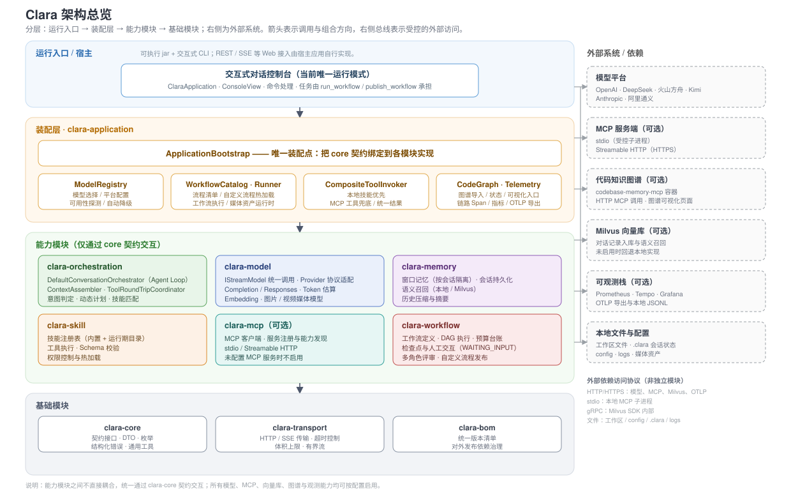

# Clara

Clara 是一套面向 Java 8 的本地 AI 智能体运行时与控制台。它把模型调用、上下文管理、工具调用、MCP、工作流、技能、代码知识图谱和可观测能力拆成独立 Maven 模块，既可整套运行，也可按需嵌入 Java 系统。

> Clara 当前是「运行时库 + 交互式 CLI」形态，不是开箱即用的 Web 服务。仓库没有 Spring Boot / Web 容器；`clara-application` 提供装配入口和控制台，REST、SSE 等 Web 接入由宿主应用自行实现。

## 架构总览



- 运行入口：当前只提供可执行 jar 与交互式 CLI；REST、SSE 等 Web 接入由宿主应用按需实现。
- 装配层：`ApplicationBootstrap` 是唯一装配点，负责模型注册、工作流清单、工具调用与图谱 / 观测接入。
- 能力模块：编排、模型、记忆、技能、MCP、工作流六个模块通过 `clara-core` 契约交互，不直接耦合。
- 基础模块：`clara-core` 提供契约与通用模型，`clara-transport` 提供 HTTP / SSE 传输，`clara-bom` 统一版本。
- 外部依赖：模型平台、MCP 服务端、代码知识图谱、Milvus、可观测栈与本地文件系统均按配置启用。
- 外部访问协议不是独立模块：HTTP/HTTPS 用于模型平台、Streamable HTTP MCP、Milvus 与 OTLP，stdio 用于本地 MCP 子进程，gRPC 由 Milvus SDK 内部使用，文件访问覆盖工作区与本地状态目录。

架构图源文件为 `assets/architecture.svg`，修改后随 README 一起提交。

## 功能概览

- 多模型对话：OpenAI、DeepSeek、火山方舟、Kimi、Anthropic、阿里通义；支持 Completion / Response 等调用方式。
- 上下文编排：窗口裁剪、历史压缩、语义召回、提示词匹配、技能匹配、复杂任务动态计划。
- 工具与 MCP：内置文件、命令、图谱、工作流工具；启动时自动发现 `config/mcp` 中的 MCP 服务，未配置 MCP 时仅使用内置工具与技能。
- 工作流：顺序、条件、并行、循环、人工确认、多角色评审等节点；支持运行期生成并发布自定义工作流。
- 代码知识图谱：优先查图谱、未覆盖时回退本地文件，降低大仓库阅读成本。
- 媒体能力：文生图、图片编辑、图片理解、视频生成；高成本视频任务必须人工确认。
- 本地记忆：会话历史落盘、历史查看与按范围清理、Milvus / 本地语义记忆。
- 可观测：链路 Span、JSONL 落盘、`/trace`、Prometheus 指标与 OTLP 导出。
- 终端体验：命令补全提示、历史输入召回、多行输入、ESC 取消、彩色输出、精简 / 全量日志。

## 模块说明

| 模块 | 职责 |
| --- | --- |
| `clara-bom` | 对外发布的版本清单 |
| `clara-core` | 跨模块契约、DTO、枚举、结构化错误与通用工具 |
| `clara-transport` | 通用 HTTP / SSE 传输、超时、体积上限与有界流 |
| `clara-model` | Provider 配置、协议编解码、流式模型、Embedding、Token 估算与媒体模型 |
| `clara-mcp` | MCP 客户端、stdio / Streamable HTTP 传输、服务注册与能力目录（可选，未配置时不启用） |
| `clara-workflow` | 工作流定义、DAG 执行、任务规划、预算台账与人工交互网关 |
| `clara-memory` | 窗口记忆、会话持久化、语义记忆、Milvus 接入 |
| `clara-skill` | 技能注册、Schema 校验、权限控制与工具执行 |
| `clara-orchestration` | 对话主循环、上下文组装、工具往返、意图计划与技能匹配 |
| `clara-application` | 整体装配、配置加载、交互式控制台、图谱与可观测接入 |

依赖方向保持单向：`core` 不依赖业务模块；`transport` 只依赖 `core`；能力模块按需依赖 `core` / `transport`；`orchestration` 只通过接口使用能力模块；`application` 负责最终装配。

## 环境要求

- JDK 8 或更高版本，编译目标为 Java 8 字节码。
- Maven 3.3.9 或更高版本。
- Python 3：工作区文件处理、搜索等技能脚本需要。
- Docker（可选）：Milvus、代码知识图谱、Prometheus / Tempo / Grafana 观测栈。
- 使用远程模型、远程 MCP 或 Milvus 时需要对应网络、账号与凭据。

## 快速开始

### 1. 构建

```powershell
mvn clean package -DskipTests
```

只构建可执行 jar：

```powershell
mvn -q -pl clara-application -am package -DskipTests
```

产物输出到仓库根目录的 `clara.jar`，入口为 `com.clara.ClaraApplication`。

### 2. 配置模型凭据

模型配置位于 `config/model-providers/*.yml`，并通过环境变量读取密钥：

| 平台 | 环境变量 |
| --- | --- |
| DeepSeek | `CLARA_DEEPSEEK_API_KEY` |
| Kimi | `CLARA_KIMI_API_KEY` |
| OpenAI | `CLARA_OPENAI_API_KEY` |
| 火山方舟 | `CLARA_VOLCENGINE_API_KEY` |

启动脚本会扫描所有模型配置，按环境变量去重后检查凭据；缺失时会在终端提示输入本次启动使用的值。

### 3. 启动

```powershell
# Windows
clara.bat

# Linux / macOS
./clara.sh
```

也可以直接运行：

```powershell
java -Dfile.encoding=UTF-8 -jar clara.jar
```

`-Dfile.encoding=UTF-8` 不要省略。Milvus SDK 在 BM25 检索中使用平台默认字符集编码文本，中文 Windows 下默认 GBK 可能导致 Milvus 分词失败。

### 4. 开始对话

直接用自然语言描述任务，例如：

- 「读取当前目录并整理一份技术文档」
- 「根据这个需求生成技术方案和开发计划」
- 「分析 PackageRuleDescriptionService 被哪些类引用」
- 「生成一张产品首页配图」
- 「帮我做一个每天导出报表的工作流」

模型会根据任务选择直接回答、调用工具或运行工作流。

## 代码使用示例

Clara 既可以作为整套 CLI 运行，也可以作为 Java 基础库嵌入宿主系统。当前版本尚未发布到 Maven Central，先在仓库根执行：

```powershell
mvn -DskipTests install
```

宿主项目引入完整能力：

```xml
<dependency>
    <groupId>com.clara</groupId>
    <artifactId>clara-application</artifactId>
    <version>0.1.0-SNAPSHOT</version>
</dependency>
```

`clara-application` 会传递依赖编排、模型、记忆、技能、MCP 与工作流模块；只需要模型调用时，也可以只引入 `clara-model`。

> 示例默认进程工作目录能找到 `config/`（`ConfigLocator` 会从当前目录向上回溯最多 6 层）。生产环境建议把 `config/` 随应用一起部署，或显式传入配置文件路径。

### 1. 嵌入完整对话编排

适合需要“模型 + 上下文 + 工具 + 工作流”完整能力的宿主：

```java
import com.clara.ApplicationBootstrap;
import com.clara.config.ConfigLocator;
import com.clara.enums.CapabilityKindEnum;
import com.clara.kernel.config.ProviderConfiguration;
import com.clara.orchestration.api.ConversationRequest;
import com.clara.orchestration.api.ConversationResult;

import java.nio.file.Path;

public final class EmbeddedChatExample {
    public static void main(String[] args) {
        try (ApplicationBootstrap bootstrap = new ApplicationBootstrap()) {
            Path modelConfig = ConfigLocator.resolveModel(ConfigLocator.modelConfigs(), "deepseek-response");
            if (modelConfig == null) {
                throw new IllegalStateException("未找到 deepseek-response 模型配置");
            }

            bootstrap.modelRegistry().select(modelConfig);
            ProviderConfiguration provider = bootstrap.modelRegistry().currentConfiguration();

            ConversationResult result = bootstrap.orchestrator().converse(
                    ConversationRequest.builder()
                            .conversationId("demo-session")
                            .provider(provider.getProvider())
                            .model(provider.toConfig(CapabilityKindEnum.CHAT).getModelId())
                            .capabilityKind(CapabilityKindEnum.CHAT)
                            .providerConfiguration(provider)
                            .userInput("用三句话说明什么是代码知识图谱")
                            .build());

            System.out.println("status = " + result.getStatus());
            System.out.println(result.getContent());
            if (result.getError() != null) {
                System.err.println("error = " + result.getError().getSafeMessage());
            }
        }
    }
}
```

关键点：

- `ApplicationBootstrap` 是装配入口，负责加载 `config/clara.yml`、模型配置、技能、MCP 与记忆；使用完必须 `close()`。
- `ConversationRequest` 绑定会话、平台配置、模型 ID 和能力种类；`providerConfiguration` 决定本次调用走哪个平台。
- `ConversationResult` 返回最终文本、思考内容、工具往返次数、token 用量和结构化错误。

### 2. 只调用模型

不需要编排、工具和工作流时，直接使用统一模型入口：

```java
import com.clara.context.ConvContext;
import com.clara.core.message.IContent;
import com.clara.core.model.IStreamModel;
import com.clara.enums.CapabilityKindEnum;
import com.clara.kernel.config.ModelConfig;
import com.clara.kernel.config.ProviderConfiguration;
import com.clara.kernel.http.HttpRequest;
import com.clara.kernel.http.HttpResponse;
import com.clara.kernel.http.execute.Jdk8HttpTransport;
import com.clara.kernel.message.delta.UserContent;
import com.clara.model.configuration.ProviderYamlConfigurationLoader;
import com.clara.model.provider.CompatibleStream;

import java.nio.file.Paths;
import java.util.Collections;

public final class DirectModelExample {
    public static void main(String[] args) {
        try (ProviderConfiguration provider = new ProviderYamlConfigurationLoader().load(Paths.get("config/model-providers/deepseek-response.yml"))) {
            ModelConfig chat = provider.toConfig(CapabilityKindEnum.CHAT);
            ConvContext context = new ConvContext("demo-user", "demo-session", provider, CapabilityKindEnum.CHAT);

            try (ConvContext.Scope ignored = ConvContext.open(context)) {
                IStreamModel model = new CompatibleStream(new Jdk8HttpTransport());
                HttpRequest request = HttpRequest.builder()
                        .model(chat.getModelId())
                        .messages(Collections.<IContent>singletonList(
                                new UserContent("你好，介绍一下你自己")))
                        .stream(false)
                        .build();

                HttpResponse response = model.chat(request, HttpResponse.class);
                System.out.println(response.getContent());
            }
        }
    }
}
```

关键点：

- `ProviderYamlConfigurationLoader` 读取平台 YAML，`ProviderConfiguration` 负责凭据、端点和能力配置。
- 调用前必须用 `ConvContext.open(...)` 绑定平台配置与能力种类；`HttpRequest` / `HttpResponse` 是协议无关的请求响应对象。
- `CompatibleStream` 不含平台分支，换平台只换配置，不换调用代码。

### 3. 流式输出

```java
import com.clara.context.ConvContext;
import com.clara.core.message.IContent;
import com.clara.core.model.IStreamHandle;
import com.clara.core.model.IStreamModel;
import com.clara.enums.CapabilityKindEnum;
import com.clara.kernel.config.ModelConfig;
import com.clara.kernel.config.ProviderConfiguration;
import com.clara.kernel.http.HttpRequest;
import com.clara.kernel.http.HttpResponse;
import com.clara.kernel.http.execute.Jdk8HttpTransport;
import com.clara.kernel.message.delta.UserContent;
import com.clara.model.configuration.ProviderYamlConfigurationLoader;
import com.clara.model.provider.CompatibleStream;

import java.nio.file.Paths;
import java.util.Collections;

public final class StreamingExample {
    public static void main(String[] args) throws Exception {
        try (ProviderConfiguration provider = new ProviderYamlConfigurationLoader().load(Paths.get("config/model-providers/deepseek-response.yml"))) {
            ModelConfig chat = provider.toConfig(CapabilityKindEnum.CHAT);
            ConvContext context = new ConvContext("demo-user", "demo-session", provider, CapabilityKindEnum.CHAT);

            try (ConvContext.Scope ignored = ConvContext.open(context)) {
                IStreamModel model = new CompatibleStream(new Jdk8HttpTransport());
                HttpRequest request = HttpRequest.builder()
                        .model(chat.getModelId())
                        .messages(Collections.<IContent>singletonList(
                                new UserContent("流式输出一段自我介绍")))
                        .stream(true)
                        .build();

                IStreamHandle handle = model.chat(request, HttpResponse.class, event -> {
                    switch (event.getType()) {
                        case TEXT_DELTA:
                            System.out.print(event.getPayload());
                            break;
                        case ERROR:
                            System.err.println("stream error: " + event.getError().getSafeMessage());
                            break;
                        default:
                            break;
                    }
                });

                while (!handle.isDone()) {
                    Thread.sleep(50L);
                }
                HttpResponse response = (HttpResponse) handle.result();
                System.out.println("\n--- done ---");
                System.out.println(response == null ? "no response" : response.getContent());
            }
        }
    }
}
```

`TEXT_DELTA` / `REASONING_DELTA` 用于实时展示，`RESPONSE_COMPLETE` 携带完整响应，`ERROR` 表示流失败。观察者回调运行在读取线程上，不要在其中执行耗时操作。

### 常用扩展点

| 场景 | 入口 |
| --- | --- |
| 完整对话 | `ApplicationBootstrap#orchestrator()` |
| 工作流 | `ApplicationBootstrap#workflowEngine()` / `workflowRunner()` |
| MCP | `ApplicationBootstrap#mcpGateway()` / `loadMcpServers()` |
| 会话历史 | `ApplicationBootstrap#conversationMessages()` / `clearHistory()` |
| 模型配置 | `ApplicationBootstrap#modelRegistry()` |
| Token 用量 | `ConversationResult#getUsage()` / `ApplicationBootstrap#conversationUsageReport()` |

## 交互命令

| 命令 | 作用 |
| --- | --- |
| `/?` / `/help` | 显示命令帮助 |
| `/model` | 重新选择模型 |
| `/init` | 重新检测模型可用性并重建配置、技能、MCP 连接 |
| `/compress` / `/compact` | 把当前上下文压缩为摘要 |
| `/new` | 开始新对话，旧历史保留 |
| `/usage` / `/tokens` | 统计 token 用量与平台分布 |
| `/history` | 查看历史聊天记录 |
| `/history clear` | 清空全部历史记录 |
| `/history clear -n N` | 清理最早的 N 条 |
| `/history clear -t N` | 清理最新的 N 条 |
| `/graph` | 查看当前工作目录的代码知识图谱状态 |
| `/graph import` | 将当前工作目录导入代码知识图谱 |
| `/trace` | 查看最近一轮执行链路 |
| `/trace list` | 列出最近链路；`/trace <traceId>` 查看指定链路 |
| `/log` / `/verbose` | 切换精简 / 全量日志 |
| `/color` | 开关彩色输出 |
| `exit` / `quit` / `/exit` | 结束会话 |

执行中连按两次 `ESC` 可取消本轮模型调用和工具执行；首次 ESC 只提示，避免误触。`Enter` 发送，`Shift+Enter` / `Ctrl+Enter` 换行，上 / 下方向键召回历史输入。

## 配置目录与扩展协议

`config/` 是 Clara 的运行期配置根目录。模型、MCP、技能、提示词、工作流、开发规范和质量门禁都通过目录约定发现；新增文件通常不需要修改 Java 代码。

### 目录总览

| 路径 | 作用 | 发现 / 生效方式 |
| --- | --- | --- |
| `clara.yml` | 主运行配置 | 启动时读取；`/init` 重新加载 |
| `model-providers/` | 模型平台、端点、能力与参数 | 启动扫描；由 `enabledProviders` 过滤 |
| `model-roles.yml` | 工作流角色到模型别名的映射 | AGENT / REVIEW 节点解析模型时读取 |
| `mcp/` | MCP 服务注册 | 启动时递归扫描 `*.json`；可选，未配置时只用内置工具 |
| `skill/prompt/` | 提示词定义 | 启动加载，按输入相似度检索，支持同名覆盖 |
| `skill/tools/` | 内置工具声明 | 启动加载，与脚本工具合并成工具目录 |
| `skill/scripts/` | Python / Shell / JavaScript 脚本工具 | 通过 `--describe` 自描述发现，按文件签名热加载 |
| `workflow/` | 随应用发布的内置工作流 | 启动加载 |
| `workflow/custom/` | 用户或模型生成的工作流 | 按文件签名热加载，无需重启 |
| `standards/` | 开发规范 | 被方案 / 计划工作流批量读取，作为固定约束注入 |
| `sonar/` | SonarQube 质量配置 | 由 `deploy/sonar` 脚本导入 |
| `static-analysis/` | SpotBugs 排除规则 | 由 Maven / SpotBugs 扫描读取 |

### 主配置 `clara.yml`

`config/clara.yml` 是唯一的主配置入口，常用节点如下：

| 节点 | 说明 |
| --- | --- |
| `defaultModel` | 默认模型配置别名，例如 `deepseek-response`；必须出现在 `enabledProviders` 中 |
| `enabledProviders` | 启动时启用、`/model` 可切换的模型配置别名列表 |
| `codeGraph` | 代码知识图谱开关、自动挂载、自动导入与补充信息上限 |
| `context.alwaysPrompts` | 每轮固定注入的提示词，不参与相似度检索；取值为 `config/skill/prompt` 下的 `id` |
| `intentPlanning` | 复杂任务识别、动态计划与计划校验 |
| `milvus` | 语义记忆与 BM25 / 向量召回配置 |
| `telemetry` | 链路追踪、JSONL 保留、OTLP 与 Prometheus |

`enabledProviders` 同时决定三件事：哪些模型配置会被加载、`/model` 列出哪些模型、启动脚本检查哪些凭据环境变量。未启用的模型配置不会被加载。

### 模型配置 `model-providers/`

每个 `*.yml` 对应一个可选择的模型别名，别名就是去掉扩展名的文件名（例如 `deepseek-response.yml` → `deepseek-response`）。目录下的 `examples/` 和 `*.example.yml` 不会被扫描。

最小结构如下：

```yaml
provider: OPENAI
credential:
  secretRef: openai
  environmentVariable: CLARA_OPENAI_API_KEY
transport:
  allowedOrigins: [https://api.openai.com]
  connectTimeoutMillis: 10000
  readTimeoutMillis: 600000
  maxRequestBytes: 33554432
  maxResponseBytes: 33554432
  allowHttp: false
capabilities:
  CHAT:
    endpoint: https://api.openai.com/v1/responses
    modelId: gpt-5.6-sol
    apiProfile: responses-v1
    protocol: RESPONSE
    parameters:
      maxTokens: 128000
```

| 字段 | 说明 |
| --- | --- |
| `provider` | `OPENAI`、`DEEPSEEK`、`VOLCENGINE`、`KIMI`、`ANTHROPIC`、`ALIBABA` |
| `credential.secretRef` | 必填的凭据引用名，用于日志与凭据解析，不直接保存明文 |
| `credential.environmentVariable` | 推荐方式：从环境变量读取 API Key |
| `credential.apiKey` | 内联密钥，仅允许出现在被 Git 忽略的本地配置中；与环境变量二选一 |
| `transport.allowedOrigins` | HTTP 目标来源白名单，端点必须命中 |
| `transport.allowHttp` | 是否允许明文 HTTP；生产环境保持 `false` |
| `transport.connectTimeoutMillis` / `readTimeoutMillis` | 连接 / 读取超时 |
| `transport.maxRequestBytes` / `maxResponseBytes` | 请求 / 响应体积上限，防止异常响应撑爆内存 |
| `transport.headers` | 附加到所有请求的固定请求头 |
| `capabilities` | 能力节点表，键必须是能力枚举名 |

能力节点统一协议：

| 字段 | 说明 |
| --- | --- |
| `endpoint` | 必填，能力调用的绝对 HTTP(S) 地址 |
| `taskQueryEndpoint` | 异步任务查询地址；视频等异步能力使用，支持 `{id}` 占位 |
| `modelId` | 平台模型 ID；生产配置必须写固定模型 ID，不要依赖会变化的别名 |
| `apiProfile` | 平台协议档位，自由字符串，用于区分同平台的接口变体 |
| `protocol` | 线格式：`COMPLETION`（Chat Completions）或 `RESPONSE`（OpenAI Responses） |
| `parameters` | 标量扩展参数，例如 `maxTokens`、`maxPromptChars`、`maxOutputs`、轮询参数 |
| `control` | 上下文窗口、压缩、召回等单能力覆盖配置 |

支持的能力键：`CHAT`、`IMAGE`、`VIDEO`、`AUDIO_TRANSCRIPTION`、`SPEECH`。同一能力最多配置一个节点；未配置的能力在调用时会报配置错误。

### 角色映射 `model-roles.yml`

把工作流中的角色名映射到模型别名：

```yaml
architect: deepseek-response
reviewer: volcengine-response
tester: deepseek-completion
```

- 键是 AGENT 节点的 `role`，或 REVIEW 节点的 `roles` / `moderator`。
- 值是 `model-providers` 下的模型别名。
- 未声明的角色会直接把角色名当模型别名解析；仍解析不到时 fail-fast，不静默降级。

### MCP 注册 `mcp/`

`config/mcp/` 下的所有 `*.json` 都会被递归扫描。协议兼容 Claude Desktop / VS Code 的 `mcpServers` 结构：

```json
{
  "mcpServers": {
    "local-tool": {
      "command": "python",
      "args": ["server.py"],
      "env": {"MCP_TOKEN": "${MCP_TOKEN}"}
    },
    "remote-tool": {
      "url": "https://example.com/mcp",
      "headers": {"Authorization": "Bearer ${MCP_TOKEN}"}
    }
  }
}
```

| 字段 | 说明 |
| --- | --- |
| `command` | stdio 启动命令；可以是字符串，也可以是字符串数组 |
| `args` | 追加到命令后的参数数组 |
| `env` | stdio 子进程环境变量；值支持 `${VAR}`，未定义时直接报错 |
| `url` | Streamable HTTP 服务地址；与 `command` 互斥 |
| `headers` | HTTP 请求头；值支持 `${VAR}`，常用于鉴权 |

同名 `serverKey` 的覆盖顺序是：运行目录配置覆盖 classpath 内置配置；同一来源内后加载的覆盖先加载的。`config/mcp/mcp.json` 可能包含真实密钥，已被 Git 忽略，只应保留在本地。

### 技能与提示词 `skill/`

`config/skill` 与 classpath 内置技能合并，同名 `id` 以运行期配置覆盖内置实现。

提示词协议（`skill/prompt/*.json`）：

```json
{
  "id": "my_prompt",
  "description": "给模型的使用说明",
  "segments": [
    {"role": "system", "content": "这里是提示词正文"}
  ]
}
```

- `id` 是工作流 `prompt`、`context.alwaysPrompts` 引用的标识。
- `description` 用于检索匹配。
- `segments` 按顺序拼接成消息段；`role` 使用模型消息角色（如 `system`）。

工具声明协议（`skill/tools/**/*.json`）：

```json
{
  "id": "my_tool",
  "name": "my_tool",
  "type": "PYTHON",
  "description": "工具用途；会展示给模型",
  "parameters": {"type": "object", "properties": {}},
  "script": "my_tool",
  "metadata": {"domain": "custom", "tags": "demo"}
}
```

- `type`：`PYTHON`、`JAVASCRIPT`、`SHELL` 或 `BUILTIN`。`BUILTIN` 表示进程内 Java 工具，`script` 是内置名称。
- `parameters` 是 JSON Schema 对象或等价 JSON 字符串，用于入参校验与模型调用。
- `script` 是脚本名或路径，由执行器解析。

脚本工具采用“自描述 + stdin/stdout”协议（`skill/scripts/**`）：

```text
python my_tool.py --describe   # stdout 输出工具声明 JSON：id/name/type/description/parameters/metadata
python my_tool.py             # stdin 读 JSON 入参，stdout 写 JSON 结果
```

- 以下划线开头的脚本视为共享模块，`--describe` 无输出时会被跳过。
- 脚本声明按“绝对路径 + 修改时间 + 文件大小”缓存，文件改动后自动重新发现。
- 脚本执行时设置 `PYTHONUTF8=1`、`PYTHONIOENCODING=utf-8`、`PYTHONDONTWRITEBYTECODE=1`，不要提交 `__pycache__`。

### 工作流 `workflow/`

内置流程位于 `config/workflow/*.yml`，自定义流程位于 `config/workflow/custom/*.yml`。两者使用同一套协议；自定义流程写入后按文件签名热加载，下一轮即可调用。

最小示例：

```yaml
workflowId: export_report
description: 汇总目录结构并生成报告
version: "1.0.0"
inputSchema:
  type: object
  required: [target_dir]
  properties:
    target_dir:
      type: string
outputs: [report]
root:
  id: root
  type: SEQUENCE
  children:
    - id: list_files
      type: TOOL
      outputKeys: [listing]
      tool: dir_tree
      arguments:
        path: "${target_dir}"
        purpose: 了解目录结构
    - id: write_report
      type: AGENT
      outputKeys: [report]
      promptText: |
        根据目录结构输出一份中文报告，只输出报告正文。
      promptVars:
        listing: "${listing}"
```

顶层字段：

| 字段 | 说明 |
| --- | --- |
| `workflowId` | 必填；只允许字母、数字、下划线、中划线，不得与内置流程重名 |
| `description` / `version` | 流程说明与版本；`version` 必填 |
| `inputSchema` / `outputSchema` | JSON Schema，可写对象或 JSON 字符串 |
| `outputs` | 对外返回的变量键列表；未列出的中间结果不回灌给对话模型 |
| `root` | 必填，节点树根节点 |

支持的配置化节点：

| 节点 | 作用 | 关键字段 |
| --- | --- | --- |
| `SEQUENCE` | 顺序执行 | 非空 `children` |
| `PARALLEL` | 并行执行 | 非空 `children` |
| `AGENT` | 调用模型 | `outputKeys`（只能一个）、`prompt` 或 `promptText`、`promptVars`、`role` / `model` / `fallbackModel`、`capability`、`attachments` |
| `TOOL` | 调用工具 | `outputKeys`（只能一个）、`tool`、`arguments` |
| `REVIEW` | 多角色讨论 / 评审 | `outputKeys`、`prompt`、`roles`、`moderator`、`topic`、`rounds` |
| `HUMAN` | 等待人工输入 | `inputKey` |
| `CONDITION` | 条件分支 | `condition.key`、`condition.operator`（`equals` / `notEquals` / `exists`）、`condition.value`、`whenTrue`、`whenFalse` |

`LOOP` 目前只存在于枚举中，配置化工作流加载器不支持，使用 `LOOP` 会直接报错。

变量协议：

| 写法 | 含义 |
| --- | --- |
| `${name}` | 取上游节点 `outputKeys` 声明的输出或运行入参 |
| `${name.field}` | 当上游输出是对象时取字段，支持逐级下钻 |
| `${name?}` | 可选变量；缺失时返回 null / 空串，不报错 |

整个字符串恰好是一个 `${...}` 时保留原始类型，可传数组或对象；否则按字符串替换。引用必须由上游输出或运行入参满足，不允许悬空引用。

### 开发规范与质量配置

- `standards/*.md|html`：所有开发规范文件都是方案的固定约束。`design_business_solution` 和 `plan_development` 通过 `file_ops read_many` 读取 `config/standards/*`，新增文件会自动纳入，不需要改工作流。当前包含后端规范、前端 UED 摘要、Honeycomb UED 全文和 Java 编码规范。
- `sonar/quality-profile-java.xml`：名为 `Clara Java` 的 SonarQube 质量配置，由 `deploy/sonar` 下的扫描 / 门禁脚本导入。
- `static-analysis/spotbugs-exclude.xml`：项目级 SpotBugs 排除规则。每条排除都必须写明理由，禁止用包级通配符整包屏蔽。

### 配置加载与安全约定

- 模型配置和 MCP 配置采用严格解析：字段类型、端点、超时、必填项不合法时直接报配置错误，不静默使用默认值。
- 运行目录配置覆盖 classpath 内置配置；自定义工作流不得与内置流程重名。
- `config/mcp/mcp.json`、`config/model-providers/local/*.yml`、`.clara/`、`logs/`、`__pycache__/` 均不纳入 Git。
- 不要把真实 API Key 写入随代码发布的 `config/model-providers/*.yml`；优先使用 `credential.environmentVariable`。

启动时会探测模型可用性。若当前模型属于「平台不可用」（401 / 403 / 429 / 5xx、连接失败、超时、无响应字节等），会按首字符响应时间顺序自动切到下一个可用模型，并打印 `[failover]` 提示；已完成工具调用的轮次不会重放。

## 工作流

内置工作流位于 `config/workflow/*.yml`：

| 工作流 | 用途 |
| --- | --- |
| `analyze_repo_docs` | 扫描当前目录并整理技术文档 |
| `design_business_solution` | 产出需求与技术方案 |
| `plan_development` | 根据技术方案产出开发计划 |
| `image_generation` | 文生图，先生成提示词并人工确认 |
| `image_edit` | 根据参考图和编辑指令生成图片 |
| `image_understanding` | 提取图片内容并生成客观描述 |
| `video_generation` | 文生视频，必须人工确认后调用，产物下载到 `.clara/media/videos` |
| `review_panel` | 多角色讨论并汇总评审结论 |
| `author_custom_workflow` | 按用户诉求生成自定义工作流并发布 |

自定义工作流写入 `config/workflow/custom/*.yml`。发布后无需重启，下一轮即可按 `workflowId` 调用。推荐直接对 Clara 说「帮我做一个……的工作流」，由模型完成起草、校验和发布；也可以手写 YAML 后让模型调用 `publish_workflow` 校验。

高成本操作（尤其是视频生成、图片生成）通过 `HUMAN` 节点暂停，返回 `WAITING_INPUT`。用户明确批准后才继续执行；修改意见会回到上一节点重新生成。

## 代码知识图谱

知识图谱基于 `codebase-memory-mcp`，与 Milvus 共用 `deploy/docker-compose.yml`：

```powershell
# 启动 Milvus + 代码知识图谱
docker compose -f deploy/docker-compose.yml up -d
```

首次部署或需要重新注册 MCP：

```powershell
powershell -ExecutionPolicy Bypass -File deploy\codebase-memory-mcp\install-docker.ps1
```

使用方式：

- `/graph`：查看当前工作目录是否已导入、导入方式与可视化地址。
- `/graph import`：把当前工作目录导入图谱。
- 开启 `codeGraph.supplement` 后，每轮先查图谱并把命中内容注入提示词；未命中时模型再调用文件工具读取本地源码。
- 开启 `codeGraph.autoMount` 后，启动时按需为当前工作目录补充容器挂载；`autoImport` 可控制是否自动导入。

MCP 服务注册在 `config/mcp/mcp.json`。该文件可能包含本机密钥，已被 Git 忽略，只应保留在本地。

## 语义记忆

`config/clara.yml` 的 `milvus.enabled: true` 时：

- 对话记录写入 Milvus，按会话隔离；
- 每轮按输入召回相关历史并注入上下文；
- 推荐 `mode: bm25`，使用 Milvus 内置中文分词，不依赖 Embedding 服务；
- `mode: vector` 需要可用的 Embedding 端点；
- 模式、分词器或向量维度变化时，需开启 `recreateOnSchemaMismatch` 重建集合，重建会清空旧记录。

本地运行 Milvus：

```powershell
docker compose -f deploy/docker-compose.yml up -d etcd minio standalone
```

## 可观测

`telemetry.enabled: true` 后：

- 链路数据写入 `<工作目录>/.clara/telemetry`；
- `/trace` 查看最近一轮阶段、耗时、token 与错误；
- Prometheus 默认监听 `9464`，路径 `/metrics`；
- 配置 `telemetry.otlp.enabled` 后导出到 OTLP/HTTP Collector。

本地观测栈：

```powershell
docker compose -f deploy/observability/docker-compose.yml up -d
```

| 组件 | 地址 |
| --- | --- |
| Grafana | `http://localhost:3001` |
| Prometheus | `http://localhost:9090` |
| Tempo | `http://localhost:3200` |
| Clara 指标 | `http://localhost:9464/metrics` |

Prometheus 在 Docker 内抓取宿主机时，`telemetry.prometheus.host` 应设为 `0.0.0.0`。

## 测试与质量

```powershell
# 全量单元测试
mvn test

# 构建 + 测试 + 打包
mvn clean verify

# 覆盖率门禁（默认 80%）
node tools/coverage/check-coverage.mjs 0.80
```

部分模型兼容性、图片 / 视频和外部服务测试会在检测到真实凭据或本地服务时发起实际调用，执行前请确认账号权限、配额与费用。纯离线验证可先移除对应环境变量或关闭 Milvus。

仓库还提供本地 SonarQube 扫描脚本：

```powershell
deploy\sonar\scan.cmd
deploy\sonar\gate.cmd
```

## 目录结构

```text
clara/
|-- pom.xml                     # Maven 聚合与版本管理
|-- clara-bom/                  # 版本清单
|-- clara-core/                 # 契约、DTO、枚举、错误模型
|-- clara-transport/            # HTTP / SSE 传输
|-- clara-model/                # 模型、Provider、媒体与 Token
|-- clara-mcp/                  # MCP 客户端与能力发现
|-- clara-workflow/             # 工作流引擎与任务规划
|-- clara-memory/               # 会话、窗口与语义记忆
|-- clara-orchestration/        # 对话编排与工具往返
|-- clara-skill/                # 技能注册与执行
|-- clara-application/          # 装配入口与交互式控制台
|-- assets/                     # README 架构图与静态资源
|-- config/                     # 运行期配置根目录
|   |-- clara.yml               # 主配置：默认模型、图谱、记忆、观测等
|   |-- model-providers/        # 模型平台、端点、能力与参数
|   |-- model-roles.yml         # 工作流角色到模型别名映射
|   |-- mcp/                    # MCP 服务注册（可选）
|   |-- skill/                  # 提示词、工具声明与脚本
|   |-- workflow/               # 内置工作流 + custom 自定义流程
|   |-- standards/              # 开发规范（自动纳入方案 / 计划工作流）
|   |-- sonar/                  # SonarQube 质量配置
|   `-- static-analysis/        # SpotBugs 排除规则
|-- deploy/                     # Milvus、知识图谱、观测栈与 Sonar 脚本
|-- tools/                      # 覆盖率等本地工具
|-- clara.bat / clara.sh        # 启动脚本
`-- clara.jar                   # 构建产物（不纳入版本库）
```

`docs/` 是本地开发过程文档，不纳入 Git，仅在当前开发机保留。

## 安全约定

- 不要提交真实 API Key、`config/mcp/mcp.json`、`.clara/`、`logs/` 或本机模型配置。
- 优先使用环境变量保存凭据，内联 `apiKey` 仅限本地未跟踪文件。
- 外部 HTTP 目标使用来源白名单，生产环境保持 HTTPS。
- 工具调用可能读写工作目录或执行命令，运行前确认工作区与权限边界。
- 会话历史和链路数据默认落在本地工作目录，共享机器上注意清理。

## License

Apache License 2.0，详见 `LICENSE` 与 `NOTICE`。
